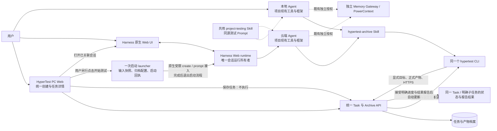
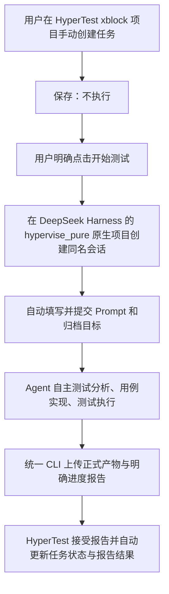

# 统一测试任务与 Harness 原生执行：实施设计与新会话交接

日期：2026-11-04（Asia/Singapore）。状态：**设计已确定，尚未据此实施或部署**。

2026-11-05 澄清：xblock → hypervise_pure 同名会话 → 自动填写 Prompt → Agent 测试 → CLI 上传 → HyperTest 根据明确报告自动更新任务。CLI 只上传不等于归档后仍须人工改状态；下文已按此修正。

本文件把项目负责人的最新决定整理成后续实现依据，对应 [ADR-042](architecture/ADR-042_UNIFIED_TEST_TASKS_AND_HARNESS_EXECUTION.md)。本轮只编写文档，不修改业务代码、不迁移数据库、不启动模型或被测系统测试。源码实现、CLI 发行、测试服务器部署和 USER_OWNED 功能验收必须分别记录。

本轮文档采用独立提交，不包含当前工作区其他会话已有的未提交实现。文档提交的父版本不能视为最新部署源码，文档分支不能直接作为部署源。新会话须先核对当前分支、dirty diff 与实际运行版本，选择正确实现基线后整合本 ADR 和设计；不得 reset 已有修改，也不得从文档分支直接部署旧代码。

## 1. 产品决定

HyperTest 只提供统一的项目、测试任务和产物档案。本地与云端使用同一种任务、同一套页面、同一套产物协议和同一个 `hypertest` CLI，差别是 Agent 执行测试的位置。

- 用户手动创建并保存任务。**保存不启动执行**，不创建 Harness 会话，不提交测试 prompt，不调用模型。
- 云端任务保存后，用户必须再次明确点击“开始测试”。HyperTest 才持久化本次开始意图，由轻量 launcher 向原生 Harness 一次性传递任务名称、任务输入和归档目标。
- Harness Web runtime 是云端 session 的唯一运行所有者。计划、工具、团队、审批、提问、继续、停止、恢复以及原生队列全部由 Harness 提供。
- HyperTest 不实现实时对话、提问/回答透传、审批代理、会话重连、运行事件镜像或执行进度同步。任务详情相对 Local 只增加已创建会话的 **Harness Web UI 跳转**。
- Agent 使用项目现有测试框架自主完成测试，通过共用 Skill 和 CLI 上传正式产物。CLI 只做授权配套、归档、回执核验及原 key 恢复，不调用 Task/Subtask 管理接口，不提供 `complete`、开始、取消或继续任务命令。
- 报告接受后立即出现在任务详情；其中具有有效目标和版本依据的明确进度/结果声明由 HyperTest 自动更新到同一任务，无需审批、发布或人工再改状态。现有 Web 人工管理能力保留。进度、报告结果、归档回执分别表达，只有明确报告声明触发状态更新，不能仅凭上传成功或会话退出推断。
- 本地仍允许先完成测试，再在 Web 创建或选择任务并上传；平台任务不是本地测试的前置条件。

本决定进一步替代 ADR-039 / ADR-041 中由 HyperTest 保存运行对话、转发原生问题、重连原会话等设计；ADR-040 的原生项目目录原则保留，其旧 SDK / Attempt 桥接要求按 ADR-042 定向替代。它也替代 [ADR-027](architecture/ADR-027_EXPLICIT_LOCAL_ARTIFACT_ARCHIVE.md) 中 Local/Cloud 必须使用独立任务实体的限制。授权、原 key、UNKNOWN、版本冲突和结果真实性仍适用。

## 2. 目标架构



图中 launcher 只完成初始交付，不在 Agent 和 Harness 之间建立持续代理。HyperTest 页面跳转到原生会话后，用户直接使用原生界面；不把原生 UI 嵌入后再代理它的聊天、审批或 session 控制 API。

部署保留现有 WireGuard、TLS、私有 BFF 和独立 PowerContext。Harness UI 的访问也须沿用已授权的私有访问边界；生成链接不等于授予访问权限，不能通过公开监听、URL token 或复制用户登录来解决接入。

## 3. 用户流程

### 3.1 统一创建

用户在同一创建页选择 Project，填写任务名称、任务输入和执行位置。输入可包含 MR/PR、开发需求、缺陷信息、测试环境地址及限制；项目双仓元数据从 Project 取得。两种执行位置不使用不同的测试需求表单，不要求 Cloud 专属阶段、授权预算、预期部署版本或源码准备表单。

“保存任务”只保存这些内容并返回任务详情。重复提交按创建原 key 返回同一结果；不能因跳转、刷新页面、读取任务或恢复创建回执而启动云端执行。

Task 的原始输入与 Agent 实际检出的 SHA、实际测试的 SUT build 分别表达。Agent 自行查询 MR 和项目上下文，按实际结果记录版本；不保留平台解析源码版本才能下发的独立业务流程，也不把仓库 SHA 当成部署或测试证明。

### 3.2 本地测试

已创建任务可以复制同源测试 Prompt，由本地 Agent 完成工作并在明确授权的产物范围内调用归档 Skill。用户也可以先在本地测试，随后创建任务并复制只有归档目标和文件范围的归档 Prompt。

CLI 完整核验归档回执后返回任务链接。测试本身可以失败、阻塞或尚未全部完成；这些正式材料均可归档。与 Cloud 相同，HyperTest 根据已接受报告中的明确进度/结果声明自动更新目标状态；普通文件上传不作此推断。

### 3.3 云端开始测试

1. 用户在已保存任务上点击“开始测试”。Web 固定本次 key 和所见 Task version。
2. 服务端在当前授权和版本检查后，原子保存 `TaskLaunch` 与不可变输入快照。接受该请求只表示启动意图已保存。
3. launcher 领取这条启动意图，在目标节点准备共用 Skill、受限 CLI 配置和项目工作目录，通过核验过的原生接入在对应框架项目内建立 session。会话名与 HyperTest 任务名完整一致，自动填入并提交固定的首次 Prompt，不让模型重新命名，也不要求用户再次手工填写。
4. launcher 保存原生 session 引用、合法 Web 深链接和真实启动回执。HyperTest 显示“打开 Harness”，此后执行交互完全在 Harness UI 中完成。
5. Agent 在原生运行环境内按共用 Skill 自主完成测试分析、测试用例实现和测试执行，显式调用共用 CLI 上传产物。HyperTest 接受报告后展示原件，并依据明确进度/结果声明更新同一任务。

用户指定的 xblock 主流程为：



xblock 与 hypervise_pure 的关联取自项目既有框架仓库和执行节点原生 workspace 映射，实施时核实实际 workspace ID、目录和名称；不要把这两个业务名称写死在通用代码里。原生“任务”是该项目内的 session，不新建第二套平台业务任务。Prompt 使用任务输入、共用模板/Skill 指令和明确归档目标生成并固定在启动快照中；后续编辑不修改已发送内容。测试分析、用例实现与执行是 Agent 的工作安排，不是 HyperTest 的三个受控阶段。

开始动作不是浏览器保存后的第二次自动请求，也不是以“创建任务并开始”为默认提交。没有用户明确开始，launcher 不得接取任何待执行任务。打开 Harness 链接和读取启动回执均为只读，不能补发初始 prompt。

### 3.4 报告与任务管理

任务详情直接展示已接受的 PLAN、CASE、REPORT 与支持的附件；保留原文、上传者、来源、修订和 reported result。可选子任务只是用户管理和产物分组，不是 Harness 阶段或团队队列。

正常路径由 HyperTest 在接受明确进度报告后自动更新状态，不要求用户再点一次“修改状态”。现有 Task 的 Web 管理接口保留作人工调整；如保留 Subtask 的独立管理接口，也不能与报告处理混为 CLI 管理命令。无需先发布汇总；已有汇总若保留，只是可选历史内容。Harness 会话结束、CLI 返回 `ARCHIVED`、只有 PASS 的报告均不单独构成进度声明。

### 3.5 报告驱动状态更新的最小合同

下列字段为拟实施的结构化 REPORT 内容，不是新增 CLI 动作：

```json
{
  "reported_progress": "COMPLETED",
  "reported_result": "FAIL",
  "basis_task_version": 3
}
```

- Agent 明确报告本轮进度与结果。`reported_progress` 可声明 `IN_PROGRESS`、`BLOCKED`、`COMPLETED`；`reported_result` 保留既有结果取值。`COMPLETED + FAIL` 表示测试已完成但发现失败，完成不等于通过；取消等管理操作仍走用户管理入口。
- 没有进度声明的报告、日志和附件只归档，不修改任务进度。同一次归档至多有一份用于更新目标状态的进度报告；多份冲突声明须明确拒绝，不能选最后一份猜测。
- 报告的目标取自本次明确 Project/Task/可选 Subtask 归档目标，版本依据随任务输入或明确授权的归档上下文固定。CLI 只运输并冻结这些字段，不生成结论、不把旧报告换成最新版本以强行覆盖。Task 根报告只更新该 Task，子任务报告只更新对应 Subtask，不自动完成父任务。
- 同一任务后续新生成的明确报告，可使用前一次已确认状态更新回执中的新管理版本作为依据；这不允许改写已经冻结的旧报告或 UNKNOWN 请求，也不能用重新读取当前版本绕过冲突。
- HyperTest 在归档接受事务内复用现有目标锁、版本检查和审计；报告符合目标及版本前提时，将其进度与结果更新到目标，记录 Submission、报告修订及变更后的管理版本。归档授权因此允许该目标的报告声明被处理，但不授予任意任务管理 API 权限。
- 旧报告、输入变化或并发人工状态调整导致版本冲突时，已有效接受的报告原件保留，当前任务状态不覆盖，回执明确记录状态更新未应用及原因；无需重测或重新上传原件。无法通过归档身份、目标或格式校验的请求仍拒绝。
- 在现有归档回执中保存状态处理结果，例如 `APPLIED`、`NOT_REQUESTED`、`CONFLICT`；复用既有回执/审计，不新建一套完成工作流。同 key 只返回原接受报告、固定版本及原处理结果，不再次推进管理版本；失答仍只按原 key 查询。

以上规则 Local/Cloud 完全相同，不是 Cloud 独有的完成协议，也不需要 Harness 事件订阅。

## 4. 最小数据方案

以下为拟实施合同，不表示当前代码、API 或数据库已经支持。优先复用现有归档实现及事务语义，不为名称统一另建一层通用框架。

| 对象 | 最小内容 | 明确边界 |
| --- | --- | --- |
| Task | `id`、`project_id`、`title`、`input`、可选默认 `execution_location`、管理 `version`、`status`、报告结果/来源、创建者与时间 | 一种业务任务；明确报告可更新进度/结果；位置不构成不可变任务类型 |
| Subtask（可选） | `id`、`project_id/task_id`、名称、说明、管理状态 | 无默认子任务；状态由服务端处理明确报告或管理接口更新，CLI 不直接调用管理接口 |
| Archive 及资产修订 | 目标根/子空间、`archive_version`、PLAN/CASE/REPORT 内容、来源、明确进度与报告结果、不可变修订 | 延续目标空间隔离；进度报告固定版本依据，不能用旧报告覆盖新状态 |
| ArchiveSubmission / Snapshot | 原 key、认证 uploader/client、完整原请求及摘要、预期版本、接受版本、固定快照、状态处理结果和回执 | 接受产物与服务端状态处理可按原 key 一并查询；不保存运行事件 |
| TaskLaunch | `id`、`project_id/task_id`、开始原 key、请求者、启动时 Task version、输入快照、节点/launcher 引用、原生 session 引用、Web URL、启动回执及时间 | 仅记录一次启动交付；不承担测试执行生命周期 |

这些是职责分组，不要求每个名词新建一张表。现有 ArchiveSnapshot、Submission、AssetRevision 和管理回执可以定向改名或重用；不建立 Skill registry、统一执行总线、阶段表、运行状态镜像或新的控制器。

`TaskLaunch` 快照只包含明确任务输入、当时项目上下文、目标工作目录引用、共用模板引用和归档目标等启动所需非秘密信息。实际凭据留在受限配置中，不进快照、普通字段、提示词或日志。首版不提供“复测”“接管”“重连”业务流程；已交付原生会话的后续使用由 Harness 处理。

相同 key 的重复点击返回同一启动记录；新的 key 不能绕过尚未确认或 UNKNOWN 的启动再建会话。已交付后通过已关联 Harness 会话继续测试，不为首片额外建设平台复测流程，也不强制用户为了原生会话中的继续测试新建 Task。改变执行位置偏好不会改写旧启动的输入、节点或 session；任何另一次独立下发都须来自明确用户意图，不能由偏好变化、刷新或归档失败隐式触发。

## 5. 拟 API 与 CLI 契约

路由名称可按当前代码约定最终确定，但实施必须达到以下单一语义；不能同时保留两套具有不同业务行为的 Local/Cloud 新写接口。

| 接口职责 | 拟接口 | 合同 |
| --- | --- | --- |
| 创建任务 | `POST /api/v1/test-tasks` | 明确 Project、title/input、位置、原 key；只保存 |
| 读取/编辑任务 | `GET /api/v1/test-tasks/{task_id}`、对应管理更新接口 | Project 归属、当前权限、管理 version 和原 key；不触发执行 |
| 人工管理任务/子任务状态 | 现有 Web 管理语义迁入统一任务接口 | 仅管理身份调用；与服务端处理报告声明的路径区分 |
| 显式云端开始 | `POST /api/v1/test-tasks/{task_id}/launches` | 用户明确动作、预期 Task version、原 key；持久化一次启动意图 |
| 启动原 key 读取 | 启动记录按 key 查询与按 ID 读取 | 只读，不创建 session，不重发 prompt |
| 归档能力与读取 | `/api/v1/archive/capabilities`、目标 archive 读取 | 同一 API 支持两种执行位置 |
| 归档提交 | `POST /api/v1/archive/tasks/{task_id}/submissions` | Project/Task/可选 Subtask、原 key、预期归档版本、明确资产；进度 REPORT 可携带结构化声明及固定管理版本依据 |
| 归档恢复 | submission 原 key 查询、固定 submission/version 完整读取 | 原请求核验、固定接受快照；不自动换 key |

CLI 保留 `auth`、`profile`、`doctor`、`archive`、`status`、`reconcile` 和明确的 Skill 安装能力；不新增测试任务管理子命令。`archive` 的参数和 manifest 均不包含 local/cloud 模式。`status` 仍指归档请求状态，不是 Task 状态或 Harness 运行状态。

现有独立 `subtask_update` 管理动作退出新合同；改由同一 REPORT 结构表达目标的明确进度和结果，根/子空间使用相同规则。CLI 不发状态管理请求，服务端按 §3.5 接受报告并处理声明。CLI 冻结内容、服务端 schema、固定快照和读回断言同步调整；不得再以“CLI 只上传”为由阻止服务端自动更新，也不能把归档扩成任意 Task 管理接口。

当前 CLI 接收有限路径的 UTF-8 文本和结构化 CASE，约 2 MiB 单请求上限；这不是截图、视频或任意目录归档能力。实施先明确统一方案需要承接的产物类型和尺寸；本轮需要保留的截图等二进制附件必须在退出旧通道前扩展到**同一个 Archive API**，包括有限文件上传、类型/大小校验、秘密边界、内容完整性及固定版本引用，两种位置共同使用。其余未支持类型如实报告，不默默丢弃；不要留下 CloudArtifact 专用通道，也不能只保存 URI 后声称已保存原件。

## 6. 状态、权限和恢复

### 6.1 不建立云端运行镜像

| 状态/信息 | 保存或展示位置 | 写入主体与含义 |
| --- | --- | --- |
| Task/Subtask 进度 | HyperTest 统一任务 | 接受明确报告后由服务端自动更新，或用户通过 Web 人工管理；不是 Harness 实时运行镜像 |
| 报告结果 | 接受的报告/用例修订 | 原产物声明；上传者和来源可追溯，不升级独立验证 |
| 归档传输状态 | CLI 私有账本与服务端回执 | PENDING、UNKNOWN、REJECTED、ARCHIVED、UNCHANGED 等仅描述提交 |
| 启动交付状态 | TaskLaunch | 仅描述尚未发送、交付中、已确认、明确拒绝或 UNKNOWN |
| Harness 运行、审批、等待输入、恢复 | Harness 原生 UI/runtime | HyperTest 不复制、不监听、不计算 |

启动状态的具体枚举在实现时确定；不能把 `RUNNING/WAITING_INPUT/COMPLETED` 等会话状态塞进 TaskLaunch，继而恢复旧运行控制。没有归档只表示平台尚无相应产物，不表示测试未运行或失败；没有启动回执不表示原生请求没有执行。

### 6.2 权限

- 创建、编辑、修改任务状态和开始测试均沿用当前 Web 管理身份及 Project 边界。
- Local 继续使用用户已批准的 CLI profile。Cloud 自动配置本任务所需的归档身份与权限；不得复制本地用户永久全项目 credential，也不得向 Agent 提供 Operator key、数据库凭据或 launcher 管理凭据。
- 两种位置使用同一归档鉴权规则，Cloud 限制通过 grant 的目标范围表达，而不是 CLI 分支。归档目标至少限定 Project/Task；如指定子任务，继续检查父子关系。`archive:read/write` 允许该获准目标的明确报告参与 §3.5 的状态处理，不授予任意 Task/Subtask 管理 API、Harness 控制或 Memory 权限。
- 归档上传者取自服务端认证，`origin_session_ref` 等只是产物来源声明。已关联的原生 session ID、Task ID 和深链接都不是授权凭据。
- 不在 URL 中携带 bearer token。Harness 深链接仅接受配置的受信原生 UI origin 与合法 session 路由，不能使用用户任务输入中的任意地址作为管理入口。

### 6.3 原 key 与 UNKNOWN

服务端归档继续在当前权限核验后先按原 key 查已接受回执，再对新写核预期版本；同 key 异正文拒绝。CLI 网络调用前冻结完整请求，发送失答或 `NOT_FOUND` 不授权更换 key 重放。收到回执后必须完整读取并核验该固定接受版本，不能以 current head 代替。

TaskLaunch 同样在发送前落盘意图，在网络 I/O 前标记可能已发送。原生 create 与首次 prompt 必须分别区分尚未发送、已确认和未知；可以保存在同一启动记录的固定阶段回执内，不需另建业务流程或操作平台。只有能证明尚未发生网络发送的准备失败可以继续原启动；进入可能发送后只能按核验过的原生能力查询原 key/session。

原生 create 的缓存响应不等于严格持久幂等。缓存丢失、超时、进程重启或首次 prompt 失答时，不得凭“本地没拿到 session”重新创建，也不得向已有 session 自动重发初始任务。没有可证明的查询方式时显示启动未确认，保留原记录；这属于交付限制，不通过重建 HyperTest 恢复 UI 来掩盖。

## 7. Harness 原生启动能力必须先核验

目前工作区含 SDK 托管会话实现；此前观察的运行方式是 SDK 持有 session writer，3080 Web 入口存在只读适配。**不能把它改一个跳转链接就宣称原生 UI 已接管执行。** 后续实施须先现场核实实际部署版本、源码入口和运行配置；本设计不把历史观察当作当前已部署能力。

需要得到以下具体结论，并记入实现交付记录：

| 核验项 | 所需结论 | 不可替代它的证据 |
| --- | --- | --- |
| runtime 运行所有权 | Web runtime 创建并持有会话，UI 可使用原生控制；SDK 不再持 writer | 只读历史页可打开、Worker 进程健康 |
| session 创建接口 | 实际版本支持受限调用，明确项目目录、调用身份及请求响应合同 | 猜测路由、仅有 SDK `session/prompt` 方法 |
| 首次 prompt 交付 | 能向该原生 session 提交且区分接受与未知 | HTTP 连接成功、模型稍后有输出 |
| 原 key 查询/幂等 | 明确 create 与 prompt 在超时、重启、缓存失效时的保证及查询方法 | create 响应缓存、同进程内重复返回相同值 |
| 原生 Web 深链接 | 可定位该 session，权限与实际部署 origin 正确 | 主页面 URL、手工编辑未验证的 session 路径 |
| CLI 与 Skill 可用性 | 原生运行用户可访问限定归档配置、共用 Skill 和项目框架 | SDK 子进程里曾经可用 |

优先读取安装包/实际版本源码、现有配置和文档，配合无模型的契约回归。不得为了“核验集成”擅自创建业务验收任务、凭据或启动模型/SUT。如果某项必须真实启动才能确认，记录为待 USER_OWNED 验收，不将模拟测试或源码存在等同于已验收。

开发调查可以读取本机实际安装材料，但“包源码提供某接口”只证明该包的静态能力，不证明当前运行进程加载的是该版本、该配置或该入口。现场记录须分别写明源码/包版本、进程加载版本、配置观察与实际调用证据。

若实际版本没有所需受限启动或可靠恢复能力，应如实记录具体缺口，选择对原生入口的最小适配或明确暂不支持用户点击开始后的程序下发。不得退回 SDK 独占运行并继续镜像 UI，也不得新增 HyperTest 原生问答桥、运行监控或审批系统。凡需改变本设计的产品边界，先更新 ADR。

## 8. 共用 Prompt 与 Skill

从真实 Local 开发需求自测做法提炼工作方法，形成通用 `project-testing` 和现有 `hypertest-archive` 两类职责。不要先设计一个抽象平台阶段协议，再要求本地和云端迁就它。

本轮只读核对过的材料如下。框架路径相对执行节点上实际的 `hypervise_pure` 仓库；新会话先定位现有项目目录，不复制一套框架，也不将留存报告当作本轮重新执行的证据。

| 材料 | 可复用内容与限制 |
| --- | --- |
| 框架 `AGENTS.md`、`docs/codex-sut-operating-rules.md` | 原生 Harness、项目规则、现有工具复用、需求到断言追踪；不搬入已退休的 UC / Gate 流程 |
| 框架 `.agents/skills/masquerading-failure-triage/SKILL.md` | 先区分探针 / 环境 / 配置问题与 SUT 故障；项目地址与账户约定仍留项目 |
| 框架 `docs/reports/2026-10-21-xblock-multi-energy-provider-test-report.md` | 实测范围、原结果与后续复核的来源区分、未证明项；历史业务事实不自动成为新任务结果 |
| [现有 Cloud Prompt](../web/lib/cloud-test-prompt.ts)、[归档 Skill](../skills/hypertest-archive/SKILL.md) | 改动—场景—断言—证据映射、明确产物和归档目标；去掉 Cloud 专属命名、默认双轮 subagent 与 `subtask_update` |

建议以普通版本化文件维护共同内容，不增加服务端注册或运行编排。以下是拟新增结构，尚未生成实际模板 / Skill：

```text
testing/prompts/
  requirement-self-test.md
  change-regression.md
  defect-retest.md
  focused-e2e.md
skills/project-testing/
  SKILL.md
  references/report.md
skills/hypertest-archive/
  SKILL.md
  references/manifest.md
```

| 同源模板 | 任务重点 | 必须保留的实际结果 |
| --- | --- | --- |
| 开发需求自测 | 理解需求与变更，识别受影响行为，调用项目现有检查 | 实际覆盖、缺口、运行命令、失败及产物 |
| 改动回归 | 根据改动及影响范围选择必要回归 | 实际执行范围和未执行范围，不追求固定全量矩阵 |
| 缺陷修复验证 | 复现原问题，验证修复及必要相邻行为 | 复现条件、修复前后观察、不能复现的限制 |
| 指定 E2E | 按用户指定业务路径在已授权环境执行 | 真实步骤结果、失败节点、相关正式产物 |

模板从同一源码生成 Local 复制 Prompt 与 Cloud 启动输入；差异仅为执行位置的启动包装和已知归档配置。不要维护两份行为逐渐分叉的正文，也不增加模板注册平台或 Skill 版本解析流程。

`project-testing` 指导 Agent 阅读项目规范、使用已有框架/CI、尊重环境与权限、按任务风险选择必要验证并保存原始材料；具体业务选择器、账号约定、框架命令和环境知识留在项目测试框架，不写入 HyperTest 通用 Skill。

四类模板不默认要求“双 subagent”、固定团队规模、并行复核或完整回归矩阵。Agent 按具体任务和原生 Harness 能力决定是否委派；提炼已有本地做法时，去掉仅属于某次任务的固定编排要求。

`hypertest-archive` 只处理明确上传指令、有限正式文件清单、manifest、CLI 调用和结果解释。它不执行测试、不扫描聊天/推理/认证目录、不调用任务管理接口；保留 Agent 已明确生成的报告进度/结果及版本依据，不自行补造完成声明。云端开始 Prompt 可预先明确授权本次正式产物归档，Agent 完成后显式调用 Skill；这不意味着新增后台 Hook、定时同步或平台收集器。

归档阶段使用已经存在的正式产物，不调用 `make report` 或其他可能重新测试、重算或改写报告的命令。若现有文件缺失，明确报告缺失和归档限制；不能为凑齐档案自动重测或生成未经实际执行支持的结果。

开发需求自测模板的目标正文示例（仍为设计示例，字段由真实用户输入和已保存任务带入）：

```text
任务：${任务名称}
请使用共用 project-testing Skill，遵循本项目已有规则、测试 Skills
和测试框架，完成以下需求自测。

需求或改动：${需求说明、需求链接或 MR/PR}
补充说明：${测试重点、目标环境、已知限制；没有则省略}

先查项目资料与现有测试，确认预期行为及影响范围，执行最小必要的
正常、异常和边界验证。需要澄清或批准时，通过当前 Harness 原生界面完成。
报告包含一句话结论、实际版本、用例及实际结果、原始执行记录、问题和未验证项。
明确声明本轮 reported_progress 与 reported_result，并保留任务上下文的版本依据；
测试完成但存在失败应报告 COMPLETED + FAIL，不把完成等同于通过。

本轮结束后，显式使用 hypertest-archive Skill，将本轮正式报告、用例
和选定原始附件上传到 Project ID：${project_id}，Task ID：${task_id}。
保留项目原有产物目录；上传失答只按原请求恢复，不重跑测试。
```

## 9. 现有文件删改地图

实施前必须重新读取实际文件和调用关系。下表是根据当前工作区提出的改造目标，不表示全部内容都应无条件删除；部分文件含其他 profile 或共享功能，必须按依赖定向处理。

| 范围 | 当前入口/文件 | 目标 |
| --- | --- | --- |
| 统一领域与归档服务 | `src/hypertest/domain/local_archive.py`、`application/local_archive.py`、`api/archive_schemas.py`、`api/archive_routes.py` | 统一 Task 与归档；退出独立 subtask_update，服务端按明确报告更新同目标状态 |
| 旧 Cloud 任务链 | `domain/cloud_tasks.py`、`application/cloud_tasks.py`、`api/cloud_routes.py`、`api/cloud_schemas.py` | 退休独立 CloudTask/Attempt 业务状态、输入解析和专用报告协议；留下必要启动交付职责 |
| SDK 运行所有者 | `cloud/native_worker.py`、`native_sdk_driver.py`、`native_sdk_adapter.py`、`native_cordis.py` | 用原生 Web runtime 启动入口替换 SDK 持 writer 的长期运行路径；不要保留并行双 owner |
| 原生会话/对话桥 | `cloud/native_conversation.py`、`conversation_bridge.py`、`native_conversation_history.py`、`application/cloud_conversation*.py`、`api/cloud_conversation_routes.py` | 删除 HyperTest 对话记录、投递、重连、运行历史镜像 |
| 提问/恢复桥 | `cloud/live_question_bridge.py`、`application/cloud_live_questions.py`、`cloud/native_session_restore.py`、`application/cloud_native_session_restore.py` | 删除平台问题、答案、审批透传、会话恢复/检查业务入口 |
| Worker 专用汇报 | `cloud/reporter.py`、`handoff_contract.py`、`handoff_rejections.py`、`artifacts.py` 及 Cloud writer 路由 | 当前目标路径改由共用 CLI；去掉阶段、平台委派、Run 和完成 gate |
| 外部操作控制 | `cloud/action_*`、`http_*`、`ssh_*`、相应 application/domain 模块 | 核对旧 profile 依赖后定向退休；不把这些控制搬进 launcher |
| 共用 CLI | `src/hypertest/cli/__init__.py`、`archive.py`、`manifest.py`、`state.py`、`auth.py` | 去位置分支；任务范围配置；只上传报告声明及版本依据，读回原回执，不调用管理接口 |
| 创建与任务详情 | `web/app/projects/[projectId]/tasks/new/`、`web/app/archives/`、`web/app/cloud-tasks/[taskId]/` | 一套表单与详情；保存和开始分开；云端仅增加原生 UI 跳转 |
| Web 旧执行交互 | Cloud conversation/live-question/恢复组件、`web/lib/cloud*.ts`、Cloud BFF | 删除实时执行界面和对应代理；收敛到统一任务/归档及启动 API |
| Prompt 与 Skill 分发 | `web/lib/cloud-test-prompt.ts`、`web/lib/archive.ts`、CLI Skill 安装/发行脚本、实际项目自测指引 | 提炼并共用四类模板；项目专有逻辑保留框架内 |
| 本机运行准备 | `scripts/prepare-macos-cloud-worker.py`、`scripts/install-macos-cloud-worker.py`、实际宿主服务配置 | 只准备原生 runtime、launcher、CLI/Skill；保留私有访问边界 |

源码中当前有未提交及未跟踪的其他轮次工作。不能以表中路径存在推断已进入 Git、已经部署，不能把本轮设计和其他轮次改动一起无差别提交。是否保留某项共享代码必须以实际调用方为依据。

## 10. ADR-028 迁移与定向退休

按 [ADR-028](architecture/ADR-028_PROTOTYPE_LEGACY_REMOVAL.md) 对被替代且不兼容的旧 Cloud 实现与关联数据定向清理，不要求兼容旧任务或重建一套历史映射。

1. 先根据实际 schema 与外键列出替代范围：旧 CloudTask/Attempt、输入解析、Cloud 专用产物与汇报记录、平台委派/运行记录、实时问题/答案/对话、原生恢复、外部动作和受其拥有的回执等。共享 Project、凭据和独立 Native/Memory 不能按名称批量删除。
2. 现行 Local 归档是共用实现基础，保留 Task ID、资产修订、快照和原接受回执；退出旧 subtask_update、采用明确报告驱动状态不意味着改写过去已接受快照。新合同采用新的版本标识时，旧回执仍按原正文解释；不得为旧报告补造进度声明或批量触发状态更新。
3. 旧 Cloud 数据若选择删除，记录确切表/对象范围和数量；若明确选择保留某份报告，按其原来源保留为历史材料，不能生成虚假的新 CLI 接受回执。不要为了保留所有旧字段增加兼容层。
4. 新旧入口切换时，不能把既有 SENT/UNKNOWN 发送意图重新排入 launcher 或共用归档队列。被退休原 key 路径无法继续查询时如实说明，不推断未执行；不自动创建新 key 或重跑模型/外部动作。
5. 不清空整库、不删除数据库卷、不重置业务库、不复制用户源文件或全局授权。只在专用 test DB 中写入/重置合成 fixture。
6. 宿主源仓库、用户工作目录、原生 Harness 会话、凭据、WireGuard/TLS/BFF、独立 PowerContext 不因 Cloud 业务表退休而顺带删除。需要切换旧 SDK 运行所有者时，明确具体服务和进程，不能以“清理旧实现”为由终止无关会话。

迁移不要求冷备恢复演练、影子环境或逐文件 hash Gate。当前测试服务器可中断，未来实施部署沿用 [服务器操作](SERVER_OPERATIONS.md) 的现行流程；本设计本身不执行任何清理或重启。

## 11. 最小相关回归

按风险选择直接受影响的检查，不把下列项目扩成多宿主全量矩阵，也不将模拟结果称为用户验收。

- **创建/开始边界：** 保存、读取、页面刷新和创建原 key 恢复均零原生启动；明确开始后一次持久启动意图；重复 key 返回同一结果；第二个 key 不能绕过尚未确认或 UNKNOWN 的启动。
- **原生交付恢复：** create/prompt 分别覆盖发送前失败、明确接受、失答/UNKNOWN 和原 key 查询；缓存命中不当作严格幂等；恢复不重发初始任务。
- **授权拒绝：** 跨 Project/Task/Subtask 拒绝；Cloud 任务归档配置不能管理任务、访问别的任务或 Memory；受限深链接 origin、当前 Web 权限和配置秘密边界。
- **共用归档：** Local/Cloud 相同输入走相同服务；普通附件或无进度声明时状态不变，明确报告自动更新同一目标；COMPLETED/FAIL、子任务不影响父任务、旧报告/人工改状态冲突时保留报告但不覆盖、同 key 不重复推进管理版本；固定版本读回、异正文冲突、UNKNOWN 不重放及旧 `subtask_update` 新写拒绝。
- **报告与页面：** 接受报告立即展示；未运行/失败/UNKNOWN 不改标 PASS；PC 宽屏统一创建/详情正常，只有云端出现已确认会话链接；不存在聊天、审批、重连或运行镜像入口。
- **定向迁移：** 在专用 test DB 验证新模型、外键与明确旧对象清理；无关 Project、当前归档、授权和 Memory 引用不被连带删除。
- **模板：** 四类模板同源，Local/Cloud 只有启动包装差异；不默认双 subagent，归档 Skill 不含任务管理、`make report` 或重测命令，项目特定测试逻辑留在框架。

正常交付只运行本次改动必要的相关自动回归；相关检查通过且没有具体未解决问题后停止。部署时做启动/健康检查及本次变更的必要非业务冒烟。真实 Harness UI 控制、启动模型、项目 SUT 测试和最终业务路径属于 USER_OWNED，除非用户另行明确要求，不由实施会话自主触发。

## 12. 实施顺序与完成条件

1. **核对工作区与原生入口。** 读取本设计、ADR-042、四份基础规范及当前 TODO；核实 dirty 内容的归属、实际部署 SHA/schema/runtime，完成第 7 节能力调查。不要从文档日期、当前 HEAD 或未跟踪文件推断部署状态。
2. **收敛领域与接口。** 实现统一 Task/Archive、报告驱动状态更新及独立 Web 人工管理、一次启动记录和任务范围归档授权；同步 schema、关键拒绝路径和基础规范。
3. **打通共用 CLI 与 Skill。** 去除位置分支和独立管理动作；传输报告明确声明并读回服务端状态处理结果；从 Local 实践提炼四类同源模板，按需要扩展同 API 的附件能力。
4. **替换云端启动。** 原生 Web runtime 获得唯一运行所有权；launcher 只准备配置和一次交付，正确保存 create/prompt 的原 key 与未知结果。删除旧 SDK 长期 owner 和平台对话/审批/重连链。
5. **统一 Web 与定向迁移。** 一套创建、详情和档案；保存不启动，显式开始，原生 UI 跳转；清理明确被替代的代码和数据。
6. **相关回归与交付。** 运行必要检查一次，记录通过、失败、未运行及仍待原生真实验证的限制。后续会话得到实现/部署授权时，按现行规则 commit/push、固定完整 SHA、复用当前 Mac 容器部署；记录镜像身份、schema 和健康结果。CLI 发行与宿主实际安装单独记录。

实现完成的判据是职责和实际行为符合本文件：只有一套任务/归档；只有用户开始会下发；原生项目中自动创建同名会话并填入 Prompt；原生 runtime 独占执行；HyperTest 没有运行交互桥；CLI 只上传，服务端接受明确报告后自动更新任务；报告直接可见；关键授权与未知恢复不退化。不能用代码存在、健康检查或一次模拟上传替代原生功能验收。

## 13. 可复制到新会话的实施指令

```text
请在 /Users/liangchenzhang/PycharmProjects/hypertest-one 实现统一测试任务与 Harness 原生执行，按仓库现行规则完成代码交付与本 Mac 测试服务器部署；真实功能验收由我进行，未经另行明确要求，不创建业务验收项目/任务/凭据，不启动真实模型、SUT 测试或其他业务验收流程。

先读：
- AGENTS.md、docs/TODO.md、docs/SERVER_OPERATIONS.md；
- docs/architecture/ADR-042_UNIFIED_TEST_TASKS_AND_HARNESS_EXECUTION.md；
- docs/UNIFIED_TEST_TASK_DESIGN_20261104.md；
- docs/foundation/HYPERTEST_WHITEPAPER.md；
- docs/architecture/HYPERTEST_TECHNICAL_ARCHITECTURE.md；
- docs/protocol/TEST_MISSION_PROTOCOL.md；
- docs/domain/HYPERTEST_DOMAIN_MODEL_AND_STATE_MACHINE.md。

必须落实的产品边界：
1. 一种 Task、一套 Archive API/CLI、一套 PC 任务创建与详情。本地和云端仅执行位置不同；本地可以先测后建任务归档。
2. 用户手动创建并保存任务，不启动执行；保存后必须再次明确点击“开始测试”，才允许 launcher 一次下发任务名称、输入及归档配置。读取、刷新、创建回执恢复均不能启动。
3. Harness Web runtime 是唯一 session 运行所有者。HyperTest 删除实时聊天、原生提问/回答透传、审批代理、重连、停止/恢复、运行事件和状态镜像；任务详情相对 Local 只增加合法的 Harness Web UI 会话跳转。
4. 当前 SDK 持 writer、3080 只读适配不能当作目标已完成。先核实实际版本原生 create/prompt 受限接入、原 key 查询保证、Web 深链接和鉴权；create 缓存不是严格幂等。超时/UNKNOWN 不重建 session、不重发初始任务。未核验的原生能力如实记录，不能用 SDK 长期代理或新平台控制流程补洞。
5. TaskLaunch 只保存输入快照、原 key、节点/launcher/session/URL 和启动回执，不演变成运行控制对象。明确区分原生 create 与首次 prompt 的未发送、接受和未知。以 xblock 为例，在对应 hypervise_pure 原生项目内创建与 HyperTest 任务完全同名的会话，自动填写并提交 Prompt；Agent 按共用 Skill 完成分析、用例实现和执行，不建平台阶段机。
6. CLI 只做归档配套、授权、上传、回执读回及原 key reconcile，不调用 Task/Subtask 管理 API，不增加 complete/start/cancel/resume。HyperTest 接受报告中明确的 reported_progress/reported_result 及有效固定版本依据后自动更新同目标状态；正常路径无需人工再改状态。退出旧 subtask_update，普通附件、仅有 PASS 或 idle 不推导完成；COMPLETED + FAIL 合法。旧报告或并发人工变更冲突时报告保留、状态不覆盖，回执明确结果，同 key 不重复更新；Local/Cloud 同规则。
7. Cloud 自动配置本任务范围 CLI 授权，不复制本地用户永久全项目凭据，不给 Agent Operator/DB/launcher 管理权限。Memory、WireGuard、TLS、私有 BFF 和独立 PowerContext 保留。
8. 从实际 Local 自测提炼通用 project-testing 与 hypertest-archive；四类同源模板为开发需求自测、改动回归、缺陷修复验证、指定 E2E。不默认双 subagent 或固定团队，归档不调用 make report、不重测，只上传已有正式产物。项目业务规则留在测试框架，不建 Skill registry 或平台阶段机。
9. 当前 CLI 主要支持约 2 MiB 的文本/结构化产物；如需附件扩展，扩同一个 Archive API，不留下 Cloud 专属上传链，不把 URI 当作已保存原件。
10. 按 ADR-028 定向退休被替代且不兼容的 Cloud 代码与数据，列明范围。不得清空整库/数据卷，不能连带删除无关 Project、现行归档、凭据、用户文件、原生会话或 Memory。未知外部操作不因旧记录删除而自动重放。

工作区可能包含其他会话大量未提交/未跟踪的改动。先核对归属和实际差异，不 reset、不覆盖、不把别轮内容无差别提交；不要把当前 HEAD 或文档里的旧 SHA 当成部署事实。常规开发复用已有依赖、checkout 与 test DB；fixture 只写明确专用 test DB，不另建默认全栈环境。

本轮 ADR/设计是独立文档提交，不包含当前 worktree 已有的未提交实现；其父版本不是“最新部署源码”。先核对当前 branch、dirty diff、实际运行版本与已推送历史，选择正确实现基线后整合 ADR/设计。禁止从这份 docs 分支直接部署旧代码，禁止为取得干净基线 reset 或覆盖当前已有修改。

先完成实际原生接入能力调查，再按设计实施，不再重复论证已确定的产品边界。可以读取本机安装材料，但包源码不是当前 live runtime 证据，须分别核对实际进程版本和配置。必要时同步 ADR/基础规范说明真实限制。只跑变更相关关键回归，重点覆盖保存不启动、同名会话与Prompt单次下发、授权/版本/原 key UNKNOWN、报告驱动状态更新/冲突不覆盖/重复key不重复更新、报告直接展示和定向迁移。通过且无具体未解决问题后停止扩大测试。

按当前测试服务器规则 commit/push 并固定完整 SHA 后部署，保留现有访问限制；做必要构建/迁移/重启和最小健康检查。最终分别报告实现、完整提交 SHA、镜像/schema、相关回归、部署健康、CLI 发行/安装和仍待我验收的原生能力。不要将未运行、健康检查或模拟测试写成功能验收通过。
```

新会话收到这段指令后才具有其中明确的实现与部署范围；本文档的创建和当前文档交付不等于这些动作已经发生。
