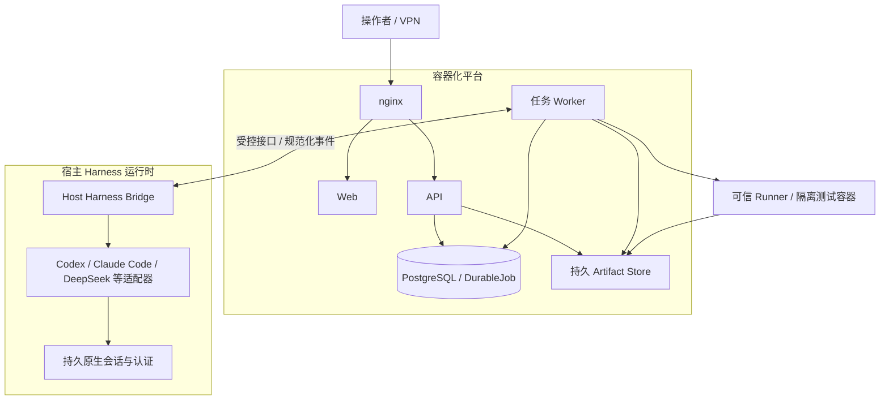

# ADR-013：容器化平台与单任务持续 Harness 会话

**Status:** Accepted；本分支已实现并进入验收，正式服务器尚未迁移（[实施与验收记录](../ADR013_ACCEPTANCE.md)）

**Date:** 2026-10-19（Asia/Singapore；根据 2026-10-18 起的工作流讨论形成）

**Deciders:** 项目负责人在本轮部署与实际测试工作流讨论中明确决定

**Scope:** 部署边界、测试任务粒度、Worker / Harness 会话生命周期与并发方式

## Context

实际测试工作的单位是某个 SUT 的一个 feat / MR 版本。测试人员通常为该变更在 Claude Code / Codex 等 Harness 中开启一个会话，连续完成分析、设计、测试代码实现、执行、诊断和报告，遇到关键决策时提问，并向 GitLab 的责任开发提单。

HyperTest 应承载并治理这一工作方式，同时保留自身的 Canonical Testing State、可信 Runner、Verifier、Gate 和审计能力。平台不重新实现通用 Agent Loop，也不把整个测试活动拆成互不连续的 Provider 会话。

本 ADR 接受时的 v0.3 实现基线是：systemd 管理 API / Web / Worker、Docker PostgreSQL；仓库的开发 Compose 使用 API reload，缺少生产任务 Worker 和 Host Harness Bridge。运行时由 bounded controller 逐阶段调度，每个新 Mission 创建会话，仅人工等待支持恢复原会话；完整运行中领域工具、GitLab 提单和其他 Provider 适配尚未交付。

本 ADR 接受以下架构；后续实现和真实验收单独登记，不把旧验收记录改写为新能力已经通过。它替代四份基础文档中以下默认目标：混合宿主平台服务部署、每个 Mission 新会话、平台逐阶段调用短会话作为主流程。v0.3 行为继续作为迁移前基线保留。ADR-011 的持久队列与租约治理、ADR-012 的受控执行环境及既有历史保全要求继续有效。

## Decision

### 1. 使用单位与任务身份

1. 一个 SUT 对应一个长期 Project；项目承载系统身份、变更任务和测试资产，不按每个分支或 MR 重建项目。Project 不以仓库 URL 唯一，保留系统未来多仓库的表达空间。
2. 一个 feat / MR 的确定完整 SHA 的一轮完整测试活动对应一个 TestRun，即用户可见测试任务。MR / 分支只是关联信息，执行必须固定实际 SHA；新 SHA 创建新任务，不覆盖旧版本的结论。
3. 任务同时固定 PRD、configuration、执行环境和 Policy。重复提交相同输入幂等返回原请求；同 SHA 的显式复测或不同输入保留新轮次与关联历史，不以 `Project + SHA` 唯一约束阻止合法复测。
4. DurableJob 是内部执行请求，Mission 是有类型的测试工作契约，MissionAttempt 是执行尝试；它们均不替代用户测试任务 TestRun。

### 2. 容器与宿主职责

| 部署单元 | 目标位置 | 职责 |
|---|---|---|
| nginx、Web、API | 平台容器 | 入口、工作台、领域 API、任务提交和状态读取 |
| 平台任务 Worker | 平台容器 | 任务绑定、租约、Harness 调用、领域工具和测试周期治理 |
| PostgreSQL | 容器 + 持久卷 | Canonical State、Operational State、队列、Audit / Outbox |
| 实际需要的中间件 | 容器 | 按明确依赖纳入，不额外要求 Redis / Kafka / MinIO |
| Host Harness Bridge 与 Provider CLI / SDK | 宿主受管服务 | 原生会话、认证、进程、事件传递、恢复和中断 |
| 可信 Runner | 受信调度组件 + 短生命周期容器 | 正式执行、事实采集、校验与清理 |

初始目标是单台 Linux 主机上的 Docker Compose 平台服务与 systemd 托管的 Host Harness Bridge。操作系统、Docker Engine、SSH 等基础设施仍属于宿主。多机 Worker 编排、远程 Harness 和其他编排器需要后续的节点、存储与恢复设计，不从容器可复制推断其已经可用。



API 不需要安装各 Provider CLI 或取得完整 Docker 管理权限。能力检测、实际镜像解析、正式执行和取消清理应经过受信执行组件；创建任务仍冻结真实 image ID，执行仍重新验证，不用静态标签或缓存猜测替代实际身份。Docker 管理权限仅授予需要它的可信 Worker / Runner 组件，不交给 Web、宿主 Harness 或测试容器。

### 3. 一个任务、一个 Worker、一个持续主会话

每个 TestRun 绑定一个稳定的逻辑 Task Worker，以及一个主 AgentSession / Provider 原生会话。具体持久化规则由领域模型的目标 Operational 记录 `RunExecutionBinding` 定义；不得把容器 ID、PID、`DurableJob.worker_id` 或一次 lease token 当作稳定任务身份。

- 同一个任务的多个 Mission / Attempt 串行关联该主会话。阶段成功或可恢复的阶段重试不会关闭或替换主会话。
- 正常期间任务由该绑定独占；每个 Run 至多一个有效执行所有者，不增加任务内部多 Worker fan-out。
- 等待人工输入释放活跃租约和计算资源，但保留逻辑 Worker、主会话、Harness 节点和工作区绑定，不把任务普通派给另一个未绑定 Worker。
- 容器 / 进程可以重启。替代进程必须经过显式、受隔离的恢复，接管同一逻辑绑定、原生会话与工作区，并拒绝旧执行者的迟到结果；不得同时存在两个有效所有者。
- 原生会话或工作区不可恢复时，明确停止并保留历史。需要新会话或更换 Provider 的活动作为新的测试轮次处理，不能在旧任务内静默换绑。
- 任务最终结束时统一关闭会话和释放绑定；历史记录和正式 Artifact 按保留策略保存。一个 feat / MR 不需要永久保留一个运行中的容器。

### 4. Harness 自驱、任务内串行、任务间并发

同一主会话连续完成以下工作：

```text
冻结输入与任务绑定
  → 测试分析 / 风险分析
  → 测试设计
  → 测试代码实现
  → 请求正式 Runner 执行并读取结果
  → 需要时诊断、修正和受控重试
  → 请求 Gate、生成报告、完成任务
```

Harness 自行思考、选择工具并推进串行流程。平台保留 typed Mission、冻结契约、依赖校验、权限、覆盖守卫、时间 / 调用 / 执行预算和取消能力；Planner 为可接受动作提供确定性 admission / coverage 检查，不接管 Provider 的模型推理、工具循环或上下文压缩，也不再把逐阶段重建 Provider 会话作为目标实现。

多个 TestRun 可以并发，包括同一个 Project 的不同 feat / MR SHA。每个任务有独立绑定、会话、受控工作副本和执行归属。每个 Worker 的实际运行预算、Host Harness 的会话并发及 Provider 容量、Runner 总并发分别管理；Worker 容器的限制不自动涵盖宿主 CLI 或由宿主 Docker 创建的其他测试容器。跨任务公平性与资源限流属于平台治理。

### 5. 平台与 Harness 的受控接口

容器 Worker 通过窄接口调用 Host Harness Bridge，桥接现有 `create_session / execute / restore_session / resume / interrupt / close` 语义，传递规范化事件和结构化结果，不提供任意 Shell / 任意工作目录入口。

单机首版采用本地 Unix domain socket，按服务账号与目录权限授权；挂载 socket 所在目录以支持 Bridge 重启。Bridge 只接触该任务受控副本和 Provider 自身目录，不连接 Canonical 数据库，不持有平台提单凭据，不操作 Docker。任务运行接口需绑定 Run、Worker 绑定、当前 Job / Attempt、原生会话、调用 ID 和恢复代际；中断、超时、重启和迟到响应必须受治理，不能因断线自动重放外部工作。

新建会话、execute、resume 及其他启动新工作的操作需要当前有效的执行授权、Job claim 和绑定代际。查询旧调用、核验既有会话 / 工作区、中断和关闭另有受限的管理 / 恢复授权：由可信服务身份明确指定原绑定、Session、call 和历史代际，即使原执行租约已被取消或过期，也能对账和清理。管理授权不能启动新工作、换会话或提交 Canonical State，不能让旧 owner 重新取得执行权。

本分支实现 `run-persistent-harness/v1` profile，使用 `hypertest.tmp/v1alpha2` 和 Bridge `hypertest.harness-bridge/v1alpha1`。既有 `hypertest.tmp/v1alpha1` 及最终结果调用语义保留为 legacy profile；新 profile 执行明确的能力协商与版本校验，不让旧 CLI / MCP 自动声称支持新工具。具体 wire 工具与传输映射由 TMP 规定。

运行中的领域工具承载读取状态、申请 / 完成有类型 Mission、提交 Proposal、请求 Runner、提问、请求 Gate、提交报告和请求 GitLab Issue。平台逐次验证并持久化，工具权限以任务和具体工作范围限定；完整契约由 TMP 拥有。

### 6. 事实、决策与协作边界

**Agent produces intelligence. Runner produces facts. HyperTest produces decisions.**

1. Agent 提交 Proposal；Verifier 验证后提交 Canonical State。Bridge、会话文本和 CLI 自报不直接写 Canonical Testing State。
2. 正式测试通过可信 Runner 执行和采集；Agent 的 shell 探索可辅助推理，但不能自动形成正式 Evidence。冻结的 SourceSnapshot、ExecutionSpec、Case / Implementation 归属和证据完整性规则继续成立。
3. Gate 基于 Policy、覆盖、正式执行、Evidence 与 Finding 判定。Harness 的任务完成、报告文本和 Job SUCCEEDED 均不等于 RELEASE_READY。
4. 关键决策通过持久人工问题暂停，记录回答并恢复同一会话。阶段内问题沿用 MissionInputRequest；阶段边界、报告或 GitLab 策略决策使用目标 RunInputRequest，归属当前 Run / Binding / 主 Session / Job，不为提问重开已完成的 Mission / Attempt。同一 Run 同时只有一个待回答 / 待消费问题；两种范围均原子暂停并在回答后重新排队同一 Job。回答不修改原 PRD、Snapshot、Policy 或已冻结 Mission；实质输入变化需新轮次。
5. GitLab 提单通过平台的受控集成，依据预设项目、责任人映射与授权策略执行；带有任务、SHA、Finding、重现信息和 Evidence 引用。外部 Issue 和负责人不是模型可任意扩大的权限范围，也不自动确认缺陷或解除 Gate 阻断。
6. 外部操作使用关联标识和去重记录；超时结果未知时先核对远端状态，不盲目重复创建 Issue。不宣称外部执行 exactly-once。创建成功回写真实 Issue 引用并记录审计；未完成或未知状态应如实展示。

### 7. 历史与迁移

保留既有 Canonical 链、不可变 Snapshot / Policy / Mission / ExecutionSpec、Audit / Outbox、幂等与租约 fencing。一个 Run 至多一个活跃 Job 的规则继续有效；Attempt / Execution 的原 `durable_job_id` 不得更换。

已存在的逐 Mission Session 记录仍按其原运行事实解释，不能合并成一个虚构主会话或伪造旧 Worker 绑定。本分支以显式 additive migrations `0013_run_bindings` / `0014_harness_operations` 实现新绑定与 Operational 记录，不为旧 Run 回填主会话或改写历史结果。

生产迁移保留原 PostgreSQL 数据卷、Artifact Store、托管源码与暂停会话工作区、Provider 认证、SSH 与 VPN 访问。生产配置独立于开发 Compose；使用固定应用镜像和兼容的 API / Worker / Bridge 版本，一次性迁移任务、健康检查与显式启停次序。

Docker 端口发布会改变流量经过的防火墙链，不能直接把现有 UFW INPUT 规则视为容器入口已受同样保护。迁移必须验证允许与拒绝的真实来源、数据库 / 后端暴露边界和 Nginx 所见身份。[Docker 防火墙说明](https://docs.docker.com/engine/network/packet-filtering-firewalls/)

## Options considered

| 方案 | 优点 | 代价 / 结论 |
|---|---|---|
| 平台服务与任务 Worker 容器化，宿主持续 Harness | 固定平台环境、便于多个任务实例运维；保留原生会话与认证；符合实际单会话测试流程 | **采用**。需要 Bridge、持续会话工具契约、共享目录与明确恢复规则 |
| 整个平台 Worker 与 CLI 一起留在宿主 | 当前改造较少，调用路径直接 | 不作为目标；后续多任务实例的依赖、发布和资源治理分散 |
| 全部包含原生 Harness 一起容器化 | 打包边界统一 | 未采用；本轮明确要求原生 Harness / 认证 / 会话留宿主，未来改变需新决定 |
| 每个 Mission 新开会话 | 符合当前实现，阶段结果收取明确 | 保留为实现基线；不满足整个测试任务持续上下文与 Harness 自驱要求 |
| 同任务多个平台 Worker 并行协作 | 大任务理论上可拆分加速 | 不纳入本次目标；用户要求任务内线性工作，扩容发生在任务之间 |

## Consequences

- 产品主线是 SUT → Project → feat / MR SHA 测试任务，任务与内部 Job / Mission / Session 的层次清晰。
- 平台复用原生 Harness 能力，减少对推理过程的重复实现；任务状态、正式事实和质量决策保持独立可审计。
- 每项任务有连续上下文；暂停和恢复要求持久原生会话与受控工作副本，节点归属与旧调用隔离必须实现。
- 多任务实例可统一运维，但并发受 Host Harness、Runner、数据库连接和主机容量共同约束；不能直接承诺随 Worker 数线性加速。
- Bridge、运行中领域工具、镜像查询、取消清理、GitLab 集成与迁移验收需要各自证据；实现、真实外部验收和正式切换分别记录。

## Specification ownership

| 文档 | 拥有的规则 |
|---|---|
| [白皮书 v1.1](../foundation/HYPERTEST_WHITEPAPER.md) | 产品使用单位、单会话完整周期与长期定位 |
| [技术架构 v0.4](HYPERTEST_TECHNICAL_ARCHITECTURE.md) | 平台容器 / 宿主 Bridge / Runner 边界、部署和资源治理 |
| [TMP v0.4](../protocol/TEST_MISSION_PROTOCOL.md) | 版本化工具、Bridge、会话调用、提问、报告和 Issue 请求契约 |
| [领域模型 v0.4](../domain/HYPERTEST_DOMAIN_MODEL_AND_STATE_MACHINE.md) | TestRun / RunExecutionBinding / AgentSession 关系、生命周期、持久化与并发约束 |

基础文档之间的既有优先级继续有效；不得只在实现代码里默默改变本 ADR 的业务和信任边界。

## Implementation and acceptance

本分支实现的详细记录、真实 Run / Session / Report 身份、自动检查及边界见 [ADR-013 验收](../ADR013_ACCEPTANCE.md)：

- [x] RunExecutionBinding 与主会话持久化、additive migration、旧行与旧 hash 保护。
- [x] 容器任务 Worker、宿主 Bridge、能力协商和过滤后的 Provider 子进程环境；API 不持有 Docker / Bridge / CLI 权限。
- [x] 同一原生 Session 串行完成 typed Mission / Attempt，保留任务副本；显式恢复复用原 Session 并隔离旧 epoch。
- [x] 九个领域工具、确定性 admission、真实镜像冻结、Runner 与撤销授权后的取消清理。
- [x] Mission / Run 问题持久化与同 Job / Session 回答恢复；真实 Web 回答与等待期间 Worker / Bridge 重启通过。过期租约、丢失会话、未知外部结果由专项 PostgreSQL / Bridge 回归覆盖。
- [x] 同 Project 不同 SHA 真实并发，独立绑定 / Session / 副本，单任务只有一个有效执行所有者。
- [x] GitLab 项目 / 责任人 / 策略配置、请求关联及未知结果只核对不盲目重建；受控 HTTP 回归通过。
- [x] 真实 Codex → Docker Runner → Evidence → Gate → 报告的成功、失败诊断、人工补充链路通过。
- [ ] GitLab 真实外部创建 / 指派验收（需实际配置与授权）；其他 Provider 分别实施与验收。
- [ ] 正式服务切换及切换后网络来源复核。独立 Linux Compose、迁移、配对恢复与应用回滚演练的结果单独登记，不等同于此项完成。

部署就绪状态另记于验收与[服务器操作交付](../SERVER_OPERATIONS.md)，不能由 ADR 的 Accepted 状态推断。
