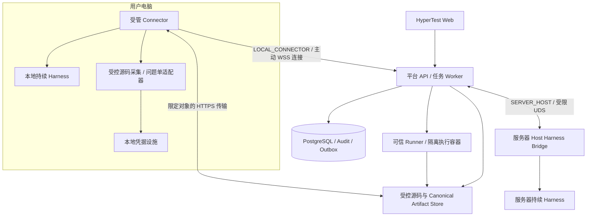

# ADR-015：双模式 Harness 与本地 Connector

**Status:** Accepted / Implemented；Production Deployed；Online Core E2E Verified；Extended Recovery Matrix Pending（2026-10-19）。双模式与 `0015`—`0018` additive migrations 已部署生产，服务器 Harness 与历史数据 / 认证 / 访问边界保全。核心隔离真实正反周期、私有 Git / HTTPS、原会话恢复和获准测试 Issue 已独立通过；严格外部 TLS、线上本地 Connector 核心周期和私有源码 source-only 接受补验已通过，后者未创建私有业务 Run 或问题单操作。发布与保全见 [ADR-015 生产部署记录](../ADR015_PRODUCTION_DEPLOYMENT.md)，隔离历史见 [ADR-015 总验收](../ADR015_ACCEPTANCE.md)，源码统计见[源码验收记录](../ADR015_ACCEPTANCE_SOURCE.md)。

**Date:** 2026-10-19（Asia/Singapore）

**Decision basis:** 项目负责人要求由 HyperTest 调用本地 Agent，复用本地 Git、模型及问题单平台授权，并明确保留本地与服务器两种 Harness 模式。

**Scope:** Harness 放置与节点授权、源码交付、受控外部集成、跨网络调用和恢复。本文不改变正式 Runner、Canonical State 或 Gate 的所有权。

## Context

ADR-013 已交付服务器上的容器化控制平面与任务 Worker，以及服务器宿主上的持续 Harness / Unix domain socket Bridge。一个 TestRun 绑定一个逻辑 Worker、主 AgentSession、节点与受控 workspace，串行完成完整周期。

用户电脑已有 Provider 登录、Git credential helper / SSH agent、问题单 CLI 或集成授权。Harness 只在服务器运行，往往需要再次配置这些权限。单纯把 Bridge 改成网络接口仍不够：源码准备及 GitLab 提单当前也由平台侧组件执行，服务器与本地之间还没有受控源码交付或跨节点调用恢复协议。

平台需要能够选择本地智能执行节点，同时继续集中治理不可变输入、Proposal 接受、正式 Execution / Evidence、Finding、Verdict 与审计。本地离线不能触发第二个 Agent、重复提单或将 Agent 自报的本地测试结果转成正式事实。

## Decision

### 1. 保留两种 Harness 模式

| 模式 | Harness 与认证位置 | 调用通道 | 适用方式 |
|---|---|---|---|
| `SERVER_HOST` | 已配置的服务器宿主；继续使用 Host Harness Bridge | 现有受限 Unix domain socket | 服务器常驻、无人值守任务；兼容当前部署 |
| `LOCAL_CONNECTOR` | 用户电脑的受管 Connector 与本地 Provider CLI / SDK | Connector 主动建立 WSS 双向通道，HTTPS 传输源码与 Artifact | 复用个人已有授权，电脑在线时推进智能工作 |

Web 在创建请求 / 首次绑定前明确所选模式与稳定节点，并检查权限、能力和容量。服务器模式保留为兼容默认值；用户可以保存本地节点偏好，离线时展示不可用并等待选择，不隐式回退到服务器。

首个绑定建立后，一个 Run 的模式、节点、逻辑 Worker、主 Session、原生会话和 workspace 身份固定。进程、网络连接和短期 grant 可以更换，不能据此更换这些身份。更换模式、节点、Provider 或使用替代主会话，需要显式创建关联的新 Run；相同 SHA 的新轮次仍合法。Harness 放置属于 Operational State，不加入 SourceSnapshot fingerprint 或 Gate state hash。

支持本目标的新创建请求在既有测试输入之外，还对固定 mode / node / 来源信任与传输策略做幂等比较；同键异值返回冲突，不将另一节点的选择静默当作重试。旧 payload 保留原兼容语义，不回填或重序列化历史。

### 2. 服务边界与调用方向

箭头表示 WSS 连接由本地发起；建立后平台通过同一通道派发结构化调用，Connector 回传受控事件、工具请求和调用状态。Connector 是本地常驻进程，不依赖浏览器页面存活，不通过远程桌面或任意 Shell 接口调用用户电脑，也不接管 Provider 的 Agent Loop。

API、Worker、数据库、Verifier、Runner Controller、Evidence 与 Gate 保留平台职责。Connector / Harness 没有 Canonical 数据库写权、Docker 管理权或通用平台管理密钥。正式测试默认继续在服务器可信 Runner 上执行；把本地电脑登记为可信 Runner 是另一个信任决策，不由本 ADR 自动授予。

首版利用现有 PostgreSQL 队列、事务 Audit / Outbox 和受控入口，不引入 Kafka、Graph DB 或通用 Agent Loop。连接路由属于 Operational 设施；它不成为第二套 Canonical 数据库。沿用现有 VPN / 入口白名单与 SSH 运维限制，不为 Connector 开放电脑入站端口或放开服务器访问边界。

### 3. 本地授权复用与设备身份

设备首次配对需要操作者在 HyperTest 中完成身份确认，登记稳定 `HarnessNode`，授予指定 Project 与能力范围。首版设备身份采用平台生成的高熵随机 bearer token：明文只留本地受保护私有文件，平台保存 SHA-256 token_hash 与 key_version 代次引用，不保存明文；key_version 不是公钥，也不宣称使用非对称设备签名。Project 权限由独立 NodeProjectCapability 关系按 harness / source_acquisition / issue_executor 分别授予；轮换保留稳定 node 身份与旧 grant 哈希 / 引用和审计，撤销旧执行权。设备授权可到期、撤销和轮换；一次配对不等于所有项目、所有仓库或所有外部平台的写权限。

Provider CLI 使用本地可实际访问的原生登录；受控 Git 适配器使用已有 credential helper / SSH agent；问题单适配器使用已有 CLI / API 集成认证。具体 Provider、沙箱和认证设施仍须能力检测与真实验收。浏览器中已登录、桌面聊天窗口已开启，都不能自动证明 CLI / SDK / API 可用；本模式启动或恢复专属测试会话，不接管用户任意已有聊天。

模型密钥、Git 私钥 / token、问题单 token、完整原生认证目录与 Cookie 不上传平台、不打入镜像、不写入 Agent Context、消息、SourceBundle 或审计。凭据设施在节点本地执行认证，而不是通过 WebSocket 转发秘密。源码和问题单适配器与 Harness 的不可信输入 / 任意工具隔离，只提供批准范围内的操作；不能因复用配置而默认加载个人全部 MCP 工具或扩大沙箱权限。

平台每次调用签发短期、限定 audience / 节点 / Project / Run / Binding / epoch / Job claim / Session / call / 工具范围的授权，期限不能超过当前租约与传输上限。Connector 验证服务身份、范围及本地单调时钟上的有效期，不接受凭设备在线身份自行启动工作。查询、对账、中断和终态清理使用独立的窄管理授权，原执行权撤销后仍可清理，不能用清理授权恢复推理或提交 Canonical。

### 4. 本地源码准备与跨机器交付

源码获取是进入 Agent Mission 之前的受控准备工作。首版 `LOCAL_CONNECTOR` 采用以下交付路径：

1. 平台在不可变 bootstrap 请求中固定 Project、批准的 credential-free origin、完整 commit SHA、采集节点、输入与环境请求、来源信任策略；仍先通过可信 Runner 的必要环境预检。源码准备不消耗 Mission 阶段预算，Git / 网络 / 文件 I/O 不持数据库聚合行锁。
2. 本地受控采集适配器在任务专用目录使用现有 Git 认证获取精确 SHA；不 reset 或清理用户的日常 checkout，不把 dirty / untracked 内容作为冻结源码。Agent 不选择任意 origin、路径或 credentials。
3. 生成无凭据的版本化 `SourceBundle` 对象包，包含目标 commit 与完整 root tree 的 tree / blob 闭包；父 commit 标识作为 commit 内容参与哈希校验，不要求打包父历史或其他无关对象。对象内容必须足以由平台独立校验目标 commit → root tree → 所有纳入文件 blob 的 Git 对象关系、相对路径和 mode，不能只交付文件列表与自报哈希。manifest 固定对象格式、origin、commit、root tree、文件摘要 / mode、包大小与 SHA-256。具体 wire schema 由 TMP 定义。
4. 经限定 Project / 请求 / 节点 / 对象 / 摘要 / 大小 / 时限的 HTTPS grant 上传至隔离暂存区。平台先校验身份、来源 receipt、包摘要、Git 对象关系与文件树，再安全物化到不可变受控源码存储；未完成或校验失败的上传不得用于创建已验证 Snapshot 或启动 Agent。重复分块 / 完成确认只能复用同一对象，异输入冲突。
5. 验收成功后，平台按既有算法冻结 SourceSnapshot、PRD / configuration 与环境身份，记录 append-only 交付 receipt；Run / Session 工作副本及正式 Runner 均从已接受对象派生。已有 Snapshot 不增加可变的“新源码”，同一 Snapshot 的重复交付必须匹配已固定对象。Runner 执行前独立核对固定 commit、tracked tree、ExecutionSpec 与已接受 Implementation Artifact。

**包完整性与仓库来源授权分开验证。** SHA-256 证明收到的包字节一致；Git 对象哈希证明对象和目标 commit 的内容关系，均不能证明该 commit 来自 manifest 声称的仓库。

项目必须选择可审计的来源信任路径：平台通过可信 origin 独立核验 / 已有可信 commit 约束，或显式授权本地 Connector 的受控源码采集适配器承担来源采集角色。后一种路径使用本地凭据访问批准 origin，并产生设备认证的 receipt，固定 Project、bootstrap 请求、节点、origin / ref、commit / tree、包摘要、来源策略版本与采集结果。平台独立核验 receipt 归属、授权和对象关系，不要求再次取得私有 Git 凭据。

该 receipt 的来源保证依赖被明确授权的采集适配器及其主机，不是对不可信电脑的密码学来源证明。设备配对本身不授予来源采集角色，Harness 不能自签或替换采集 receipt；不信任该节点的项目应使用其他可信来源通道。无有效来源信任路径、授权撤销或结果未知时拒绝验收，不以 Agent 自报替代。

包不得包含 credential-bearing remote 配置、认证目录、临时文件或无关 `.env`。仅依据固定树纳入 tracked 内容；如果固定树本身包含不允许交付的秘密，应拒绝并要求操作者处理来源 / 选择新输入，不能静默过滤后仍宣称相同 SHA。首版拒绝未支持的 submodule / LFS 及外部下载依赖，直到有显式固定对象与校验契约；符号链接必须不越出受控根目录，不作为读取上传宿主文件的入口。拒绝路径穿越、绝对路径、特殊设备、大小 / 解压展开越限；解包不运行 hooks 或仓库脚本。

生成测试仍走 `ImplementationProposal → Verifier → checksum-addressed Artifact`。本地文件改动、测试日志及会话历史不能绕过接受流程，也不能成为正式 Evidence。大文件传输不复用无界 WSS 消息；未验收上传和本地临时副本按配额 / 保留策略清理，已有 Canonical Artifact 不受此清理影响。

**首版实现边界补注（2026-10-19）。** 本 ADR 的有界对象包已采用 `hypertest.source-bundle/v1alpha1` 无压缩 JSON：单对象原始 payload 最多 24 MiB、commit / tree / blob 原始 payload 合计最多 32 MiB、完整传输包最多 48 MiB。单对象上限从初始实现的 16 MiB 调整为 24 MiB，以完整接收已批准固定 tree 内的合法 tracked JAR，不过滤 tree、不改变 SHA，也不扩大总量与身份授权。首版只接收 `100644` / `100755` 文件，当前 Runner 不支持 symlink，因此连安全 symlink 也明确拒绝。精确对象 / 文件 / 深度、120 秒上传、192 MiB staging 与 2 GiB 本地缓存边界由 [TMP §22.3](../protocol/TEST_MISSION_PROTOCOL.md#223-本地授权复用与固定源码artifact-传输adr-015-目标) 定义；真实私有 Git 授权复用的源码预验收结果见[源码验收记录](../ADR015_ACCEPTANCE_SOURCE.md)。该记录的本地采集成功不替代后续 HTTPS 平台接受或正式 Runner 验收。

### 5. 问题单操作：平台批准，本地受控执行

保留现有服务器问题单执行器；新增可选的本地受控执行器。Harness 仍调用现有 `request_gitlab_issue` / `get_issue`，提交 draft 与 Finding / Evidence 引用，不直接持有平台或本地问题单 token。未来其他问题单平台以独立适配能力扩展，不由 GitLab 能力推定已支持。

平台先验证已接受 Finding、可信 Evidence、Run / 完整 SHA、项目白名单、责任人映射、操作者权限和提单策略，需要人工决策时仍走持久问题。通过后先保存 `GitLabIssueOperation` 创建意图和授权摘要，再选择并固定服务器或本地 executor。该授权不包含任意 URL、任意 API method、任意通知或通用 MCP 调用。

本地 delegation 固定 operation ID、原 Binding / Finding / Job、executor 节点、授权项目与责任人、清理后的 draft / 摘要、correlation marker 和时限。Connector 的受控适配器验证精确范围、在本地持久登记调用后才发外部请求，用本地认证执行一次批准的操作；重放相同消息返回账本状态，异输入冲突。Agent 无法借此选择其他账号、项目或负责人。

同一逻辑操作沿用平台原去重键，不因连接重建、换 Job、epoch 或后端切换而获得新建 Issue 的机会。超时、断线、ACK 丢失、executor 在登记后崩溃都可能是 `UNKNOWN`；未知只允许按 correlation 查询对账，禁止再次 POST。未发送可被可信账本明确证明前，也不把超时当作“肯定没执行”。本地账本丢失不能作为重提理由；查询不能消除不确定性时保持可观察 UNKNOWN 并交人工处理，不承诺 exactly-once。

平台通过可信外部读取结果核对固定项目、correlation、issue IID / HTTPS URL，再记录 SUCCEEDED。可由平台直接查询，或由被单独授权的本地集成适配器经认证回传核对 receipt；Agent 返回的文字或 URL 不算核验。执行器接收与远端结果确认是不同状态，不把 WSS ACK 当作外部成功。

撤销执行授权后不得新建问题单；已经发出的外部副作用不能靠撤权或断网回滚。旧 generation 只允许查询 / 清理对账，不能重新写入 Canonical 或发起新操作。已确认外部结果经平台当前授权的对账事务进入原操作历史；提单不自动确认 / 解决 Finding，不解除 Gate 阻断。

### 6. 断线、恢复与取消

WSS 连接在线状态、Connector 执行 grant、服务器 Job lease 和 Runner 所有权分别治理。节点离线是 Operational 观察，不能自动变成测试失败或质量结论；连接恢复也不是恢复执行的授权。

| 情形 | 必须行为 |
|---|---|
| 短暂断线，原调用仍在有效授权内 | 仅允许重建通道、按 cursor 读取事件和查询原 call；不再次 create / execute / resume，不自动延长授权或重发外部写入。 |
| 无法续约、执行 grant 到期或节点被撤销 | Connector 的本地 watchdog 停止新工作并中断受控调用；平台撤销新工具 / 提交权限，按资源归属进入可观察恢复治理。未确认停止前不启动第二个 owner。 |
| 需要显式恢复 | 无行锁核验原节点、原生 Session、workspace、固定源码、原 call 和不确定外部操作；确认旧 owner / 调用已 fenced，事务递增原 Binding 的 epoch、保存审计，按原规则取得新 Job claim 后才能继续原会话。 |
| 原生 Session / workspace 丢失、被篡改或不可验证 | 明确失败并保留事实、预算和历史；替代会话 / 节点 / 模式使用关联新 Run。 |
| `WAITING_INPUT` 时离线 | 保留问题、答案、原绑定和会话；回答不绕过节点可用性及恢复准入，不因重连消费两次答案。 |
| 本地断线但服务器 Runner 已接受 Execution | 若服务器 owner / Runner 授权仍有效，继续原 Execution 的受控执行和证据采集；先撤 Harness dispatch、禁止新 Harness 工作，但保留原 Binding 可提交状态 / epoch / Job claim，仅收尾已接受的 Execution。完成 / 收集或受控取消后才进入 RECOVERY_REQUIRED 并进行显式恢复，不能提前换代或变更状态误拒有效 Runner 结果，也不能绕过单活跃 Job。若服务器 Job 本身失联则按原 Execution 中断规则处理，不重新执行冒充结果对账。 |
| 离线取消 / 撤销设备 | 平台先持久取消或撤权，立即拒绝新调用与迟到提交；清理记录为 pending / unknown，重连后仅用受限管理授权停止 / 清理精确旧调用，不能恢复终态 Run。 |
| 报告完成、Binding / Session 已 `CLOSED` | 不重新开启；ADR-014 的独立 Gate 治理仍在平台执行，无需本地在线。 |

事件序号、ACK 和 cursor 用于补读已发生事件；重放事件不等于重放副作用。所有新工作与 Canonical 提交重新校验 Run / Binding / epoch / 当前 Job claim / Session / call / Mission 范围。旧 epoch 对账只能解释原操作，不能恢复旧 owner；本地累计预算在调用结果未知时保守计入，恢复不能重置预算。

### 7. 协议与持久化演进

现有 `hypertest.tmp/v1alpha1` legacy 路径、已实现的 `hypertest.tmp/v1alpha2` / `run-persistent-harness/v1` 以及 `hypertest.harness-bridge/v1alpha1` 保留原语义。已实现独立协商的传输版本 **`hypertest.harness-connector/v1alpha1`**，承载节点能力、受限调用 / 事件、源码交付、问题单 delegation 与恢复对账。不能给旧 Bridge 消息加字段后假定它已支持远程连接。

Connector 版本、TMP wire/profile、Provider 能力、来源采集 / 问题单能力分别协商；声明不支持或缺少能力时明确拒绝准入。现有九个 Agent 领域工具的业务语义不因此改变。新 envelope / 操作、消息大小 / 队列上限、事件确认、错误和授权字段由 TMP 规定；关系、不可变字段、状态、唯一性与迁移由领域模型规定。

新增 Operational 节点、设备授权、项目能力、绑定前 Selection、放置、dispatch grant、持久 ConnectorRequest mailbox、源码输入 / upload grant / transfer / Snapshot receipt 与问题单 executor 已通过 `0015`—`0018` additive migrations 落地。既有 `harness_host_id` 与节点身份保持一致；当前 `0013` / `0014` 表、旧 Job payload、原生引用、快照、FINAL Verdict、Artifact URI、审计和验收历史不回填或改写。没有新放置记录的历史数据仍按原 `SERVER_HOST` 行为读取，不能声称曾由本地执行。源码内容进入受控存储，传输状态、设备 presence 与认证材料不加入 Canonical 链或 Gate hash。

## Options Considered

| 方案 | 收益 | 代价 / 决定 |
|---|---|---|
| 双模式 + 本地主动 Connector | 复用用户认证；保留服务器常驻能力；会话与平台治理分离 | **采用**。需节点身份、受控交付及跨网络恢复，个人电脑可用性影响智能阶段。 |
| 仅服务器 Harness，复制个人凭据 | 改动小，常驻可用 | 不满足避免重复授权的目标；仍保留为用户明确选择的服务器模式，不复制个人全部配置。 |
| 浏览器页面直接调用本地 Agent | 页面体验集中 | 不作为执行承载；浏览器页面无法承担持久原生进程、设备凭据和关页后的恢复治理。 |
| VPN / SSH 隧道把现有 UDS 直接暴露 | 可能较快连通 | 不采用为产品协议；不能解决来源交付、设备授权、side-effect 对账与亲和恢复，且不改变现行 SSH 转发限制。 |
| HTTPS 长轮询或 gRPC 流 | 可承载相同业务契约 | 首版选择 WSS 双向控制 + HTTPS 对象传输；今后可更换传输，不能降低身份、幂等或恢复语义。 |
| 把本地 Agent 同时当作正式 Runner | 可复用本地测试环境 | 本 ADR 不采用。Harness 节点授权不等于 Runner 信任，探索结果不能升级为正式证据。 |

## Consequences

用户只需将本地设备与 HyperTest 配对，并确认项目允许的来源 / 外部集成范围；可用的原生授权继续留在本地。平台不再要求为了本地模式而在服务器重复配置这些第三方凭据。服务器模式继续承载需要常驻运行的任务，运行中的任务不会在两者之间漂移。

平台必须维护新的节点、授权和交付账本，区分等待本地、恢复待对账与质量失败，并能解释哪些外部结果仍未知。本地睡眠、网络及授权设施可用性成为明确约束；敏感源码仍会交付给服务器 Runner，不能向用户承诺“凭据留本地”等于“源码不出本机”。仅允许本地执行或不允许源码上传的项目不满足本方案默认远端 Runner 前提，需另行设计与授权。

## Specification Ownership

| 文档 | 本次同步职责 |
|---|---|
| [领域模型](../domain/HYPERTEST_DOMAIN_MODEL_AND_STATE_MACHINE.md) | SourceSnapshot 接受、节点 / 放置 / grant / receipt、Issue executor、唯一性、生命周期、恢复与历史保护的规范性规则 |
| [TMP](../protocol/TEST_MISSION_PROTOCOL.md) | Connector 协商、typed 消息 / 授权、源码传输、本地问题单 delegation、断线与未知结果协议 |
| [技术架构](HYPERTEST_TECHNICAL_ARCHITECTURE.md) | 双模式部署、服务边界、本地凭据设施、受控存储、调度和可信执行路径 |
| [白皮书](../foundation/HYPERTEST_WHITEPAPER.md) | 产品使用方式、授权复用收益、在线约束及 Intelligence / Facts / Decision 原则 |

本文扩展 ADR-013 中“初始单服务器 Harness、远程节点另行设计”的部署限制，以及“GitLab 仅由服务器侧集成执行”的位置限制；其单 Worker / 主会话、绑定亲和、可信 Runner 和恢复不变量继续有效。ADR-014 的关闭后治理保持不变。本 ADR 不改写 ADR-013 的历史验收；新模式已有本分支实现和隔离回归，独立真实验收与生产部署仍分别登记。

## Implementation Mapping and Acceptance

| 已实现记录 / 边界 | 落地与验收状态 |
|---|---|
| Node / DeviceGrant / NodeProjectCapability | `0015`；operator 独立配对、bearer hash 身份、节点稳定轮换与项目分权；隔离撤权 / scope 回归通过，已部署生产；线上核心周期已通过 |
| DispatchGrant / ConnectorRequest | `0015`，`0018` 补安装准入；PostgreSQL durable mailbox、操作 / 响应白名单、120 秒授权、generation / epoch / claim fencing；SENT 不重发 |
| SourceAcquisitionRequest / SourceBundleTransfer / SourceUploadGrant / SourceTransferSnapshot | `0016`；固定输入、HTTPS 长度 / 摘要 / 时限授权、独立对象链验证、只读受控源与 append-only Snapshot 关联；私有 Git glab helper 与隔离平台 HTTPS 接受已取得真实结果 |
| GitLabIssueOperationExecutor | `0017`；固定 executor / delegation 与一次创建身份、本地持久 operation journal、UNKNOWN 只读对账；隔离回归通过，真实创建 / 负责人 / 引用已通过，已批准的测试 Issue；外部 UNKNOWN 故障注入矩阵未全覆盖 |
| RunHarnessSelection / Placement | `0018`；Web / API 在 bootstrap 冻结 mode / node / accepted source；首 Binding 与 Placement 原子一致，不能因显式 null / Job retry / 离线回退服务器 |
| 原 workspace 安装与恢复 | 初装 create=true 需要当前 claim / epoch 与执行 grant；create=false 是原身份的只读管理验证，不能重建丢失目录；单 owner / Runner 先收尾 / 显式恢复隔离回归已覆盖，完整真实矩阵验收中 |

Source / Issue receipt 的认证来自 TLS 上设备 bearer 身份、固定授权 scope 与平台二次核对，不是非对称设备签名。包 Hash 不证明 origin，设备身份也不替代项目来源角色。未知消息结果通过原 call / operation 管理查询解释，不以新的执行副作用补齐。

核心真实独立验收已通过：本地 Codex → Proposal / Verifier → 远端 Docker Runner → Evidence / Gate → 正反报告、私有源码经 HTTPS 接受、TTL 到期 / Runner drain / 同会话显式恢复、GitLab 创建 / 指派 / 引用。服务器 UDS 兼容和 UNKNOWN 对账已有回归；剩余逐设备真实矩阵包括其他网络闪断 / 操作系统休眠 / 离线取消 / WAITING_INPUT / 原会话丢失及外部 UNKNOWN 故障注入。结果分别写入总验收记录，未完成项保持待验收；不能由文档、mock、源码包 Hash 或旧 ADR-013 证据推定已通过。生产已完成数据 / OAuth / Artifact / SSH / VPN 保全验证；严格外部 TLS 已确认，线上核心周期已通过，见[生产记录](../ADR015_PRODUCTION_DEPLOYMENT.md)。
