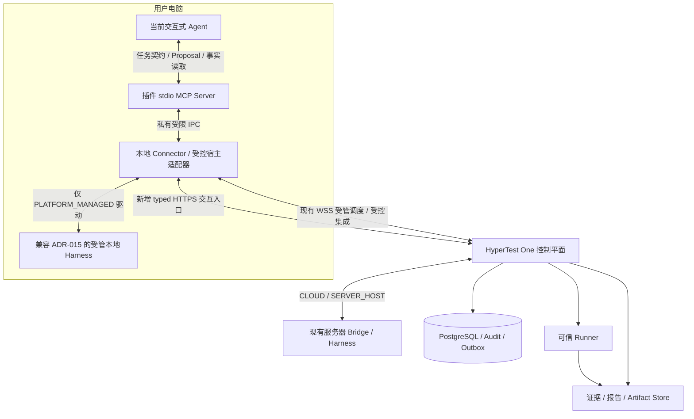

# ADR-016：交互式 Agent MCP 接入与云端 / 本地任务执行

**Status:** Accepted / Implemented / Isolated Current-Agent Core E2E Verified / Not Production Deployed（2026-10-20，Asia/Singapore）。本分支已实现 MCP 安装包、交互 API、受控宿主适配器与 `0019` / `0020` additive migration，并通过当前真实 Agent 的隔离核心闭环，见 [ADR-016 验收记录](../ADR016_ACCEPTANCE.md)。该结果不代表生产已部署或全部恢复矩阵通过，ADR-015 的生产状态与验收历史保持原记录。

**Date:** 2026-10-20（Asia/Singapore）

**Deciders / Decision basis:** 项目负责人要求为 Agent 提供 HyperTest One MCP 插件，并明确：本地 Harness 的任务由本地 Agent 执行，HyperTest One 在此时作为其外接测试平台；任务执行步骤应提供“云端执行 / 本地执行”选择。首版聚焦任务提交、进度查询、证据和报告读取，同时必须具备本地 Agent 实际参与任务的最小绑定与执行通路。

**Scope:** 安装式 MCP 接入、任务执行归属、交互执行绑定、授权、可靠提交及断线恢复。保留现有两种 Harness 接入模式，不变更 Canonical Chain、Runner 事实来源、Proposal 接受及平台 Gate 所有权。

**Relationship to prior ADRs:** 保留 [ADR-013](ADR-013_CONTAINERIZED_PLATFORM_AND_PERSISTENT_HARNESS.md) 与 [ADR-015](ADR-015_DUAL_MODE_HARNESS_AND_LOCAL_CONNECTOR.md) 的受管执行路径和历史。ADR-016 对新 `INTERACTIVE_MCP` 驱动允许经过明确授权，将当前本地 Agent 会话绑定为 Run 的执行者；此前“不接管已有聊天”“由 Connector 启动专属 Harness”的规则继续适用于 ADR-015 受管驱动，不能用于禁止本 ADR 的显式绑定，也不能据此自动接管任意聊天。

## Context

HyperTest One 是 Autonomous Testing Control Plane。Agent 负责分析、设计、实现与诊断，Runner 产生正式执行事实，平台验证 Proposal、维护 Canonical State 并形成质量结论。MCP 应让交互式 Agent 使用这些平台能力，不能把平台重新包装为另一个通用 Agent Loop。

ADR-015 已将 Harness 放置扩展到服务器和用户电脑，解决本地认证复用、固定源码传输及受控问题单执行。现有本地 Connector 由平台调度，托管专属 Provider 会话。用户希望直接使用当前本地 Agent 完成测试任务：该 Agent 已有模型授权和本地工作环境，安装 MCP 后应能与平台交换任务契约、请求可信测试执行、读取证据和报告。仅允许它提交任务，然后另启一个 Harness 执行，不能满足这一要求。

当前 `harness_bridge/relay.py` 是受管 Harness 单次调用内的私有 stdio MCP relay；其能力来自原 call / Run / claim，不是可安装的交互入口。现有 WSS 设备通道和全局 Operator API 也不能直接开放为交互插件的通用代理。

## Decision

### 1. 任务执行步骤统一为云端执行 / 本地执行

`execution_mode` 表达 **Agent / Harness 在哪里推进测试任务**，不表示正式测试命令或 Runner 一定运行在哪里。首版正式测试仍由平台可信 Runner 在冻结环境中执行；本地 Agent 可通过 MCP 请求它。将用户电脑登记为可信 Runner、允许源码完全不离开本机，均需要独立设计与验收，本 ADR 不授予这些能力。

| 用户选择 | `execution_mode` | 保留的 `harness_mode` | `execution_driver` | 实际执行者 |
|---|---|---|---|---|
| 云端执行 | `CLOUD` | `SERVER_HOST` | `PLATFORM_MANAGED` | 平台调度服务器 Harness，经现有 Host Bridge 推进任务 |
| 本地执行，兼容现有方式 | `LOCAL` | `LOCAL_CONNECTOR` | `PLATFORM_MANAGED` | 平台调度 Connector 托管的本地专属 Harness，沿用 ADR-015 |
| 本地执行，当前 Agent | `LOCAL` | `LOCAL_CONNECTOR` | `INTERACTIVE_MCP` | 当前本地 Agent 经显式绑定直接推进任务，MCP 连接外接测试平台 |

`execution_driver` 是 Operational 调度选择，不是第三种 Harness 模式，也不是新的 Canonical 事实。提交在首次绑定前明确并冻结 mode / driver / node；不支持的组合拒绝。`LOCAL + INTERACTIVE_MCP` 下，Connector 负责认证、传输与受控适配，不再启动第二个 Provider / Agent 替当前 Agent 执行。

旧请求缺少新字段时按原 `harness_mode` 解释为原受管驱动；省略原模式的请求继续默认 `SERVER_HOST`。不回填旧 Snapshot、Job payload 或 Placement，不把历史受管会话追认为交互执行。首绑定后更换执行模式、驱动、节点、Provider 或主会话，必须显式创建关联的新 Run。

### 2. 插件与两条执行路径

插件由本地 stdio MCP Server、宿主接入配置、受控宿主适配器和使用 Skill 组成。Skill 说明调用流程，不提供授权。MCP Server 通过私有、限当前用户的本地 IPC 接入 Connector，再访问新增的 typed HTTPS 平台入口；不开放本地 TCP 监听，不把平台管理 API、UDS Bridge 或现有设备 WSS 原样转发给模型。

云端执行时，本地 Agent 可以只提交任务和读取结果。交互式本地执行时，当前 Agent 本身承担测试智能工作，平台协调器仅维护持久请求、租约、领域准入、Runner、Verifier 和 Gate；不得同时让 Bridge / Connector 再拉起另一执行 Harness。模型推理仍由宿主原有 Agent Loop 驱动，平台和 MCP 不通过 sampling、轮询触发隐藏模型调用或接管用户聊天。

交互 API 只鉴权、规范化严格类型参数、持久化 `InteractiveToolRequest` 并有界等待或查询结果，不执行九个 TMP 领域工具，不调用 Docker / Provider。这个 inbox 是原 Run 的 Operational 运输账本；原 `ADVANCE_RUN` Job 的唯一 Worker / coordinator 在同一 claim 下消费请求，复用九工具和可信 Runner。它不创建第二个业务 Job、独立调度队列或 Agent Loop。HTTP / MCP 等待结束不取消已接受请求，也不取消 Worker 中已接受的 Runner。

新应用能力使用独立 `hypertest.interactive-mcp/v1alpha1` profile；MCP wire version 由宿主与 Server 协商，不能把应用 profile 当作标准协议版本。已有 TMP、Bridge、Connector profile 及私有 relay 保留，交互执行复用 TMP 业务语义并适配生命周期，不直接公开旧 relay token。

### 3. 首版工具：提交 / 读取，加本地执行最小闭环

| 工具 | 作用 | 最小交互授权 |
|---|---|---|
| `hypertest_submit_task` | 固定输入、执行选择并可靠提交任务 | `task:submit` |
| `hypertest_get_submission` | 按原提交 key 查询最小回执与原 Run / Job 引用 | `task:submit` |
| `hypertest_get_progress` | 读取该 Run 的平台进度与 Operational 状态 | `run:read` |
| `hypertest_list_evidence` / `hypertest_read_evidence` | 读取获准证据目录、元数据与有界内容 | `evidence:read` |
| `hypertest_list_reports` / `hypertest_read_report` | 读取获准报告版本与内容 | `report:read` |
| `hypertest_bind_execution` | 显式绑定当前本地 Agent，申请该 Run 的受限执行能力 | `run:execute`，并验证当前执行身份与准入 |
| `hypertest_get_execution` | 按原 attach key / binding 查询绑定及执行操作，不隐式恢复 | `run:execute`，仍按对象范围鉴权 |

仅提交 / 读取权限不会把当前 Agent 变成任务执行者。绑定成功且持有效的 Run 级执行能力后，首版复用现有九个 TMP 领域工具：`get_state`、`request_mission`、`complete_mission`、`request_execution`、`ask_user`、`evaluate_gate`、`submit_report`、`request_gitlab_issue`、`get_issue`。其领域 Schema、Proposal 验证、Runner 准入、Gate 与问题单策略保持原规则；实际发布工具集必须受当前绑定和能力限制，不能以插件安装代替执行授权。

典型本地流程为：提交 `LOCAL / INTERACTIVE_MCP` → 显式绑定当前 Agent → 获取固定状态与 typed Mission → 本地分析 / 测试实现 → 提交 Proposal → 请求可信 Runner → 查询进度 / 读取 Evidence → 必要时诊断 → 请求平台 Gate → 提交并读取报告。`evaluate_gate` 只请求平台作出决定，`submit_report` 只提交与正式事实一致的报告，均不授予模型自行确认质量结论的权限。

首版不增加通用 Shell、任意文件 / URL / HTTP 代理、设备配对、权限授予、凭据管理、任意提单、业务取消或强制恢复工具。人工问题沿用持久 `ask_user` / 人工答复入口。源代码采集、Issue 执行和恢复仍经过各自既有受控流程。

### 4. 授权复用与独立平台权限

`InteractiveIntegrationGrant` 按 actor、注册的稳定 client instance、Project 与 scopes 授权，支持 `task:submit`、`run:read`、`evidence:read`、`report:read`、`run:execute`。安装插件、存在 MCP 连接或已登录 Provider 均不产生平台权限。client identity 必须由受控注册确认，不能信任模型提供的 ID。

上述交互权限独立于 NodeDevice / HarnessDeviceGrant、`NodeProjectCapability` 的 harness / source_acquisition / issue_executor、Job claim、短期执行 grant、清理管理 grant 和全局 Operator key。不得向插件发全项目管理密钥，也不将交互 scopes 塞入现有节点能力枚举。本地执行绑定还须核验现有有效设备身份和该节点的 Project harness 能力，`run:execute` 不替代设备 / 节点授权。

短期执行 grant 固定签发时的精确 `device_grant_id`，准入、inbox 消费和领域提交均核验这一原设备授权；同一 node 轮换得到的新设备凭据不能使旧短期 grant 继续有效。节点 / adapter 白名单、Project 能力和集成授权也分别核验。已在有效授权下提交的不可变 Runner 请求按原 Job / Binding / epoch 收集事实，撤权不追溯改写它，也不允许借此产生新请求。

每次提交、绑定、读取和执行均核验当前身份、Project、Run / 对象归属、授权有效期与撤销状态。运行中的 Agent 只获得限 Run / Binding / epoch / Session / 当前 MissionAttempt / 调用的短期能力；平台持有并核验原 DurableJob claim，不把原 lease secret 交给模型。撤销写权限立即阻止新 Proposal、Runner 请求或其他受控写入，不自动撤销独立保留的读取权限，也不回滚已接受任务或已发生的外部副作用。

模型授权继续使用本地 Agent 原有 Provider 登录；固定源码与问题单适配器继续使用本地已有 Git / glab 等认证。凭据保留于本地受保护设施，平台只保存授权引用和审计；不上传认证目录，不在模型上下文、命令参数、日志或 Artifact 中传递 token。平台不能保证禁用用户本来就有的 Shell、个人 MCP 或关闭整个聊天；它能保证本 Run 的平台准入和事实接受受到 fencing。插件本身不得扩充宿主的个人工具权限。

### 5. 固定源码、问题单、证据和报告

本地工作区与平台 Runner 不共享绝对路径。`LOCAL_CONNECTOR` 沿用 ADR-015：批准的 credential-free origin、完整 SHA、来源授权、受控 SourceBundle、平台独立校验及 `ACCEPTED` transfer 在 Snapshot 冻结前完成。本地 Agent 的受控测试工作区从固定已接受输入派生；不得把其日常 dirty checkout、manifest 自报或本机路径直接当作可信源码。服务器模式继续支持既有受控 pinned source 准备路径，不强制历史服务器任务改用本地包。

交互提交引用已批准固定输入及相应模式要求的来源引用；插件不隐式 fetch 任意仓库、冻结当前目录或触发新授权。Git / 网络 / 文件 I/O 在数据库聚合事务外执行，准入提交前再次核验来源、节点及授权。测试实现仍以 Proposal 接受至受控 Artifact，再由 Runner 复核执行；本地调试日志不构成正式 Evidence。

`request_gitlab_issue` / `get_issue` 沿用 ADR-015 的 Finding / Evidence 依据、项目白名单、责任人、审批、持久操作、固定 executor 与 UNKNOWN 对账规则。`run:execute` 不等于 source_acquisition 或 issue_executor；MCP 不新增任意 GitLab API 或直接 glab 调用面，不因本地账号已有权限而自动写问题单。

证据 / 报告读取按 ID 和对象归属授权，支持有界分页、固定版本和摘要校验；不得接受任意 URL 或文件路径。保留 Evidence 的 status / trust level / 来源与正式 Verdict 引用；Job `SUCCEEDED` 不等于质量 PASS。未通过验证的数据不得重标为 Runner 事实，报告文字不覆盖正式结论。源文件、日志和报告内容均为不可信任务数据，不是新的工具指令或授权。

### 6. 提交、绑定与持久会话

提交前客户端先将稳定 `submission_key` 和版本化输入摘要写入私有 journal。平台使用 `UNIQUE(actor_identity_id, client_instance_id, project_id, submission_key)`，对完整 SHA、冻结输入 / 环境、mode / driver / node、来源引用和策略作幂等比较：同 key 同摘要返回原回执，同 key 异摘要冲突。

已实现的交互应用门面在一个 PostgreSQL 事务内接受 `InteractiveSubmissionReceipt`、Run / bootstrap 快照、执行选择、初始 `ADVANCE_RUN` DurableJob、Audit / Outbox。环境 / 来源和 Artifact I/O 在该事务外完成，提交前重新鉴权。原来分别调用 bootstrap 和 enqueue 的两个 HTTP 请求不因此获得原子性。确定拒绝不创建 Run / Job。本地交互驱动的初始 Job 在受控绑定完成前不能取得执行准入，不能被旧默认调度路径提前启动成受管 Harness。

`InteractiveExecutionBinding` 是当前交互执行者到既有唯一 `RunExecutionBinding` / 主 `AgentSession` 的 Operational 关联，不是第二 Worker、第二主会话或另一队列。绑定使用独立稳定 `attach_key`、完整身份 / 输入摘要和可查询回执；重复请求不得建立第二绑定。初次 attach 先在互斥事务中登记唯一 Binding / 已核验真实 Session / Placement，不要求尚未领取的 Job claim，也不颁发领域执行权；完成登记后，coordinator 才可领取初始 Job，再凭有效 claim / epoch 发放短执行能力。这样不会形成“绑定等 claim、claim 等绑定”的循环。具体字段、唯一性和状态约束以领域文档为准。

必须分别识别用户聊天、MCP transport session、稳定 client / grant、平台 AgentSession / RunExecutionBinding，以及宿主真实原生 session。受控宿主适配器提供可核验的 Provider / native continuation、稳定 node、受控 workspace、固定 source 与本次执行生命周期；模型自报聊天 ID、JSON-RPC request ID、MCP session ID 或 Connector 在线状态均不足以绑定和恢复。

首个实现为 `codex-desktop-stdio/v1`，只支持受控的当前 Codex Desktop stdio 启动上下文：实际 native thread / session 环境、归属当前用户的原生 metadata 首行、真实 Codex 祖先进程及出生时间、kernel 观察的 stdio peer PID 与固定源码必须一致。只读取 native metadata，不读取聊天正文。daemon 首个可信 stdio PID / 出生时间在其生命周期内固定；相同活进程的传输闪断可重连，替换 stdio 进程必须在原可信 native 上下文显式重启 daemon，再按原 key 对账和显式继续。daemon 重启不创建 native Session、Job 或执行 grant；其内存中的短期 token 丢失后也不能通过查询恢复秘密。普通共享 MCP 启动或不具备这些证明的宿主只支持提交 / 读取或 CLOUD，不能宣称所有 Codex 安装方式都能绑定当前聊天。安装与限制见[客户端说明](../INTERACTIVE_MCP_CLIENT.md)。

绑定可以明确选择当前本地 Agent，绝不自动接管任意已有聊天，不上传聊天记录或 chain-of-thought。首版保持 `UNIQUE(provider, provider_session_id)` 等原会话不变量：一个真实原生执行会话只绑定一个 Run；它仍可提交或读取其他 Run。另一个执行 Run 需要用户 / 宿主提供真实的新原生执行上下文，不能伪造复合 session ID 或让 Connector 偷启替代 Agent。

宿主不能提供所需的真实身份、隔离 / 来源或生命周期能力时，只开放可支持的提交 / 读取和云端执行；明确拒绝本地交互绑定。预算依据可验证的本 Run 授权 / 活动及平台操作账本，不把整个聊天存活或模型自报耗时当作旧 Bridge 的 `stopped` / elapsed 证明；具体适配能力必须单独验收。

### 7. 断线、恢复、撤销和结束

| 情况 | 平台与 Agent 行为 |
|---|---|
| 云端执行，提交方聊天 / MCP 关闭 | 云端任务按已有授权继续；提交方重连后读取原状态 |
| 本地交互执行，Agent 关闭或执行关联失联 | 停止新的本地任务推进，平台保留已接受进度；Connector 不替身执行，也不以自身心跳证明 Agent 活跃 |
| 已发出 Runner 调用或问题单操作后断线 | 原可信执行 / 外部操作可能继续，先按原 Execution / operation 对账，不重复创建 |
| 提交或绑定响应丢失 | 客户端记为 UNKNOWN，按原 submission / attach key 查询；不自动再发写请求或换 key |
| 原身份、绑定和当前授权仍有效 | 先读回执 / binding / 原调用状态，核验后显式继续；连接重建本身不调用 execute / resume |
| 原租约过期、owner 不明或需正式恢复 | 通过既有受控恢复入口 fence 旧交互 owner、对账原调用；仍有效的 Runner 先按原 Binding / epoch / claim 完成收集或受控取消，再在原节点 / native session / workspace 下发新 epoch；首版 MCP 不提供强制恢复工具 |
| 原 native session 不可恢复或需换模式 / 节点 | 保留原历史，显式创建关联新 Run 与真实新执行上下文，不假装原会话续接 |
| 用户问答、报告完成、取消或撤权 | 按该 Run 的持久状态收口 / 暂停与撤权；不承诺终止用户整个聊天或其无关工作 |

UNKNOWN 是客户端对操作结果的知识状态，不是新的 Run 质量状态。查询 `NOT_FOUND` 本身不能证明原写入未发生；未决事务、查询时序或可见性均可能影响结果。不得以此自动创建第二任务、第二 Attempt、第二 Runner 执行或第二 Issue。保留 journal、服务端回执及操作历史以便对账，不承诺网络 exactly-once。

九工具均先持久运输 request key；业务写使用原 `arguments.idempotency_key`，外层 `request_key` 若存在必须一致。`get_state` / `get_issue` 使用独立运输 key，不改业务 Schema。POST / GET 返回统一 inbox envelope；`QUEUED` / `RUNNING` / `UNKNOWN` 后只按原 key 查询，不能重新 POST。客户端仅在运输 `SUCCEEDED` 时解包原业务 result 并附 `_transport` 身份；业务 `REJECTED` 不转成接受。旧 Job 的未消费请求受控拒绝，已消费但未核实的请求保留 UNKNOWN，只按精确账本对账，不能由新 Job 重派。

MCP 请求级取消或断开不等于取消已接受 Run，也不回滚已提交事实。业务取消沿现有平台入口先持久取消并撤销执行能力；已发操作尽力中断与对账，迟到 / 旧 epoch 写入拒绝。已完成 / 取消的终态不能被 MCP 重连重开。单独保留的查询或清理能力不得用来恢复执行。

过期恢复由独立操作者入口提供：`POST /interactive/executions/{id}/recover` 同时验证 Operator、当前集成权限、精确设备授权和原宿主证明，按原 attachment / `retry_key` 持久登记恢复命令。API 不执行源码文件校验；既有 runtime-control Worker 从固定 Binding / 已接受 transfer 解析来源，在行锁外核验原工作区，再锁定原 Run 并复查授权、版本、旧 Job / Runner 结算后恢复。需要换代时递增原 epoch，并创建关联旧终态 Job 的 retry Job，不重开旧 Job。POST 有界等待；返回 `QUEUED` / `RUNNING` / `UNKNOWN` 时，操作者通过同样独立授权的 `GET /interactive/executions/{id}/recoveries/by-key` 查询原 `retry_key`，不得换 key 重做。恢复成功返回原绑定与 `new_job_id`，客户端仍须显式 continue，查询或重启不颁发短期 grant。首版 MCP 不开放该管理恢复工具。

## Options considered

| 方案 | 复杂度与成本 | 规模与维护 | 团队 / 现有系统适配 | 决定 |
|---|---|---|---|---|
| MCP 只提交 / 查询，仍由另一个 Harness 执行 | 首版较小 | 易扩展读取 | 可复用任务 API，但不能让当前本地 Agent 执行 | 不采用为完整方案；保留其云端客户端子集 |
| 用 MCP 替代所有 Harness / 直接暴露现有 relay 或管理 API | 表面入口少，实际授权和恢复成本高 | 连接与任务耦合，兼容风险大 | 破坏原 call / Job claim 假设，丢失服务器兼容路径 | 不采用 |
| 云端 / 本地任务选择，受管与交互驱动共存，typed MCP 适配 | 增加 scoped grant、宿主适配、绑定和原子门面 | 沿用 PostgreSQL / Audit / Outbox，执行按绑定扩展 | 复用既有 TMP 领域服务与 ADR-015 安全边界 | 采用 |
| 首版即提供远程 MCP、可信本地 Runner 与完全本地源码 | 授权、来源与执行信任改动大 | 需独立部署 / 适配矩阵 | 超出当前可复用能力及本次范围 | 后续单独决策 |

## Trade-offs and consequences

当前本地 Agent 可以直接消费平台测试能力，复用已有模型和受控集成授权；服务器无人值守任务、既有 Connector 受管执行和历史会话继续可用。两种执行位置共享同一 Canonical Chain、Runner 事实、Verifier、Gate 与审计。

代价是插件并非只包装七个 HTTP 端点：必须增加可靠提交与绑定、宿主能力检测、当前 Agent 生命周期适配，以及执行驱动的调度隔离。现有 `create_session / start_call / close` 行为不能直接套到用户已有聊天。普通 stdio MCP 本身不能证明宿主原生会话身份；未适配宿主不能承诺本地执行或无缝恢复。同一原生会话只执行一个 Run、正式 Runner 仍在平台、固定源码仍需传输，是首版明确限制。

本分支已实现上述接入、授权、原子提交、执行绑定、原 Job 工具 inbox 与宿主适配，并取得当前真实 Agent 的隔离正向完整周期结果。代码回归、隔离真实周期与生产交付分别登记。ADR-015 的已部署运行时、生产数据、认证、VPN 白名单、服务器 Harness 及原验收结论不因本 ADR 改变，ADR-016 尚未生产部署。

## Action items and acceptance

- [x] 实现 scoped enrollment / revocation、typed HTTPS 门面、私有 IPC 与可安装 MCP / Skill 包，不分发全局 Operator key。
- [x] 实现 mode / driver 兼容映射、原子提交 receipt、待绑定调度准入和幂等绑定；增加 `0019_interactive_mcp` / `0020_interactive_tool_inbox`，保留旧数据和历史。
- [x] 实现受控 Codex Desktop stdio 宿主适配、原 Job Worker 九工具 inbox、精确设备 grant 与提交 / 消费 / 领域提交 fencing；隔离 API/runtime、数据库守卫、客户端与宿主回归已通过。
- [x] 完成受控当前 Codex Desktop Agent 的隔离核心验收；真实 Agent 使用官方 MCP SDK 通路推理并提交四个 Mission 的 Proposal，未另启 Provider。闭环完成四份 Implementation、真实 Docker live HTTP 27 / 27、五份 VERIFIED Runner Evidence、`RELEASE_READY`、报告接受及 Job / Binding 正常收口。
- [x] 所有五份 Evidence 经 MCP 读取并核验 hash / 字节数；报告经两页 cursor 读取并核验版本、hash / 字节数。Runner 完成后重启 stdio / daemon，原 key 查回同一 Execution，无第二执行。
- [ ] 验证提交 / 绑定响应丢失、重复 key、异输入冲突、重复绑定、跨项目 / 跨 Run 访问、撤权与旧 epoch 写入拒绝。
- [ ] 验证 MCP 断连、Agent 关闭、Connector 独立存活、原调用 UNKNOWN、Runner 已发后断线、同身份显式恢复及不可恢复时关联新 Run；不重复执行或提单。
- [ ] 回归 `SERVER_HOST` 云端和 ADR-015 `LOCAL_CONNECTOR / PLATFORM_MANAGED` 两条路径，保留数据、授权、访问边界和历史 hash；分别记录实现、隔离验收、上线与线上验收。

具体身份、保留的过期 Job、epoch 1 → 2 → 3、结果摘要及验收限制见 [ADR-016 验收记录](../ADR016_ACCEPTANCE.md)和[机器可读观察](../evidence/adr016-20261020.json)。当前 Agent 的传输重启发生在 Runner 完成后，不是运行中断线验收；最初的真实恢复在最终 Worker-only 源码校验重构之前完成，最终恢复路径由独立集成回归核验。该隔离结果不覆盖 ADR-016 私有 Git / GitLab 写入、通用共享 MCP 宿主或生产部署。新 Web 执行步骤的 CLOUD / LOCAL 与 driver 展示也须单独交付和验收，不能由 MCP / API 实现推定前端已完成。

## Specification ownership and references

- [白皮书](../foundation/HYPERTEST_WHITEPAPER.md)：交互 Agent / 外接测试平台定位及云端 / 本地产品流程。
- [技术架构](HYPERTEST_TECHNICAL_ARCHITECTURE.md)：两种执行位置、两种驱动、现有 Harness 兼容与部署边界。
- [TMP](../protocol/TEST_MISSION_PROTOCOL.md)：交互工具、绑定 / 执行上下文、幂等、读写及恢复契约。
- [领域模型与状态机](../domain/HYPERTEST_DOMAIN_MODEL_AND_STATE_MACHINE.md)：授权 / 回执 / 绑定的 Operational 模型、唯一性、事务与持久身份；发生冲突时仍按 AGENTS.md 的基础文档优先级解释。
- [MCP transport 参考（2025-11-25 固定版本）](https://modelcontextprotocol.io/specification/2025-11-25/basic/transports)：stdio / 消息传输参考；不宣称该固定版本为最新版本。
- [MCP authorization 参考（2025-11-25 固定版本）](https://modelcontextprotocol.io/specification/2025-11-25/basic/authorization)：标准传输授权与 HyperTest 业务授权分层；本地 stdio 不自动提供远端平台权限。
