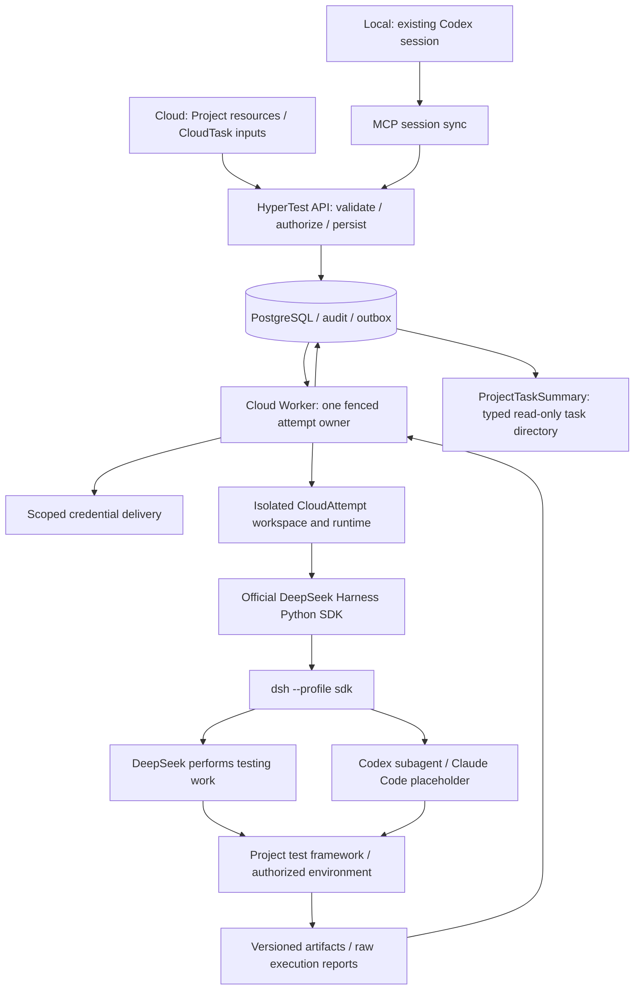

# ADR-019：通过官方 Python SDK 托管云端测试任务

## 当前交付限定（2026-10-23）

本次正式候选只交付 DeepSeek Harness + Codex，Claude Code 保持占位；下文提及 Claude 的可替换 worker 目标不构成具体实现、当前能力或本轮验收要求。

本候选正式迁移接续管理路径的 `0024_local_task_binding`：先 `0025_cloud_tasks`，再 `0026_cloud_ssh_operations`。旧隔离 fixture 的 `0023_cloud_tasks` / `0024_cloud_ssh_operations`、source pins 和接受记录保持历史身份，不以新编号改写。最终管理 head 与 ADR-024 统一 Cloud/Local 创建及平台预建 Local ID / MCP 绑定仍需串行合并；本候选最终树尚未验证或部署。服务器是允许中断的单人专用测试环境，按本地修改 → Git commit/push → 服务器拉固定完整 SHA 构建、向前迁移、重启 → 一次相关远端验证交付；纯文档变更只做静态检查，不额外要求生产维护窗口或恢复演练。

ADR-022 的 Memory Gateway 是独立 Proposed / NOT IMPLEMENTED 提案，不在本次 Cloud 交付中。经验服务与 Canonical 测试状态、TaskSyncCore 分离；`task:sync` / `cloud:work` 不授权经验访问，服务管理 key 不进入 Agent，外部 Generation / Embedding 默认关闭。

**状态：Accepted design；实现状态：PARTIALLY IMPLEMENTED / DEFAULT OFF / NOT DEPLOYED（更新2026-10-23，Asia/Singapore）。首个受控六步任务已正式接受reported PASS；全部P0路径及生产准入尚未完成。**

当前增量包含独立CloudTask / CloudAttempt、资源 / 加密凭据、解析 / 冻结、官方SDK Worker、报告与Web源码；已验收执行包括HTTPS Git、工作区项目框架与显式opt-in隔离fixture固定SSH诊断专项。source-r23新独立Task已固定读回v20 COMPLETED / reported PASS，ANALYSIS与DESIGN均直接引用当前child原件；source-r24只读验收器对同v20严格PASS，独立只读重放8项与原件 / 实际文件 / host日志关联通过。旧source-r22 v17仍保留DESIGN直接引用NON_PASS，原RECOVERY / HELD历史不变；SSH固定诊断默认关闭，source30 Worker的r8 canonical专项PASS，source31对同v19固定快照strict重评PASS；旧source30 NON_PASS保留（不是新的current GET，精确证据见实现状态），故障矩阵与真实staging未验收；Claude占位，CI / 一般远端shell和生产未准入。本ADR以下仍定义完整目标；精确source、历史失败 / 预算和验收边界见[实现状态](../CLOUD_IMPLEMENTATION_STATUS.md)与[计划](../CLOUD_TEST_IMPLEMENTATION_PLAN.md)。

历史r11所选370项 / r12 Ruff及后续各快照回归均分别登记，不作为模型成功的替代证据。首个真实Task因CASE details提案未交付、人工协调FAILED后原两个HELD不变；后续缺handoff、配置及模型选择失败也独立保留。新关联Task使用同Project / 配置 / 固定双SHA、新授权预算和账本，没有自动重试旧任务。当前已核对ROOT27 / CODEX7完整请求及正式委派身份 / 文本贡献，子工具SIGTRAP另由无模型有限AS单变量对照定位；native16修正的source-r21所选535通过 / 1跳过，source-r22契约澄清针对性169通过；source-r21任务的typed引用拒绝 / RECOVERY与原HELD历史另列；source-r22新任务已接受reported PASS、runtime-reported子原件 / 资产 / Run及独立重放9项，DESIGN直接引用的精确PRD偏差与独立来源边界保留。服务文件仅完成临时PreStart准入、未长跑Worker或部署生产；精确source、任务、原件、失败和清理证据见实现状态，Claude仍为placeholder。

**决定方：项目负责人明确采用官方 Python SDK，并确认六步云端测试流程。**

**同日产品模式澄清：Cloud 与 Local 是同一 Project 内可共存的两种任务来源 / 协作模式，不是项目二选一配置（2026-10-22，Asia/Singapore）。**

**独立 Local 交付：[ADR-020](ADR-020_HOOK_DRIVEN_LOCAL_SESSION_SYNC.md) 的 Hooks 自动触发与 MCP 显式操作已随 Local 0.1.0 及三宿主真实矩阵独立交付；确切版本 / 范围见[Local 状态](../LOCAL_MODE_IMPLEMENTATION_STATUS.md)。该客户端交付不证明 Cloud 运行能力，也不改变本 ADR 的云端官方 Python SDK 决定。**

**同日共享同步决定：[ADR-021](ADR-021_SHARED_TASK_SYNC_CORE.md)将本地同步机制抽为 TaskSyncCore，由 CloudTaskReporter + CloudSyncAdapter 复用于运行中的云端进度 / 产物报告；SDK 仍负责执行控制，Cloud 独立权限与 fenced Worker 保持。共享核心与 Cloud reporter / adapter 已有增量源码，完整验收未完成；Local 交付另记，详见[实现状态](../CLOUD_IMPLEMENTATION_STATUS.md)。**

**业务 profile：`cloud-harness-task/v1alpha1`。**

## 1. 背景与范围

用户希望在 HyperTest 一次配置被测仓库、测试框架、Git 授权与环境访问资料，随后为确定变更下发完整测试任务，由 DeepSeek Harness 自行工作或委派 Codex / Claude Code，形成分析、设计、用例、自动化代码和执行报告。

当前 [ADR-018](ADR-018_CODEX_SESSION_TASK_SYNC.md) 的职责是会话产物同步，不能通过增加表单字段变成云端执行。新路径需要独立的稳定任务身份、工作区、资源授权、Worker 生命周期和执行记录。它共享既有 Project；保留 SessionTask、原同步工具与 reported result、ADR-017 native 路径及 legacy Runner / Gate 的现有语义和历史。

本决定只替代将“平台不承担测试执行”普遍应用于新云端 profile 的限制；在云端 profile 内，平台可以准备与监督任务执行环境，Agent 可以执行已授权的 shell、文件写入与项目框架入口。测试发现、fixtures、断言和框架调度仍属于项目原工具链；模型推理、工具选择和子代理分工属于 DeepSeek Harness。它不放宽 ADR-015 / 016 的 managed 工具禁令或改变两种 HarnessMode。

### 1.1 Cloud / Local 产品模式与共享项目

| 产品模式 | 创建、推进与同步 | 任务身份与交付状态 |
| --- | --- | --- |
| Cloud 云端模式 | 用户在云端创建 / 配置 Project、创建 CloudTask 并下发；云端 Worker / DeepSeek 完成六步流程并保存产物与执行结果 | CloudTask / CloudAttempt；官方 Python SDK 路径部分实现、默认关闭，首个受控任务reported PASS已接受，source-r23新Task reported PASS、直接双原件 / Run已接受；source-r24同版本严格PASS与独立重放8项，旧v17直接引用NON_PASS保留，r8固定SSH专项PASS，source31对同v19固定快照strict重评PASS、旧source30 NON_PASS保留，故障矩阵 / 其余P0与生产仍待 |
| Local 本地模式 | 用户在本地驱动 Agent 会话，Agent 使用自身已有工具链开展工作，经 MCP 将任务、计划、用例、报告及 reported result 同步到同一云端 Project | SessionTask；保留现有 Codex 同步实现，其他 Agent 的本地 adapter 为后续工作 |

Project 是长期被测对象与资产目录，同一个 Project 可以同时拥有多个 CloudTask 和多个 SessionTask，不设置排他的项目模式。Cloud 的项目资源配置是可选云端能力，不成为 Local 使用项目前提；Local 不要求 Git / 环境 / 模型云端凭据、Job、执行绑定或源码上传，不远程启动或接管本地 Agent，也不为本地 Git、shell、SSH 或 CI 提供额外执行授权。本地 Agent 可以使用另行授权的远端框架或 CI；Local 表示会话来源和协作方式，不证明测试框架或 SUT 一定位于本机。

面向用户的 `product_mode=CLOUD|LOCAL` 从 `task_kind=CLOUD_TASK|SESSION_TASK` 派生，表达不可变的任务类型 / 来源，不新增持久化可变 mode 列，不允许将既有任务转换身份。项目统一列表仅是只读 `ProjectTaskSummary` 查询投影（当前默认关闭源码已加入、尚未更新测试服务器常驻Cloud服务），以 `(task_kind, task_id)` 标识来源对象，显示模式 / 来源标签并支持筛选；同 UUID 的不同类型不能混淆，也不能用单个无类型 task FK 将两张任务表伪装成一张。具体字段与授权见领域 §51、TMP §46；详情、写入、状态和历史仍归各 profile。

这里的 Cloud / Local 与 ADR-015 / 016 的 legacy `execution_mode=CLOUD|LOCAL` 属于不同契约；后者继续解释既有 TestRun、HarnessMode、Connector、Binding 和 Runner 历史。不得用新的产品来源标签重写旧模式或把旧 LOCAL 绑定要求施加给会话同步。

## 2. 决定：六步完整云端流程

| 步骤 | 输入与平台交付 |
| --- | --- |
| 1. 创建项目 | 在云端创建 Project 或配置既有共享 Project，添加 credential-free 被测对象 Git 仓库、测试框架 Git 仓库（允许同仓）、可加密持久化的 Git token / 密钥、测试环境及私钥 / SSH 连接方式；项目默认配置可复用 |
| 2. 创建任务 | 在云端创建 CloudTask，指定被测分支、feat、MR 或完整 SHA，提供 PRD、测试目标、基本流程；选择测试框架版本、环境、资源授权范围、预算及超时 |
| 3. 下发任务 | DRAFT 阶段先由受限 Worker 预检 ResolveCloudInputs，形成不可变 CloudInputResolution，固定 SUT / framework 完整 SHA 及 MR base / head / 实际测试提交；dispatch 校验并引用 resolution_id、冻结输入后原子入队，PREPARING 只 checkout 和核验，不再解析浮动分支 |
| 4. Harness 接取与分工 | Cloud Worker 通过官方 Python SDK 驱动 DeepSeek；其自行参与分析、实现、执行与诊断，或委派 Codex；Claude Code 保持占位，平台不实现模型内部调度循环 |
| 5. 输出测试产物 | 分阶段追加分析、设计、用例、自动化代码和实现引用；保存 commit 或可恢复完整 patch、manifest 与版本关联，主指挥官统一提交 |
| 6. 运行与汇报 | Agent 调用项目已有测试框架或已授权 CI / SSH 入口；回收用例结果、原始日志与报告、实际版本和环境观察，形成带来源的最终报告 |

第 5、6 步允许诊断、补充用例和重跑的循环；每次保留原执行与失败。仓库 commit 不证明环境已部署该 commit；环境部署版本和 source/build 关联需单独观察。输入或授权范围改变不得重写已冻结任务。

CloudTask 只有 DRAFT 可编辑。输入解析快照绑定 draft / config 版本、选择器、PRD 和授权；草稿或配置变化使旧解析结果不可用于首次 dispatch。预检受理不等于执行 dispatch 接受，预检不得运行 Harness 或测试。相同冻结输入的显式复测建立新 CloudAttempt，复用固定 SHA；改变输入建立关联的新 CloudTask。每个任务最多一个未终结 attempt，WAITING_INPUT 与 RECOVERY_REQUIRED 都占用该执行归属，不因重新打开页面产生第二个执行者。

## 3. 服务与身份

- CloudTask / CloudAttempt 使用平台 UUID，独立于 SessionTask、TestRun、Job 以及 Provider session ID。DeepSeek 与子代理原生会话引用仅用于追溯，不创建对应 Codex SessionTask。
- API 负责授权、接受和查询；Cloud Worker 负责租约、源码准备、预检、超时、停止、产物回收与受控提交。只有当前 fenced coordinator 可以提交云端状态；主指挥官统一汇总产物，子代理没有平台 writer token 或 Operator key。
- 每 CloudAttempt 一个专属 runtime、workspace、`dsh_home` 和受监督进程范围；根与子代理、测试进程在范围内受控。不同任务不共用可写工作区、运行凭据或原生认证目录。
- 使用既有 PostgreSQL / Artifact Store / Audit / transactional outbox 的增量能力；云端领取使用独立 CloudAttempt 归属，不借旧 RunExecutionBinding 或 DurableJob 外键伪造身份，不新增 Kafka 或通用 Workflow DSL。
- 项目统一目录按原任务类型读取与鉴权，保留各自实际状态、版本和 reported result；列表可并列显示两模式，但没有通用 dispatch / cancel / sync 写入口。读取权限不因同 Project 而授予另一模式的执行、同步或凭据权限。

组件详细职责见[技术架构 §45](HYPERTEST_TECHNICAL_ARCHITECTURE.md)，字段和生命周期见[领域 §51](../domain/HYPERTEST_DOMAIN_MODEL_AND_STATE_MACHINE.md)，请求和事件见[TMP §46](../protocol/TEST_MISSION_PROTOCOL.md)。

### 3.1 运行中报告与共享同步核心

Cloud 不等最终答复才回收产物。Worker 内的 **CloudTaskReporter + CloudSyncAdapter** 复用 [TaskSyncCore](ADR-021_SHARED_TASK_SYNC_CORE.md)，整理根指挥官明确提交的阶段 checkpoint / 产物清单、collector 核对的原件与必要执行观察，按对应 Cloud typed operation 保存修订、Run 和报告。它复用完整请求整理、语义差异、固定 key / version、隔离待提交账本、回执校验、UNKNOWN 原 key 对账与固定接受版本读回；不是将 CloudTask 送进 SessionTask / `task:sync`，也不普遍套用 Local 完整快照或版本规则。

中途业务进度使用现有 `SubmitCloudAssets` 提交 `kind=REPORT` 非最终报告修订：使用每 Attempt 独立的稳定 key，同 Task 内不跨 Attempt 复用进度 key，原文记录阶段 / 里程碑 / 阻塞与已接受产物 refs，CloudAttempt 现有 checkpoint 可引用已接受 REPORT revision。它不自动改变任务 / Attempt 的 status 或 reported result，不新增操作或表；`final_report_revision` 仍须单独指定并符合原收尾条件。

未来该操作的可选 `checkpoint_report_key` 选择本批正式 REPORT key，在同原 operation key、Task version、lease / generation 的接受事务中接受或复用修订并绑定 Attempt 既有 checkpoint，回执与固定版本读回包含绑定。省略不改，不允许任意 ref / 隐式清除；该 Cloud draft 字段不改变 Local wire。

绑定只更新 checkpoint 的业务进度报告引用，不覆盖 WAITING_INPUT / Resume 所需 SDK 会话、文件、委派或外部操作恢复材料；REPORT 可读回不能证明 runtime 或外部进程可恢复，仍按 §6 核验原运行状态。

SDK 是执行控制通道，报告由当前持有效 lease / generation 和短期 `cloud:work` 的 Worker broker 回写。根与子代理只交领域进度 / 产物，不取得平台 writer token、DB 或 Operator key；SDK idle / tool / 子代理通知只提供脱敏活动观察，不能直接推导业务阶段完成、RunRecord 或 PASS。Hook / plugin event 可在核验后辅助触发检查，但云端不依赖终端 Local installer、三宿主 release 或 Hook readiness。

每 Attempt 使用独立持久报告账本与原件来源，不共享 Local journal / 凭据。未决报告阻塞后续普通汇报 mutation，不阻止有权安全取消 / fence。取消或租约失效阻止旧 reporter 新提交；保留原冻结请求供合法 owner 对账，不能换 generation 重发。上传、Artifact 接受、领域回执与外部 CI / SSH 运行在取消后仍分别核对，UNKNOWN 不被清除；报告失败不覆盖测试结果或自动重跑，也不能越过未决直接完成。最终收尾仍按本 ADR §6。

## 4. 采用官方 SDK 的依据与限制

截至 2026-10-22 对官方文档的核对：Python 包 `deepseek-harness-sdk` 配套同版本 runtime，通过 stdio NDJSON / JSON-RPC 驱动 `dsh --profile sdk`。公开入口包含 `DeepSeekHarness`、显式 `dsh_home`、`cwd`、`run()` 与 `resume_session()`；恢复原会话不恢复外部进程。实施时固定 SDK、runtime、插件和 profile 版本，不沿用浮动 `master` 作为运行版本。[官方 Python SDK](https://github.com/deepseek-ai/deepseek-harness/blob/master/python/sdk/README.md)

当前 SDK 协议没有单会话 cancel / close，也没有实际运行的 server→client 审批请求；版本握手不是兼容性协商。`session/prompt` 的回执仅表明入队；`session/wait` 与 idle 不能代替业务验收。`subagent.finished` 仅覆盖进程内子代理，外部委派另行核对。平台因此管理整个 attempt 进程树的停止，预先配置权限，不宣称有实时审批 API。[官方 SDK 协议](https://github.com/deepseek-ai/deepseek-harness/blob/master/packages/sdk/protocol/README.md)

本轮固定实现为 SDK / runtime `0.2.1rc2`、wire `0.0.1`。官方 DeepSeek provider 使用 Anthropic Messages `/v1/messages` 与 `x-api-key`；host broker 固定文本 / thinking / 客户端工具推理范围，不回退 Chat Completions。Codex opt-in 使用官方 bundle `0.2.1-rc.2` 与 Codex CLI `0.153.4` 的 app-server，单独 host Responses relay 使用云端已有 OAuth；真实 key / OAuth 不进 Agent namespace。Node、完整 npm lock / payload 与可信 manifest 摘要固定，shim 只适配精确 argv 的 Node 启动，不替换官方 provider。source-r18的真实根任务和Codex原生推理 / 文本贡献已按固定接受版本核验，source-r22 native16已接受runtime-reported子文件原件 / typed贡献并独立重放9项，DESIGN经ANALYSIS传递关联但未字面满足PRD直接引用要求，独立来源边界保留，Claude Code仍是placeholder；具体证据见实现状态。

官方生命周期 plugin 通过有界私有 UDS 发送 READY / DELEGATION / CLOSED 元数据与序号 / ACK；不扩 SDK wire 或持久化 transcript。委派 `native_ref` 是官方工具返回的 external activation child UUID，并非 Codex 产品 thread ID；不能宣称可恢复原生 thread。根 Agent 提交责任与资产，状态由 Worker 的已核对 start / terminal 观察注入。该来源仍为 runtime-reported，不升独立证明；READY 只证明组件加载。

官方提供 Codex 与 Claude Code 子代理 bundle，使用父工作区、原生认证以及显式子进程环境；每次外部委派是一次性任务，不支持继续输入或恢复。其返回答案不包含完整 workspace diff。实现必须从工作区收集交付原件，并在云端预配各模型身份。[Codex bundle](https://github.com/deepseek-ai/deepseek-harness/blob/master/packages/subagent/subagent-codex/README.md)、[Claude Code bundle](https://github.com/deepseek-ai/deepseek-harness/blob/master/packages/subagent/subagent-claude-code/README.md)

选择 SDK 的理由是符合现有 Python Worker 技术栈、减少接线与类型适配工作；没有基准数据证明测试执行或模型推理更快。SDK 不负责统一用户授权、任务排队、平台幂等、执行隔离或结果可信性。

## 5. 项目凭据与一次授权体验

资源凭据是新设计的独立 Project 资产：密文持久化、密钥与业务数据库分离；记录版本、用途、允许仓库 / 环境、授予对象、到期 / 撤销及审计。任务只冻结凭据引用与授权范围，不把原文写入任务、PRD、提示词、URL、事件或报告；上传后只显示非秘密元数据。

运行时使用受限 Git helper、SSH agent / 临时私有文件和指定子进程环境注入；仅当前 attempt 的获授权动作可使用。SSH 方式还需主机、端口、用户、host-key 校验及必要跳板 / 网络路径。Git 与环境授权不自动包含推送、合并、部署、提单或额外环境写入。模型服务身份由云端按 Provider 预配和核验，不能假定父环境的全部凭据会被子代理继承，也不能把本机已登录状态复制上云。

授权范围必须由运行时与工具策略执行：限制工作区挂载、凭据提供、目标网络、SSH / CI 入口和允许的外部操作，不仅写在 prompt 中。部署方式无法强制本次范围时拒绝启动并报告 BLOCKED。需要新增授权时，通过 HyperTest 持久问答和显式重新准入处理；这不是 SDK 原生动态审批。独立目录和进程监督是最小运行隔离，不声称已构成可运行任意恶意代码的完整安全沙箱。

任务级隔离必须保留，机制不强绑定Linux namespace；容器或VM的替代方案必须独立验证工作区 / 凭据 / 网络范围、有限资源、整树停止与清理，不能退为共享宿主普通进程或仅依赖prompt。当前已验证基线是专用非root systemd RootDirectory + 独立cgroup + bubblewrap namespaces；不因性能或OAuth推测放宽权限 / 实际内存，不在首片引入通用Runner后端矩阵。隔离成本没有A/B量化数据就不报百分比；认证是否可用以模型服务实际回执独立核验。

用户在项目层配置、在任务层选择资源授权即可覆盖根代理和获准的子代理；各产品认证的实际提供仍由平台运行配置负责。凭据撤销需阻止新使用并停止对应运行授权，已发生的外部动作不得据此宣称回滚。

### 5.1 SSH固定诊断增量

[ADR-023](ADR-023_CLOUD_SSH_FIXED_DIAGNOSTICS.md)补充独立默认关闭的`SSH_FIXED_DIAGNOSTICS_V1`。第一片只允许一个精确literal IP / port / nonroot user / host key目标、无参数只读动作及有限时间 / 输出，不授权一般远端shell / CI。namespace仅连接host UDS；SSH / 签名 / 平台密钥留host，受信只读OpenSSH无PATH回退。canonical远端ledger先SENT再一次发送，失答 / NOT_FOUND按原ID QUERY，短票据及远端有限unit / TTL公开有界撤销窗口。完成 / 结算须另核远端terminal与emptycgroup，不能沿用“无外部能力”或本地停止证明；未知保留RECOVERY / HELD。当前r8 canonical固定SSH专项PASS，source31对同v19固定快照strict重评PASS、旧source30 NON_PASS保留；故障矩阵和真实staging仍待，默认关闭，不改变管理SSH、Local或PowerContext。

## 6. 完成、取消与恢复

2026-10-23 实施增补：当前受控 Worker 尚未实现原 SDK 会话续接；SDK 包暴露的 resume 方法不等于平台能力，能力响应与 Web 明确不支持，服务端拒绝新 RESUME_ATTEMPT。真实续接需独立核验原会话/工作区/未决操作/剩余预算后另项实施。人工 RECONCILE 复用 RECOVERY_REQUIRED 收尾：有权操作者携原停止/对账观察与声明，服务端重新核验版本、writer fence、checkpoint/平台/外部未决和委派；未知不清空、不重放。声明来源为 operator-attested，不证明独立停止或模型 drain；FAILED/CANCELLED 收尾保留 reported_result、历史及全部 HELD/preparation hold。超时/异常/失联先封闭普通 broker 写并安全 fence，再停止本地树。

CloudTask 主进度为 `DRAFT → QUEUED → PREPARING → RUNNING → COMPLETED`；需要输入时进入 WAITING_INPUT，回答后显式回到 PREPARING 重查，再进入 RUNNING。另保留 `FAILED / CANCELLED / RECOVERY_REQUIRED`；精确合法迁移由领域 §51 规定。`reported_result=NOT_RUN|PASS|FAIL|ERROR|SKIPPED|UNKNOWN|BLOCKED` 独立表达测试结果。完成的任务可以报告 FAIL 或 BLOCKED；进程成功、根 idle、上传成功都不自动产生 PASS。

只有已核对执行尝试、委派终态、阶段交付和原始结果，且不存在未知外部操作时，才允许业务完成。无法解析的原件仍可保存，但不得推定具体用例 PASS。reported 结果保留来源和原文，不自动成为 legacy VERIFIED Evidence、FINAL Verdict 或 RELEASE_READY。

取消先持久撤销调度 / 写入权限，再停止整个 attempt 的进程范围并记录观察；SSH / CI 等远端动作需按原操作身份核实停止或完成。运行时失联、未确认外部写和恢复前存在活动进程时进入 `RECOVERY_REQUIRED`，只对账，不自动重复 prompt 或测试。平台写请求失答也只按原 key 查询；NOT_FOUND 不授权重发。

显式恢复原 attempt 时，须确认原 owner 已失效、外部动作已对账，并复用且校验原 session、home、workspace 和版本；SDK 的历史恢复本身不重建外部测试进程。无法恢复时由明确重试建立新 CloudAttempt，保留旧 attempt 与未知项，不冒充原会话或自动重放副作用。

恢复原 attempt 需要新的 fencing generation。只有原 attempt 已终结且未知操作已对账后，才可显式重新下发同冻结输入，仍受原任务累计预算约束；RECOVERY_REQUIRED 不能直接跳过。任务状态聚合最新 attempt，旧 attempt 的状态和结果保持不可改写。

累计预算不能只依赖结束时用量：Git 准备前持久时间 hold；RUNNING 前持久预留整个截止及 root / child 各自上限共同占用的最坏请求额度。丢失 lease、取消、UNKNOWN 或人工对账不释放 HELD。只有整 namespace 已停、模型 broker 关闭 / join 且无在途请求，才由当前 Worker 按相同单位和完整请求计数结算为 SETTLED，保留原 hold 与结算原 key；Agent 不控制预算。缺省 `CONSERVATIVE_MICROUNITS` 与旧冻结任务不变，Codex OAuth 首片显式使用 `REQUEST_CREDITS`，虽沿用 cost 字段名也不声称 USD / 供应商计费。字段、不变量与同事务终态约束见领域 §51.3。

专用非 root systemd RootDirectory + 独立 cgroup 基线已在 r7 通过同一生产 bubblewrap 的无模型真实 SDK 初始化 / 关闭；默认 Docker namespace EPERM 保留为独立 BLOCKED，不放宽宿主权限。模型 / Git 网络、身份、真实框架与委派仍须分别验收，无模型基线不满足完整六步或 P0 退出条件。

当前native Codex runtime profile采用有限 `RLIMIT_AS=16 GiB`、root-only仍4GiB；AS是每进程虚拟地址上限，不是RSS。聚合memory + swap准入上限仍4GiB、pids最多256且核对PID归属，现场部署仍精准2GiB / 0swap / 256pids；配置上限与实际cgroup观察分别保存为闭集数值。相同payload / IPC / V8flags / namespace / 权限 / 物理额度的无模型对照中，AS4 / 8GiB执行阶段SIGTRAP、16GiB纯text执行及关闭成功，支持V8有限AS兼容性修正。此源码与新真实子文件 / 命令工具须独立回归 / 验收，不把纯text探针、先前任务reported PASS或委派COMPLETED当作子工具成功，不改旧失败 / 原请求 / HELD。

## 7. 备选方案、权衡与非目标

| 方案 | 判断与取舍 |
| --- | --- |
| 官方 Python SDK | 采用。直接对接 Python Worker，官方维护运行调用和事件；平台必须承担隔离、取消进程树、授权与恢复 |
| ACP | 暂不采用。适用于通用 Agent 互操作与会话控制，但本场景优先 SDK；以后可在适配层新增，不把 ACP method 当 SDK 能力 |
| API 内直接运行 Harness / 共享 runtime | 不采用。HTTP 生命周期、凭据和取消范围与任务混杂，无法提供本设计的 attempt 隔离 |
| 自研 Agent Loop 或平台测试引擎 | 不采用。复用 DeepSeek 的分工能力和项目已有测试工具链 |

本决定的规范目标与当前代码 / 隔离验收分别登记于[实现状态](../CLOUD_IMPLEMENTATION_STATUS.md)；不据局部实现宣称生产部署、实际凭据录入、远端接入或 SUT 重跑完成。不新增管理会话的隐式执行，不导入本机账户，不把原始 Provider 对话或思维链当测试资产。SDK 升级、外部委派停止、费用 / token 统计完整性、项目网络与依赖可用性均需阶段验收。

## 8. 后续实施与验收

按[分阶段实施计划](../CLOUD_TEST_IMPLEMENTATION_PLAN.md)交付资源与凭据、任务状态和冻结、隔离 Worker / SDK、产物与框架结果、Web 和可靠性。首个云端端到端验收必须有实际两个仓库版本、运行环境、真实项目框架结果和原始报告读回；SDK mock 或启动成功不能替代。

Cloud P2 / P3 与 Local L1 复用 TaskSyncCore 设计和同源库，分别集成 / 验收，不要求 Local 安装包先发布。增加运行中阶段保存、原接受版本读回、旧 lease 拒写、取消期间未决报告 / 上传对账，以及任一模式故障不污染同 Project 另一类任务的验收；共享语义见 TMP §48、领域 §53。

每阶段同时回归 ADR-018：原同步 API / MCP、会话唯一性、幂等 / 旧版本防护、原报告读回和无执行副作用。旧 native / Runner / Gate / FINAL、数据库卷、Artifact 与原认证和访问边界保持；关闭新云端入口即可停止新调度，不删除已接受产物或重新解释已有结果。

双模式验收还须覆盖：同一 Project 内真实 Codex SessionTask 与 CloudTask 并存，统一目录能按模式 / 来源筛选并通过有类型身份进入正确详情；两类任务保留独立写入、生命周期、版本、结果与权限，跨类型操作和身份转换被拒绝。未配置云端资源的项目也能继续 Local 同步；项目配置或撤销云端凭据不会让 Local 获得秘密或额外执行能力。独立关闭云端调度 / SDK，或其故障、取消和恢复时，Local MCP 同步、原 key 对账和两类历史读取仍可用；活动 CloudAttempt 继续按原取消 / 对账流程收尾。其他 Agent 的本地 adapter 未经独立实现和验收前，不算已交付的 Local 支持。
