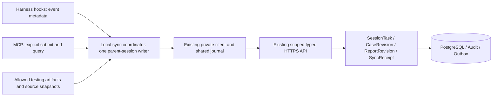

# ADR-020：Hooks 驱动的本地会话任务同步

## 2026-10-23 新增真实矩阵（已通过）

`local-v0.1.0` 已公开，协调器、三宿主 Hooks/MCP、TaskSyncCore Local adapter 与固定摘要安装器已交付；首发仅 `darwin-arm64-py313`。本次直接使用原公开包，无产品 runtime 修改。Claude Code、Codex、DeepSeek harness 的用例、原始报告、真实 headless 与同源跨进程恢复必需矩阵均已独立复核通过。**DeepSeek 恢复仅指新进程的官方持久 Registry API，不是 CLI / SDK wire resume 参数，也未新增通用恢复命令。**

本次 `FAIL` 是管理同步保全 fixture，业务 SUT 为 `NOT_RUN`。Claude / Codex 原始证明中的生成时 `PENDING_INDEPENDENT_REVIEW` 保持不变，后续资格单独记录。精确流程、后端、版本与限制见[新增验收记录](../LOCAL_CASE_REPORT_RESUME_ACCEPTANCE_20261023.md)及[矩阵](../local-acceptance/local-matrix-20261023.json)。原 2026-10-22 R5/R6 证据、0.1.0 tag / 四资产 / manifest 和旧 MCP 发行保持历史身份；PR 合并与生产 Web 部署仍待最终 gate。

## 已公开发行（2026-10-22）

[local-v0.1.0](https://github.com/ZhangLiangchen/hypertest-one/releases/tag/local-v0.1.0) 已于 `2026-10-22T12:08:14Z` 正式公开，固定源码 `874569fa566a137eba77ac4852caa6052cb04a17`；本轮只发布 `darwin-arm64-py313`。三项可信摘要、三宿主六条安装命令和限制见[正式安装入口](../LOCAL_MODE_RELEASE_AND_INSTALLATION.md#已公开的-local-v010)。[公开发行记录](../local-acceptance/local-v0.1.0-publication.json)保留四个资产匿名 HTTP 200 与完整字节摘要核验；公开一键 bootstrap 已在 Mac 新隔离目录完成下载、校验、安装与 Codex 配置复验；新安装的真实 MCP / 自动同步仍未观察，详见该记录。R6 原始宿主证据保持不变。

## 历史：R6 固定源码验收与发行资格（2026-10-22）

三宿主的真实 Local 接入均已完成，本提交固定 Darwin arm64 / CPython 3.13 的正式构建资格。[资格记录](../local-acceptance/darwin-arm64-py313.json)绑定 R6 源码 `7aefe2878ffad4149d7e01bc18df69a6f090b0a6`、Local source digest `a5db7a7cc5058bd5fc9162c056f2b8d93c41bf18d6975879a334bbc611d56d8a` 和实装候选 wheel SHA-256 `dd88a810e43eea70bf669f7c3fde2929d77e7035b6cdf87a48c735951e47ac40`。验收与公开资产发布分别记载；实际下载命令由固定资产生成并通过受信任的 [GitHub Release](https://github.com/ZhangLiangchen/hypertest-one/releases) 分发，资产尚未出现时不使用占位 URL。

| 精确目标上的宿主 | 实际通过范围 | 限制 |
| --- | --- | --- |
| Claude Code `2.1.218` | [原生证据](../local-acceptance/claude-code-native-20261022.json)：真实 SessionStart、批准 analysis.md → TEST_PLAN、原生 Hooks 自动同步、实际 MCP GET、Agent child 无独立 Task | 官方 DeepSeek Anthropic-compatible backend；DRAFT / NOT_RUN |
| Codex CLI `0.144.6` / `gpt-5.6-sol` | [原生证据](../local-acceptance/codex-native-20261022.json)：同一最终父会话自动产物同步与实际 MCP GET completed；固定版本读回和 SHA 一致 | 子代理生命周期 / 404 / 无 child binding 来自另一真实 R6 父会话的独立 probe；最终父会话 3 次 spawn PreToolUse 未产生 child，不宣称这些尝试成功；DRAFT / NOT_RUN |
| DeepSeek harness CLI `0.1.5-rc.1`，组件 `0.1.5-rc.2` | [R6 SDK-profile 证据](../local-acceptance/deepseek-native-20261022.json)：官方 JsonRpcLineTransport 双 turn、真实 SessionStart / PostToolUse、自动 ACK 与固定版本全页读回、实际 MCP GET、native registry child 404 | 显式批准策略 IN_PROGRESS / NOT_RUN；Stop 独立 handler 次数、headless / resume 未验收 |

本次实机为 macOS 26.5.1 / arm64 / Python 3.13.3。Linux x86_64 / CPython 3.12 仅有源码回归、固定依赖构建与离线安装证明，保留 CANDIDATE，稳定 tag 不发布该目标；其他 OS / 架构 / Python / 宿主版本未接受。`local-v*` 使用独立发行线，旧 `mcp-v*` 内容与适用范围保留。

该次 R6 历史轮次的真实产物范围仅为批准的 analysis.md → TEST_PLAN，另有实际 MCP GET；case / raw report 为 0。用例、报告与 FAIL 保全已有 ASGI / 单元回归，不能扩大为三宿主全部产物类型的原生 E2E。状态来自批准策略；Stop、上传或 ACK 不推导 COMPLETED / PASS。R5 DSH 证明保留为[独立历史](../local-acceptance/deepseek-native-20261022-r5.json)，当前资格来自新的 R6 运行。

[CI #118](https://github.com/ZhangLiangchen/hypertest-one/actions/runs/39770913859) 已通过：后端 1180 passed / 21 skipped，Web 137 passed、typecheck 与 production build。R6 候选另通过隔离远端 168 项 Local / MCP / 旧客户端回归、focused Ruff、固定 29 依赖离线安装与 pip check。最终 evidence / target / 文档提交保持同一 Local source digest，另行执行发行专项与 CI。

后文表格记录决定时的历史状态；当前 Local 资格以上节和[实现记录](../LOCAL_MODE_IMPLEMENTATION_STATUS.md)为准。`artifact_source` 模式显式 MCP 写入要求已有真实 root binding，核对 Project / provider / session / workspace / policy / artifact directory；此为私有来源选择约束，不认证当前调用者，不承诺防止知道 root ID 的本地 actor 冒用。旧路径和 GET-only 原 key 恢复保持。

**Local 源码分支实现增补（2026-10-22）：Local 协调器、TaskSyncCore Local adapter、三宿主入口和统一发行工具已实现源码；真实宿主与发行状态见 LOCAL_MODE_IMPLEMENTATION_STATUS.md 及确切目标验收记录。下文为初始设计原文，其中 NOT IMPLEMENTED 是当时状态，不覆盖本段当前 Local 状态；本分支不包含 Cloud/Memory 的实现。**

**决定时历史状态：Accepted design / NOT IMPLEMENTED。当前实现与原生验收状态见上节（2026-10-22，Asia/Singapore）。**

**决定方：项目负责人接受 Hooks 自动触发、MCP 保留显式操作、二者共用本地同步协调器的设计。**

**范围：Local 客户端触发与编排扩展；沿用 ADR-018，不新增或升级业务 wire / profile。**

**同日发行决定：Hooks、MCP 与共享同步客户端作为统一 Local release，提供一个安装入口，目标宿主为 Claude Code / Codex / DeepSeek harness；决定时发行和安装工具均待实现，当前实现与实机资格见文首，原设计见 §9（2026-10-22，Asia/Singapore）。**

**同日共享同步决定：[ADR-021](ADR-021_SHARED_TASK_SYNC_CORE.md)将这里的可靠同步机制抽为 TaskSyncCore，供 LocalSyncCoordinator + LocalSyncAdapter 与云端 CloudTaskReporter + CloudSyncAdapter 复用；决定时共享组件尚未实现；当前 TaskSyncCore Local 消费方已发行，Local 原 wire / grant 与云端 lease / 权限仍保持独立。**

## 1. 背景与决定

Local 当前依赖 Agent 显式调用 `hypertest_sync_task` / `hypertest_get_task` 保存任务、计划、用例和原始报告。该入口继续保留。自动触发可以减少漏同步，但单次 Hook 只观察宿主事件，不能承担业务状态判断、完整资产合并或可靠交付。

决定增加以下客户端结构：**Hooks 自动触发与 MCP 显式提交 / 查询 → 同一个本地同步协调器 → 现有私有客户端 / journal / typed HTTPS → ADR-018 SessionTask。** Hooks 负责通知同步时机；Agent 或项目已有工具产生获准的领域产物；协调器负责来源映射、去抖、完整基线合并、唯一写入、幂等与读回。Hook 不启动测试、另一个 Agent 或云端执行。

这是 [ADR-018](ADR-018_CODEX_SESSION_TASK_SYNC.md) 的 additive 客户端扩展，不替代其原文或改变 SessionTask 字段、`(provider, session_id)` 唯一性、首次 Project / actor owner、权限、版本及 reported result。Cloud 仍按 ADR-019（独立设计参考，本 Local 源码分支未包含该文档） 的六步流程与官方 Python SDK 实施；CloudTask 与 SessionTask 可共存于同一 Project。

| 能力 | 本决定时的状态 |
| --- | --- |
| Codex 经 MCP / 私有客户端同步 SessionTask | 已有实现，继续保留；原验收 / 部署记录不扩写为新能力证据 |
| 本地同步协调器及 Hook 自动同步 | 设计已接受，尚未实现、安装或验收 |
| Codex Hook adapter | 尚未实现，不因 Codex MCP 已可用而推定存在 |
| Claude Code Hook adapter / provider 与父会话映射 | 尚未实现，需独立契约与真实接入验收 |
| DeepSeek harness 本地父会话 adapter / 事件桥 | 尚未实现；不同于 Cloud 指挥官及其 Codex / Claude 子代理，不宣称已支持原生 Hooks |
| 统一 Local release / 一键安装、doctor、upgrade、uninstall | 设计已接受，尚未实现或发布；不重标已有 `mcp-v0.1.0` |

## 2. 职责、身份与数据流

- **Harness adapter** 按固定版本识别受支持事件、真实父会话来源和来源文件。Hook metadata 是输入，不天然可信；其 session 引用只用于正确关联来源，不是授权、宿主执行证明或能力密钥。
- **LocalSyncCoordinator / LocalSyncAdapter** 对同一父会话的 Hook 与 MCP 写入承担唯一串行责任，使用 TaskSyncCore 复用同步语义，adapter 保留原 SessionTask 完整请求 / 私有客户端契约。协调器登记当前 writer 与本地运行代次，覆盖读取、合并、固定、发送、对账与读回全过程；旧进程不能恢复后继续写。该代次属于客户端运行态，不新增服务端 session / fencing 字段或授权。
- **现有私有客户端** 保管集成授权，复用受保护 IPC、请求 journal、typed HTTPS 和回执校验。不让 Hook 自行创建 token、Operator key、第二套提交账本或直接绕过协调器 POST。
- **平台的 Local 同步链路** 继续核验 integration actor / client / Project grant、固定 owner、expected version、幂等与内容约束；不运行 Hook、Git、SSH、SUT、测试或第二个 Agent。

必须先确定已有受权 Project 和实际父会话来源，再读取 / 建立任务。不得依据路径、仓库名、prompt、展示名猜 Project / session ID，不以 MCP connection ID、子代理 ID 或一次 Hook invocation ID 代替父会话。一真实父会话仍一 Task，resume 复用同一身份；新会话建立自己的 Task 并显式关联旧任务与剩余工作。子代理只贡献父任务的产物，不各建 Task 或取得管理写权限。

首次 actor owner 不变。同 actor 的有效新 client 也须沿用原 Project / task 身份和完整基线；跨客户端或跨机器继续工作需显式移交同一协调责任，不能让两个协调器同时写同一父会话。私有 IPC 的单次调用锁只能保护一个调用，不等于多调用读取—修改—写入互斥；服务端 expected version 仍是最终防旧写边界，不宣称仅靠本地锁实现跨机器 exactly-once。

## 3. 同步意图与完整请求

现有 `hypertest_sync_task` 是完整任务字段提交，**不是 PATCH**。任务标量会被替换，用例与报告按稳定 key 保留 / 追加修订。仅携一个状态、将缺失计划设为空串，或让默认 `NOT_RUN` 覆盖既有 FAIL，都可能损坏最新投影；Hook 不能把事件 JSON 直接填成同步请求。

局部 Hook 意图按字段 presence 和明确修改 / 清空声明合并基线，未提供字段继续保留；有意清空不是缺失。现有 MCP 显式完整 snapshot 的语义继续保留，包括明确的空值；不能把所有空值当 unset。已经固定的 MCP 请求必须保持原 payload / key / expected version，不由协调器擅自 rebase、补字段或改请求身份；其恢复仍沿原 journal 查询。完整合并只用于生成尚未固定的新意图，具体两类输入边界见 TMP §47、领域 §52。

协调器必须按顺序执行：

1. 记录允许的事件元数据、父会话映射与待检查资产引用；去重并合并同一会话的 dirty 通知。
2. 在覆盖整次 RMW 的单 writer 归属下，先核对原 journal 是否有未决提交；存在时只对账，不开始后续写。
3. 从服务器完整分页读取固定版本 task / cases / reports。新 Task 需明确不存在且无旧未决写，使用 `expected_version=0`；已有任务核验 Project、provider、父 session、task UUID 与 owner 授权链。
4. 从允许来源取得分析、设计、用例、代码引用、原始报告和明确报告的进度 / 结果，与基线语义合并。保留未改变标量、既有用例 / 报告和失败；事件缺少字段不表示清空。状态和测试结果须有业务来源，不能从工具退出或聊天收尾推导。
5. 比较完整管理内容，自动触发只有实质变化才形成一个新同步意图。无变化通知清除对应 dirty 标记，不发 POST、不制造 task version；既有显式 MCP 完整请求与原 key 语义保留。允许的资产范围不得静默截断或丢原件。
6. 写前固定完整非秘密请求、稳定幂等 key、expected version 和请求 digest；同一意图仅走现有 journal 的唯一提交路径。新意图确实尚未发送时才允许第一次 POST。
7. 核验瘦回执中的原 key、Project / provider / session、task UUID、契约与 `expected_version+1`。失答或身份不匹配进入同步 UNKNOWN，保留原意图，只 GET 原 key。
8. 取得匹配 ACCEPTED 回执后，按该接受版本完整分页读回，重组并核对 task / cases / reports 和原始正文，才将对应意图标为 synced。journal 的 ACK 仅表示传输接受，不等于产物读回完成；后到事件保持 dirty，下一轮重新读基线。

版本冲突须显式读取当前基线并重新评估差异。只有已确认原请求被拒绝、无未知提交的新业务意图，才可固定新请求 / key；不能把换 key 当作重发方式，不能静默覆盖其他已接受修订。任务进度、case result 与原报告结果分别保存；诊断后 PASS 不删除旧 FAIL，不把历史报告重提记为本次测试。

## 4. 生命周期事件只是触发信号

| 事件类别 | 可触发的同步动作 | 不能推导的业务结论 |
| --- | --- | --- |
| SessionStart / resume | 恢复父会话映射，先查 journal / 未决 key，再读原 Task 与待提交资产 | 不为每次启动 / compaction 新建 Task，不凭事件授予 Project 权限 |
| PostToolUse / 文件或阶段产物变化 | 仅标记获准资产待检查；去抖后比较基线与领域内容 | 工具成功不等于测试 PASS，失败也不自动覆盖已有报告 |
| Stop / 回答结束 | 请求刷新已完成阶段产物；已有明确业务结果时走相同提交路径 | 不自动设 COMPLETED、CANCELLED 或 PASS |
| SessionEnd / 中断 | 在可用时间内持久化 pending 元数据，尝试有界刷新；下次继续原 key 对账 | 不保证完成网络上传，不将会话结束解释为任务完成 |
| SubagentStart / Stop | 关联父会话的获准贡献引用，等待父协调器汇总 | 不按子会话建 Task，不为每个子代理发平台授权 |

本地 pending / dirty / deferred / readback-needed 是客户端运行态，不是新增 SessionTask status、reported result 或正式测试事实。Hook 是 best-effort：可能重复、乱序、未触发、超时或退出前被终止。事件去重、持久待处理引用和重启恢复不构成 exactly-once 保证；Agent 仍可经 MCP 显式提交 / 查询。

Hook 刷新必须排除同步工具自身事件和协调器生成的临时文件，防止递归触发；处理重复事件时不创建新任务或无变化版本。后台队列只服务同步，不调度测试、不重跑命令、不重启 Harness。同步失败可显示待同步 / UNKNOWN，不回写为测试失败，也不撤销已报告的测试结果。

## 5. Harness 能力核验与官方依据

2026-10-22 核对的官方文档提供以下接入依据；实际实现必须固定安装版本、入口和能力探针，不能由网页能力推断本机配置可用：

- Claude Code 提供 `mcp_tool` Hook。启动时 SessionStart 的 MCP 尚未就绪，相关调用会跳过；SessionEnd 不等待未连接服务。退出 Hook 有时间限制，异步工作可能在非交互会话退出时终止。[官方 MCP Hook](https://code.claude.com/docs/en/hooks#mcp-tool-hook-fields)、[退出事件](https://code.claude.com/docs/en/hooks#sessionend)、[异步限制](https://code.claude.com/docs/en/hooks#run-hooks-in-the-background)
- Codex 提供 command / `mcp_tool` Hook，但 MCP Hook 使用已有连接；SessionStart 可早于连接就绪，SessionEnd 不支持 MCP Hook。父会话与子代理字段需按其事件契约处理，transcript 格式不构成稳定接口。[官方 OpenAI Hooks 文档](https://learn.chatgpt.com/docs/hooks)
- DeepSeek harness 的固定源码 `687f282e8625c6b8d11ff58211a90524be2e4317` 提供 experimental Claude Code / Codex command-hook bridges，事件并非完整同构：Claude bridge 无 SessionEnd，配置只读取一次，其 SubagentStart / Stop 的 `session_id` 属于子会话；Codex bridge 无子代理事件，两者不提供可用于同步全文的 transcript。它们是本地 adapter 的候选触发机制，不证明父会话映射或 HyperTest 接入已通过。必须显式选择本地 profile / home，并核验该宿主实际配置生效 / 重启需求，不套用 Cloud SDK 的配置。[Claude bridge 与限制](https://github.com/deepseek-ai/deepseek-harness/blob/687f282e8625c6b8d11ff58211a90524be2e4317/packages/experimental/hooks-claude-code/README.md#L168-L183)、[Codex bridge 与限制](https://github.com/deepseek-ai/deepseek-harness/blob/687f282e8625c6b8d11ff58211a90524be2e4317/packages/experimental/hooks-codex/README.md#L168-L178)

因此，安装前分别核验事件 / handler 支持、MCP readiness、真实父会话映射、退出与中断时限、配置作用域和私有客户端可用性。支持且服务已就绪时，MCP Hook 可调用已接入同一协调器的入口；启动 / 退出等时机可采用获授权的轻量 command adapter 仅保存本地允许元数据。不能预设所有 Harness 的 SessionStart / SessionEnd 均能稳定调用 MCP，也不把完整业务快照直接塞进 Hook 参数。

配置中仅保存固定可执行入口、非秘密 adapter / Project 引用和能力设置；不写 token、私钥或把它们放进命令参数、URL、stdout。具体 Hook 配置、包安装与 provider mapping 需经后续独立实现 / 验收；本决定不生成可立即执行的安装脚本。

## 6. 持久数据、秘密与故障恢复

本地事件队列 / 去抖记录仅持久化允许的元数据、引用、版本和 digest；不用 Hook 的 raw tool payload、prompt、transcript 或最后一条答复充当领域资产。完整获准请求若为崩溃恢复所需，可保存在与传输 journal 分离的私有领域产物 / 来源快照文件中，校验路径、访问权限、内容 digest 与范围；journal 仍沿 ADR-018 仅保留查询身份和完整请求 digest，不反复复制计划 / 报告。

不上传整聊天、思维链、原始工具载荷、认证资料或任意工作区文件。正文来源必须是明确允许的测试分析、设计、用例、实现引用或原始测试报告；Hook 获得 transcript 路径不授权读取或上传其全文。完整原件不能安全保存或获取时保留 pending 与明确阻塞，不从摘要补造原件。

写前固定请求与 journal，发送前记录发送状态；崩溃后只要不能证实尚未发送，就保守按 SENT / UNKNOWN 对账。原 key 的 PENDING / UNKNOWN / 失答或 NOT_FOUND 均不允许自动重发 POST、更换 key、另建 Task 或签发新凭据。未决意图占用该父会话写入顺序；之后事件仅累积允许的待处理引用，不越过未决写。撤权 / 过期 / owner 不匹配时停止写与受限读取，保留本地允许材料并报告同步阻塞。

使用既有 `task:sync` integration grant，不引入 Operator key、云端执行 scope、Job、Runner、execution binding 或云端资源密钥。本地工具 / SSH / CI 授权继续独立。关闭 Cloud 或其 Worker 故障不影响 Local MCP、协调器对账和历史读取；关闭自动 Hooks 后 MCP 仍经同一同步路径可用，不删除未决意图或已接受历史。

## 7. 备选与取舍

| 方案 | 评价 |
| --- | --- |
| 仅由 Agent 显式调用 MCP | 保留为现有能力与人工恢复入口；自动触发不足，依赖 Agent 记得在各阶段同步 |
| 各 Hook 直接 POST / 直接填 `hypertest_sync_task` | 接线少，但生命周期不是领域状态；缺完整基线会覆盖标量，多 writer、失答与退出恢复难以控制，不采用 |
| Hooks + MCP 共用本地同步协调器 | 采用；增加本地编排与版本适配成本，统一完整合并、幂等和恢复责任，复用现有平台契约 |
| 云端监听 / 接管本地 Agent | 超出 Local 产物同步职责，不采用；不以同步扩展执行与凭据范围 |

## 8. 实施与验收边界

按[本地同步实施计划](../LOCAL_SESSION_SYNC_IMPLEMENTATION_PLAN.md)分阶段交付：L0 三宿主能力 / 契约核验 → L1 通用协调器 → L2 Codex adapter / L3 Claude adapter / L3b DeepSeek harness adapter → L4 故障、统一 release / 安装升级卸载工具、干净机验收与受控发布。L2 / L3 / L3b 分别依赖 L1，可独立推进；接入矩阵逐一记录三宿主的真实身份、MCP 和自动触发结果，不以一项通过覆盖其他宿主。L4 可先验证候选包，但正式宣称三宿主支持须各自通过。这一 Local 计划独立于 Cloud P0–P4；共享 Project 的兼容验收同时覆盖两类任务和各自权限。

L1 将可靠同步整理为 TaskSyncCore + LocalSyncAdapter，供 Cloud P2 / P3 按 ADR-021 复用；共享库的契约变更覆盖两个模式 adapter 回归，Local 不因 Cloud 未发布而等待，Cloud 也不依赖 L4 安装器完成。共享不要求同一进程、全局锁、journal、凭据或发布周期。

验收至少包括同父会话唯一 Task / owner、Project / 子代理映射、Hooks 与 MCP 同时到达、完整标量保留、无变化去重、原 FAIL / 报告保留、原始正文完整分页读回、乱序 / 重复 / 重启、退出前未完成、请求失答后只查原 key、NOT_FOUND 不重发、版本冲突 / 撤权、私有文件和秘密边界、关闭自动触发后显式 MCP 可用，以及 Cloud 停用时 Local 仍可同步。需要真实 Harness 与对应版本记录，文档检查或 fake 事件不足以宣称接入通过。

本次只接受文档设计，不实现或安装 Hook、不启动后台监听 / 上传、不执行测试、不修改全局 Skill 或默认 XBlock 同步流程、不自动同步现有会话。用户当前工作流中“只用现有原生管理工具，不新建 Hook / MCP / Runner / 上传进程”继续有效；未来受控安装与真实验收单独落实，不把设计接受当作运行授权。

服务边界由[技术架构 §46](HYPERTEST_TECHNICAL_ARCHITECTURE.md)拥有；触发和客户端协作由[TMP §47](../protocol/TEST_MISSION_PROTOCOL.md)拥有；客户端运行态与服务端不变量由[领域 §52](../domain/HYPERTEST_DOMAIN_MODEL_AND_STATE_MACHINE.md)拥有。ADR-018 原文、TMP §45 和领域 §50 继续保持其原有契约与历史语义。

## 9. 统一 Local release 与 Agent 自助安装（待实现）

统一包产品名为 **HyperTest Local**，采用独立的未来 `local-vMAJOR.MINOR.PATCH` 发行线。目标体验是用户在所选 Harness 中让 Agent 执行一个安装入口，即可安装 Local 同步所需组件。统一发行采用单一版本与固定完整源码 commit，包含 MCP stdio server、私有客户端及共享 journal、本地协调器、三个宿主 / provider adapter、Hooks / 配置模板、明确允许的 Skills / manifest，以及 installer / doctor / upgrade / uninstall 工具。模型 CLI、云端 Python SDK / runtime、平台服务和凭据不属于该安装包；宿主及其模型登录仍由实际产品提供。

每次发行保存 manifest，固定 bootstrap / payload 摘要和来源校验、完整源码 commit、core / templates / adapters / installer 及依赖来源、MCP wire / journal / 配置兼容要求、支持的 OS / 架构和三宿主能力 / 实测验收矩阵；组件或依赖不分别漂移到 `latest`，相同版本不替换内容，也不混装不同版本组件。checksum 只核对完整性，bootstrap 和后续 payload 的来源信任需由受信发布渠道及预先可信的固定 digest 或签名密钥建立，不能把同源下载的 checksum 当来源认证。旧 `mcp-v0.1.0` 及其安装 / 验收历史不改名、不补写为此统一发行。

一个入口的目标流程如下；详细交互与未来命令契约见[Local 发行与安装设计](../LOCAL_MODE_RELEASE_AND_INSTALLATION.md)，本文不提供假定已发布的 URL 或可执行 CLI：

1. 检测并选择宿主 `claude-code|codex|deepseek-harness`，默认选择一个；这些值仅是安装目标，不是新的 wire provider enum。多宿主也须明确选择，`all` 仅表示三个目标的显式请求集合，不是第四个 host 或 provider；不静默剔除缺失 / 不支持目标，逐项报告 NOT_INSTALLED / UNSUPPORTED / BLOCKED / 就绪等级，部分成功不显示整体 READY，也不据此假定已有 `all` CLI flag。固定发行版本、来源信任与兼容性，说明配置作用域和最小权限。
2. 下载并校验该固定发行，在隔离依赖目录安装核心；验证完整 manifest 后备份原配置，再仅合并所选宿主的 MCP / Hooks / 获准资产配置并原子写入，保留其他 MCP、Hooks 和用户设置。安装操作保留私有非秘密回执，支持中断对账。
3. 绑定已有有效的 Project / integration actor / client 与本地会话选择范围（仅客户端配置，不新增 wire 字段或授权 scope）；无可用授权 profile 时进入私有认证引导或明确等待。安装器不得调用旧使用 Operator key 的 `setup` / 设备配对路径替代 Local task 安装，不自动取得 Operator key、签发或提升 `task:sync`、配对执行设备或取得 Cloud scope。秘密不进入参数、聊天、模板、日志或回执；授权请求失答按原 key 对账，不换身份或补发凭据。
4. 执行版本、配置、权限与只读 doctor，报告是否需宿主 reload / restart，不能强关当前会话；仅在宿主实际加载配置后核验真实父会话、MCP 和触发路径，分级报告 readiness。安装器不伪造会话、不启动模型或 SUT、不创建 CloudTask，不以安装为由上传已有聊天或自动开始业务同步。

一个 Project 绑定可供所选宿主的有效适配使用，不为每个宿主自动发独立全局凭据；复用必须符合现有 grant / client / actor 链，不能承诺不同 provider 必能共享一个 actor。相同真实父会话经过多个入口时仍使用同一协调器锁、提交队列和账本，安装不产生另一个 writer。

DeepSeek harness 在此是**独立 Local 父会话**的安装目标；Cloud SDK 指挥官及其子代理不因此安装 Local adapter 或新建 SessionTask。须先固定和实测其身份来源、MCP、可用触发能力；若对应版本无适用原生 Hooks，可使用合法且验证过的 provider plugin 事件桥，同样只向共享协调器提供允许元数据。桥采用 Claude / Codex 格式不授权将 DeepSeek 父会话冒充对应 provider；父会话映射无法核实则保持受阻，不造 ID 或标记 READY。源码存在也不表示对应包已发布或 HyperTest adapter 已验收。不得扫描聊天代替事件、不绕过 single writer；不兼容或失效时明确显示自动触发不可用，保留显式 MCP，不静默宣称全功能已启用。

安装下载完成、配置已写入、doctor 进程成功、MCP 已连接、Hooks 已启用、首个真实 checkpoint 获得 ACK 并完整读回是不同证据。只有实际版本、授权与宿主能力满足对应检查项时才显示分级 READY；MCP 可用不得显示为自动同步就绪，自动触发就绪也不等于已有业务产物同步通过。首个真实同步仍由主会话发布获准产物，按 §3 / §6 完整读回，不能用安装器模拟事件代替。

重复安装幂等复用既有 client / Project 绑定、回执和账本。升级整体切换兼容组件并核验 journal schema；未决 / UNKNOWN 请求不得清理、改 key 或重发，旧状态无法安全读取时阻塞切换并允许回退。失败回退或禁用 Hooks 保留可用 MCP、原 key、材料和历史。卸载只移除本包所管理的配置项与二进制，保留用户会话目录、项目、原账本及必要私有导出，不覆盖用户后续修改或删除其他集成。安装不静默切换用户全局默认 Skill。

决定时统一发行、安装器及三个宿主自动接入均为 **NOT IMPLEMENTED**；当前已实现并完成文首精确目标验收。本设计不授权当前会话发布 release、下载安装、修改宿主配置、签发授权或启动后台同步；现有 Codex MCP 同步继续独立可用。L0–L4 须分别完成三宿主身份 / MCP / 触发、缺授权、配置重载、重复安装、中断、升级回退和安全卸载的真实验收，当前 `local-v0.1.0` 的固定目标已公开，项目安装命令依据独立发行记录中的版本 / hash 生成；未发布目标仍不得生成可安装入口，命令不得含秘密。

## 10. 本地同步设计复用于云端

按 [ADR-021](ADR-021_SHARED_TASK_SYNC_CORE.md)，Local 将 TaskSyncCore 的固定兼容版本随统一 release 交付；Cloud 在自身镜像 / Worker manifest 内固定同源库和 CloudSyncAdapter，不安装用户终端 Local bootstrap 或共享其 token。两种模式分别保留 Task 身份、作用域、持久账本与读回规则，关闭任一模式不阻断另一模式。

TaskSyncCore 共享结构化进度 / 产物清单、完整请求整理、语义差异、稳定 key / version、回执校验、UNKNOWN 对账与接受版本完整读回。局部意图合并仍以本 ADR §3 的完整基线和字段 presence 为准；原 MCP 完整请求 / 空值 / 冻结 key 语义不变。云端由 CloudTaskReporter 经当前 fenced Worker 使用 Cloud typed operations 保存领域进度与产物，不走 Local SessionTask API，不把本地运行代次升级为服务端 lease。

共享的是可靠交付机制，SDK / Hook 的活动观察不等于领域进度、任务完成或测试结果；两种模式都只提交明确允许的领域产物，不上传聊天、CoT、raw tool payload 或秘密。共享架构见技术架构 §47，协作契约见 TMP §48，私有运行态 / 不变量见领域 §53；均为待实现设计。

Codex 的项目 Hook trust、MCP 读工具许可和宿主重载由其标准权限流程分别处理。安装器合并配置后，需让实际项目重新加载配置并确认受信任 Hook；`hypertest_get_task` 还须具有标准读工具许可。验收中的读许可通过该工具专属 `approval_mode=approve` 的单次 CLI overlay 显式给予；沙箱与持久用户配置保持原值，其他全局 MCP 仅在本次 CLI 运行中停用。安装成功、一次独立 GET 成功或诊断调用通过均不替代同一真实父会话的自动产物 ACK / 固定版本完整读回及 child 边界证明。此前缺少原始错误的失败运行保留为失败记录，不追认根因。
