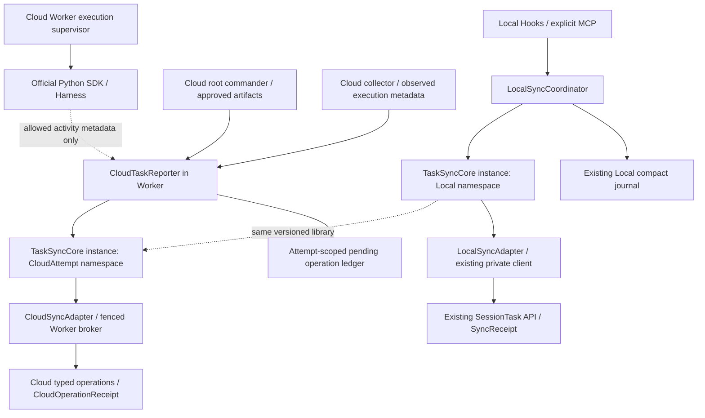

# ADR-021：本地与云端复用任务同步核心

**Local 源码分支实现增补（2026-10-22）：Local 协调器、TaskSyncCore Local adapter、三宿主入口和统一发行工具已实现源码；真实宿主与发行状态见 LOCAL_MODE_IMPLEMENTATION_STATUS.md 及确切目标验收记录。下文为初始设计原文，其中 NOT IMPLEMENTED 是当时状态，不覆盖本段当前 Local 状态；本分支不包含 Cloud/Memory 的实现。**

**状态：Accepted design；实现状态：NOT IMPLEMENTED（2026-10-22，Asia/Singapore）。**

**决定方：项目负责人确认本地任务的进度 / 产物同步设计应复用于云端任务。**

**范围：复用同步语义与库，不合并产品模式、任务实体、平台权限或执行控制通道。**

## 1. 背景与决定

[ADR-020](ADR-020_HOOK_DRIVEN_LOCAL_SESSION_SYNC.md)为 Local 设计了完整基线合并、单 writer、幂等提交、UNKNOWN 对账和接受版本读回。ADR-019（独立设计参考，本 Local 源码分支未包含该文档）的 Cloud 也需要在运行过程中保存进度、阶段产物与结果，而不能等最终答复再回收。两条路径各自实现上述机制容易形成不同的失答处理、修订保全和完成判断。

决定抽取 **TaskSyncCore**，作为两种模式复用的同步语义与库。Local 使用 **LocalSyncCoordinator + LocalSyncAdapter**，Cloud 使用 Worker 内的 **CloudTaskReporter + CloudSyncAdapter**。两者复用领域意图整理、来源 / 产物清单、语义差异、完整请求固定、操作账本驱动、回执校验、原 key 对账与固定接受版本读回；各 adapter 保留自己所属 profile 的请求、身份、权限、版本与持久化规则。

本决定是设计补充，不建立通用 Task 根实体、跨模式写入 API、服务端同步 daemon 或新授权 scope。不修改 ADR-018 原文、TMP §45、领域 §50；既有 Codex MCP 实现继续独立可用。TaskSyncCore、两个新 adapter 与 CloudTaskReporter 均未实现，不能把原 MCP 的验收记录扩写为这些组件已交付。

## 2. 共享机制与模式边界

| 维度 | Local | Cloud |
| --- | --- | --- |
| 输入与协调器 | Hooks / MCP → LocalSyncCoordinator | 根指挥官领域交付、collector、Worker 观察 → CloudTaskReporter |
| 领域 adapter | LocalSyncAdapter 生成 ADR-018 完整同步请求 | CloudSyncAdapter 生成 cloud profile 的对应 typed operation |
| 平台身份 | 原 Project、真实父 `(provider, session_id)`、SessionTask、固定 actor owner | Project、CloudTask / CloudAttempt、当前 Worker lease / generation |
| 权限与 writer | 原 integration grant / client / `task:sync`；同父会话串行协调 | 限定 Task / Attempt / 用途的短期 `cloud:work`；服务端 fencing |
| 版本与回执 | 原 expected version、SyncReceipt、task / cases / reports 固定版本读回 | 对应操作所属聚合版本、CloudOperationReceipt、接受修订 / Run / Artifact 的受控读回 |
| 存储与原件 | 原 compact journal；允许的私有来源快照；原 Markdown / 引用契约 | Attempt 隔离的持久待提交账本；受控对象上传、领域接受与原件校验分别记录 |
| 执行控制 | 本地 Harness 及另行授权工具链；同步不接管 Agent | Worker → 官方 Python SDK → DeepSeek / 子代理；报告不代替 SDK 执行控制 |

共享的是实现责任与算法，不能将 CloudTask 伪装成 SessionTask、以 Attempt ID 冒充 session ID、复用 Local token 或取消 Cloud 的 lease 检查。Local 锁 / 运行代次不成为服务端 lease；Cloud lease / generation 也不回填进 Local wire。共用 Project 不使二者共用 writer 或凭据。

## 3. 组件与数据流

TaskSyncCore 不持有 Operator key 或数据库访问，不替 adapter 选择 Project、推导身份或签发授权。adapter 在当前合法 owner 上下文中提供基线读取、请求构造与校验、版本规则、持久账本、提交、原回执查询和原件读回能力。通用核心可以拒绝不完整或跨域输入，不能自行回退到另一 profile。

共享库不要求共享物理进程、daemon、全局锁或账本。Local 按原 profile / Project / actor / 父来源隔离，Cloud 按 profile / Project / Task / Attempt 隔离并记录当前运行归属；具体私有记录与恢复约束由领域 §53 拥有。服务端 transactional outbox 仍是各领域接受事务的既有持久机制，不等于客户端的待提交队列；不得以一张泛化 Task 表或全局 journal 替代现有模型。

## 4. 进度、正式产物与同步状态

共同输入采用显式领域 checkpoint / 产物清单：声明本次工作阶段、已完成交付、待处理项、阻塞 / 需要输入、允许的分析 / 设计 / 用例 / 实现 / 报告引用及其来源版本。该清单是适配输入，不是自动新增的 Canonical 实体或统一 wire 字段；两种模式分别映射到自己已有或明确设计的领域操作。

Cloud 的中途业务进度使用现有 **SubmitCloudAssets + `kind=REPORT` 非最终报告修订**，使用每 Attempt 独立的稳定 key，同 Task 内也不跨 Attempt 复用进度 key；完整原文包含阶段 / 里程碑 / 阻塞与已接受产物引用，归属原 Task / Attempt。CloudAttempt 已有 checkpoint 可引用该接受 REPORT revision。无需新增进度操作、profile、enum 或表；保存进度报告不自动改变 Task / Attempt status 或 reported result。最终报告仍通过独立明确的 `final_report_revision` 指定并满足原完成条件，不能把最新进度报告默认当最终报告。

未来 `SubmitCloudAssets` 的可选 **`checkpoint_report_key`** 选择本批正式 REPORT 稳定 key；在同一原 operation key、Task version、lease / generation 接受事务中接受或复用该修订并更新 Attempt 既有 checkpoint，回执与固定接受版本读回同时包含该绑定。省略该字段保留原 checkpoint，不接受任意 ref 或隐式清除；这是 Cloud draft 的操作字段，Local wire 不变。

该绑定只更新 checkpoint 中的业务进度报告引用，保留 WAITING_INPUT / Resume 所需的 SDK 会话、文件、委派和外部操作恢复材料；报告可读回不证明 runtime、SDK 会话或外部进程可以恢复，恢复仍按 ADR-019 重新核验。

必须区分三类信息：

1. **活动观察**：SDK turn / tool / idle、Hook Stop / SessionEnd 和子代理通知，只能触发检查或提供有界、脱敏的活动摘要，不直接变更业务阶段、完成状态或测试结果。
2. **领域进度与产物**：由负责该任务的主 writer 明确提交，携可核对来源与允许原件；按 profile 保存阶段进度、修订、执行记录与 reported result。运行中形成阶段交付即可同步，不等待任务终态；原 FAIL、修订与后续执行持续保留。
3. **同步交付状态**：pending、SENT、UNKNOWN、ACK、readback-needed / synced 等由各客户端运行态表达；不成为任务状态或测试结果。ACK 不是原件读回完成，上传成功不是 PASS，同步失败也不覆盖已报告的 FAIL / PASS。

不得从聊天末句、transcript、原始工具载荷或完整 SDK 事件流抽取 Canonical 状态。产物来源须在允许清单内；不上传聊天、思维链、模型 / Git / SSH 秘密。事件队列与传输 journal 仅保存允许元数据、refs、版本和 digest；恢复所需获准完整请求 / 领域原件放在独立受保护来源存储。来源不足时保留未决并报告阻塞，不静默截断或从摘要补造原文。

Local 保持 ADR-018 的 Markdown / 引用边界，不能因共享 collector 就新增任意二进制上传。Cloud 的受控对象上传、字节 / hash / 大小核验、Artifact 关系接受与领域回执是不同事实，须分别确认；hash 仅证明完整性，不提升结果信任级别。

## 5. 共同交付算法与域适配

1. 由所属模式核验身份、授权与 writer。先恢复本命名空间的未决操作；存在 SENT / UNKNOWN 或未完成接受读回时，阻塞同一汇报顺序中的后续普通 mutation，后来事件只累积允许的待检查引用。该限制不阻止有权控制面的安全取消 / fence；不得借此例外越过未决报告直接完成或重跑。
2. 对尚未固定的新意图，按 adapter 的操作语义完整读取固定版本的必要基线，核对来源和已有修订，再合并明确提供的字段；缺失不表示清空，显式 CLEAR 与已有 MCP 完整请求的空值语义不同。
3. 比较领域内容。自动触发无实质变化不制造业务版本；显式完整请求仍保留原契约。为目标操作形成完整非秘密请求，固定目标、操作、payload、原 key、expected version / 必要运行归属与 digest；不是给所有 Cloud 操作强加 Local 完整任务 snapshot。
4. 使用该模式唯一提交账本。仅能证明从未发送的新请求允许第一次提交；冻结请求不 rebase、不换 key、不替换运行代次重发。回执校验按所属 profile / 操作的身份、接受版本与引用进行，不能将 Local 的 `expected_version+1` 规则泛化为所有聚合。
5. SENT / UNKNOWN / 失答只查询原操作 key，NOT_FOUND 也不授权重发、换 key、新建 Task 或重跑 Harness / 测试。查询继续核验当前读取 / 受权委派关系；原请求无法确认时阻塞该写入顺序。
6. 得到匹配接受回执后，按其固定接受版本完整读取该操作承诺的对象、修订、分页与原文 / 原件，核对完整性再标记 synced。当前版本后来前进不改变本次接受版本；读回失败只继续原读回，不重新提交。冲突只有在确认原请求已被拒绝后，才按新基线和新业务意图重新固定。

Cloud 取消或 lease 失效时，先阻止旧 reporter 新提交，保留冻结意图供合法对账；新 owner 先核对原回执与已接受原件，再在有效新归属下形成后续请求，不修改旧冻结请求的 generation。在途回执、上传和可能已接受产物在取消 / fence 后独立对账，不能因取消而清除 UNKNOWN 或重新提交；安全取消不证明这些动作从未发生。同步问题可阻止完成并按 Cloud 生命周期进入恢复处置，但不能单凭网络错误修改测试结果。外部 CI / SSH / 测试副作用始终按各自原操作身份另行对账，核心不重放执行动作。

## 6. 云端的执行控制与报告分离

官方 Python SDK 继续是 Worker 驱动 DeepSeek Harness 的执行控制通道。CloudTaskReporter 是同一受控 Worker 中的报告组件：接收根指挥官通过允许的领域交付入口 / 工作区 manifest 形成的 checkpoint，结合 collector 的原件核对与 Worker 的执行观察，经 CloudSyncAdapter 和当前 fenced broker 回写平台。该入口须在云端实施时明确限定 schema、路径、大小与 Attempt 归属，不能执行模型提供的任意文件 / URL；本决定不虚构 SDK 已有正式产物上传 API。

子代理向根指挥官交付进度 / 产物，根指挥官统一整理，Worker 是唯一平台提交边界。根与子代理都不获得平台 writer token、数据库访问或 Operator key；模型服务 / Git / 环境权限仍按 ADR-019 独立配置。经过版本核验的 Hook / plugin event 可以辅助触发检查，但 Cloud 不依赖终端 Hook 就绪或退出事件完成网络上传，不以 SDK idle 代替完成清单。

Agent、子代理或 collector 并行产出不意味着多个平台 writer；CloudTaskReporter 依据当前 Attempt 所有权串行固定与提交同一任务的管理操作。最终完成前，领域要求的阶段交付、每次执行结果和原始报告须已接受并可完整读回，委派与外部动作按原 Cloud 完成条件收尾。

## 7. 发行、实施与兼容

HyperTest Local 发行可以携带 TaskSyncCore 的固定兼容版本及 Local adapter；Cloud 镜像 / Worker 以自身受控依赖 manifest 固定同源共享库与 Cloud adapter。两者不需要同一物理安装或强制同步升级，必须记录实际 core / adapter 版本及契约兼容性。Cloud 不安装用户终端 Local bootstrap、不复用本地授权 setup，也不依赖三宿主 Local release 发布后才能实施。

本地 L1 与 Cloud P2 / P3 消费同一共享设计和可复用库：P2 先完成中途 REPORT 的最小接受、checkpoint 绑定与读回，P3 扩展完整产物 / 执行结果。按[本地计划](../LOCAL_SESSION_SYNC_IMPLEMENTATION_PLAN.md)与云端计划（独立设计参考，本 Local 源码分支未包含该文档）分别交付、分别开关与验收。共享组件变更须覆盖两个 adapter 的契约回归；一个模式未安装、停用或故障，不阻断另一模式写入、原 key 对账与历史读取。

| 备选方案 | 取舍 |
| --- | --- |
| 本地 / 云端独立复制同步实现 | 接入快，但重复处理完整合并、失答、修订保全和读回，长期容易漂移，不采用 |
| 统一服务、Task 表、凭据与写 API | 表面接线少，但破坏 SessionTask / CloudAttempt 的身份、权限和生命周期边界，不采用 |
| TaskSyncCore + 模式 adapter | 采用。复用可靠交付责任，保留各域规则；增加 adapter 接口、版本兼容与双模式回归成本 |

待实施验收须覆盖：运行中阶段 checkpoint；Hook / MCP 与云端 collector 重复或乱序触发；部分意图不清空已有字段；原失败保全；失答 / 重启 / NOT_FOUND 只查原 key；ACK 后原固定接受版本完整读回；Cloud 旧租约拒写、取消期间未决上传 / 回执对账；同 Project 两类任务与凭据隔离；任一模式失败不污染另一模式。真实 SDK / Harness 接入与真实原件读回仍需各自证明，文档检查不替代运行验收。

架构组件由[技术架构 §47](HYPERTEST_TECHNICAL_ARCHITECTURE.md)拥有；共享协作语义由[TMP §48](../protocol/TEST_MISSION_PROTOCOL.md)拥有；私有运行态与领域不变量由[领域 §53](../domain/HYPERTEST_DOMAIN_MODEL_AND_STATE_MACHINE.md)拥有。本次不实现、安装、发布、启用后台同步或执行测试；既有管理工具、认证、默认 XBlock 工作流与历史均保持原授权和语义。
