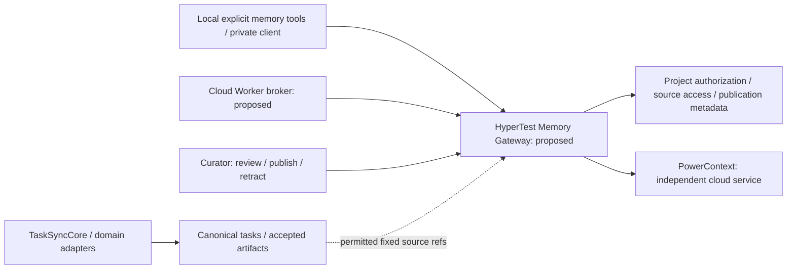

# ADR-022：以 PowerContext 托管跨模式项目经验

**状态：Accepted / 实现于2026-10-23；功能验收由用户负责。** 用户明确要求本轮完成集成。下列实施决定拥有当前接口、权限与目录合同；后文原2026-10-22提案保留为设计历史，其中 Proposed / NOT IMPLEMENTED 不再描述本轮实现。独立服务历史仍见[服务记录](../POWERCONTEXT_SERVICE.md)，最新实现/部署见[集成交付](../POWERCONTEXT_INTEGRATION_DELIVERY_20261023.md)。

## 0. 本轮实施决定

Gateway 是 HyperTest API 角色内的独立可选服务层，不在 API 启动 SDK、Agent 或测试。仅 API Gateway 挂载上游 admin secret；Web BFF 复用既有服务端 Operator 身份，Cloud Worker 使用逐 Project 独立 Memory integration bearer，加当前私有 Worker lease/work proof。Agent 及其 namespace 不持有上述秘密。独立 PowerContext 服务保持1.4.0固定版本，SQLite Basic/FTS，不升级或导入聊天，不调用context/prepare或外部Generation/Embedding。

新增 `memory:read`（仅已发布可见经验）、`memory:propose`（私有候选）、`memory:publish`（管理范围）；CONFIGURE/PUBLISH/REVISE/RETRACT还必须是人工Operator。现grant不自动增scope，`task:sync`/`cloud:work`不授Memory权。源引用按其原模式核验：Local候选须当前owner/BOUND、固定SyncReceipt与确切ReportRevision；Cloud候选须同Project/Task/Attempt、固定Cloud receipt内的asset及当前fenced Worker。Operator可审核，其他actor不可读取私有候选或来源原文；共享投影只给opaque provenance，不附私有task/session/URL/报告内容。

schema `0027_project_memory`仅增加四表：`memory_project_mappings`（Project/服务端namespace/scope/开关/版本）、`memory_entries`（稳定身份、owner、冻结source、当前状态/版本）、`memory_revisions`（不可变内容、适用条件/时效、人工确认/撤回原因、精确upstream ref）、`memory_operations`（独立原key/request/digest/version/state/回执及持久发送意图）。Project、scope与namespace唯一，操作Project/entry有composite FK，revision及接受回执不可改写。扩展integration scope约束不授予旧grant权限；不改Task/Attempt/result/TaskSyncCore表或历史。

Typed HTTPS前缀 `/api/v1/memory`：`POST /operations`接受CONFIGURE、CREATE_CANDIDATE、PUBLISH、REVISE、RETRACT；`GET /operations/by-key?project_id&operation_key`仅原key恢复；`GET /projects/{id}`有界目录、`GET /projects/{id}/configuration?version=N`与`GET /entries/{id}?project_id&version=N`固定接受版本；`POST /query`只接显式query及受控context。请求profile为 `hypertest-project-memory/v1alpha1`，每mutation固定key/expected_version；scope、候选/entry版本独立于Task版本。query≤1000字符、结果≤20；候选正文≤16000字符，发布渲染正文经NFC/strip后≤8192 UTF-8字节以匹配固定上游。

首次CONFIGURE由Operator单次创建独立scope；namespace由Project UUID生成，不信调用者scope。先提交SENT事务后才单次上游POST；网络I/O不持任务/授权锁。候选只保存在Gateway，人工确认的脱敏正文才通过remember传上游。ACK后GET原artifact固定revision并核正文、scope、family、digest后才接受；失答/UNKNOWN只查原Gateway key，再按原ID或marker只读FTS定位及固定GET，不重remember。上游FTS按协议使用只读POST，不是重复写入。未匹配、歧义或NOT_FOUND保留未决。撤回立即从Gateway可见集剔除，旧索引/迟到发布响应不能重新激活；旧修订和upstream原件保留。

检索只返回当前PUBLISHED、未过期、上游精确ref仍匹配的Gateway可见集；旧revision标SUPERSEDED，未发布/待对账/撤回/过期不参加常规召回。不能用空结果推断没有历史。检索前后复核当前权限、Project/映射和Cloud fence；独立故障≤5秒降级，不占任务同步槽。已知服务/Operator/当前请求认证秘密与项目凭据入库/外发前拒绝，错误不回显原HTTP对象或凭据。

Local新增显式 `hypertest_query_memory`、`hypertest_propose_memory`、`hypertest_get_memory_operation`，私有profile显式 `memory_enabled=true`，使用独立memory.sqlite3。查询无需新报告，仍核真实Codex父caller/Task绑定；候选固定来源不放宽。现新写仅已实现Codex可信caller，其他宿主拒绝，原key恢复保留。Cloud使用独立memory-ready/responses及后台broker，query context由Worker注入原claim Task/Attempt/接受版本，不需先产生asset；候选必须引用固定asset。记忆内容是历史参考，不是指令、执行授权或测试事实。旧local-v0.1.0及MCP发行不重标；源码适配不冒称真实宿主或新发行验收。

## 1. 背景与目标

同一 Project 的 CloudTask 与 SessionTask 可由不同 Agent、不同会话协作。任务与原报告已有稳定来源，但跨会话复用排障方法、测试设计经验和工具限制仍依赖手工转述。拟增加可检索的项目经验，使 Cloud Worker 和本地 Agent 经同一受控边界引用历史经验，并保留其适用条件、来源和失效信息。

该能力不扩大测试执行权限，不将聊天或模型自述升级为测试事实，不替换 [ADR-018](ADR-018_CODEX_SESSION_TASK_SYNC.md) 会话同步、[ADR-019](ADR-019_CLOUD_TEST_TASKS_WITH_DEEPSEEK_SDK.md) 云端任务或 [ADR-021](ADR-021_SHARED_TASK_SYNC_CORE.md) TaskSyncCore。

## 2. 拟议决定：三层职责

| 层 | 责任 | 权威边界 |
| --- | --- | --- |
| HyperTest Canonical Testing State | PostgreSQL 中的任务、固定接受修订、原始报告、执行记录与原件引用；保留各 profile 的可信度 | 当前任务 / 授权 / 结果以其原领域契约为准，经验不得改写 |
| TaskSyncCore + 各模式 adapter | 正式进度与产物的冻结提交、原 key 对账和固定接受版本完整读回 | 管可靠交付，不成为记忆数据库或新增跨模式 writer |
| Memory Gateway → PowerContext | Gateway 复核身份、项目权限、发布范围与可读来源；PowerContext 托管获准经验及检索索引 | 历史经验是辅助上下文，不是当前环境、执行或质量结论的证明 |

Gateway 及其发布目录、权限、审计和适配器均 **NOT IMPLEMENTED**。图中目录是拟议集成责任，不声明已有表、MCP tool、HTTP endpoint 或授权 scope；四基础文档中的补充同样保持 Proposed。

## 3. 上游能力与首版限制

固定评估基线为官方 **PowerContext 1.4.0**，commit `cab054dbf6d86e2311b079388e5158178257def2`。SQLite Basic 可以不配置 Generation / Embedding，显式写入经验并使用 `fts` 检索；首版据此关闭外部模型调用，不把 OceanBase 数据库作为部署前提。独立服务的精确构建、配置和真实读写结果由[服务记录](../POWERCONTEXT_SERVICE.md)拥有。

该版本的静态 Bearer 接入将调用者视为同一 `admin`；Scope 是检索 / 数据组织机制，不能当项目授权或多租户隔离。当前独立服务仅面向可信单操作者。后续接入 HyperTest 时，服务端 key 仅由 Gateway 的受保护配置持有，不交给项目用户、根 Agent、子代理或 Local 安装包；Gateway 必须独立鉴权，不能依赖请求者自填 scope。

首版不安装上游自动 memory Hooks，不扫描历史会话。固定版本的 Codex recall Hook 即使 `CAPTURE_PROMPTS=false`，仍会把完整当前 prompt 提交到 `context/prepare`；关闭 capture 不能据此宣称“无 prompt 外发”。仅允许显式、最小化 query 与获准经验正文；未来自动接入需另行审查其实际发送内容，不能沿用这个开关作为数据边界。

## 4. 作用域、授权和协作

- Gateway 从当前有效授权确定 Project，服务端生成 / 校验存储过滤条件；Agent 提供的 Project、task、session 或 namespace 只是待验证输入。首版只查当前获准 Project，不做跨项目召回或自动共享。
- Local 候选绑定 SessionTask UUID、固定接受版本、真实 `(provider, parent_session_id)` 与原 actor owner；Cloud 候选绑定 CloudTask / CloudAttempt UUID、固定资产修订及来源，提交时核验当前 Worker 权限与 lease。来源关联不合并两种任务的 owner 或生命周期。
- 检索、提交候选、确认发布 / 修订、撤回分别授权。既有 `task:sync`、`cloud:work`、同 Project 归属或能调用某个模型，都不自动包含 memory 权限。未来 capability 名称、grant 存储和撤权规则须在集成实施前另行确定；本 ADR 不修改现有 scope 枚举。
- 候选仍受来源 owner 的访问范围约束。经有权人员确认、脱敏并明确发布的正文才进入 Project 共享经验；确认不是模型自评“高置信度”。共享经验不得使其他 actor 取得不可读原报告、秘密或敏感标题 / URL；来源目录和引用解引用分别鉴权。若不能安全提供公开来源引用，返回授权范围内的溯源标识或拒绝发布，不能附送原文。
- 子代理只向真实父任务交候选或查询意图，由 Local 私有客户端或 Cloud Worker broker 提交；不给每个 Agent 新增服务管理员凭据，不为经验另建 SessionTask。查询返回按调用者权限裁剪，不能把原始候选缓存变成项目公共数据。

## 5. 经验内容、版本与失效

拟议经验至少包含：稳定经验身份 / 修订、Project、候选作者与确认者、问题 / 方法 / 反例、适用 SUT / framework / API / 环境版本、观察时间 / 有效期、固定接受任务版本及原报告 / 原件确切 refs、发布范围和被替代 / 撤回原因。模型生成、人工确认、历史观测和本次实际验证须明确区分，hash 仅用于关联与完整性。

拟议维护过程为 **Candidate → Confirmed → Superseded / Expired / Retracted**；这是待评审的记忆维护状态，不是 Task / Attempt / reported result enum，也不宣称上游已有同名状态机。修订追加并保留来源，不覆盖原始失败或报告。环境、代码或框架变化以及反例出现后重新评估适用性；过期默认不参与常规召回，显式历史查询仍须标明状态。撤回立即在 Gateway 的获准可见集排除，不依赖异步索引删除才生效；索引无法证明最新时不得静默返回为当前可用。

“Confirmed”只表示有权人员确认发布，不能证明本次环境仍可用、当前版本已修复或测试通过。Agent 使用前仍读取当前任务 / 授权并重新核验环境与执行事实。经验内容和检索命中均作为不可信历史上下文处理，不能成为高优先级指令、工具授权、命令重放或凭据获取依据。

## 6. 两种模式复用及故障边界

Cloud 通过 Worker broker 接入 Gateway，与 CloudTaskReporter 的任务报告职责分开；Local 未来可在统一 release 内提供可选 Memory Adapter / 显式 MCP 工具，经私有客户端接入同一 Gateway。两者可复用来源选择、脱敏、固定引用和兼容性校验，但 memory 操作使用独立队列 / outbox、操作身份和结果；不复用 SessionTask endpoint、提交 journal 或 Cloud lease 来冒充服务认证。Local release 不安装远端服务，也不包含其 admin token；Cloud 不依赖本地安装包交付。

经验写入只从获准内容和已固定来源生成。不能让 memory 查询 / 写入、索引重建、超时或 UNKNOWN 阻断任务同步、原 key 对账、测试运行或历史读取；记忆失败仅报告该可选能力不可用，不能改测试结果。若索引异步处理，先持久化拟议发布元数据与独立待办，再由专门消费者交付；不要求任务接受事务跨服务提交。

不声称 PowerContext 具有 HyperTest 的幂等回执或 exactly-once。失答时保存实际 operation / memory ID 或上游确实支持的已知业务 key，按固定版本实际查询能力核对原写；查不到、缺少可查询身份或无法确认时保留未决并由有权者处理，不盲目重写、换 key 或重放经验。Gateway 自身的幂等与发布版本机制须独立设计 / 验证，不能借 TaskSyncCore 名称继承保证。

## 7. 部署和取舍

用户选择独立于 HyperTest 平台的云主机，服务独立运行、持久卷 / 配置 / 备份与资源限额分开，不修改 HyperTest PostgreSQL、生产 Compose、认证目录或既有入口。同机原有服务应单独保全；独立服务先按单操作者边界验收。网络可达、health 或一条检索成功都不代表 Gateway / 项目隔离已实现。具体固定版本、网络 / TLS / 密钥、备份恢复和验收以[服务运行记录](../POWERCONTEXT_SERVICE.md)为准，公开文档不收录 token、私钥或不必要的入口细节。

| 方案 | 取舍 |
| --- | --- |
| 各 Agent 直接携 PowerContext admin token | 接入少，但把全局权限分发给多来源；Scope 无法补成项目授权，不采用 |
| 以记忆服务替代任务 / 原件数据库 | 破坏已有版本、归属、证据与回执，不采用 |
| Gateway + 独立可选经验服务 | 拟采用；统一授权、发布 / 失效和来源校验，增加目录 / 适配与运维成本 |
| 首版开启自动全量会话提取与外部模型 | 来源与外发边界难核验，首版关闭；显式经验 + SQLite Basic / fts 先证明闭环 |

分阶段交付见[集成计划](../POWERCONTEXT_INTEGRATION_PLAN.md)：P0 独立服务与真实检索；P1 Gateway 权限 / 数据边界；P2 两模式适配；P3 发布维护与故障验收。P0 的真实结果独立登记，P1–P3 保持 Proposed / NOT IMPLEMENTED，不是现有任务链路的上线依赖。

## 8. 官方固定源码依据

- [静态 Bearer 共享 admin / 无 RBAC](https://github.com/oceanbase/powercontext/blob/cab054dbf6d86e2311b079388e5158178257def2/docs/en/docs/operate/deploy-server.md#L178-L180)；[Scope 不等于授权](https://github.com/oceanbase/powercontext/blob/cab054dbf6d86e2311b079388e5158178257def2/docs/en/docs/workflows/scopes-and-access.md#L8-L20)。多用户需要额外身份与访问控制，不能只用项目 scope。
- [Basic 无需 Generation](https://github.com/oceanbase/powercontext/blob/cab054dbf6d86e2311b079388e5158178257def2/docs/en/docs/get-started/configure-models.md#L17-L25)；[FTS 不要求 Embedding](https://github.com/oceanbase/powercontext/blob/cab054dbf6d86e2311b079388e5158178257def2/docs/en/docs/operate/configuration.md#L564-L567)。是否真实采用这些配置及读写通过仍看服务记录。
- [Codex recall 读取当前 prompt](https://github.com/oceanbase/powercontext/blob/cab054dbf6d86e2311b079388e5158178257def2/integrations/codex/plugins/powercontext/hooks/recall.py#L153-L171)并[提交 context/prepare](https://github.com/oceanbase/powercontext/blob/cab054dbf6d86e2311b079388e5158178257def2/integrations/codex/plugins/powercontext/hooks/recall.py#L230-L247)；[关闭 capture 的分支](https://github.com/oceanbase/powercontext/blob/cab054dbf6d86e2311b079388e5158178257def2/integrations/codex/plugins/powercontext/hooks/recall.py#L197-L198)不关闭上述 recall。自动插件能力不能直接当作已满足 HyperTest 最小化输入与授权的 adapter。
