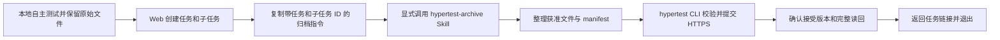

# ADR-027：Local 显式 Skill 与 CLI 后置产物归档

日期：2026-10-27（Asia/Singapore）。状态：**架构方向已接受，产品实现未开始**。

用户决定将 Local 模式改为测试完成后显式归档：移除该模式现有 MCP、Hooks 和常驻同步依赖，新增 HyperTest One CLI 与 `hypertest-archive` Skill。本决定拥有新流程及旧入口退出范围；实施任务见[重构开发计划](../LOCAL_ARCHIVE_REFACTOR_PLAN_20261027.md)。本文中的命令、实体和接口均为待实现目标，不表示现有客户端或服务器已切换。

## 1. 改造原因

当前 Local 安装器注册 `PostToolUse`、`Stop` 等事件；批准产物目录模式会在事件到来时读取文件、计算摘要、进入协调器，并可能读取服务器完整基线后才返回 UNCHANGED。MCP 指引又允许 Agent 在工作过程中主动同步。即使没有新增报告版本，也可能付出进程启动、IPC、文件读取、网络与模型工具调用成本。来源见 [Hook 注册](../../src/hypertest/local_sync/installer.py)、[文件观察](../../src/hypertest/local_sync/sources.py)和[协调器](../../src/hypertest/local_sync/coordinator.py)。此处是源码行为分析，没有端到端耗时测量，不声明具体提速比例。

现有预建、BIND、JOIN、SessionStart、逐调用 caller 与宿主版本耦合，增加首次接入和跨会话归档成本。用户实际需要本地 Agent 自主完成测试，随后把计划、用例、原始报告和真实 reported result 持久保存。归档无需平台在测试期间持续在线，也无需原测试会话在上传时仍存活。

MCP 本身支持读写工具调用和 HTTP 传输，频繁同步来自当前触发策略。采用 CLI 的依据是明确的调用时机、按需进程、确定的文件输入、统一的恢复机制及较少的宿主接入配置，不能把改造理由表述为“MCP 只能 pull”。参见 [MCP Tools](https://modelcontextprotocol.io/specification/2026-07-28/server/tools)与[传输规范](https://modelcontextprotocol.io/specification/2026-07-28/basic/transports)。

## 2. 产品决定与适用边界

1. 新 Local 流程以 **用户显式指令 → Skill → CLI → HTTPS 归档 API** 为唯一正式接入路径；不保留新的 Local MCP 接入选项，不注册任何 SessionStart、PostToolUse、Stop 或子代理事件。
2. 测试开始前无需创建平台 Task、绑定来源、安装 Hook 或保持平台连接。Agent 使用项目既有工具完成测试；首次归档时才需要 CLI、Skill 和有效授权。
3. 用户在 Web 创建或选择 Local 归档任务及子任务，获得明确 ID，再在本地指定产物范围调用 Skill。也允许显式归档阶段性材料；归档不以测试成功为前提。
4. CLI 是可独立使用的短命进程，无 daemon、定时任务、后台监听或自动刷新。Skill 只在明确归档请求中加载完整指引和执行 CLI。
5. 新 profile 为 `local-artifact-archive/v1alpha1`。新增 Local 专用归档实体，沿用 Project；不共用 CloudTask/CloudAttempt，不新增跨 Local/Cloud 的通用 Task 根表。
6. Local 的产品职责为测试资产归档、查询与汇总，测试仍由本地 Agent 和项目工具完成。Cloud 执行能力、Memory 独立权限及旧执行领域保持各自边界。

本决定替代 ADR-020 在**新 Local 接入流程**中的自动 Hooks/MCP 默认方案，以及 ADR-024/026 在该新归档 profile 中的 native BIND/JOIN 前置条件。旧 SessionTask 记录、绑定、参与关系、回执和历史仍按原合同解释。切换前已部署旧版本继续受旧合同约束；本次文档提交不改变运行行为。

## 3. 用户流程与组件职责



| 组件 | 职责 |
| --- | --- |
| 本地 Agent | 按用户要求完成测试，保存项目原有正式产物；归档时补充清单与结构化映射 |
| `hypertest-archive` Skill | 解释明确上传指令、解析目标 ID 和文件范围、整理 manifest、调用 CLI、解释结果 |
| `hypertest` CLI | 私有配置、HTTPS、文件读取与校验、冻结请求、账本、提交、回执核验、固定版本读回和原 key 恢复 |
| HyperTest One API | 认证及目标授权、父子关系检查、版本约束、原子接受、历史与回执 |
| PC Web | 创建任务/子任务、设置上传授权、复制指令、查看原件/来源/修订、显式汇总 |

每次归档明确指定 Task ID、Subtask ID 和产物路径或清单。关键词只表达用户意图，不进入鉴权协议或成为 CLI 必填字段。任务和子任务 ID 是目标地址，不是凭据。

原会话结束后，用户可以在新会话或终端归档已有文件。归档发生时不补造 SessionStart、caller context、BIND/JOIN 或测试执行记录；尚未留存的原件不能从摘要、对话记忆或散列中恢复。

## 4. 任务与来源模型

领域字段、关系和状态由[领域 §56](../domain/HYPERTEST_DOMAIN_MODEL_AND_STATE_MACHINE.md#56-adr-027-local-显式后置归档目标合同)拥有。

| 新对象 | 职责 |
| --- | --- |
| LocalArchiveTask | 一次业务测试需求，所属 Project、管理创建者、owner_uploader_actor_ref、管理版本、状态及显式汇总 |
| LocalArchiveSubtask | 工作项或归档分组，所属 Task、authorized_uploader_actor_ref、独立版本和 reported result；可按会话默认划分 |
| LocalArchiveSubmission | 一次不可变归档请求、原 key、接受结果与固定版本；同内容提交也有可恢复的回执 |
| LocalArchiveAssetRevision | 子任务内按 kind/stable_key 追加的计划、用例和原始报告修订 |
| LocalArchivePublication | 任务整体汇总，冻结所采用的子任务版本与产物引用 |

子任务 ID 不复用 participant ID、contribution ID 或宿主 session ID。同一子任务可以追加多次提交，同一会话可以为多个业务工作项提供来源材料；来源字符串不承担写入权限或全局唯一约束。

上传者由认证信息确定，Web Operator 创建者与 integration uploader 分开记录。未指定有效 uploader 的 Task 可保存为未授权草稿；首次接受归档后 owner 不可改写。`origin_provider`、`origin_session_ref`、测试发生时间和报告生成时间是可选的逐资产来源声明，平台接受时间由服务器生成。同一批多会话材料分别保留各自来源。UI 分别展示上传者和原测试来源，不将材料声明展示为已核验 native 会话。报告中的 PASS/FAIL/UNKNOWN 原样保留；归档成功与整体测试完成分别表达。

不同子任务的上传使用各自 `expected_subtask_version`；不因兄弟子任务更新而争用任务版本。任务元数据、子任务目录/授权调整和汇总使用 `expected_task_version`。整体汇总在同一事务验证明确的子任务版本向量，之后的新上传不改写旧汇总。

## 5. 授权与可靠交付

新权限为 `archive:read` 与 `archive:write`；CLI 完整归档需同时具备两者。沿用 integration actor/client/Project 的私有授权设施，服务端再核 Task owner、Subtask uploader 和父子关系。首片限定子任务上传 actor 与 Task owner 相同，允许该 actor 在不同会话或客户端归档；跨 actor 协作不在首片。

`task:sync`、`cloud:work` 和 Memory scope 不自动获得归档权限。Web 使用其既有 Operator 管理边界选择上传 actor；CLI 不取得 Operator key，也不自助扩大授权。凭据仅由客户端从私有配置读取，不写入 Skill、manifest、命令参数、日志或响应；私有文件不被宣称为同 UID 进程隔离。

上传仅从显式批准的清单读取文件，文件内容为数据，不能驱动 shell 命令或授权。首片支持 UTF-8 计划/原始文本报告与结构化用例，保留原文和稳定业务 key。接口按条数、字符数及总字节有界，超限明确拒绝，不截断、不隐式分批；截图、视频和压缩包的二进制存储协议独立后续设计，不以本地路径或 URL 引用冒充已上传文件。

每次请求明确 upsert 所选资产的完整内容/结果/来源，省略旧资产不删除；子任务状态/结果只更新明确出现的字段，不将缺省或 null 当作清空。CLI 依据固定基线冻结本次预期合并结果，读回完整接受快照；这属于新归档协议，不改变旧 full sync 的含义。

复用 TaskSyncCore 的冻结、账本、回执和读回机制，通过新的 ArchiveAdapter 接入。请求、文件字节、目标、结果、来源和预期版本在发送前固定；POST 前持久化 SENT。失答、UNKNOWN、NOT_FOUND 只查询原 key，不改正文/版本、不换 key 重发。

幂等 key 绑定 actor、Project、Task、Subtask、profile 与完整请求。当前授权检查后先查原 key，再检查新请求版本；同 key 同输入返回原结果，异输入拒绝。同内容且当前版本匹配的新意图返回 UNCHANGED，仍保存可恢复的 Submission/回执，业务版本和资产修订不增。一次新的测试活动须保留新的来源发生记录或明确资产 key，不能仅按文件 hash 抹掉它。

只有回执字段和固定接受版本的完整内容核对一致，CLI 才返回归档完成。上传传输状态不覆盖 reported result，也不升级 legacy VERIFIED、Verdict 或 RELEASE_READY。

## 6. CLI 与显式 Skill

协议由 [TMP §51](../protocol/TEST_MISSION_PROTOCOL.md#51-adr-027-local-显式归档协议目标合同)拥有。首版公开命令为 `hypertest profile`、`doctor`、`archive`、`status`、`reconcile` 和 `skill install`。`archive` 是一个主动作，不要求用户依次运行多个内部准备命令。`--dry-run` 完成所需校验并预览目标/产物，不提交业务变更；`--json` 返回稳定结构，日志写 stderr 且不含凭据。

拟议调用：

```bash
hypertest archive --profile my-project --task-id TASK_UUID \
  --subtask-id SUBTASK_UUID --manifest ./archive-manifest.json --json
```

Skill 随 CLI 同一受控版本分发，名称为 `hypertest-archive`。在支持显式调用策略的宿主上关闭隐式调用，例如 Codex 的 `allow_implicit_invocation: false`；Web 给出包含显式 Skill 引用、Task ID、Subtask ID 的可复制指令。其他宿主采用各自明确的 Skill 选择方式，未核验的能力不标支持。自然语言“测试完成”本身不自动启动归档，也不推导 PASS。机制依据见 [OpenAI Skills](https://learn.chatgpt.com/docs/build-skills)。

Skill 不监听聊天、修改测试指令、定期读取状态或扫描整个工作区；由用户在归档调用中指定正式产物范围。CLI 结果 UNKNOWN 时引导原请求查询，REJECTED 时报告具体拒绝原因，不启动自动重试循环。用户明确给出的归档指令已经授权该范围提交，不再增加固定二次确认。

CLI 与 Skill 采用独立 `cli-vSEMVER` 发行线及固定来源/资产摘要，新安装只提供归档所需依赖。已有 `local-v*` 和 `mcp-v*` 保留原版本身份；新升级入口识别旧安装并执行受管配置迁移，不把旧 tag 内容替换成 CLI 包。

## 7. MCP 和 Hooks 移除与历史兼容

| 范围 | 目标处置 |
| --- | --- |
| 新 Local 包和安装入口 | 不安装 MCP server、Hooks、native event bridge、daemon/IPC；提供 CLI 和归档 Skill |
| 已有受管宿主配置 | 按安装收据精确移除 HyperTest 自有 MCP 项、Hook 组和插件 bridge；其他服务/配置保持，配置漂移时保留原件并明确指出冲突 |
| 旧接入 Skill 和自动同步提示 | 从新包与默认安装中移除，以显式归档 Skill 替代；精确升级自有文件，保留用户修改的冲突副本 |
| 本地旧进程和状态 | 停止自有同步触发/daemon；保留私有授权、journal、冻结请求、源文件及安装/迁移收据 |
| 旧服务端写入口 | 在新链路可用后的明确切换点关闭新 CREATE/BIND/full-sync/ENABLE/JOIN/CONTRIBUTE/PUBLISH 等 Local 会话写入准入；已接受回执与固定版本读取继续可用 |
| 旧请求恢复 | 新 CLI 提供显式选择旧 profile/账本的只读查询；不重放旧 POST，不合并新旧 namespace，不扫描其他 root 私有账本 |
| 旧业务记录与发行物 | 保留 SessionTask、成员、贡献、报告、回执、失败原件、tag/digest；不自动转换为归档实体，也不重标旧验收 |

切换前在途且已经进入服务端事务的请求按原协议完成接受或拒绝，结果仍可按原 key 查询。已在本地冻结但未决的记录不因卸载或切换被清除；无回执不能推断未执行。无需等待所有历史 UNKNOWN 消失才发布新流程，也不得把它们重发至新归档接口。

“移除”适用于当前 Local Agent 接入产品和其安装/运行依赖；其他插件的 MCP、Cloud 内部工具、独立 Memory 服务和历史执行系统不因名称包含 MCP/Hook 被批量删除。依赖审查后只删除没有兼容读回/恢复消费者的旧实现；共享库不能随入口一起移除。旧读恢复也不要求重新安装 MCP/Hooks。

## 8. 开发顺序与完成条件

1. **领域和 API**：实现新表、独立授权、任务/子任务管理、原子归档、幂等回执、固定版本读取和显式汇总；迁移保持旧表和历史。
2. **CLI**：增加统一入口和 ArchiveAdapter，复用私有配置/账本；提供 JSON、诊断、原 key 恢复及旧账本只读兼容。
3. **Skill 与 PC Web**：实现显式 Skill、任务/子任务创建、复制指令及原件/版本/来源展示，取消新流程中的绑定与 Hook 信任步骤。
4. **退出旧接入和发行**：移除新包 MCP/Hooks/daemon 依赖，完成精确配置迁移、旧写准入退休及独立 CLI 安装发行。
5. **部署与交付**：按仓库测试服务器流程从已推送 Git 构建、非破坏迁移和最小冒烟；代码自测、部署、客户端发行、USER_OWNED 功能验收分别记录。

关键自动化验证集中在本次新增授权/跨目标拒绝、版本冲突、same-key/UNKNOWN、原文与失败历史保全、旧配置精确移除和原 key 只读恢复；普通命令与文案不另建全量宿主矩阵。纯方案文档只做文档静态检查，不触发服务部署或业务验收。

交付完成应同时满足：新 Local 测试过程中无 HyperTest 自动同步；可在测试结束后以任务/子任务 ID 显式归档；CLI 与 Skill 可独立安装使用；旧自有 MCP/Hooks 配置可安全移除；历史与未决原请求仍可读回；官方新入口不再引导用户启用旧同步。
