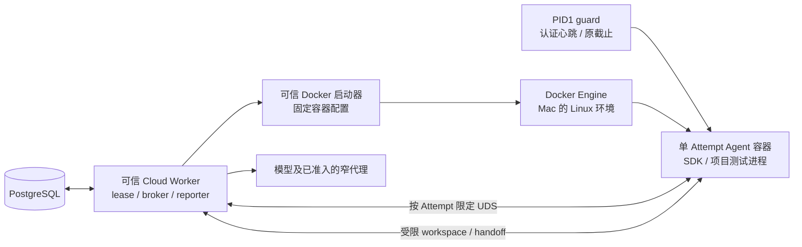

# ADR-029 草案：单次 Cloud Attempt 的 Docker 隔离

**状态：提案，未实现、未准入、未部署。** 日期：2026-10-29（Asia/Singapore）。本稿为本机 Docker 路径的设计候选，不改变现行合同，也不表示诊断、模型、框架或业务验收通过。若采纳并实现，须在同一变更中按实际字段与状态更新领域模型、测试任务协议和技术架构；本文不抢占它们的规范所有权。

## 背景和目标

当前测试服务器是本 Mac，平台以 OrbStack Docker Compose 运行。[本轮记录](../CLOUD_WORKER_FIRST_SLICE_20261029.md)中，默认非特权容器内的 bubblewrap 无法创建完整 namespace：隔离中的 `/proc` 挂载被拒绝。放开外层 `/proc` 遮蔽虽可越过该点，却使外层只读系统路径变可写，未证明等价防护，不可作为上线方式。当前无可领取任务的 Cloud Worker。

[ADR-019](ADR-019_CLOUD_TEST_TASKS_WITH_DEEPSEEK_SDK.md)要求 Attempt 独立隔离，但不把机制绑定为 Linux namespace；其他机制须独立验证工作区、凭据、网络、资源、停止和清理。本提案考虑由 Docker 自身的容器边界承载单个 Attempt，避免在默认容器内再创建 bubblewrap。CloudTask / CloudAttempt、租约、fencing、冻结输入、预算、官方 DeepSeek Harness SDK、受控 broker、handoff 和 TaskSyncCore 报告继续复用；Agent 仍调用项目现有框架，不建设通用 Runner 或新的测试引擎。

本提案不提供 XBlock 的认证写入、签名、浏览器、通用网络或 SSH 能力；受控 HTTPS V1 仍只允许批准的公开只读资源。XBlock staging 的 SSH / 服务器操作与 166dev 的 Local-only 路由不变。Git SHA 不证明 staging 的实际部署版本。

## 候选边界

Worker 是可信控制面：拥有必要的 DB / `cloud:work`、项目密钥解封及模型 broker 能力，Agent 容器没有这些能力。Docker API/socket 不挂载给 Agent、子代理或框架，也不出现在其环境、文件、workspace 或工具输入中。持 Docker socket 的组件相当于对 Docker 宿主有高度控制权；这是本方案的新增信任与风险，不能因 Agent 容器未挂 socket 就忽略。受信 Worker 或其限域代理仅使用固定镜像和封闭的创建、查询、启动及 attach 请求；不向 Agent 暴露 Docker API、可选命令、挂载或网络参数。若不能阻止 Agent 接触 socket 或控制入口，方案拒绝准入。

Worker 不在 Agent 容器内。候选以固定、不可转储的容器 PID1 guard 执行原墙钟截止并验证 Worker 的有界认证心跳；Worker 崩溃、控制流 EOF、心跳过期或认证失败时，guard 退出并使私有 PID namespace 内的后代终止。密钥不进入 SDK、环境或日志；Agent 不得获得 Docker socket。原截止不随心跳延长。现有合成探针验证了这些机制，尚未与真实 Worker 接线；Compose `restart`、Worker 进程内定时器或仅靠 RLIMIT CPU 时间不能单独保证墙钟硬截止。Docker daemon、主机或控制流异常导致停止无法确认时，标记 UNKNOWN / `RECOVERY_REQUIRED`，禁止后续新执行，不把“发出停止请求”当作已停止。节点完全不可用时无法保证远端进程物理停止；网络和模型代理的失效边界仍须分别核对。

## 每个 Attempt 的可见范围

Agent 使用可信、不可变摘要固定的执行镜像和镜像内固定 SDK driver；不从容器参数或 Agent 文本选择另一镜像或入口。配置以默认 Docker seccomp、非 root UID/GID、`cap-drop ALL`、`no-new-privileges`、只读根、私有 PID/IPC、`network=none`、受限 `/tmp`、`/dev` 和默认 `/proc` 遮蔽为起点；不使用 privileged、宿主网络/PID、增加 capabilities、`seccomp=unconfined` 或放开宿主系统路径。是否足以运行官方 SDK、原生子代理及工具须实际验证，失败即拒绝，不退回普通共享宿主进程。

| Agent 可见对象 | 访问 | 约束 |
| --- | --- | --- |
| 固定 SUT checkout | 只读 | 精确冻结 SHA；不挂其上级目录或 Git 凭据 |
| 固定 framework checkout 与 handoff 目录 | 可写 | 属于当前 Attempt；collector 仍核验相对路径、类型、原件和引用 |
| 当前 Attempt 的 `dsh_home` | 可写 | 独立于其他 Attempt、Worker 与用户个人 HOME；不得作为恢复成功的证据 |
| 模型 broker UDS | 仅该 Attempt | 唯一窄协议、任务作用域和请求额度；socket 不提供通用网络或平台写入 |
| 已显式获准的其他 broker UDS | 分别限域 | 默认不挂；只提供各自已实现 profile，不能借 socket 扩权 |
| 临时目录 | 有界、私有 | 仅 SDK 确需的可执行临时范围；不能改变宿主系统路径 |

不得挂载宿主 HOME、Docker socket、DB socket/凭据、Operator key、模型真实 key、Git token、服务包装密钥、其他 Attempt 工作区或私有报告账本。真实 Provider key 留在 Worker 的模型 broker；Git 凭据只在受限源码准备阶段由可信侧使用。父子 Agent 不获得平台 writer token；accepted assets / Run / report 仍只由当前 fenced Worker 经原 typed operation 提交。

仅挂上述明列的 Linux 卷或路径。Docker named volume 的子路径、嵌套只读挂载、Unix socket 可见性和容器间 uid/gid 对应关系均需在实际 OrbStack 引擎验证；Mac 文件系统 bind mount 的路径权限、UID 映射及 UDS 语义不能凭 Linux 主机历史结果推定。若无法让 framework 可写而 SUT 和私有账本不可写/不可见，不得放宽为挂整个 runtime 目录。agent stdin/stdout 使用受控有界通道；日志配置不得将原始对话、工具负载或密钥落到 Docker 默认日志。容器退出后，原 workspace、handoff、账本和可追溯原件按现行合同处理，不以自动删除容器等同删除资产。

## 创建、停止与原身份恢复

1. Worker 先完成固定输入、当前权限和准备时间 hold；启动器仅接受经审核的固定 spec。创建之前持久保存 Project / Task / Attempt、当前 generation、一次性容器名/nonce、预期镜像摘要、资源上限和 spec digest，使用独立原操作 key。申请身份或 spec 不由 Agent 提供。
2. 发送 Docker create 后必须保存并核对实际完整 container ID 与名称、镜像、标签和 spec；再持久化 start 意图，才能对该 **原 ID** 启动并写入 SDK prompt intent。丢 create/start 回执时只查询原名称/原 ID 与原 intent；名称、标签或 digest 不匹配即拒绝。查询不到也不证明未发生，不换名字、key 或 ID 重新创建/启动，不重放 prompt。
3. 启动前固定 guard、原硬截止与心跳身份，控制方按当前 lease/fence 发送有界认证心跳；不得以 Worker 的临时计时器替代 PID1 原截止。恢复时只检查原容器身份及实际状态，无法确认则保留 UNKNOWN 和原预算 hold。
4. 取消、超时、lease 丢失时先 fence 平台 writer、封闭新的代理请求，再关闭原容器控制流；不再允许旧 generation 发起工具动作或提交结果。停止请求 ACK 或连接关闭不是停止观察。受信 Worker / 受限 broker 应查询固定原完整 ID，核对容器 spec 及 Engine 报告 exited、非 running、PID 为 0；在此前验证的私有 PID namespace、固定 PID1 和默认安全配置成立的前提下，按 Linux PID1 退出语义判断该 namespace 后代终止。记录 Engine 观察及 namespace 推断来源，明确没有独立读取宿主 cgroup；缺少必要条件、身份不符或 Engine 不可达则保留 UNKNOWN。
5. Worker 与模型 broker 的 in-flight 请求要单独 drain；SSH / HTTPS / 未来 CI 等外部操作按各自原 ID/key 查询并确认。容器结束不说明远端写操作、链上交易或模型请求已结束。只有满足现有领域收尾条件时才接受完成及同事务预算结算；否则保留 `RECOVERY_REQUIRED`、未决操作与 HELD。

Docker daemon / Worker 重启后的原容器发现、重复名与 ID 不匹配、daemon 不可达、Agent 自退以及硬截止竞争，均须按原记录协调；关闭日志或移除容器之前先保存必要的状态观察。无需自动恢复 SDK 原会话：当前 `supports_resume=false` 保持，未知 prompt 和外部动作不得自动重发。显式新 Attempt 仍须旧 Attempt 合法终结、无未决操作且遵守原任务累计预算。

## 预算、资源与镜像

此前 Worker / broker / Agent 同处一个专属 cgroup；本候选的 Agent 容器与 Worker 可能是 Docker 中的兄弟 cgroup。**不能只检查 Worker cgroup，就声称包含 Agent 的总资源受控。** 启动前必须取得可信引擎对 Worker/broker、独立代理（如有）与各 Agent 范围的真实限制、成员身份及关系，确认它们的并发总 memory + swap 和 PID 上限不超过原允许包络（当前 Cloud 聚合上限为 4 GiB / 256 pids）；每项限制必须有限且可验证。若能由可信共同父 cgroup 直接限制整体，可验证父级包含全部进程；否则需严格核对所有同任务兄弟包络的上限之和与单并发条件。缺失、身份不明或超过上限则拒绝领取 / 启动。2 GiB 或 4 GiB 是策略上限，不应被写成未观察的实际使用量。

业务时间 hold 在 Git 准备前持久化；`RUNNING` 前预留全部 root / 子代理共享请求预算与原截止。模型 broker 在 Agent 外独立计数并在权限/预算/截止失效时封闭。只有观察整个 Agent 容器进程范围已停、所有相关 broker 关闭并 drain、没有未知外部动作时，当前 fenced Worker 才能按原合同结算；未知或人工对账保留 HELD。容器资源限制不是模型预算或外部费用证明。

执行镜像必须从已推送的固定源码构建，部署配置固定实际 image ID / content digest、平台架构、SDK/runtime 与必要依赖；启动器在 create 前和 inspect 后核对实际身份，不使用可变 tag 当作固定身份。环境专用依赖需有可追溯的锁定与供应策略，不能因镜像含 Python 或框架锁文件摘要匹配，就声称依赖闭包可用。仅 SDK wheel 对固定 hash 的校验不自动覆盖所有传递依赖。镜像内不得包含真实凭据或个人会话。

## 验证和实施顺序

以下是本新增隔离机制的最小必要检查，不是每轮开发的固定全量回归：

1. **无模型准入探针。** 使用当前 Docker / OrbStack 和预期 Compose 身份，验证默认防护、真实 SDK 初始化/关闭、精确挂载、UID/GID、UDS 与无一般网络；检查 Agent 无 Docker、Worker 私有账本、DB、model key 或其他 Attempt 文件的读取途径。还须通过官方工具接口验证一个固定的无模型工作区命令，确认 SDK 自身执行工具不再因内部 namespace 依赖而失败；不以关闭 SDK 安全策略或只测进程初始化替代。仅证实这些已观察能力。
2. **失效与拒绝。** 覆盖超限/缺资源、镜像或 spec 不符、UID/卷/UDS 不可用、错误身份、lease 失效、create/start 回执失答、旧 ID 不匹配与 NOT_FOUND；均不得开启替代容器或重发旧 prompt。
3. **停止与预算。** 使用无模型合成进程验证 Worker 被终止后 guard 硬截止、Agent 及后代停止、broker drain 和原容器 Engine 状态观察；分别验证控制流或 daemon 不可达时保留 UNKNOWN / HELD、不接受完成或新 Attempt。核验父级或兄弟 cgroup 合计上限；不把 PID namespace 推断记为独立读取 cgroup。
4. **框架与报告。** 复用专用测试数据库与合成项目，跑一次已有框架的通过/失败路径，验证 handoff、原件与固定版本读回；不将合成结果升级为真实项目验收。真实模型身份、框架依赖、真实 SUT 和用户选定的 staging 场景分别验证。

代码改造应先定义内聚的单 Attempt 执行边界和关闭状态，接入现有 Worker / broker / reporter，而非更换 Task、取消原 key 合同或扩宽网络权限。先完成无模型阻断路径与真实隔离探针，确认 guard 的失联停止和 aggregate 限额可观测，再逐步连接官方 SDK、受控模型身份及项目框架。每阶段的实现、镜像/部署和真实任务结果分别记录；如任一前提不能成立，保持 Cloud 不可执行并继续使用现有受控路径。

## 备选与取舍

| 方案 | 取舍 |
| --- | --- |
| 当前容器中继续 nested bubblewrap | 沿用已实现路径，但当前 Docker 默认隔离实测阻塞；不能以移除 `/proc` 防护替代。 |
| 本候选：每 Attempt 一个 Docker 容器 | 复用现有本机容器环境，减少内层 namespace 依赖；需要可信 Docker 控制、guard 失联停止和兄弟 cgroup 总额验证，尚未完整接线。 |
| 历史专用 Linux systemd RootDirectory | 有旧环境无模型证据，但本 Mac 当前环境未部署该宿主 profile；不能将旧结果当作现场可用性。 |
| 共享普通进程或给 Agent Docker socket | 无法提供所需隔离、停止及凭据边界，拒绝。 |
