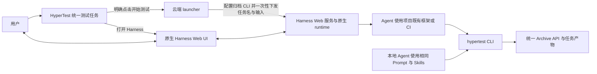

# ADR-042：统一测试任务与归档，云端执行交由 Harness 原生服务

**状态：Accepted design。**

**日期：2026-11-04（Asia/Singapore）。**

**决定者：项目负责人，已确认本文产品与架构边界。**

**交付状态：实现 PENDING；部署 PENDING；USER_OWNED 功能验收 PENDING。**

本文记录已确认的目标设计，不证明代码、数据库、CLI、执行节点或原生 Harness Web 已按本决定改造。本轮仅整理文档；实施、部署身份和用户验收须分别登记。后续实现以[统一测试任务设计](../UNIFIED_TEST_TASK_DESIGN_20261104.md)为具体交接入口。

## 1. 背景

Local 当前已采用用户创建任务、Agent 使用项目自身工具测试、通过 `hypertest` CLI 显式归档的路径。Cloud 则另有 CloudTask/CloudAttempt、Worker 报告代理、handoff 文件、完成协议和平台对话。即使移除了阶段、审批和停止对账 gate，两条路径仍重复实现任务与产物协议，并把会话连接与任务完成耦合在一起。

项目负责人明确：云端与本地采用同一套测试逻辑，差别仅在执行位置及云端的启动配置。计划、执行、工具权限、团队、human in the loop、聊天和恢复均是 Harness 的职责。HyperTest 不需要将其原生能力重新做成表单、消息队列或透明转发。

当前宿主 SDK 会话与原生 Web 并不是同一个可共同写入的运行时。现有路径曾出现会话写锁冲突，并为 Cloud 会话安装原生 Web 只读适配。因此，仅删除 HyperTest 聊天 UI 并保留 SDK 执行，不能保证用户在 Harness Web 中继续交互。新设计需要明确唯一的会话运行所有者。

## 2. 决定

### 2.1 同一个任务、同一份输入、同一种归档

1. Local 与 Cloud 使用同一测试任务模型、创建和编辑契约、任务详情页面、子任务能力与归档 API。执行位置只是本次交付的选择或可编辑的默认偏好，不是不可变任务类型，不再产生两套测试任务业务聚合和产物协议。
2. 用户手动创建并保存任务。**保存只持久化任务，不调用模型、不启动 Harness、不自动下发测试。** 云端仅在用户明确点击“开始测试”后，由 launcher 处理该次启动意图。
3. 任务名和任务输入是两种执行方式共享的输入。MR/PR、测试说明、项目上下文等按统一任务输入契约表达，不因为选择 Cloud 增加另一套测试目标、流程、范围、检出或审批表单。
4. Local 由用户使用本地 Agent/Harness 开展测试；Cloud 在执行节点完成必要的 CLI 配置，并向 Harness 传递同一任务名和任务输入。测试方法、步骤与产物要求采用同一来源的 Prompt 和 Skills。Local 仍允许先完成测试、后手动创建任务上传既有产物；归档不要求重新运行测试或补造平台启动记录。
5. Cloud 任务详情与 Local 使用同一页面，只额外提供“打开 Harness”入口。HyperTest 不展示或维护 Cloud 专属对话、原生问题、审批、运行控制、团队状态、重连表单或 Harness runtime 状态镜像。
6. 启动记录仅用于记录一次下发及其原生 session 关联，不是新的 Cloud 测试任务、测试阶段、任务结果或执行状态机。

### 2.2 CLI 只负责上传产物

Local 和 Cloud 的 Agent 均在生成产物后显式使用同一 `hypertest` CLI、同一归档契约和同一 Archive API。

- CLI 的职责限于读取产物清单明确指定的文件并上传、验证并读回服务端归档回执、按原 key 查询和恢复未确认的归档请求，以及执行这些操作所必需的连接和授权配置。文件范围由用户指令及归档 Skill 明确，不由 CLI 扫描或猜测。
- 每次上传显式携带 Project ID、Task ID；Subtask ID 可选。省略 Subtask ID 时归档到 Task 根空间，不创建默认子任务。
- **CLI 不创建、开始、完成、取消或阻塞 Task/Subtask，不修改它们的业务状态。** 不新增 `complete` 命令、隐藏完成标志或通过报告上传暗中触发状态流转。
- 上传成功、读回完成、文件名含“最终报告”、报告中的 PASS、Harness idle、回合结束和进程退出，均不自动将任务标为 COMPLETED。
- 报告可以保留来源声明、实际执行信息和 `reported_result` 内容；保存这些内容不授予 CLI 任务管理权，也不将来源声明升级为平台独立验证。
- Task/Subtask 的业务状态由统一任务管理能力处理，Local/Cloud 相同。任务管理状态、已归档产物和报告结论分别表达，不能互相推定。

新 Cloud 不再使用 `.hypertest-cloud/ready` handoff、CloudTaskReporter、Worker report collector、`SUBMIT_*` 或 `COMPLETE_ATTEMPT` 等专用产物和完成协议。上传失败属于归档问题，由 CLI 按其原请求恢复；不得因上传失败重跑测试或重发启动请求。

### 2.3 Harness Web 服务是会话的唯一运行所有者

云端任务由用户可直接访问的 Harness Web 服务及其同一原生 runtime 创建、运行和持有会话。会话中的聊天、问题、审批、团队、工具权限、原生队列、暂停、继续和恢复全部在 Harness 中处理。

HyperTest **不保留**以下能力作为透明桥接或备用流程：

- 用户消息、助手消息或原生问题的转发、持久化与重放；
- `on_user_question` callback 代答、原生审批答案转发和平台审批；
- 会话连接、断线恢复、消息投递队列、会话历史投影与实时状态镜像；
- 自动 continuation、会话接管、停止对账，以及依据会话事件驱动任务完成；
- 为观察运行而启动第二个 SDK writer，或让独立 SDK 进程与 Web 服务同时持有同一 session。

任务页的外链只导航到原生服务，不代理认证、不转发 HyperTest Operator/Worker 凭据、不读取原生会话内容。浏览器关闭或 HyperTest 页面断开，不改变 Harness 会话。原生服务的连接和恢复由原生服务负责。

### 2.4 Launcher 只完成一次启动交付

Launcher 是执行节点上的最小启动适配，不是 Harness runtime 或测试调度器。它只负责：

1. 领取用户明确提交的启动意图，核对当前 Project/Task 归属、输入版本及下发身份。
2. 使用执行节点已经配置的 Harness、项目目录、模型身份和工具环境；为当前任务准备统一 CLI 的端点、Project/Task 标识及受限归档授权。
3. 通过实际核验支持的原生 Harness Web 启动接口创建会话、设置任务名并投递任务输入。
4. 保存本次启动回执及 Task 与 Harness instance/session 的关联，以提供原生 UI 入口；确认已接受后结束本次启动工作。

启动意图和回执只回答“这次任务输入是否交付到哪个原生会话”，不回答 Agent 是否已开始工作、测试是否通过或任务是否完成。最小原 key、去重、授权和失答处理仍属于一次启动的可靠交付职责，不延伸为后续消息队列或运行状态同步。

Cloud 自动配置 CLI 不要求用户为每次任务重复配置；但它只能提供明确授权的归档能力。不得把 launcher/Worker 管理身份、数据库凭据或无关项目授权交给 Agent。并发任务不得通过覆盖共享用户 profile 互相改变上传目标。宿主同一用户进程不构成强隔离，文档不能声称文件权限能够限制该用户本已拥有的权限。

### 2.5 Prompt、Skills 与执行环境

测试 Prompt 和 Skills 以现行本地测试工作流为共同来源，Cloud 仅补充任务名、任务输入、归档目标和执行节点上必要的路径。不得维护第二套 Cloud 测试阶段或另一份业务测试规范。

执行节点可以复用已有项目目录；Agent 根据项目规则决定是否创建 worktree、如何检查实际版本、安装依赖和运行测试。HyperTest 不重建测试引擎、不管理 SUT 部署，也不把启动前的源码解析、冻结双仓库、框架入口清单或预期部署版本作为新任务统一流程的额外 gate。用户明确输入的版本约束仍须原样传递；实际检出 SHA、部署版本和执行结果由实际观察的产物记录，不能由任务输入推定。

保留 ADR-040 中“在原生项目目录开展工作、保留已有用户编辑与原始产物位置”的原则；不保留其与旧 Attempt 传输目录、SDK writer 或平台归组桥接绑定的实现要求。

## 3. 当前技术事实与实施前核验

本决定选择 Harness Web runtime 单一所有者；**不假定当前 Python SDK 能 attach 到既有 Web runtime，也不把只读历史页当作可交互会话。** 当前 SDK 执行加原生 Cloud 只读 UI 的路径需要替换。

本机可读的原生包源码曾显示 `session.create` 与 `session.prompt` 能力，但源码版本、当前部署版本和授权接口必须分别核实。尤其是某版本 `create` 对已经开始或被其他 writer 持有的指定 session 会新建另一 session，不能把相同 session ID 当作严格幂等键。

实施首先核验：

1. 当前部署的 Harness Web 是否具有可供 launcher 使用的受限原生启动接口，其 gateway 身份、项目目录和 session 创建权限如何配置。
2. 创建、命名、首次输入的接受回执及原 key 查询能力。失答时应查询原请求；若原生能力不足则记录 UNKNOWN 并停止自动重发，不换 key、不创建替代会话，也不重复初始任务。
3. 被创建的同一会话是否由该 Web runtime 持有，用户能否在原生 UI 中直接处理真实问答和审批，而非只读历史。
4. 受支持的 session 导航方式及认证边界。未核验深链接前不猜 URL；可先提供已配置的原生首页与 session ID。关联中不保存带凭据或短期 bearer token 的导航地址。

若需要补充启动接口适配，其范围只到一次创建、首次投递、回执和关联；不得以此恢复已删除的 HyperTest 对话、问答或 session 管理。不得通过删锁文件、复制 session、后台重放或并行 writer 规避原生约束。

## 4. 对既有决定的定向替代

本 ADR 是对当前统一测试任务与新 Cloud 执行路径的决定，不宣布所有历史 profile、验收结论或独立能力失效。

| 既有决定 | 本 ADR 替代的部分 | 继续适用的部分 |
| --- | --- | --- |
| [ADR-019](ADR-019_CLOUD_TEST_TASKS_WITH_DEEPSEEK_SDK.md) | Cloud/Local 两套任务业务身份、官方 Python SDK 独立运行进程作为当前 Cloud 必经路径、Cloud 专用完成和报告流程 | Project 归属、结果来源真实性，以及未被本 ADR 替代的独立历史 profile 解释 |
| [ADR-021](ADR-021_SHARED_TASK_SYNC_CORE.md) | 通过 Local/Cloud 两个 adapter 保持任务和归档分裂、仅由 Cloud broker 写 Cloud 报告 | 可复用的冻结请求、原 key、回执与读回语义；不要求保留已无用途的旧实现 |
| [ADR-027](ADR-027_EXPLICIT_LOCAL_ARTIFACT_ARCHIVE.md) | 将显式 CLI 归档限定为 Local 专属任务模型，与 Cloud 另建任务和归档协议的边界 | 显式归档、Project/Task 必填、Subtask 可选、真实上传者授权、来源声明、原请求恢复与无隐式后台同步 |
| [ADR-031](ADR-031_CLOUD_NATIVE_HARNESS_CONFIGURATION.md) / [ADR-032](ADR-032_LIGHTWEIGHT_HARNESS_WORKER.md) | 旧 Cloud 启动准备、独立 SDK writer、Worker 报告回传与持续会话管理要求 | 执行环境提供原生 Harness 配置、平台不管理模型推理、最小下发身份和宿主隔离事实 |
| [ADR-038](ADR-038_TASK_FOCUSED_CLOUD_INPUTS.md) | Cloud 专属任务输入/创建合同、旧 START_TASK 自动准备与冻结双仓库等前置流程 | 项目维护仓库上下文、用户输入不被补造、SUT 部署不由 HyperTest 管理、输入版本不等于实际测试版本 |
| ADR-039 / ADR-041 | HyperTest 作为对话外壳，以及原生问题转发、平台消息队列、离线重连和会话历史持久化 | Harness 拥有测试执行、工具、团队与审批的职责原则 |
| ADR-040 | 与旧 Cloud Attempt、传输目录、独立 SDK 会话及平台桥接绑定的要求 | 使用原生项目目录开展工作，保留用户编辑与产物原始位置 |

实施时同步调整四份基础文档中的相应规范，不让旧 Cloud 专用规则继续约束新统一路径。独立 Native、历史 Runner/Gate、CLI 发行历史和其他未涉及能力按各自决定解释，不能借本 ADR 改写历史结果。

## 5. 数据承接与移除范围

1. 现行 Local 任务是统一任务的承接基础。保留其 Task/Subtask 身份、Project 归属、产物、修订、上传者、授权关系和原回执身份；不得通过新建任务再复制结果伪造迁移。具体表名、外键及 API 转换在实施设计中明确。
2. 被新设计替代且不兼容的旧 Cloud 任务、Attempt、报告、handoff、对话、问答、恢复和相关专用账本，可按 [ADR-028](ADR-028_PROTOTYPE_LEGACY_REMOVAL.md) 定向删除，不要求新增兼容端点或恢复演练。必须先列出实际关联对象和清理范围。
3. 删除旧 Cloud 数据不代表旧模型、测试、网络或外部业务操作未发生。未知操作不得自动重发，不得据此构造成功历史或替代任务。旧活跃 writer 的退出和新运行所有者的启用按实际原生能力处理，不能通过删 session 锁规避。
4. 本决定不授权清空数据库、删除数据卷、无关项目、现行 Local 数据、用户源文件、凭据、WireGuard/TLS/BFF 配置、其他服务或无关的原生 Harness 会话。不得为统一模型连带清除这些对象。
5. Memory 保持独立。其服务、Project 映射、权限、知识记录和发布职责不由新 CLI 归档权限或 launcher 启动身份代替，也不因移除 Cloud 对话和旧 broker 而连带停用或清空。

## 6. 方案比较与取舍

| 方案 | 取舍 |
| --- | --- |
| 保留 Cloud 专用任务和 handoff，仅删除审批页面 | 改动较小，但仍要求 Agent 学习两套归档/完成协议，无法达到统一流程目标，不采用 |
| 统一归档，但由 HyperTest 继续转发 Harness 对话和 HITL | 仍需维护消息、问题、重连与 session 状态；与用户确认的产品边界冲突，不采用 |
| 统一任务与 CLI，原生 Harness Web 唯一运行会话 | 采用；HyperTest 聚焦任务和产物，原生 UI 承担全部执行交互；需要核验并适配一次启动入口 |

收益是减少重复模型、归档协议、前端流程和运行时集成，Local/Cloud 可共享测试工作流。代价是用户在 Harness 中交互，HyperTest 不再提供实时执行视图或统一聊天；原生服务不可用时不能在 HyperTest 内替代操作。用户明确开始后的程序下发仍需一个可靠且受限的原生接口，但该成本被明确限制在首次交付。

## 7. 后果与实施事项

任务业务状态与 Harness 生命周期解耦。用户修改任务状态不会暗中终止或恢复原生会话；用户在 Harness 停止或结束一个回合，也不会自动更改任务状态。归档产物不足、上传失败或未观察到执行结果均如实展示，不能用运行时事件补造结果。

实施按以下顺序推进，并在每步后更新[统一测试任务设计](../UNIFIED_TEST_TASK_DESIGN_20261104.md)与当前 TODO：

1. [ ] 核验当前原生 Web 启动、鉴权、原请求查询、唯一 writer 与会话导航合同，记录支持项和限制。
2. [ ] 更新统一任务/归档规范与四份基础文档；确定现行 Local 数据承接及旧 Cloud 定向清理清单。
3. [ ] 实现统一任务创建、保存、明确开始、任务详情与状态管理；使 Local/Cloud 使用同一页面和 API。
4. [ ] 实现执行节点 CLI 自动配置与最小 launcher，使用共同 Prompt/Skills，仅保存一次启动回执和原生 session 关联。
5. [ ] 移除旧 Cloud handoff、report collector、专用完成协议、对话/问答/恢复及运行时镜像；同步替换原生 Cloud 只读适配和独立 SDK writer 路径。
6. [ ] 完成改动相关的关键自测：保存不启动、重复开始拒绝或原请求返回、归档不能改状态、目标授权隔离、启动与上传 UNKNOWN 不重放、Local 身份和原回执承接。
7. [ ] 按当前测试服务器规则从已推送 Git SHA 部署，记录镜像/迁移/节点版本与最小健康检查；功能验收维持 USER_OWNED，未明确要求时不自行创建验收任务或触发模型/SUT。

本 ADR 的 Accepted 仅表示设计决定已确认。上述事项未完成前，现有实现和部署仍须按现场事实描述，不能把本设计写为已实现、已部署或已通过功能验收。
