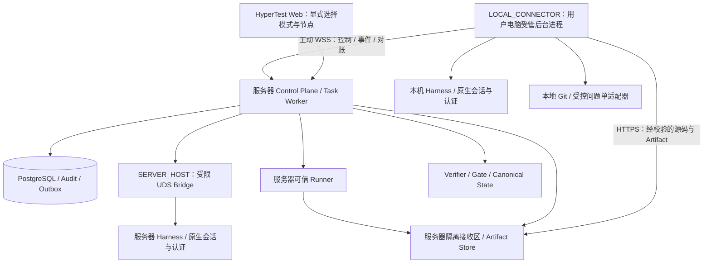
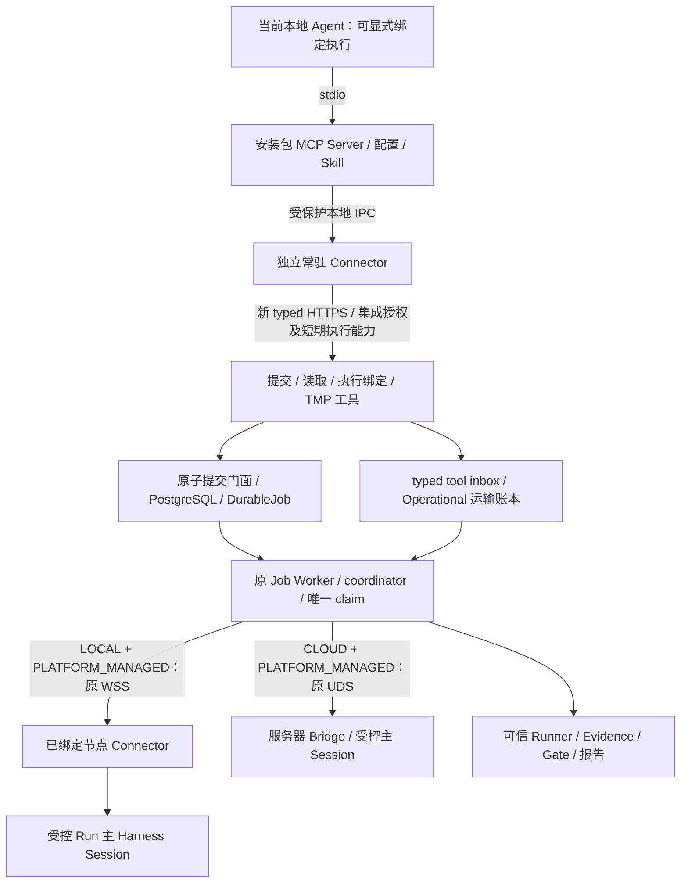

# HyperTest Technical Architecture

**Document Status:** Accepted v0.8 / ADR-018 Session Task Management (2026-10-21, Asia/Singapore). Implementation and acceptance tracked separately; ADR-017 and legacy histories retained below.

**Version:** v0.8

**Parent Document:** HyperTest Whitepaper v1.6 (v1.4 product responsibility correction retained)

**Architecture Role:** Autonomous Testing Control Plane

### v0.8 当前入口：Codex 会话任务同步（ADR-018 优先）

现阶段 HyperTest 是 Codex 测试任务、用例和报告的管理平台：一个 Codex 会话对应一个 SessionTask，Codex 在项目已有工具链中完成测试并同步产物。平台只校验与保存管理数据，不承担测试执行。

当前链路为 **Codex → MCP/私有客户端 → typed API → Project/SessionTask/CaseRevision/ReportRevision/SyncReceipt + Audit/Outbox（PostgreSQL）**。共享既有 Project 与存储，不使用旧 TestRun bootstrap、Job、execution binding、Harness、Runner 或 Gate。查询不接管原生会话；session reference 是同步来源元数据，不要求宿主执行身份核验。

新入口保留 reported result 与原始报告，版本保护和幂等回执保障同步一致性；缺少独立 CI 证明不阻止管理保存、不改写报告结果。正式质量门禁与 legacy VERIFIED Evidence 保持原义。[ADR-018](ADR-018_CODEX_SESSION_TASK_SYNC.md)优先于下文把新入口视为执行材料准入的描述；§43 ADR-017 切片及旧受管模式继续作为独立历史保留。模型与协议分别由领域 §50、TMP §45 拥有。

### v0.7 原生框架接入与兼容范围（ADR-017）

[ADR-017](ADR-017_NATIVE_FRAMEWORK_EVIDENCE_AND_HANDOFF.md)保留历史 `native-framework-intake/v1alpha1` 的材料治理与顺序贡献者交接。该兼容 profile 不增加平台执行引擎，不自动提升材料可信度；当前 Codex 任务、用例及报告管理按 ADR-018 同步，私有执行与验收原件不随产品源码分发。

本轮是 PostgreSQL / Artifact Store 上的独立 native 轮次与 Operator 受控 API / 本机客户端，不改旧 `TestRun`、两种受管 Harness、交互 MCP 或 Runner 历史。下文 v0.3–v0.6 的部署、Job、Session、SourceSnapshot、Runner / OFFICIAL / Evidence 描述是旧 profile 的实现和规范；新 native 边界与最小组件见 §43，字段与请求由领域 §49、TMP §44 拥有。原生 CI 可信来源验证、正式 native PASS、Web/MCP 接入和生产发布不在已完成声明中。

v0.4 由 [ADR-013：平台容器化与持续 Harness 会话](ADR-013_CONTAINERIZED_PLATFORM_AND_PERSISTENT_HARNESS.md) 确立。Run Binding、Host Harness Bridge、持续会话、九个领域工具和受控 GitLab 集成已有实现，新增 `0013_run_bindings` / `0014_harness_operations`；本地实现证据见 [ADR-013 验收记录](../ADR013_ACCEPTANCE.md)。2026-10-19 生产容器切换及真实正反链路已验收：该次源码入口为 `f415fd0`，运行构建来源为 `95e92c5`；PR #10 后已更新至 `828225d` API/Worker/Web，兼容 Bridge 保留 `95e92c5`、schema0014。现有数据和 OAuth 保留，访问策略以运维材料的最新决定为准。完整结果见[正式部署验收](../ADR013_PRODUCTION_DEPLOYMENT.md)；真实 GitLab 提单、其他 Provider 及后续 Web 改进不由该结果推定完成。标注“当前 v0.3”的段落记录当时的兼容路径，不描述当前生产拓扑；部署现状以[服务器运维文档](../SERVER_OPERATIONS.md)与实际验收为准。字段、关系及生命周期以[领域模型](../domain/HYPERTEST_DOMAIN_MODEL_AND_STATE_MACHINE.md)为准，消息与工具契约以 [TMP](../protocol/TEST_MISSION_PROTOCOL.md) 为准。

v0.5 由 [ADR-015：双模式 Harness 与本地 Connector](ADR-015_DUAL_MODE_HARNESS_AND_LOCAL_CONNECTOR.md) 定义：保留服务器 `SERVER_HOST`，增加用户电脑的 `LOCAL_CONNECTOR`，复用本地实际可用的认证，通过受控传输与服务器平台协作。ADR-015 双模式、设备 / 项目授权、WSS 持久 mailbox、HTTPS 源码接收、本地问题单适配与显式恢复已实现，`0015_connector_nodes` → `0018_harness_selection` 已部署生产。核心隔离真实验收已通过，包括本地 Codex → 远端可信 Docker Runner → Evidence / Gate → 报告正反链、私有 Git 经 HTTPS 接受、原会话断线恢复及获准测试 Issue 的创建 / 负责人核验。这些隔离结果不冒称生产结果。生产切换已完成原数据、文件、认证、SSH / VPN 与服务器 Bridge 保全；严格外部 TLS、线上本地 Connector 核心周期和生产私有源码 source-only 接受补验已通过，后者未启动私有业务 Run 或问题单操作，扩展真实设备故障矩阵继续分别登记。该次发布与实际验收范围见 [ADR-015 生产部署记录](../ADR015_PRODUCTION_DEPLOYMENT.md)，隔离历史见 [ADR-015 总验收](../ADR015_ACCEPTANCE.md)，源码统计见[源码验收记录](../ADR015_ACCEPTANCE_SOURCE.md)。现有 `hypertest.tmp/v1alpha2` / `run-persistent-harness/v1` 与 UDS Bridge `hypertest.harness-bridge/v1alpha1` 保持原语义。

v0.6 的 [ADR-016：交互式 Agent MCP 接入](ADR-016_INTERACTIVE_AGENT_MCP_ACCESS.md)接受云端 / 本地 Agent 执行选择：安装包提供 MCP Server 与配置 / Skill，经 stdio → 独立常驻 Connector → 新的 typed HTTPS API 连接平台。本地交互式执行时，当前 Agent 经显式绑定成为任务执行者，获取 Mission、推理 / 实现并提交 Proposal，HyperTest 是其外接测试平台，不再另启一个 Harness 代执行。接入、执行绑定、独立集成授权、原子提交门面与原 Job Worker 工具 inbox 已在本分支实现，新增 `0019` / `0020` additive migration；当前真实 Codex Agent 的隔离核心周期已通过，见 [ADR-016 验收](../ADR016_ACCEPTANCE.md)，已部署生产，线上当前 Agent 核心周期已通过。现有 Node WSS / UDS Bridge 不是新 HTTPS API 的代理，ADR-013 / ADR-015 的生产状态、部署和验收历史继续按上文独立记录。

生产发布为 PR #17 / `c7cd43ad6346d8ce6c85564f7838afbb017f2da4`，正式库已向前升至 `0020_interactive_tool_inbox`；PR / main CI 为967 passed、21 skipped。同一真实当前 Codex Desktop Agent 经官方 MCP SDK console 完成生产核心周期：2 Requirements / 3 Risks / 4 Cases / 4 Implementations，唯一平台可信 Docker Execution 的33项 HTTP 测试通过，五份 VERIFIED Evidence 与两页报告内容均经 MCP 读取并核验 hash / 字节数，形成 FINAL `RELEASE_READY`。真实过期后的两次显式 Worker 恢复保留原 Run / native / workspace，epoch 1 → 2 → 3，旧 Job / Attempt 保留；最终历史保全另经39项只读检查通过。详细身份、时序与保全边界见[ADR-016 生产部署记录](../ADR016_PRODUCTION_DEPLOYMENT.md)及[生产机器证据](../evidence/adr016-production-20261020.json)。隔离验收的27项测试仍属其独立历史；本轮不宣称聊天原生工具目录热加载、运行中断线注入、两种原受管路径的新完整周期、私有 SUT 业务或新增问题单写入通过。

---

## 1. 文档目的

本文定义 HyperTest 的技术架构、模块边界、核心数据模型、运行时状态、部署模型以及与外部 Agent Harness、Test Runner、BUGate Protocol 的关系。

本文重点回答：

1. HyperTest 具体由哪些服务组成；
2. 哪些能力属于 HyperTest，哪些能力交给 Codex / Claude Code；
3. Testing State 如何持久化；
4. Mission 如何产生、执行、验证；
5. 如何接收项目原生执行材料、独立核验来源，以及保留旧 Runner Evidence；
6. 如何支持多 Agent Harness；
7. 系统如何从 MVP 演进为完整 Autonomous Testing System。

---

## 2. 架构目标

HyperTest 不重新实现 Coding Agent，而是建立一个长期稳定的软件测试控制平面，使不同通用 Agent 能围绕统一的 Testing State、Testing Policy、Mission、Evidence 和 Verdict 工作。

核心公式：

> **Agent performs testing work.**<br>
> **Project test tools produce execution results.**<br>
> **HyperTest governs evidence and conclusions.**

旧 Runner 仍在其 legacy profile 中产生可信正式事实；新 native 本机材料的来源尚未验证，不能因产品分层改变就获得相同信任。

系统必须满足：Agent-independent、Model-independent、Stateful、Evidence-driven、Policy-driven、Reproducible、Auditable、Extensible、Human-observable、Agent-native。

---

## 3. 系统边界

### 3.1 HyperTest 负责

Project / Plan / Case / Testing State、Coverage、Task / Mission、责任与权限、Proposal Validation、Canonical State Commit、执行出处与材料接入、来源核验、Finding、Quality Gate、Conclusion / Verdict、Audit / History。原有 Official Test Execution / Runner Controller 作为 legacy 执行路径保留，不扩为新产品通用执行引擎。

### 3.2 Agent Harness 负责

Codex、Claude Code 等可替换 Agent 负责分析、设计、实现、原生框架 / CI 调用、结果分析和诊断，以及自身 Reasoning / Tool Calling / Context / Retry。native profile 通过持久状态与显式贡献者交接维持连续性，同一时刻只允许一个获授权 writer。ADR-013/015/016 的旧 TestRun 仍使用同一个持续主会话并遵守原 Binding / 恢复规则，不因新 profile 修改其身份。

### 3.3 Test Framework 负责

项目已有 pytest、JUnit、Playwright、k6 等框架 / CI 负责测试发现、fixtures、断言与执行语义、环境依赖和原始报告。Agent 调用项目入口；HyperTest 管任务下发、记录和证据治理，不复制框架执行调度。

### 3.4 旧受管 / 交互 profile 的云端 / 本地执行（ADR-016）

产品 `execution_mode=CLOUD|LOCAL` 指 Agent / Harness 在何处完成任务智能工作，与正式 Runner 的位置及信任独立；首版仍使用平台可信 Runner。既有 `SERVER_HOST` / `LOCAL_CONNECTOR` 接入配置继续兼容，另以 Operational `execution_driver=PLATFORM_MANAGED|INTERACTIVE_MCP` 区分谁驱动原生会话，不新增第三种 Harness mode：

| 产品执行选择 | 既有 Harness mode | 执行驱动 | 执行者与路径 |
|---|---|---|---|
| `CLOUD` | `SERVER_HOST` | `PLATFORM_MANAGED` | 平台 Worker 经服务器 UDS Bridge 托管 Harness |
| `LOCAL` | `LOCAL_CONNECTOR` | `PLATFORM_MANAGED` | 保留 ADR-015 路径，平台 Worker 经 WSS 由 Connector 托管本机专属会话 |
| `LOCAL` | `LOCAL_CONNECTOR` | `INTERACTIVE_MCP` | 当前本地 Agent 显式绑定后直接执行，经 MCP / typed HTTPS 与平台协作，不另启模型或 Provider |

组合在请求 / 首次绑定时明确固定，不支持的组合拒绝。旧 payload 缺少新字段时，按原 Harness mode 规范化为原 `PLATFORM_MANAGED` 行为，不回填历史或暗中改为当前聊天执行；新字段不加入 SourceSnapshot 或 Gate hash。每个 Run 仍只有一个逻辑 Worker / 主 Session / 节点 / Workspace 及有效执行 owner。

普通提交与查询不会绑定聊天。`INTERACTIVE_MCP` 必须由可信宿主适配器提供可验证的真实 native Session、节点、受控 Workspace、固定来源和宿主生命周期，并显式把当前 Agent 绑定为 Run 主会话；模型传入的 chat ID、MCP connection ID 或显示名均不足以证明身份。无法提供这些能力的宿主只能提交 / 读取或使用 `CLOUD`，不能冒称本地执行。原聊天文本和思维链不上传为 Canonical State。

---

## 4. 总体逻辑架构

```text
Web / MCP（旧 profile） / 本机 native 管理客户端
                         │ typed API
                         ▼
HyperTest Control Plane：Project / Plan / Case / Task / Records
  Proposal / Verifier / Gate / Evidence governance / History
                         │
          PostgreSQL + Audit / Outbox + Artifact Store
                         ↕ 下发范围 / 贡献 / 材料 / 结论
                   可替换 Agent
                         │ 调用项目已有入口
                         ▼
              SUT 既有测试框架 / 环境 / CI

兼容分支：旧受管 / interactive Run → 既有 Harness / Runner
          只保留原 OFFICIAL / Evidence / Gate / 历史语义
```

本机 native API 是当前最小接入；上图的 Web/MCP 不意味着新 native 工具 / 页面已实现。平台保存材料及验证结论，不插入通用测试执行引擎。

---

## 5. 核心服务划分

v0.6 保留“模块化单体 + 独立 Task Worker”的服务边界。Task Worker 指服务器上的平台任务托管组件，Harness 指实际执行智能工作的 Provider CLI / SDK；两者不是同一个进程。部署边界为：

```text
容器：nginx / hypertest-web / hypertest-api / hypertest-task-worker / postgres
SERVER_HOST：服务器 Host Harness Bridge / Provider CLI 或 SDK / 原生会话与认证
LOCAL_CONNECTOR：用户电脑受管 Connector / Provider CLI 或 SDK / 原生会话与认证
按需容器：可信 Runner 的隔离测试执行容器
持久存储：PostgreSQL volume / Canonical Artifacts / 每 Run 的受控 Workspace
```

Agent Gateway、Planner、Verifier、Gate 与 Runner Controller 首先是平台模块，不要求分别部署服务。未来确有需要的中间件同样容器化；PostgreSQL 队列、本地持久 Artifact Store 已足够作为起点，不把 Redis、Kafka 或 MinIO 设为首版依赖。完整物理拓扑见 §38。

两种 Harness 模式共享服务器侧 Worker、Canonical 数据库、Verifier、Gate 与可信 Runner。Connector 不是平台 Worker，也不是可信 Runner；它不连接数据库、不接受任意远程 shell，不把用户电脑上的探索执行升级为正式 Evidence。

ADR-016 安装包中的 stdio MCP Server 是协议适配层，配置 / Skill 帮助当前 Agent 使用测试平台，不携带平台权威或替代服务端策略。独立常驻 Connector 承担受保护本地 IPC、凭据保管、可信宿主身份映射与新 typed HTTPS 客户端。在 `LOCAL + INTERACTIVE_MCP` 中，平台 coordinator 只维护租约、验证、领域编排和 Runner 调度，不调用第二个 Harness；当前 Agent 承担推理 / 实现并保持唯一执行身份。`CLOUD` 与既有本地 `PLATFORM_MANAGED` 路径继续由原 Worker 托管 Harness。聊天关闭不等于取消已受理 Job，但当前本地 Agent 的智能工作随其宿主停止，Connector 不得代替推理。

---

## 6. hypertest-web

推荐技术栈：Next.js + Ant Design + TanStack Query。

主要页面：Project Overview、Requirement Explorer、Risk Matrix、Test Case Explorer、Coverage Dashboard、Test Run、Mission Activity、Evidence Viewer、Finding Center、Quality Verdict、Agent Activity。

Agent Chat 可以存在，但只能是辅助界面，不能成为产品主界面。

ADR-015 本分支工作台在提交测试任务时明确呈现 Harness 模式、节点、Provider 与可用性。现有默认继续为 `SERVER_HOST`；用户可为本次输入显式选择本地节点；持久默认偏好属于后续 UX，离线节点不得触发自动回退。首次绑定后，模式、节点、主 Session 与 Workspace 固定；更换模式、节点、Provider 或丢失主会话需要新 Run。设备连接状态与测试阶段、人工等待、正式 Verdict 分开展示，重连不显示为任务已恢复。Web / API 已实现明确模式、节点、配对 / 撤销、源码接收和恢复入口；真实浏览器交互与生产启用仍按独立验收登记。

ADR-016 的新执行步骤以“云端执行 / 本地执行”（`CLOUD / LOCAL`）表达 Agent 工作位置；本地还需明确选用旧受管会话或当前 Agent 的 `INTERACTIVE_MCP` 驱动，不能只改文案后仍隐式另启 Harness。选择当前 Agent 时显示待显式绑定、可信宿主能力、原生身份和执行授权状态；未具备能力就拒绝该组合。正式 Runner 仍为平台可信执行，与本地 Agent 选择分别说明；本节新交互尚未实现。

当前 MVP 的 TestRun Workbench 提供 Requirements、Risks、Test Cases、Missions、Automation、Executions、Evidence、Findings、Verdicts。用户通过表单创建 Project / 输入快照 / Run，规划和执行 Mission，启动 Runner、查看证据、管理 Finding、评估 Gate。计数、Risk identification coverage 和 Risk test coverage 来自 Canonical State；每个被评估 Risk 显示 Complete / Gap 以及 required / covered / missing dimensions。没有分母时显示未知，设计覆盖不代表执行或发布验收完成。

这是面向单个可信 Operator 的可操作工作台。当前没有 Login / RBAC / Tenant Isolation，不能宣称多用户生产安全；Agent / Docker / Workspace 是 Operator 管理的主机集成。运行前提、当前能力和后续路线见 `docs/MVP_STATUS.md`。

---

## 7. hypertest-api

推荐：FastAPI + Pydantic + SQLAlchemy + PostgreSQL。

主要职责：Authentication、Project Management、Testing State CRUD、Mission Lifecycle、Policy Access、Evidence Metadata、Finding Lifecycle、Verdict、Audit。

API 不直接执行 Agent。旧 managed / interactive profile 的所有 Agent 工作必须进入原 Run 绑定并取得 Mission / Run scope 授权；native profile 通过 §43 / 领域 §49 的独立 Operator 与私有 writer capability 管理贡献，不伪造旧 Binding。API 容器不安装 Provider CLI、不挂载 Host Harness Bridge socket 或 Docker socket，也不依赖宿主 Provider 认证目录。长任务、受控环境实际镜像查询/绑定、运行能力检查及取消后的外部资源清理，交由具备相应权限的 Task Worker / Runner 组件处理；API 读取其受控结果并按领域规则冻结输入，不能用镜像 tag 或缓存配置冒充实际 image ID。已有同步 direct 执行和宿主检查入口需要迁移，不属于此目标形态的保留接口。

请求校验失败的 HTTP 422 仅返回错误的 `type`、`loc`、`msg`；不回显 `input`、validator `ctx` 或原请求 body，避免把提交中的凭据和 PRD 放入表单错误响应。此约束不等于所有日志已全面脱敏，持久化边界见领域模型 §9。

ADR-016 已新增独立受限的 typed HTTPS API 及应用事务门面，仍位于本控制平面；它不使用现有 operator 全局 key 或 Node WSS / Bridge 管理身份代替集成身份。该接口提供批准输入提交、窄读取、显式执行绑定和有效 Run scope 内的 typed 领域请求；API 只入账 / 查询，原 Job Worker 执行工具和 Runner，不在 API 执行 Docker、Provider 或第二个模型循环。原子提交与授权边界见 §21.1，具体消息和持久化规则以 TMP / 领域模型为准，原有 bootstrap 与创建 Job 的两个 HTTP 请求不因此获得该原子性。

---

## 8. Test State Engine

State Engine 维护 Canonical Testing State。

Canonical State 指经过 Schema、Policy、Consistency 验证，正式成为 HyperTest 系统事实的数据。

Agent Conversation 不属于 Canonical State。

---

## 9. Domain Model

核心实体：

```text
Project
SourceSnapshot
PolicySnapshot
TestRun
Requirement
Risk
TestCase
TestImplementation
TestExecution
Evidence
Finding
Verdict
Mission
MissionAttempt
MissionProposal
AgentSession
RunExecutionBinding  # legacy Operational State，非质量事实链
NativeTestRun / NativeCase / NativeExecutionRecord / NativeMaterial
NativeVerification / NativeConclusion / NativeContributor / NativeHandoff
```

详细字段、关系、生命周期和数据库约束以 `docs/domain/HYPERTEST_DOMAIN_MODEL_AND_STATE_MACHINE.md` 为准。

---

## 10. Legacy SourceSnapshot

一次 TestRun 必须绑定不可变 SourceSnapshot，至少固定 Repository、完整 Commit SHA、PRD Hash、Configuration Hash、Environment Definition。feat / MR 编号、分支名和 URL 是来源参考；正式测试对象始终是创建时解析并固定的精确 SHA，MR 更新后创建新测试任务，不能改写原 Snapshot。

Web bootstrap 物化 PRD 与配置为输入 Artifact。Runtime 在创建 AgentSession / Attempt 前读取并校验这些原始 UTF-8 内容和快照 Hash；配置为空也必须保留其空内容 Artifact，缺失或损坏时停止，不能静默省略。已有 direct API 的 hash-only Snapshot（无 PRD Artifact URI）不因此强制补造配置文件；其配置仍为可选上下文，但一旦存在物化文件必须校验。此兼容范围不更改不可变输入或 Hash，具体规则见领域模型 §9。

Repository origin 的身份不得包含 HTTP(S) userinfo 或可解析 URL 的 password（包括空密码），认证由所选 Harness 节点的受控 Git 集成管理。创建 Project / SourceSnapshot / Run 的输入 Schema 拒绝这些形式，不重写原 URL；无密码 SSH username、scp 形式及本地 origin 保持兼容。Runtime 在注入 Snapshot 上下文前重复校验，历史含凭据 Snapshot 在 AgentSession / Attempt 创建前阻断且不改写历史。此守卫不扫描路径、query 或任意文本中的秘密，也不证明仓库可达。现有本地 origin 兼容不意味着可将用户电脑路径交给服务器解析；跨机器源码必须经过下述接收流程。

### 10.1 本地授权与源码接收（ADR-015 已部署生产，线上核心验收通过）

仅将 CLI 放到用户电脑不能替代服务器源码准备。`LOCAL_CONNECTOR` 中，本地受控 Git 集成依据已批准的 credential-free origin 和完整 SHA 准备独立 pinned checkout，复用 Git credential helper / SSH agent 等实际可用授权；不重置用户 checkout，不上传 dirty / untracked 内容、Git 配置、认证目录或无关 `.env`。上传包只含该固定提交验证所需的 tracked Git 对象及 manifest，避免把无关历史或工作副本一并打包。发现目标 tree 中含秘密时拒绝传输并报告受控原因，不能静默删文件后继续声称仍测试原 SHA。

首版拒绝未支持的 submodule / LFS 与未固定外部下载依赖，待显式对象固定和校验协议后再支持。首版拒绝所有 symlink；未来支持安全链接需另有显式能力。打包和物化均拒绝路径穿越、绝对路径、特殊设备和大小/展开越限，不运行仓库 hooks 或脚本，不通过链接读取本机目录。

源码通过有界 HTTPS 上传进入服务器隔离接收区，WSS 仅传控制消息与内容引用；首版使用精确整包与幂等接受确认，不提供分块续传。测试代码继续通过 typed ImplementationProposal 的 code 接受并生成平台 Artifact，不因该源码通道推定已有通用本地 Artifact 上传 / 下载能力。平台独立校验包与 manifest 的传输 SHA-256，并重新计算 Git commit / tree / blob 哈希、路径与文件 mode，检查目标 SHA、完整性和安全解包；包摘要不能替代 Git 身份校验。远端 origin 绑定也不能仅信任 Agent、普通 manifest 或本地 `.git/config`，必须选定并校验可信来源路径。

项目可以显式授予配对设备中与 Agent 隔离的受控 source-acquisition adapter 来源采集角色。该适配器使用本地 Git 凭据，从批准 origin 获取精确 SHA，并生成设备认证的 acquisition receipt，固定项目、源请求、origin/ref、commit/tree、包摘要、节点与授权策略。平台独立验证 receipt 的设备身份、角色、scope 与输入一致性，再校验 Git 对象链；来源真实性来自对受控采集器的显式信任，不能由哈希或设备配对本身推导。该路径允许私有 Git 凭据继续仅留本机，无须服务器再向同一 Git 服务授权。其他可选路径是平台独立读取 origin，或使用已有可信 origin/commit 约束。未配置任何充分可信来源路径时拒绝接收；receipt 的验真不把 Connector 变成可信 Runner。

验收前的上传记录只属于 Operational staging；平台验收通过后，才允许将受验证源内容固定到不可变 SourceSnapshot 的来源引用。既有 Snapshot 不原地补写或改 SHA；重传相同内容可以复用已验证包，改变输入创建新 Snapshot / Run。服务器 Runner 从平台受控存储物化源码，正式执行前再次校验固定 origin、commit 与 tracked 内容。生成测试继续走 Proposal → Verifier → immutable Artifact，不把本地 Workspace 差异直接当作正式实现或 Evidence。持久化和历史语义以领域模型为准，传输 manifest 与引用契约以 TMP 为准。

原则：

> TestRun 必须能够回答“测试的到底是什么”。

---

## 11. Legacy TestRun

TestRun 是用户可见的一个测试任务：一个 SUT 对应一个长期 Project，一个 feat / MR 的精确 SHA 的一次测试轮次对应一个 TestRun。TestRun 绑定 SourceSnapshot 和 PolicySnapshot，固定 PRD、配置、环境与策略，并拥有 CREATED、ANALYZING、DESIGNING、IMPLEMENTING、EXECUTING、DIAGNOSING、VERIFYING、COMPLETED、BLOCKED、CANCELLED 等运行状态。同一 SHA 可显式创建多个独立测试轮次；禁止以 `(project, SHA)` 唯一约束吞掉复测历史。

每个 Run 具有一个稳定的逻辑 Task Worker 绑定和一个持续主 Harness Session，由领域模型的 Operational `RunExecutionBinding` 表达。逻辑绑定不等于容器 ID、PID 或短期 Job lease；物理进程重启/恢复必须继续原绑定、原会话和原 Workspace，并取得有效 fencing。不同 Run 可以并发，包括同一 Project 下不同 MR、不同 SHA 或显式复测轮次；同一个 Run 内不进行多 Worker fan-out。

PASS / FAIL 不属于 TestRun Status，而属于 Verdict。

---

## 12. Mission

Mission 是 HyperTest 内部最重要的工作单元：

> 为推动 TestRun 从当前 State 向目标 State 转移而创建的 Testing Work Unit。

典型类型：ANALYZE_REQUIREMENTS、ANALYZE_RISKS、DESIGN_TESTS、IMPLEMENT_TESTS、DIAGNOSE_FAILURE、INVESTIGATE_FINDING、VERIFY_COVERAGE。Mission 保留为阶段目标、权限、验收与审计边界；一个持续 Session 可以依次履行多个 Mission，Mission 完成不关闭或另建会话。

---

## 13. Mission State Machine

```text
CREATED
   │
   ▼
READY
   │
   ▼
DISPATCHED
   │
   ▼
RUNNING
   │
   ├──► WAITING_INPUT ──► RUNNING
   ├──► WAITING_EXECUTION ──► RUNNING
   ▼
SUBMITTED
   │
   ▼
VERIFYING
   │
   ├──► RETRYING ──► DISPATCHED
   ▼
COMPLETED

异常：FAILED / CANCELLED / EXPIRED
```

Mission Retry 不覆盖历史 Attempt，而是创建新的 MissionAttempt。v0.4 的新 Attempt 仍使用该 Run 绑定的持续主 Session；会话丢失时明确阻断恢复，不能用新会话冒充原会话。具体恢复和新测试轮次规则以领域模型为准。

---

## 14. Test Planner

v0.4 的 Planner 是确定性的依赖、准入与覆盖守卫，不是驱动模型 reasoning 的外部 Agent Loop。Harness 在同一会话中读取 Canonical State、提出下一阶段意图、提交 Proposal、请求执行并分析反馈；Planner / Mission Compiler 判断该意图是否符合输入、Policy、依赖、覆盖缺口和资源限制，为允许的工作建立不可变 Mission。像“P0 Risk 没有 Case”这样的完整性检查仍由平台确定性组件完成。

平台可拒绝越权、依赖不满足或没有覆盖进展的请求，并把结构化原因返回原会话。平台不为每个阶段重建 Session，不逐条规定 Harness 的思考、工具调用或局部重试。Gate 的正式质量决策也不由 Harness 代写。

### 14.1 v0.4 Run 执行与并发

一个 Run 的逻辑 Task Worker 负责托管该 Run 的同一个主 Session，按序完成分析 → 风险 → 设计 → 实现 → 请求正式执行 → 诊断/修正 → 报告。按冻结 Policy 允许的诊断、补充测试或重执行仍在同一串行周期内；不增加 Run 内并行 Worker。Typed domain tools 把每个阶段的 Mission、Attempt、Proposal、Runner 请求和 Gate 决策保存为平台记录，不把原生 Session 变成 Canonical Store。

平台仍使用 PostgreSQL DurableJob 和 `SKIP LOCKED` 分发工作，但任务领取必须匹配 `RunExecutionBinding` 的逻辑 Worker、主 Session、Harness Host 和 Workspace。每次执行性外部调用和正式提交同时受当前 binding epoch 与有效 Job lease 约束；旧进程、失效 epoch 或迟到结果不得继续调用 Harness、提交 Proposal、启动正式 Runner 或创建 Issue。具体字段、唯一约束和恢复事务以领域模型为准。

WAITING_INPUT 原子持久化问题和等待状态，释放运行 lease、CPU 和 Provider 调用名额，保留逻辑绑定、原生会话与宿主亲和性。用户回答后恢复原会话；阶段内等待还恢复原 Mission / Attempt。物理 Worker 容器或 PID 可以在显式恢复后变化，但必须 fencing 掉旧持有者并继续同一绑定与工作区；不能由任意空闲 Worker 静默换会话接管。租约失效或未知外部结果仍显式中断，不承诺 exactly-once，也不自动重放正式执行或 GitLab 副作用。

阶段内问题沿用 `MissionInputRequest`；阶段边界或 GitLab 策略决策处没有非终态 Mission / Attempt 时，使用 Operational `RunInputRequest`，不重开已经完成的阶段。两种问答都暂停同一 Job / Session / Run 绑定，回答重新排队原 Job，并在原绑定下继续。字段与互斥约束以领域模型为准。

多个 Run 可各自绑定逻辑 Worker 并发推进；同一 Project 不需要全局串行。调度分别限制活跃 Run、宿主 Harness 调用和 Runner 执行数量，避免把 Worker 副本数误认为可安全运行的模型或测试并发数。

### 14.2 当前 v0.3 deterministic controller

以下为既有 bounded controller 的实现记录，供迁移与历史兼容使用；此旧路径不提供 §14.1 的持续会话、自驱域工具与绑定调度，本分支通过独立 persistent profile 实现这些能力：

```text
无 ACTIVE Requirement → ANALYZE_REQUIREMENTS
ACTIVE Requirement 无非 OBSOLETE Risk → ANALYZE_RISKS
非 OBSOLETE Risk 缺少 required test design dimensions → DESIGN_TESTS
所有 Risk 的设计维度满足、Case 无可用实现 → IMPLEMENT_TESTS
Case 已实现、缺少正式执行 → EXECUTION_REQUIRED
正式执行进行中 → EXECUTION_IN_PROGRESS
正式执行失败且有可信证据 → DIAGNOSE_FAILURE
事实可供质量评估 → VERDICT_REQUIRED
```

Planner 返回 Mission 或运行阶段原因；正式执行由 Runner API 发起，Verdict 由独立 Gate API 评估。Planner 调用独立的 `RiskCoverageEvaluator`，不自行使用 LLM 判定覆盖。重复规划复用仍相关的可执行 Mission；后续缺口变化时创建新的不可变 Mission，保留已有 Mission 和 Attempt 历史。Web 的 Run test cycle 提交持久化 Job，由独立 Worker 调用 bounded controller；每个周期默认最多 12 步，上限 32。controller 根据 Planner 决策委派 Mission Runtime、Runner、Gate，不生成 Agent Intelligence 或改写 Canonical 结果。每一步由所属服务验证提交，遇到拒绝、活动中的外部步骤、错误或 work limit 可观察停止，下次从 Canonical State 继续。单步操作也可提交独立 Job；用户不需要保持 HTTP 请求或浏览器页面存活。

### 14.3 当前 v0.3 Durable Work Queue

PostgreSQL 保存 Job 的请求、状态、结果与 Worker liveness；队列属于平台 Operational State，不把 Canonical 状态塞入 Job JSON 或 Agent Session。每个 Run 同时最多一个活跃 Job，重复 idempotency key 必须匹配相同输入。独立进程 `python -m hypertest.worker` 通过 `FOR UPDATE SKIP LOCKED` 领取任务、续租并执行既有服务。API 与 Worker 共用数据库、Artifact Store、Workspace Root 和宿主集成配置。

周期在 Git / Agent 之前调用所选 `DockerRunner` / `LocalRunner.fingerprint` 做只读就绪预检，确认 Docker daemon / 预制可信镜像可访问，或本地 Runner 已显式启用。预检前 owner guard 后提交释放 Run / Job 行锁，预检后重新 fence / admission；不持锁跨 Docker I/O，不自动 pull / install，不创建 Execution 或 Evidence。预检不保留环境可用性，正式执行仍重新检查。独立 Gate 评估不要求 Runner 就绪。

`ADVANCE_RUN` 恰选一种输入方式：`prepare_workspace: true` 且不传 workspace，或使用已有 workspace 且 `prepare_workspace: false`（缺省）。自动方式由同一 Job 调用既有 source preparation 服务，准备固定 GitHub HTTPS commit 后继续周期；不新增 Job 类型。准备在 max_steps 计数前执行，失败时不创建 AgentSession / Mission。controller 在 Git I/O 前提交并释放 Run / Job 行锁，准备后重新检查 operation ownership / lease，失联 Worker 不得继续派发 Mission。最终周期 result 返回已解析 workspace，供 UI 后续操作；独立 `PREPARE_WORKSPACE` 仍可使用，其他 Host 保持明确已有 workspace 模式。

Worker 对每次 Canonical commit 使用有效 lease token、Job 状态与数据库时钟进行 fencing，租约锁顺序为 TestRun → Job。MissionAttempt / TestExecution 使用不可变 nullable durable_job_id FK 保存同一 Run 的受控归属；恢复不依赖跨宿主时间戳推断，也不替历史 direct API 调用回填关系。取消先持久化，再中断外部工作；API 重启或 Web 刷新不取消已提交的请求。Worker 退出或租约过期会显式记录 INTERRUPTED，并把其拥有的未完成 Attempt / Execution 转为可观察的失败，保留原始历史。恢复不会自动重放可能已产生外部影响的任务，用户检查后创建关联新 Job 重试。租约不保证外部执行 exactly-once。

受控 `MISSION_REJECTED` / `MISSION_FAILED` 停止使 Job 进入 FAILED，并保存 stop reason、已持久步骤、关联 Mission ID 与已解析 workspace；独立 EXECUTE_MISSION 拒绝还保存 Attempt ID。这些是导航与恢复信息，不是新的 Canonical 测试事实。已有 FAILED Mission 不能误报为活动中或自动重放。通用异常未必具有部分 result；取消与失联仍以其已提交终态为准，不写入迟到 handler 的推测结果。终态 Job、原 Proposal / Attempt 与显式 retry lineage 保持不变。旧 ADVANCE_RUN payload 缺少新增缺省 `prepare_workspace: false` 时，仅在内存中按 schema 规范化后比较幂等输入，不改写历史 payload。

Docker 的 staging / execution containers 和预创建的 source / result volumes 均带 Job UUID label。失联恢复先提交领域终态，再在数据库锁外清理精确匹配的受控资源；`job.resources_cleanup` Audit / Outbox 记录可用性与清理数量。清理属于运行治理，不是测试 Evidence。Docker 不可访问或 provider 残留进程仍需 Operator 检查。

兼容 direct `/advance` 仍是同步调用，不独占整个 Loop。controller 在每个 Planner 步骤前后重新检查当前操作归属；若服务提交间隙入队了 DurableJob，旧 direct controller 停止继续派发，避免替新 Job 启动未归属的工作。

每个 Worker 一次处理一个 Job，可启动多个 Worker 处理不同 Run。`worker_heartbeats` 提供近期活动状态；后台 Worker 仅消费用户提交的工作，没有新增自动发布、任意 Agent reasoning loop 或周期性项目扫描 Scheduler。

---

## 15. Mission Compiler

v0.4 中 Harness 通过受控 `request_mission` 提出阶段意图，Planner 验证准入后由 Mission Compiler 负责：Resolve Context、Attach Policy、Calculate Permissions、Build Acceptance Criteria、Select Output Schema、Select Execution Profile，最终生成不可变 `TestMission`。

当前 v0.3 DESIGN_TESTS 编译上下文包含同一 Project / SourceSnapshot 下的 Canonical Risks、PolicySnapshot 引用和覆盖评估。Mission 固定目标 Risk 和 missing dimensions；Verifier 至少要求有效 Proposal 对其中仍缺失的一个维度形成进展。Mission 完成不等于整个 TestRun 设计完成，剩余缺口由下次 Planner 评估。

---

## 16. Agent Gateway

Agent Gateway 是 HyperTest 与外部 Agent Harness 的 Anti-Corruption Layer，防止 Codex / Claude / OpenCode 的 Provider-specific Session、Event、CLI/API Model 渗入 HyperTest Domain。

Gateway 位于服务器 Task Worker 一侧，按已固定的 Harness 模式选择传输。`SERVER_HOST` 延续 v0.4：通过服务器上的受限 UDS Host Harness Bridge 访问宿主 Provider Adapter，Bridge 与 CLI / SDK 由宿主管理。`LOCAL_CONNECTOR` 的本分支实现路径由用户电脑上的受管 Connector 主动建立 WSS，平台经该连接调用本地 Adapter。两条路径只承载受控会话生命周期、Provider 调用、取消和事件投影，不拥有 Canonical 数据写权，不负责规划模型思考。

以上为 `PLATFORM_MANAGED` 调用路径。ADR-016 的 `INTERACTIVE_MCP` 不由 Gateway 再 create / execute / resume 一个 Provider；可信宿主适配器提供当前 Agent 的原生身份映射，平台 coordinator 仅维护同一绑定、短期授权、领域工具与正式事实。当前 Agent 本身就是被绑定 Harness，普通查询不取得该身份或执行权。

统一接口概念：

```python
class AgentHarness:
    async def create_session(self, workspace, profile): ...
    async def execute(self, session, mission): ...
    async def restore_session(self, session, workspace): ...
    async def resume(self, session, mission): ...
    async def interrupt(self, session): ...
    async def close(self, session): ...
```

这些是生命周期能力，不表示在每个 Mission 调用 create / close。v0.4 在 Run 获得绑定时创建主会话，之后的 Mission 和人工回答在同一会话中执行或 resume；只有整个任务结束、取消或不可恢复失败才关闭会话。

当前 v0.3 实现：`CodexAdapter`，由 Worker 直接运行本地 CLI。`ClaudeCodeAdapter`、DeepSeek Harness 及其他 Provider 属于后续可替换路线，统一接口不表示已完成这些集成。

restore_session 使用已持久化的 Gateway handle、真实 Provider thread 引用和受控 workspace 恢复进程内映射，不能创建新会话冒充原会话。当前 v0.3 的阶段内人工问答以 resume 进入原 Mission / Attempt 的下一交互轮次；人工回答不是新 Mission，原 Attempt 的 Job 所有权和冻结 spec 保持不变。v0.4 对 Run scope 问答则恢复同一 Run 的主会话和原 Job / 绑定，不伪造活动阶段或重开已完成 Mission / Attempt；阶段内问答继续保留原 Attempt。完整 Capability 协商和跨 Provider 的恢复不由接口声明推断为已实现。

### 16.1 Host Harness Bridge 边界（v0.4 目标）

单台 Linux 宿主机首先使用受限 Unix domain socket，把 socket 的专用目录挂载给授权 Task Worker；按专用服务 UID/GID 和文件权限控制访问，不向 Web、API 或测试容器挂载。Bridge 校验调用方身份、Run 绑定、执行性调用的有效 epoch / lease，Worker 进一步校验当前 Mission / Attempt 范围和领域准入，串行处理同一 Run 的会话调用。本分支已实现 `hypertest.harness-bridge/v1alpha1`；实际操作、签名上下文、续约与管理授权见 [Host Harness Bridge](../HARNESS_BRIDGE.md)，服务器模式生产验收见 [ADR-013 历史记录](../ADR013_PRODUCTION_DEPLOYMENT.md)，本次兼容保全见 [ADR-015 生产部署记录](../ADR015_PRODUCTION_DEPLOYMENT.md)。

执行授权与管理/恢复授权分开：create / execute / resume 及领域写调用必须匹配当前有效绑定、epoch 和 Job claim；原 claim 撤销后，可信管理组件仍可用限范围管理授权查询、对账、interrupt / close 和清理明确的历史 binding / Session / call。该授权可以指向原调用的历史 epoch，但不能启动新执行、创建替代会话、提交 Canonical 事实或绕过显式恢复。不能以“旧 claim 无效”阻止取消清理，也不能把管理授权变成新的执行 owner。

允许面限于结构化 create / restore / resume / interrupt / close、受控事件与结果、健康/能力查询。请求绑定显式 Provider、既有会话/工作区身份、有界 timeout 和幂等身份；不提供任意 shell、可执行路径、host mount、Provider 认证导出或通用宿主 RPC。Bridge 管理完整受控进程组、取消和失联清理，不能仅结束 Worker HTTP 请求便假定宿主 CLI 已退出。

ADR-015 已在本分支实现下面的本地节点传输；现有 UDS Bridge 继续独立工作，不因新增模式而原地改变其 wire 语义。原生会话具有节点亲和性，不能因负载均衡而迁移到任意节点。

### 16.2 Local Agent Connector 边界（v0.5 已部署生产，线上核心验收通过）

Connector 是用户电脑上的受管后台进程，独立于浏览器页面存活，并主动向受保护的平台入口建立 WSS 双向连接；用户电脑不开放公网入站端口。控制连接承载版本/能力协商、心跳、结构化调用、事件、工具请求与对账，源码和 Artifact 使用独立 HTTPS 通道。服务器只在有效设备身份、Run 绑定、当前 epoch / claim 与 scope 内路由调用；不增加 Kafka、Redis 或通用远程命令平台。

已实现独立协商的 `hypertest.harness-connector/v1alpha1` 传输，复用 AgentHarness 生命周期与现有 TMP 工具语义。节点必须声明支持的 TMP/profile、Provider、会话恢复、源码传输和问题单适配能力；不支持就拒绝所需操作，不能隐式降级或把声明当作真实验收。UDS Bridge 与 Connector 版本各自协商；现有 `hypertest.tmp/v1alpha2` 及 `run-persistent-harness/v1` 不因网络位置变化而升级或重解释。字段、消息和调用 ledger 规则由 TMP 与领域模型拥有。

首次设备配对是独立的 HyperTest 授权，必须绑定明确操作者与设备，可到期、撤销和轮换，不能拿第三方 token 充当设备身份。首版平台生成高熵随机设备 bearer token，节点在受保护的私有文件保存明文，平台只保存 SHA-256 哈希与 `key_version` 代次引用；`key_version` 不是公钥或非对称签名。Project 级能力由独立 `NodeProjectCapability` 关系授权，设备身份与第三方凭据分开保护；撤销后平台立即阻止新调用，设备侧执行权限在有界 TTL 内由本地 watchdog 失效。当前单 Operator 环境不能因 Connector 配对就宣称已有多租户隔离。

本地 Harness 只复用本机 Provider CLI / SDK 实际可用的原生登录。Connector 隔离的源码采集适配器复用 Git credential helper / SSH agent，问题单适配器复用其实际可用的 CLI / API 集成授权；Harness 不直接继承这些外部集成权限。浏览器登录不保证这些进程可以使用；不能复用时明确缺少能力，由用户在本机补足。ADR-015 的 `PLATFORM_MANAGED` 路径创建或恢复专属测试 Session，不接管用户任意已有聊天或桌面 Agent 窗口；ADR-016 另允许在可信宿主证明与显式绑定后，由当前本地 Agent 成为该 Run 主 Session，不能自动接管。复用不扩大原有权限，也不导出模型、Git 或问题单 token、cookie、完整原生配置到服务器、镜像、Agent Context、源码包或日志。ADR-015 已实现的 `native_shell=false` / `native_filesystem=false` 及外部通用工具禁用保留原行为；新交互绑定须明确宿主能力、工具策略与权限，不能因 `run:execute` 自动放宽本机工具或外部集成范围。

首版使用 PostgreSQL `ConnectorRequest` durable mailbox 在 API / Worker 间路由，不引入新消息中间件；消息先提交 SENT 再发送，连接重建不重发 SENT，UNKNOWN 通过原 call / operation 查询对账。`RunHarnessSelection` 在 bootstrap 时冻结本地节点与已接受 SourceBundle，首绑定再原子形成 `RunHarnessPlacement`。`SourceAcquisitionRequest`、`SourceUploadGrant`、`SourceTransferSnapshot` 分别固定源输入、限定 HTTPS 接收和 append-only Snapshot 关联；设备 / Project 授权、dispatch 与 issue executor 各自持久化，具体字段和约束归领域模型所有。设备 receipt 的身份来自 TLS 上认证的设备 scope 与 grant 归属，首版不使用非对称设备签名。

### 16.3 断线、撤销与恢复（v0.5 已实现，完整真实矩阵验收中）

本节保留 ADR-015 平台托管会话的实际行为。ADR-016 `INTERACTIVE_MCP` 另按 §21.1 管理当前 Agent 的平台执行权；撤销该 Run 的权限不表示平台能够终止用户整个聊天或其个人原生工具。

连接 ONLINE / OFFLINE 等状态属于 Operational 传输状态，不等于 Binding、Mission、Execution、Finding 或 Verdict 的生命周期。页面关闭不影响后台 Connector；电脑休眠、退出或网络中断会使本地 Harness 路径不可用，平台不得改派服务器 Harness 或另一节点。短暂重连只恢复通道并查询原 call / operation 的状态，不自动 resume Provider、不重放未确认工具请求。

执行授权必须有有界 TTL，Connector 的单调时钟 watchdog 在授权无法续期时停止接收新工作并中断其受控进程组；平台撤销 epoch / claim 后拒绝旧调用提交，即使电脑仍离线。不能把 socket 关闭当作本地进程已停止的证明，未完成清理需保持可观察状态并在重连时完成受限管理清理。

达到失联/租约阈值后进入领域模型规定的 `RECOVERY_REQUIRED` 恢复流程。显式恢复必须先证明旧 owner 已失效，并以限范围管理授权核对原节点、原生 Session、Workspace、pinned source、最近 call 与未决外部操作，再在事务中按领域模型取得新 epoch / 新 claim。恢复只接续原身份；会话或工作区丢失时停止当前 Run，替代身份使用新 Run。网络重连本身不增加 epoch，不重置累计预算，也不重开 CLOSED / FAILED / CANCELLED 或覆盖 WAITING_INPUT。

服务器可信 Runner 已接受的 Execution 可按原 ExecutionSpec 和独立有效授权继续采集同一执行的事实；Connector 掉线不启动第二个 Execution，后续 Agent 诊断等待恢复。必须先完成/收集该 Execution 或受控取消，再进行需要更换 epoch / Job claim 的 Harness 恢复，不能提前换代误拒有效 Runner 结果，也不能绕过单活跃 Job；服务器 Job 自身失联仍按既有 Execution 中断规则治理。离线取消先在平台持久撤销执行权限并处理等待问题/待执行意图，再由 TTL watchdog 和重连管理清理终止本地资源；未知问题单结果只对账。已接受历史事实保持，取消和晚到结果按原所属调用审计，不能恢复旧 owner。

---

## 17. Provider Adapter 责任

Adapter 负责：

```text
Mission → Provider Input
Provider Event → HyperTest AgentEvent
Provider Result → AgentResult
HyperTest Permissions → Provider Sandbox / Approval
HyperTest Session → Provider Session / Thread
```

Provider-specific metadata 必须隔离在 Adapter 或 `provider_metadata` 中。

当前 v0.3 Codex CLI Adapter 通过官方 `exec -` stdin 接口传输 UTF-8 Mission Prompt，避免大 PRD 进入 argv 触发宿主参数长度限制；写入与 stdout / stderr 读取并行，防止管道相互阻塞。正式响应仍使用严格 `--output-schema` 和 CLI 写入的 `--output-last-message` 文件，read-only sandbox 与非交互审批策略保持；Provider telemetry 不代替正式结果。大输入 subprocess 回归仅证明传输，不证明 Provider 上下文容量或语义处理能力。

Codex 的真实 thread.started 引用与 HyperTest 自有 AgentSession ID 分离持久化；Attempt.provider_metadata 保存 Gateway handle，恢复只调用明确的 thread UUID，不使用 --last 或旧占位值。exec resume 的 JSON / Schema / 最终结果文件选项显式传给 resume 子命令；Agent 仍在父 exec 的 read-only 沙箱内。人工输入使用结构化 WAITING_INPUT 控制结果，不假定普通 CLI 暴露实验性 App Server 工具。Provider 进程结束后返回可暂停标记，由 Worker 的租约归属事务决定是否持久暂停；Adapter 不自行改变 Canonical 状态。

---

## 18. Legacy AgentSession

HyperTest 维护自己的 AgentSession ID；Provider Session 只是外部引用。

```text
AgentSession
├── id
├── provider
├── harness
├── provider_session_id
├── workspace_id
├── test_run_id
├── status
├── created_at
└── last_active_at
```

禁止以 Codex thread ID / Claude session ID 作为系统主键。

v0.4 每个 Run 的 `RunExecutionBinding` 引用唯一持续主 AgentSession；Session 的生命周期覆盖多个串行 Mission / Attempt 和多次 Provider turn / CLI 进程。阶段结束、等待用户或进程退出都不意味着主会话结束。Provider 原生会话目录、认证和上下文压缩由宿主 Harness 管理；平台只保存恢复所需的受控外部引用与 Operational 状态。原生会话或 Workspace 丢失时明确阻断，不静默生成替代 Session；需要全新会话时显式新建测试轮次，并关联历史。

---

## 19. Context Delivery

Agent Context 不应该等于整个数据库 Dump。Context Compiler 根据 Mission 只构建最小充分上下文：Mission、Relevant Requirements、Relevant Risks、Relevant Cases、Relevant Evidence、Relevant Findings、Policy Excerpts、Repository、Source Diff。

> **Context should be mission-scoped, not project-global.**

持续会话不等于项目全权限：每个阶段的工具授权仍绑定当前 Mission / Attempt 和有效 Run 绑定，阶段结束后旧工具权限失效。Harness 可以保留上下文，但继续工作前通过领域工具读取当前已验证状态，不把聊天记忆或先前拒绝的 Proposal 当作 Canonical 事实。

---

## 20. Legacy 受管 Workspace

每个旧 managed / interactive TestRun 绑定一个隔离、持续的受控 Agent Workspace，供所选 Harness 节点的主 Session 在完整周期中使用；平台 Worker 通过受控引用治理它：

```text
/workspace
├── repo/
├── context/
│   ├── mission.json
│   ├── requirements.json
│   ├── risks.json
│   └── policy.md
├── artifacts/
└── scratch/
```

Workspace 是 Agent 的操作世界；数据库是 HyperTest 的 Canonical World。

Workspace 需要区分固定源码、可写的生成/临时目录和已接受 Artifact；保护 Snapshot 中的 tracked source，不因持续会话而允许改写被测应用版本。阶段间保留所需上下文和生成内容，整个 Run 结束、取消或明确失效后才按保留策略清理，不能在每个 Mission 完成时删除。等待人工回答期间仍保留原目录；恢复时验证归属、固定源码与受控路径，禁止重用其他 Run 的工作区。

单宿主机中，Worker 和宿主 Bridge 通过专用持久目录共享必要 Workspace，并保持可验证的绝对路径映射、UID/GID 和读写权限；它不包含 Provider OAuth、API key 或完整原生配置目录。Provider 认证与原生会话目录仅由宿主服务访问，既不挂给平台容器，也不进入 Runner。API 与 Task Worker 的 Canonical Artifact Store 暂时必须使用同一持久根目录和相同绝对路径，保留已有 URI；后续改成对象存储必须先做显式 URI/读取兼容迁移。

在 `LOCAL_CONNECTOR` 实现路径中，Agent Workspace 与原生 Session 留在用户电脑，服务器没有相同绝对路径或共享文件系统假设。跨边界只传经校验的来源内容和 Artifact 引用；本机路径不能作为服务器可读 URI。节点内路径解析、归属和安全目录检查由 Connector 执行，服务器独立校验接收内容，Runner 使用另一份平台受控副本。Connector 与服务器的清理各限于明确归属资源，不能触及 Operator checkout、其他 Run、认证目录或符号链接目标。

以下为当前 v0.3 Workspace 实现记录；该旧路径按 Mission 创建/结束 Agent 副本，不满足持续 Run Workspace 目标。本分支 persistent profile 另以稳定 Binding 保留并核验原副本，不修改旧生命周期历史：

当前 Web 可通过同一 `ADVANCE_RUN` 的自动准备选项，或独立 prepare-workspace 操作，为 GitHub HTTPS 源准备/复用 managed pinned checkout，使用既有 Git proxy/auth，不重置 Operator checkout；其他 Host 使用明确的既有 workspace。准备阶段不得跨 Git 网络或文件 I/O 持有 Run / Job 行锁，进入后续领域工作前重新验证归属。

源码准备诊断由平台 Workspace 服务生成，Worker 在有效 Job lease 下保存固定阶段与分类及有界运行标记，Web 显示受控双语说明和原 Job 的关联重试入口。四个 Git 准备命令（init、remote add、fetch、checkout）及准备路径的四个校验命令每流最多采集16KiB，后者跳过未使用的来源文件列表；stderr 只在内存有界分类。校验进程失败保留可修复环境的诊断，只有已证明的内容不匹配才记为检出完整性问题；循环链接只报告受控存储错误。其他 Runner/Agent 的默认 checkout 校验继续使用既有每流8MiB的有界来源列表读取，不把原始输出、命令或认证 URL 写入持久错误详情。Provider 活动边界保持独立。未识别错误和历史未记录原因必须明确未知。改变冻结输入使用新轮次，已有 Binding 按原恢复规则处理；详细持久化和历史语义见领域模型 §23.1。

创建 Run 前，Web 可通过只读 `/sources/resolve` 将 credential-free GitHub HTTPS 的分支或标签解析为固定完整 SHA；同名分支/标签必须明确 ref namespace。解析不创建 Canonical Snapshot、不改写 checkout，仍在 bootstrap 时固定 SHA，Runner 继续独立验证匹配的 origin、commit 与 tracked 内容。其他来源保留手工完整 SHA 与匹配 Worker checkout 路径，不能把任意检出目录当作 repository origin。

当前 Runtime 在临时 tracked-source 副本中运行 Agent，固定 SourceSnapshot / PolicySnapshot 并注入 PRD 与规范化 Mission；Canonical Artifact 和业务状态不放入 Vendor Session。IMPLEMENT_TESTS 的生成源码作为 Proposal `code` 返回，经 Verifier 校验后进入内容寻址 Artifact Store，不直接修改用户 checkout 或应用 Commit。

该副本位于配置 workspace_root 下的 `.hypertest-agent-sessions/<UUID>/repo`，是可清理的托管 Agent 数据。WAITING_INPUT 时保留副本以跨 Worker / Gateway 实例恢复，不依赖 TemporaryDirectory 析构；正常完成、失败或取消时通过受限路径清理。恢复前从原 pinned source 重建 expected Hash 并验证副本，不使用 Agent 保存的 Hash 作为可信来源。缺失、改动或越界路径必须停止恢复；清理函数不能删除 Operator checkout、其他目录或符号链接目标。Provider 原生会话、临时副本及运行遥测都不升级为 Canonical Testing State。

---

## 21. Legacy 运行中领域 MCP 与交互式 MCP 入口

运行中领域 MCP / typed domain tools 是 v0.4 自驱工作流的工具契约，本分支已在 `hypertest.tmp/v1alpha2` 与 `run-persistent-harness/v1` profile 实现，不能按现有 `v1alpha1` 消息直接改变语义。此工具面供受平台绑定和执行授权的任务主 Harness 使用；ADR-016 的普通交互客户端只有提交 / 读取能力，当前本地 Agent 经显式绑定和有效短期执行授权后，才可在同一 Run 范围内复用该领域工具面。Harness 使用 `request_mission` / `complete_mission` 顺序推进阶段并提交 Proposal batch，使用 `request_execution` 申请可信 Runner，通过 `get_state` 读取正式事实继续诊断，最后通过 `evaluate_gate` 和 `submit_report` 请求判定并提交报告。平台保留工具准入、Schema/Policy/关系校验、事务提交及审计；不在工具实现中重建通用 Agent Loop。报告不引入新的 Mission Type，也不替代 Canonical State 或 Verdict。

当前 v0.3 使用预先物化的 Mission Context、结构化最终 Proposal 结果及独立 WAITING_INPUT 控制结果；尚未提供完整 MCP 域工具或 Mission Token 工具授权，不能由协议定义或状态枚举推断这些功能已实现。WAITING_INPUT 的持久问题、Web 回答与原会话 resume 不依赖完整 MCP，具体契约见 TMP §29、领域模型 §23.2；真实模型验收按实际版本单独登记。

当前阶段内等待时，同一 DurableJob 保持非终态但释放 Worker lease，继续保留 per-Run 操作独占。Worker 原子提交 Question、Mission / Session WAITING_INPUT 与 Job WAITING_INPUT；回答通过 row_version 和 idempotency_key 防并发覆盖，在原 Job 上重新排队。新 lease 的 Worker 消费已回答问题、同事务记录 Audit / Outbox 后恢复同一 Attempt / Session，不重复启动已完成步骤，也不覆盖取消或失败历史。v0.4 还必须保留并检查原逻辑绑定和宿主亲和性，而不是因 lease 释放就重新选择会话。v0.4 的阶段边界问题使用本分支已实现的 `RunInputRequest` / `run_input_requests`，暂停同一 Job / Session / Binding，不依赖或重开已完成的 Mission / Attempt；回答后继续原会话，由下一阶段准入建立后续工作。回答仅作为补充上下文，原 PRD、Snapshot、Policy、spec / spec_hash 与 Canonical 接受规则不变。Provider 会话丢失时明确失败，显式重试仍保留旧记录；direct 无持久 Job 的等待请求不能留下不可恢复的暂停状态。

Read Tools 目标语义：`get_mission`、`get_requirement`、`get_risk`、`get_test_case`、`get_coverage`、`get_execution`、`get_evidence`、`get_finding`。本分支统一通过分页 `get_state` 的受控资源读取，不提供这些同名别名端点。

Proposal Tools 目标语义：`propose_requirement`、`propose_risk`、`propose_test_case`、`propose_implementation`、`report_finding`。本分支通过当前 Attempt 的 `complete_mission` batch 交由既有 Verifier 原子接受 / 拒绝。

Execution Tool：`request_execution`。

Interaction / completion tools（本分支）：`ask_user`、`evaluate_gate`、`submit_report`、`request_gitlab_issue`、`get_issue`；其中 `evaluate_gate` 实现目标 `request_gate` 语义。关键产品歧义和需要用户决策的分支通过 `ask_user` 进入持久 WAITING_INPUT；回答后继续原会话。对开发的缺陷协作通过受控 GitLab 集成：只允许已配置的 Project、责任人映射与提单策略，必须关联已接受 Finding / 可信 Evidence、精确 SHA 和 Run；先执行去重/幂等校验，外部写入结果与 Issue 引用进入审计。GitLab 凭据仅由可信集成持有，不传给 Agent。Issue 创建不自动确认 Finding、不替代修复验证或改变 Gate 结论，未知外部结果先查询/核对，不自动重复提单。该受控集成保留服务器实现及注入 HTTP transport 的数据库回归；ADR-015 本地 glab 路径已真实创建并独立核验获准测试 Issue，详见总验收记录。九工具名称、分页与权限映射见 TMP §25.2。

ADR-015 已实现同一平台治理下的服务器集成或本地受控问题单适配器执行已批准操作；本地 glab 的真实创建 / 指派 / 引用已按 [ADR-015 总验收](../ADR015_ACCEPTANCE.md) 核验，其余执行器不能由此推定通过。平台先记录不可变操作意图，固定 `op_id`、执行节点/后端、目标项目、责任人、Finding / Evidence 和清理后的 draft，再授予窄执行权限；本地适配器持有本地凭据并调用外部 API，不能让 Agent 自选 MCP 直接绕过平台提单。本地浏览器 cookie、问题单 token 不进入 Agent 或服务器。平台核验实际 Issue 身份、项目、URL 与操作关联后才保存正式引用，可以直接受信查询，也可以核验被单独授权的本地集成适配器回传的认证 receipt；无需为了核对本地操作再复制私有平台凭据。Agent 文字或普通 Connector 自报成功不足以完成该核验。

操作跨重连、epoch、Job 和服务器/本地后端共享原有去重身份，不因改换执行路径创建第二张单。`UNKNOWN` 只允许查询与对账，禁止重复 POST 或切换后端重试创建；无法通过受控查询核验则保持未知并请求人工处理。授权范围改变、重派负责人等外部写操作必须另有明确受控意图，不能借恢复扩大权限。现有 GitLab 工具名与当前服务器实现保留；通用问题单平台仍需独立适配；当前本地 GitLab / glab 适配器已有版本契约和隔离回归，真实创建与对账仍须按实际操作记录独立验收。

Agent 默认只能：

> **READ canonical state / WRITE proposals**

禁止 Agent 直接修改 Canonical State、删除 Evidence、标记 Verdict 或改变 Policy。

### 21.1 交互式接入与本地执行（ADR-016 已实现，隔离与生产真实核心验收通过）

首版安装包提供 stdio MCP Server、客户端配置与 Skill，经受限本地 UDS 连接独立常驻 Connector，由 Connector 使用 TLS 和独立集成授权请求新增 typed HTTPS API。`LOCAL + INTERACTIVE_MCP` 的方向为“当前 Agent → MCP → Connector → 平台”，与既有“平台 Worker → Connector WSS → 受管 Harness”分开；不借 WSS 或 UDS Bridge 代启另一个模型。安装配置不自动注册设备、配对、轮换 token、采集源码或授予项目能力，也不提供任意 shell / URL / 文件路径代理。接入业务 profile 为 `hypertest.interactive-mcp/v1alpha1`，独立于 MCP 标准协商和既有 TMP / Bridge / Connector 版本；首版不开放 Remote MCP 或 sampling。安装说明见[交互客户端](../INTERACTIVE_MCP_CLIENT.md)。

首版按提交 / 读取、绑定与任务执行三层分别授权。以下工具面已有实现，完整参数、权限和分页契约由 TMP 定义；实现与回归不等于真实周期验收或生产已启用：

| 工具 / 工具面 | 服务边界 |
|---|---|
| `hypertest_submit_task` / `hypertest_get_submission` | 提交固定输入并按稳定 key 对账原 receipt / Run / 初始 Job，不自动绑定当前 Agent |
| `hypertest_get_progress` | 读取指定 Run 的平台状态、等待 / 恢复原因和质量引用，不推进任务 |
| `hypertest_list_evidence` / `hypertest_read_evidence` | 分页列出和有界读取正式 Evidence，核验归属、对象版本与摘要 |
| `hypertest_list_reports` / `hypertest_read_report` | 分页列出和读取已接受报告，保持其历史 Verdict 引用 |
| `hypertest_bind_execution` / `hypertest_get_execution` | 显式绑定当前本地 Agent、按原幂等身份核对执行绑定及授权状态；查询不自动 bind / resume |
| 现有九个 TMP 领域工具 | 只有已绑定且持有有效短期 Run 执行能力的 Agent 才能申请 / 完成 Mission、提交 Proposal、请求 Runner、读取事实、提问、请求 Gate、报告与受控问题单；继续受 TMP §25.2 的阶段 / 策略约束 |

提交前须具备批准的 Project、credential-free origin / 完整 SHA、PRD / configuration、Policy、固定环境与明确的 execution mode / driver / Harness mode / 节点组合；`LOCAL` 还引用既有 `ACCEPTED` SourceBundle 与来源授权，并满足节点 / 项目能力准入。插件不自动采集 Git、不上传 dirty 文件、不新增来源信任，也不因当前 Agent 在本机就推导它拥有受控源码或问题单权限；这些仍走 ADR-015 的独立授权与接受流程。

平台已实现单一事务门面：原子提交 Operational submission receipt、Run/bootstrap 所需固定 Snapshot / 选择、初始 `ADVANCE_RUN` DurableJob 与 Audit / Outbox，成功响应以数据库事务已提交为准。环境 / 来源校验、Artifact 与网络 I/O 在聚合锁事务外执行，提交前重新鉴权并核验输入仍有效；旧 bootstrap / enqueue 两个 POST 不因此获得原子能力。对 `LOCAL + INTERACTIVE_MCP`，Job 已入队不等于 Agent 已获执行权，须等待显式绑定才取得执行准入；平台 coordinator 是唯一 DurableJob claim owner，当前 Agent 仅持派生的短期任务能力，不取得原始 lease 秘密。coordinator 不调第二个 Harness，不新增独立业务调度队列、模型循环或 Canonical 副本。

九个 TMP 工具通过 `InteractiveToolRequest` typed inbox 交付原 Job Worker。API 仅鉴权、严格参数校验、入账和有界等待 / 查询；它不执行领域工具，不获得 Docker / Provider 控制权。原 coordinator 在同一 claim 下顺序消费、执行领域验证、调用 Docker Runner 并持久化结果，HTTP 超时或 MCP 取消不取消原 Worker 的已接受操作。运输 request key 先写客户端 journal：七个业务写沿用原 idempotency key，两种领域读使用外层运输 key；已发送后只 GET 原 key，不 POST 重放。统一 envelope 的 `SUCCEEDED` 只表示运输完成，客户端解包后仍保留原业务拒绝或接受结果。旧 Job 排队请求受控拒绝，未知调用只对精确账本对账。

稳定 `client_instance_id` 由受控注册固定并由集成 grant 确认，不能由模型提供；客户端在写入前持久保存 `submission_key` 和版本化规范输入 digest，摘要包含 execution mode / driver 与已选节点等实际输入。平台以可信 actor / client instance / Project / key 的组合约束唯一性，同 key 同输入返回原 receipt，异输入冲突；不用 JSON-RPC request ID 代替，不重置预算。响应丢失后的 UNKNOWN 是客户端认知，不新增 Run 状态；只查询原 key，NOT_FOUND 不是未创建的证明，不自动 POST、换 key 或新建 Run。执行绑定另在首次写入前持久保存 `attach_key`、目标 Run、宿主身份 / Workspace 与输入摘要，失答只查原身份，不重放 bind、换 key、产生第二个 owner 或自动 resume。

`InteractiveIntegrationGrant` 按项目区分 `task:submit`、`run:read`、`evidence:read`、`report:read` 和显式 `run:execute`。集成凭据留在 Connector 私有文件，不进入模型、工具参数、配置 / Skill 正文或日志，不复用 NodeDeviceToken、NodeProjectCapability、Bridge management 或 operator 全局 key。`run:execute` 只允许申请执行绑定；实际工作还须获得限定 Run / Binding / epoch / 主 Session / Job claim / Mission / Attempt 的短期能力，平台逐次核验租约、范围、策略与预算。它不授予任意本地 Git / Issue / MCP 权限，也不直接提交 Canonical 或改变 Verdict。

MCP 发行与独立安装准备在运行期工具面之外：构建器从 clean 固定 Git commit 导出源码，校验 tag 与 package version，产生 wheel / manifest / SHA256SUMS / 安装说明；发布和实际可下载状态单独确认。Web 只复制含非秘密平台 / Project / 固定发行引用的安装 prompt。本地 `setup` 从 owned `0600` key 文件或真实终端隐藏输入读取管理员授权，复用既有配对、Project Harness 与 scoped integration 注册 API，并仅输出公共身份和配置路径；管理 key 不写入 daemon / MCP 配置。该便利入口不增加 MCP 工具、匿名取 key API、身份 schema、源码信任或 issue 权限，不改变两种受管模式。

短期能力固定精确 `device_grant_id`，逐次准入、inbox 消费与领域提交均复核原设备 grant、集成 grant、Project / 节点能力及 adapter 白名单。同 node 的新设备凭据不能重新授权旧短期能力。Runner 仅在原请求已经过有效授权并提交不可变 Execution 后，才可按原有效 Job / Binding / epoch 收集事实；撤权前的源码检查或单纯进入 handler 不足以获得该例外。

绑定须由可信宿主适配器提供真实 native Session、节点、受控 Workspace / 固定源码与宿主生命周期，并证明当前 Agent 身份和唯一 owner；模型自报 chat ID 不算证明。保留领域模型的 `UNIQUE(provider, provider_session_id)`：首版一个真实 native 执行会话只绑定一个 Run，可以提交 / 读取其他 Run，但新的执行 Run 需要宿主 / 用户创建真实新上下文，不伪造复合 ID，也不由 Connector 悄悄 spawn。普通查询不绑定、接管或迁移会话；宿主不支持持久身份与生命周期核验时，只提供提交 / 读取或 `CLOUD`，明确拒绝本地交互执行。当前聊天可以显式成为 primary Session，但不上传原聊天、Provider transcript 或思维链。领域写入仍是 Proposal / Request，经 Verifier / Runner / Gate 形成正式状态，本地 shell 结果不成 Evidence。

当前实现仅为受控 Codex Desktop stdio 上下文的 `codex-desktop-stdio/v1` adapter：核对真实 native 环境、owned metadata 首行、Codex 祖先进程及出生时间、kernel 观察的 stdio peer 和固定源码。daemon 首个可信 peer PID / 出生时间固定；原进程活着时可恢复传输，新 stdio 进程必须在原真实 native 上下文显式重启 daemon，并以原 submission / attach / 工具 key 对账。重启不自动产生新 native Session、Job 或 grant；短期 token 不持久化，丢失后须显式继续，租约过期仍走操作者 fencing / 恢复。通用共享 MCP 注册不保证当前聊天身份，不具备宿主能力时只能提交 / 读取或 CLOUD。

读取按 actor / Project / Run / 对象逐层校验，使用固定 ID / 版本、hash 与有界 cursor，不接受任意路径、URL、数据库 Dump 或 Provider transcript。正文标记为不可信数据，不能被客户端或 Skill 当作工具命令、授权或平台决策。独立业务取消、设备配对 / 轮换和失联恢复不由普通交互读取获得；人工回答及终态 Gate 治理仍沿用各自操作者入口，绑定执行者使用既有领域工具的范围不扩大。

云端执行不依赖聊天在线；当前本地 Agent / 宿主关闭则智能工作停止，Connector 不得替身推理或另启会话，已接受的可信 Runner Execution 可以在原有效归属下完成。重连先查询原 submission、执行绑定与未知操作；仅原身份和执行授权 / 租约仍有效时，才允许经显式继续准入推进同一任务。超期按 ADR-015 对账、fence 旧 owner 并显式恢复，不能自动 resume、换节点或 driver；原 native Session 无法恢复须关联新 Run。聊天退出不等于取消平台任务，平台保留事实、预算、等待状态与历史。撤权只隔离该 Run 的平台能力，不承诺 kill 用户整个聊天或其原生工具；MCP 接入不扩大个人 shell / filesystem / 其他 MCP 权限，也不将用户电脑变成可信 Runner。

交互恢复的独立 operator POST 只登记幂等控制命令并有界等待，原 `retry_key` 可通过 operator GET 查询；源码镜像的实际验证在既有 runtime-control Worker 中完成，API 不读取该镜像或运行 Git。Worker 在 I/O 后重新锁定原 Run 并复核权限、expected epoch / row version、原 native / workspace、旧 Job 与 Runner 结算，再递增 epoch 和创建关联 retry Job。未确认的控制结果保持 `QUEUED` / `RUNNING` / `UNKNOWN`，不能自动换 key；成功后还须由客户端显式 continue。具体入口与原请求查询见 [ADR-016 §7](ADR-016_INTERACTIVE_AGENT_MCP_ACCESS.md#7-断线恢复撤销和结束)及[客户端说明](../INTERACTIVE_MCP_CLIENT.md)。

---

## 22. Proposal Engine

所有 Agent-generated Domain Objects 先进入 MissionProposal，再经过 Schema Validation、Reference Validation、Policy Validation、Semantic Validation、Deduplication，最终 Accepted / Rejected。

---

## 23. Verifier

Verifier 分三层：

- **L1 Structural**：Schema、required fields、references。
- **L2 Policy**：required risk categories、evidence、forbidden operations、acceptance criteria。
- **L3 Semantic**：必要时使用 LLM 判断 Test 是否真正覆盖 Risk、Finding 是否匹配 Evidence、Requirement 拆解是否合理。

v0.2 DESIGN_TESTS 使用确定性 schema / reference / source snapshot / fingerprint / idempotency / coverage progress 校验。整个 Proposal batch 通过后，TestCase、`risk_test_cases` 关系、Proposal acceptance、AuditEvent 和 OutboxEvent 在同一数据库事务提交。Canonical State 不保存在 Agent Session 中。语义质量判定属于后续扩展，当前类型维度覆盖不能替代语义证明或 Runner Evidence。

---

## 24. Legacy Runner Controller

旧 OFFICIAL Execution 不能通过 Agent Shell 直接成为系统事实。新 native 路径按 §43 接收未验证原生材料，不调用这个 Controller，也不因此产生正式 Evidence。

```text
Agent
  │ request_execution
  ▼
HyperTest Runner Controller
  │
  ▼
ExecutionSpec
  │
  ▼
Runner Worker
```

v0.4 Runner Controller / 执行组件在授权 Task Worker 一侧接收领域请求，按 Canonical Implementation 和冻结环境构造 ExecutionSpec，再启动临时隔离测试容器。API 仅接收请求和提供状态，不挂载 Docker socket。具有 Docker 控制权的 Worker / Runner 组件属于高权限可信基础设施，必须与 Host Harness、Web/API 及不可信测试代码隔离；不能把 Docker socket、Bridge socket、平台数据库或 Provider 凭据传进测试容器。

---

## 25. Legacy Runner ExecutionSpec

ExecutionSpec 至少固定 execution_id、source_commit、environment、framework、targets、timeout、collect 等字段，并计算不可变 SHA256。

当前 Runner 只接受 Canonical TestImplementation 中的安全 pytest node ID，校验 Repository origin、完整 Commit SHA、干净的 tracked 内容以及实现源码 hash。平台复制 tracked 源码到隔离执行副本，按已接受 Artifact 覆盖安全 `tests/**/*.py` 新文件；生成测试不能覆盖 Snapshot 中已跟踪文件。Execution 输入和环境指纹固定后才执行，重复 request key 不启动第二次执行。

---

## 26. Legacy Runner Backend

既有 `RunnerBackend` / DockerRunner / LocalRunner 仅为已交付 legacy 执行路径。旧草案的 KubernetesRunner、SSHRunner、ExistingEnvironmentRunner 矩阵不再是产品演进承诺；新项目复用其原生框架 / CI，平台按真实报告需要接入材料与来源核验。新路径不把 Agent 包装成 Runner，也不以增加语言镜像或 SUT 启动器补齐职责差异。

MVP 提供 DockerRunner 与显式开启的 LocalRunner。DockerRunner 使用预构建 Python/pytest 镜像，并记录解析出的 image ID；禁用网络、只读根文件系统、非 root、移除 capabilities、限制资源。执行时不安装依赖。LocalRunner 仅用于受控开发环境，需 `HYPERTEST_RUNNER_ALLOW_LOCAL=true`，不是安全沙箱。

受控环境扩展见 [ADR-012](ADR-012_CONTROLLED_API_ENVIRONMENTS.md) 与领域模型 §9：平台提供 `python-pytest-v1` 和预装 FastAPI / uvicorn / httpx 的 `python-api-v2`，完整传递依赖经 pin/hash 的 binary wheelhouse 离线安装到 digest-pinned 基础镜像。bootstrap 固定实际镜像、依赖锁和 launcher 身份，运行按绑定 image ID 校验；不执行 Repo Dockerfile / 安装 hooks，不接受 Agent 或 Web 提供任意依赖、Shell、host mount、外部 URL 或网络配置。

当前 API-v2 固定禁用仓库 pytest 配置和所有 conftest（`-c /dev/null --noconftest --rootdir=/repo`），生成测试/fixtures 须在提交模块内自包含；原 API-v1 与 pytest-v1 launcher/lock/image 保持历史身份，迁移0012只扩profile CHECK。

API profile 的可信 launcher 在同一 Docker 容器内启动单个 ASGI SUT，通过 `127.0.0.1:8765` 有界 HTTP200 就绪探测后启动 pytest，注入 `HYPERTEST_BASE_URL`。保留 `--network none`（仅容器 loopback）、只读源、非 root、资源限制及 Job 标签清理，不开放宿主端口。Runner 采集服务生命周期、探测身份、退出/清理结果及有界日志；未就绪、早退、超时或证明缺失不得形成 PASS。服务就绪仅为环境事实，真实业务断言与最终 Gate 仍独立。image inspection、服务等待和 Docker 执行不持 Run/Job/Project 行锁；正式 Execution 预留与结果提交前后仍按已有 lease 重新 fencing。External SIT、多服务、外部数据库、秘密与其他语言/框架另需明确契约。

---

## 27. Legacy Runner Evidence Collector

旧 Runner 执行完成不能只返回 PASS / FAIL，必须输出 Execution Metadata、Command、Exit Code、JUnit、Stdout、Stderr、Logs、Metrics、Traces、Screenshots、Artifacts。

PostgreSQL 保存 Evidence Metadata、Hash、URI、Relations。首版继续使用持久的本地内容寻址 Artifact Store，并在 API / Worker 中保持一致绝对路径；S3 / MinIO / Object Storage 是后续有独立需求时的迁移选项，不是容器化前提。

---

## 28. Legacy Evidence Integrity

Evidence 至少记录 SHA256、Source Execution、Source Commit、Environment ID、Created At、Collector、Content Type。

当前 MVP 使用本地 SHA-256 内容寻址 Store，数据库保存 immutable metadata。ExecutionEvidence 是显式关系，允许同一 Run 的相同内容在多个 Execution 中去重复用；Gate 不依赖 Evidence.execution_id 的单一首次来源判断全部关系。读取与 Gate 评估重新验证内容摘要；丢失/篡改 Artifact 阻止放行。

重要 Evidence 长期可形成 Evidence Manifest，必要时支持 signed Evidence Manifest。

---

## 29. Coverage Engine

Coverage 不只是代码覆盖率。HyperTest 应管理：Requirement Coverage、Risk Coverage、Case Coverage、Automation Coverage、Execution Coverage、Evidence Coverage。

Coverage 是 Derived State，不是 Agent Claim。

当前设计覆盖边界位于 `application/coverage.py` 的 `RiskCoverageEvaluator`，供 Planner 和 Coverage API 共同使用。`risk-design-baseline/v1` 对每个非 OBSOLETE Risk 要求 FUNCTIONAL；BOUNDARY、FAILURE、CONCURRENCY、SECURITY、PERFORMANCE 额外要求同名维度，RELIABILITY 额外要求 RECOVERY，其他类别使用 FUNCTIONAL 基线。只有同一 Snapshot 下通过 `RiskTestCase` 关联的 ACTIVE TestCase 贡献维度。

`application/policy.py` 编译当前 TestRun 固定的 PolicySnapshot。`coverage.default_dimensions` 声明全局维度，`coverage.by_category` 覆盖指定类别的专用维度，未配置类别继承基线；FUNCTIONAL 保持强制。自定义规则版本为 `risk-design-policy/v1`，等效基线保持原规则版本。Coverage API 返回 `rule_version` 与规范化规则的 `effective_policy_hash`；Planner 以二者构建不可变 Mission 契约和幂等身份，Verifier 校验契约与固定 Policy 一致，Gate 消费同一覆盖结果。未知规则在创建快照前拒绝，不能静默忽略 Policy。

Risk identification coverage 为存在非 OBSOLETE Risk 关联的 ACTIVE Requirements / 全部 ACTIVE Requirements；Risk test coverage 为已满足全部 required dimensions 的非 OBSOLETE Risks / 全部非 OBSOLETE Risks。空分母返回 `null`。未来 Policy 可扩展所需维度，Planner 和 Web 继续使用同一服务边界，无需成为通用 LLM Agent。

---

## 30. Gate Engine

Gate 采用 deterministic-first。示例：Requirement Coverage = 100%，P0 Risk Coverage = 100%，P0 Case 仅允许 PASS，Blocker Finding = 0，Evidence Complete = true。

最终 Verdict 必须尽量可解释。

旧 `canonical-gate/v1` 是确定性 Policy 组件；它不读取 native 表或把新材料升级为 VERIFIED。native Gate 当前只允许 UNKNOWN/BLOCKED，见 §43。它要求完整识别/设计覆盖、每个 ACTIVE Case 最新 OFFICIAL 事实匹配 Commit 且通过、可信 VERIFIED metadata + JUnit Artifact，以及没有阻断级 confirmed PRODUCT_DEFECT。默认 BLOCKER / CRITICAL 阻断，可配置其他 FindingSeverity，BLOCKER 不可移除。缺失事实为 BLOCKED，失败为 RELEASE_BLOCKED，完整满足为 RELEASE_READY。评估记录规范化 State hash、Evidence manifest hash 和关系，重复状态评估幂等，变化追加新 Verdict；FINAL 内容由数据库 Trigger 保护。

多个 TestRun 共享同一 SourceSnapshot 的 Canonical 分析 / 设计 / Implementation 状态。Gate 在 TestRun 锁之后持有 SourceSnapshot `FOR UPDATE`，覆盖读取、决策与 Hash 序列化处于一致的快照范围；Verifier 提交与 Runner 共享 Implementation 更新使用同一锁，不跨实际测试执行持有快照锁。State Hash 绑定既有 Gate rule version、Canonical 输入、Artifact integrity 与 computed decision；重用 Verdict 还要求 decision 和 Evidence manifest 相同，不能让矛盾的历史决策命中旧缓存。规则版本仍为 `canonical-gate/v1`，旧 FINAL 记录保持不变。

---

## 31. BUGate Integration

BUGate 是 Policy Source：

```text
BUGate Protocol
       │
       ▼
Policy Compiler
       │
       ▼
PolicySnapshot
```

每个 TestRun 固定一个 PolicySnapshot，避免 BUGate 后续升级改变历史 Run 的解释。

SourceSnapshot 与 PolicySnapshot 的完整行内容由 PostgreSQL Trigger 保护，创建后禁止变更或删除；未引用的 Snapshot 同样受保护。已离开 CREATED 的 Mission 也冻结身份、spec、目标、协议、优先级和幂等键，Retry 只更新运行状态并追加 Attempt。`0006_immutable_contracts` 为已有数据库安装这些守卫，不重写历史输入。

---

## 32. Event System

HyperTest 内部采用 Domain Event：`test_run.created`、`requirement.accepted`、`risk.accepted`、`test_case.accepted`、`mission.created`、`mission.completed`、`execution.completed`、`evidence.created`、`finding.reported`、`verdict.changed` 等。

MVP 使用 PostgreSQL Transaction + Transactional Outbox，不需要一开始引入 Kafka。

Mission 生命周期由共享记录组件写 AuditEvent / OutboxEvent，并与创建、Attempt 更新或 Proposal 接受处于同一事务。`mission.completed` 仅在 Verifier 接受 required outputs 后产生；重复处理不重复发出同一决策事件。记录中只包含领域身份、状态、错误类别与受控原因，Provider 日志和 raw results 不进入 Domain Event。Outbox 行持久化不等于已发布到外部总线；自动投递仍是独立扩展。

---

## 33. AgentEvent

Provider-specific Event 进入 Adapter 后统一为：

```text
AgentEvent
├── session_id
├── mission_id
├── type
├── timestamp
├── payload
└── provider_metadata
```

类型可包括 SESSION_STARTED、TURN_STARTED、ACTIVITY、TOOL_REQUESTED、TOOL_COMPLETED、FILE_CHANGED、WAITING_INPUT、RESULT_SUBMITTED、ERROR、TURN_COMPLETED。

这些用于 UI、Observability、Debug、Audit，但不是 Canonical Testing State。

当前辅助活动面板通过独立 Operational 表 `mission_activity_events` 与只读 Job activity API 提供。Adapter 只输出允许列表的活动代码；不透传 Provider JSONL、推理、命令、路径、消息正文或 stderr。固定类型、来源、平台时间、合并计数和平台所属身份足以说明“最近观察到了什么”，不把原始 Agent 会话复制成平台状态。

采集通过有界队列和独立单写入器，约 2 秒合并、每 Attempt 保留最近 200 条。短事务检查当前有效 Job lease / claim、Run / Attempt / AgentSession 关系；繁忙或失效时丢弃遥测，不跨 Provider I/O 持锁，不让活动收尾与主任务完成事务互等。正式 Result 与 Runner 事实仍由原通道提交，遥测失败不会变更 Canonical 结果。活动不写领域 Outbox，也不参与 Gate hash。

Web 区分当前领取的 Provider 信号、该 Job 的 Worker 心跳与接口最近成功刷新，使用服务器观察时间避免浏览器时钟误差。人工等待不消耗运行 lease，也不构成模型静默；沉默提示不判定卡死或自动重放。首次实现使用有界轮询，不以引入 SSE / Redis 作为前提。关系、保留与取消边界见领域模型 §23.3，消息边界见 TMP §21。

---

## 34. Persistence

PostgreSQL 负责 Domain State、Mission State、Run 绑定、DurableJob、Audit、Outbox 和 Metadata；持久 Artifact Store 负责 PRD、Artifacts、JUnit、Logs、Screenshots、Reports。首版使用 PostgreSQL 队列，不新增 Redis / Kafka / MinIO 前提。未来确有容量或共享存储需求时再引入并容器化中间件；任何缓存或队列都不能代替 Canonical Store。

---

## 35. Consistency Model

Canonical State 写入必须 transactional；关键状态迁移使用 optimistic locking；Mission 和 Runner Request 必须支持 idempotency key。

---

## 36. Observability

至少暴露 mission_duration、mission_success_rate、agent_token_usage、agent_failure_rate、runner_duration、execution_failure_rate、proposal_acceptance_rate、evidence_collection_failure、coverage_progress、test_run_cycle_time。

Trace 应贯穿 TestRun → Mission → AgentSession → Execution → Evidence。

---

## 37. Security

必须考虑 Repo Credential Isolation、Secret Injection、Agent Tool Permission、Network Policy、Workspace Isolation、Command Approval、Environment RBAC、Evidence Access、Audit Log。

Agent 默认不能看到非 Mission 必需的 Secret；Secret 按 Mission / Execution 注入。

容器化与设备配对本身均不构成 Agent 安全沙箱。服务器 Harness 使用专用服务身份；本地 Connector 使用用户明确授权的本机身份与专用任务目录，两者都必须配置 Provider sandbox / approval、限定工具和目录。平台容器资源限额不会约束远端或本地 CLI。Task Worker、Harness 和 Runner 分别设置并发与 CPU/内存/超时预算，独立保留取消与清理能力。Provider OAuth 和密钥只保存在实际 Harness 节点的认证目录，现有认证不得通过复制到镜像或共享 `.codex` / `.claude` 来迁移。能力声明、有效配对和内容哈希分别证明不同属性，均不能替代来源证明、权限校验或可信 Runner Evidence。

---

## 38. Legacy 服务器基线与双模式部署

下图保留 ADR-013 已实现的 `SERVER_HOST` 单宿主机拓扑。ADR-015 的本地扩展见 §38.4，不改变服务器平台与可信 Runner 的位置：

```text
Linux Host
├── Production Docker Compose
│   ├── nginx             # 唯一受限访问入口
│   ├── web               # Next.js production
│   ├── api               # Control Plane / typed domain API
│   ├── task-worker A     # Run A 的逻辑绑定，Gateway / Runner Controller
│   ├── task-worker B     # Run B 的逻辑绑定，同一 Project 也可并发
│   └── postgres          # Canonical + Operational + Audit + Outbox + Queue
├── Host Harness Bridge   # systemd，受限 UDS，仅授权 Task Worker 可调用
│   ├── Run A → 原生 Session A → Codex / Claude Code / DeepSeek Harness
│   └── Run B → 原生 Session B → Codex / Claude Code / DeepSeek Harness
├── Trusted Docker Runner
│   └── 临时隔离测试容器   # 只处理批准 ExecutionSpec，独立采集事实
└── Persistent data
    ├── 既有 PostgreSQL volume
    ├── Canonical Artifacts（API / Worker 同绝对路径）
    ├── Run Workspaces（Worker / Bridge 受控共享）
    └── Provider 认证与原生 Session（仅宿主身份访问）
```

所有平台服务和平台 Task Worker 容器化。一个 Run 只绑定一个逻辑 Task Worker 和一个持续主 Session；上图的 A/B 是两个独立任务，不是同一 Run 的多个执行分支。物理容器可回收或经显式恢复替换，但不得改变绑定、原生会话、Workspace 和宿主身份。Agent Gateway / Runner Controller 可先作为 Worker 内模块；只有存在明确需求才拆成独立服务。

数据库不暴露公网；API、Web 和内部服务仅在私有网络或受控回环入口通信。用户 Web 仅通过受保护部署配置声明的单一跳板出口白名单进入；SSH 只保留运维登录，禁用 TCP/StreamLocal/Tunnel 转发。nginx 回环入口仅提供 GET/HEAD 健康检查，其余 Web/API 请求拒绝，内部组件仍使用受控直连。首次启用、访问策略变化或故障时核验 Docker/宿主防火墙路径并保留允许/拒绝证据；常规部署检查白名单与内部 readiness，不重复要求用户进行完整外部连接矩阵。已有密码登录和 `ssh hypertest-one` 密钥别名继续保留，自动运维按 [Remote operations](../../AGENTS.md#remote-operations) 使用统一密钥连接。

### 38.1 生产配置与调用边界

- 新建独立生产 Compose 配置，与现有开发 `docker-compose.yml` 区分；现有文件含开发口令、源码挂载、`--reload` 和 API 启动内迁移，不能原样宣称生产可用。
- Web/API/Worker 使用不可变、带明确版本的构建镜像；API 与 Worker 发布必须通过协议、数据库 schema 和 Job payload 兼容性检查。在途任务先 drain 或显式中断/恢复，不让旧版本 Worker 持有无法理解的新绑定或工具契约。
- Alembic 作为受控一次性 migration job 运行，成功后再启动兼容服务，不由多个 API/Worker 副本同时自动迁移；应用回滚不自动回滚 schema。
- API 不获得 Docker/Bridge socket 或 Provider 凭据。Worker 的能力与就绪检查、受控环境目录和实际镜像解析通过授权 Worker / Runner 通道提供；在冻结 Snapshot 前完成实际镜像绑定，正式执行按既有 image ID/依赖锁/launcher 重新核验，禁止降级或改按当前 tag 执行。
- 取消先持久化并使旧调用失效，再由 Worker / Bridge / Runner 分别终止其受控进程组和精确带归属标签的容器/volume，记录清理结果；API 容器重启、HTTP 断连或仅清除 lease 都不能证明外部执行已停止。
- 分别限制平台 Worker、宿主 Harness、Runner 的资源和并发；容器副本数、活跃模型调用数、正式执行数是三个独立容量。实际服务器容量必须压测，不预设增加副本就能承载多个活跃测试任务。

### 38.2 迁移与数据保全

容器化迁移必须在单独实施变更中完成，不能通过本文更新推断远端已切换。迁移前核对真实服务、活跃任务、数据库迁移 head 和配对 DB/Artifacts 备份，演练恢复与应用回退，并在无活动执行或受控 drain 后切换。

显式复用现有 PostgreSQL volume、数据库数据、Canonical Artifacts、固定 Snapshot、FINAL Verdict 与 Audit/Job/Attempt 历史；保留 Workspace、Provider OAuth/原生会话、服务配置、SSH 密钥/密码登录和 VPN allowlist。不要因 Compose project name 改变而误建空数据库或将匿名新 volume 当作旧数据，不执行删除 volume 的清理。已持久化 PRD 等输入的绝对路径引用和 Evidence / Implementation 的 `sha256:` 内容地址必须在 API/Worker 中可读，不能先改挂载路径再假定历史输入和证据仍可访问。

在旧 release 与配置保留的前提下核对数据计数、关键摘要、真实 Artifact 读取、数据库 readiness、Web/API health、Worker heartbeat、Bridge 原生 session resume，以及正式 Docker Runner / Gate 完整闭环。新 Bridge 和绑定 schema 使用 additive migration；旧的 per-Mission Session 保持其真实历史，不把旧多会话 Run 回填成“一个持续会话”的已验收任务。

---

### 38.3 报告后的平台治理 Worker

[ADR-014](ADR-014_POST_SESSION_GATE_REASSESSMENT.md)允许已正常 CLOSED 且有已接受报告的 Run 提交独立 Gate Job。Worker 使用专用 CLOSED-only fence 验证原 Binding/epoch、primary Session、操作和有效租约，不取得 Harness 执行授权。无需 Bridge、Provider、Git、Runner 或能力探测；即使取消、失败和租约过期，也不执行这些组件的资源清理。

Finding 继续通过审计状态机由操作者处置；重评理由、durable Job、返回的新或复用 Verdict 形成可追溯治理记录。质量算法与可信事实规则保持不变，旧 FINAL 和报告保留，不能以重开会话或新 Run 通过更新旧事实。具体字段、准入、锁序及历史规则以领域模型 §19/§23.8 为准，平台与 Agent 权限分离以 TMP §38.1 为准。

### 38.4 双模式 Harness 拓扑（ADR-015 已部署生产，线上核心验收通过）



本地连接通过既有 VPN / 白名单允许路径到达平台的受保护 WSS/HTTPS 入口，不开放用户电脑入站、不引入 SSH 隧道，也不扩大公网访问。本次已启用既有受保护入口的 TLS/WSS 配置，严格外部 TLS 已确认，线上核心周期已通过；设备认证、撤销、消息大小/速率/TTL 和连接容量按实际验收记录分别核验；必须保留数据库隔离、SSH 密钥与密码恢复登录以及现行 VPN / 入口白名单。平台内部可使用受控连接网关路由到持有原 Run 绑定的 Worker，不用任意可用 Worker 重新接管会话。设备不在线时，服务器模式的其他 Run、只读查看和 ADR-014 独立治理仍按各自权限运行。

### 38.5 交互式入口与执行路径（ADR-016 已实现，隔离与生产真实核心验收通过）



`LOCAL + INTERACTIVE_MCP` 由图中当前 Agent 直接完成智能工作，经上方 MCP 链获取 Mission、提交 Proposal 并读取 Runner 事实；平台 coordinator 不再走下方 WSS / UDS 派生另一个 Harness。API 只接收 / 入账请求，Worker 在原 Job 中消费九工具并调用可信 Runner；下方两个 Harness 箭头仅属原 `PLATFORM_MANAGED` 路径。查询客户端可以与执行节点不同，但本地执行绑定必须匹配可信宿主身份和所选节点，不共享身份或权限推导。新 API 沿用受保护入口、TLS、VPN / 白名单与速率 / 响应上限，不扩大现有 SSH 或公网边界。安装包、MCP 能力和新 API 契约独立协商；当前隔离真实核心周期已独立登记，新增 `0019` / `0020` migration 已在本次生产发布应用，迁移、线上核心周期与历史保全分别见[生产记录](../ADR016_PRODUCTION_DEPLOYMENT.md)。

## 39. Legacy 并发与多节点边界

扩容单元是独立 TestRun。每个 SUT Project 可以有多个 feat / MR SHA 的 Run，同一 SHA 的显式复测也独立记录；各 Run 分别使用一个逻辑 Worker、一个持续主 Session 和隔离 Workspace。首版在同一宿主机增加 Task Worker 实例，受 Harness Provider/账号配额、CPU/内存和 Runner 容量共同限制。

ADR-015 将 Harness 节点登记、认证、受控传输、容量和 Workspace/Session 亲和性定义为 v0.5 本地 Connector 实现；它不使用户设备自动成为可信 Runner 节点。调度按用户已选模式/节点建立首次绑定，后续执行与人工恢复路由回原节点；原会话或工作区不可达时进入可观察阻断，不向另一台机器静默创建新 Session。更换模式、节点或 Provider 须新 Run。这些能力已通过隔离回归；生产已部署，线上核心周期已通过。隔离真实本地 Codex 正反周期和同会话断线恢复已按 ADR-015 单独记录，不从既有宿主恢复结果或源码接收结果推定通过。

平台基础设施的扩容可在有需求时另行决策，不为 native 场景扩展 Runner backend。ADR-013 替代原先“一次 TestRun 派生 N Agent Jobs”的 legacy 目标；ADR-017 为新 native profile 明确顺序贡献者交接，仍不允许并发 writer，也不改变旧受管 Session。

---

## 40. Legacy 实现状态与验收边界

v0.3 历史兼容路径已有 CodexAdapter、Python/pytest、DockerRunner、受控 ASGI profile，以及 Requirement → Risk → TestCase → Implementation → Execution → Evidence → Finding / Verdict 闭环。v0.4 保留其 Canonical 事实与历史语义，新增持续会话边界；目标仍是验证 Testing Semantic Chain，而非仅验证 Agent 能生成测试。

以下区分历史兼容路径、当前实现与仍需独立验收的边界：

| 领域 | v0.3 历史兼容路径（非当前生产拓扑） | 当前实现与验收边界 |
|---|---|---|
| 平台部署 | `0a2af9c` / `0012`，宿主 Nginx 与 systemd Web/API/Worker + Docker PostgreSQL | 正式五容器 Compose + 宿主 Bridge 保留；ADR-016 当前业务 `c7cd43a`、原宿主 Bridge `95e92c5`、schema `0020`。生产切换、当前 Agent MCP 核心周期及历史保全见[ADR-016 生产记录](../ADR016_PRODUCTION_DEPLOYMENT.md)；ADR-015 的 `63bd6cc` / `0018` 保留[独立历史](../ADR015_PRODUCTION_DEPLOYMENT.md)。ADR-013 的 `f415fd0` / `95e92c5` / schema0014 身份仍作为历史保留 |
| Harness 调用 | Worker 直接运行 Codex CLI | 已实现宿主 Bridge + 受限 UDS，认证与原生会话留宿主；本地及正式容器 Worker 的真实 Codex 链路已运行 |
| 调度与会话 | PostgreSQL Job；逐 Mission 创建/关闭 Session；bounded controller 推进 | `0013` / `0014` 支撑稳定 Binding、主 Session 与运行账本；正式正向经 Web 显式恢复后完成报告，负向在运行补丁下完整完成 |
| 人工交互 | 阶段内持久 WAITING_INPUT、Web 回答和原 Attempt/Session resume | Mission / Run 两类问答已实现并真实消费回答，原 Job / Session / epoch 保持，最终形成 `RELEASE_READY` 报告 |
| 运行工具 | Mission Context + 结构化最终结果，无完整域工具 | 已实现 v1alpha2 profile 九工具、分页读取、准入 / 验证、正式执行与 Gate、报告及 Run 总活跃时间预算 |
| Provider / 协作 | 默认 Codex；无完整多 Harness 协商和 GitLab 提单集成 | Codex 能力探测已实现；服务器受控 GitLab 配置、去重与未知结果对账保留兼容回归；ADR-015 本地隔离真实创建已独立核验，本轮生产不新增问题单写入；其他 Provider 和真实外部 UNKNOWN 矩阵待验 |

本地实现证据见 [ADR-013 验收记录](../ADR013_ACCEPTANCE.md)；正式正反链、恢复、配对备份与访问边界见[正式部署验收](../ADR013_PRODUCTION_DEPLOYMENT.md)。该 ADR-013 历史不覆盖宿主实际重启、其他 Provider 或 ADR-015。本地受控 GitLab 的真实创建已由 [ADR-015 隔离记录](../ADR015_ACCEPTANCE.md) 独立核验；生产部署与已通过的线上核心周期见[生产记录](../ADR015_PRODUCTION_DEPLOYMENT.md)。

v0.4 验收至少覆盖：同一 Project 的两个独立 Run 并发；单 Run 全周期只有一个逻辑 Worker 绑定和一个真实原生 Session；跨多个 Mission 的上下文保持；人工等待释放运行资源后原会话恢复；物理 Worker 显式恢复时拒绝旧 epoch/lease；会话/Workspace 丢失不静默替换；可信执行、Evidence 验证与 Gate 判定；Issue 幂等与取消；迁移前后数据/Artifacts/认证/SSH/VPN 保全。fake Harness 或文档检查只能验证契约，不能代替真实 Provider、生产拓扑和多任务验收。

### 40.1 ADR-015 已实现范围与独立验收

ADR-015 双模式、设备 / 项目授权、WSS 持久 mailbox、HTTPS 源码接收、本地问题单适配与显式恢复已实现，`0015_connector_nodes` → `0018_harness_selection` 已部署生产。核心隔离真实验收已通过，包括本地 Codex → 远端可信 Docker Runner → Evidence / Gate → 报告正反链、私有 Git 经 HTTPS 接受、原会话断线恢复及获准测试 Issue 的创建 / 负责人核验。这些隔离结果不冒称生产结果。生产切换已完成原数据、文件、认证、SSH / VPN 与服务器 Bridge 保全；严格外部 TLS、线上本地 Connector 核心周期和生产私有源码 source-only 接受补验已通过，后者未启动私有业务 Run 或问题单操作，扩展真实设备故障矩阵继续分别登记。该次发布与实际验收范围见 [ADR-015 生产部署记录](../ADR015_PRODUCTION_DEPLOYMENT.md)，隔离历史见 [ADR-015 总验收](../ADR015_ACCEPTANCE.md)，源码统计见[源码验收记录](../ADR015_ACCEPTANCE_SOURCE.md)。

| 已实现能力 | 独立验收要求；未标通过的项目仍待核实 |
|---|---|
| 两种模式并存 | 保留服务器 UDS Run；本机真实 Harness 完成同一 Canonical / Runner / Gate 链；Web 明确选择且离线不自动回退 |
| 本地授权复用 | 本机现有 CLI / Git / 问题单认证实际可用；设备单独配对/撤销；服务器、镜像、上下文和上传包未取得第三方凭据 |
| 源码接收 | 私有 origin 的批准 SHA 可由本地准备并被平台独立核验；错误 commit/tree/blob、伪造 origin、危险路径、秘密和不完整包均拒绝；Runner 再验且不改旧 Snapshot |
| 问题单操作 | 批准项目/责任人和事实引用后真实创建，平台核验引用；断线/超时 UNKNOWN 只查询对账，跨后端不重复创建 |
| 断线与恢复 | 浏览器关闭、电脑休眠、网络闪断、TTL 到期、离线取消/撤销、旧 epoch 迟到结果、原节点恢复、会话/Workspace 丢失、WAITING_INPUT 与终态不被重开 |
| 执行信任与兼容 | 断线前已接受的 Runner 执行只产生一份所属事实；本地探索不成 Evidence；旧 TMP/UDS/数据库历史、认证、Artifact、SSH 与 VPN 边界保全 |

验收应记录两端版本、真实节点/Run/Session/call/operation 身份及受控结果。文档、mock、能力声明和哈希传输测试不足以证明本地认证、私有源归属、真实提单或跨机器恢复。ADR-015 已新增 `0015`—`0018` additive migration，并仍需各自真实集成记录，不能把 `0014` 或 ADR-013 的既有证据标为新能力已完成。

### 40.2 ADR-016 已实现范围、隔离核心验收与剩余边界（已部署生产，线上核心验收通过）

| 已实现范围 | 当前验证与边界 |
|---|---|
| stdio MCP / 私有 Connector / 安装配置与 Skill | 官方 MCP SDK、受限 UDS、私有 journal、TLS 和凭据投影已有回归；不启动 Provider |
| scoped 集成授权 / 原子 submission / 执行绑定 | `0019_interactive_mcp` 固定新选择与真实主会话；隔离 API / 数据库约束回归通过，旧记录不回填 |
| 原 Job Worker typed inbox / 精确设备 grant | `0020_interactive_tool_inbox` 保留单一 claim；API 不执行九工具，排队 / 消费 / 提交 fencing、响应丢失查询与设备轮换拒旧已有回归 |
| 受控 Codex Desktop 当前会话 adapter | native / pinned source / peer PID 与出生时间核验、替换进程拒绝已有回归；通用 MCP 宿主不自动获得本地执行能力 |

隔离验收时，当前真实 Codex Desktop Agent 已经官方 MCP SDK / stdio / 私有 daemon / HTTPS / 原 Worker 通路完成四个 Mission 的 Proposal、四份 Implementation 和真实 Docker live HTTP 测试 27 / 27；五份 VERIFIED Runner Evidence 均经 MCP 读取并核验 hash / 字节数，形成 `RELEASE_READY` 和已接受报告，Job `SUCCEEDED`、Binding / 主 AgentSession `CLOSED`，报告又以两页 cursor 读取并核验版本、hash / 字节数。过程没有另启模型。身份及结果见 [ADR-016 验收](../ADR016_ACCEPTANCE.md)与[机器可读观察](../evidence/adr016-20261020.json)。

此前隔离验收的传输重启发生在 Runner 完成后，原 key 查回同一 Execution；不把它描述为当前 Agent 在 Runner 运行中的断线测试。真实过期恢复保留同一 Run / native / workspace，epoch 依次为 1 / 2 / 3；这些恢复早于最终 Worker-only 源码验证重构，最终控制路径由独立集成回归核验。生产发布与当前 Agent 核心周期已由[独立生产记录](../ADR016_PRODUCTION_DEPLOYMENT.md)确认；上述隔离结果不代表新 Web execution mode / driver 交互已交付、其他宿主 / Provider 或 ADR-016 私有 Git / 问题单写入已真实验收。

scope / TTL / 精确设备撤权、旧 epoch、原子提交 / 并发幂等、未知对账、Worker 独占和兼容映射已有隔离回归，测试明细由验收记录维护。真实设备故障、运行中断线、不可恢复身份、外部 UNKNOWN、其他 Provider 与扩展生产升级矩阵仍须各自独立验收，不从当前正向闭环推定全部通过；本地关闭不冒称已 kill 个人聊天，源码 / 问题单仍需独立授权。代码回归、打包、真实集成与生产分开登记，ADR-015 历史不能代替本能力验收。

---

## 41. Architecture Decision Principles

- **ADR-001** HyperTest 不自研通用 Agent Loop。
- **ADR-002** Agent Harness 必须可替换。
- **ADR-003** Agent Output 默认是 Proposal。
- **ADR-004** Agent Conversation 不是 Canonical State。
- **ADR-005** 旧正式 TestExecution / OFFICIAL 仅由受控 Runner 产生；ADR-017 新 native profile 独立接收执行材料，来源与质量不足时 UNKNOWN/BLOCKED，不重解释旧 Evidence。
- **ADR-006** Verdict 必须基于 Policy + Canonical State + Evidence。
- **ADR-007** BUGate 保持 Stateless。
- **ADR-008** HyperTest orchestrates Testing Missions, not model reasoning.
- **ADR-009** v0.2 首次实现 TestCase 时采用 `description`、`test_type`、字符串 `expected_result` 和 `risk_test_cases` Join Table；替代早期草案未实现的 `objective` / `case_type` / 结构化步骤方案。详细持久化约束以领域模型为准，不涉及已有 Canonical 列的破坏性重命名。
- **ADR-010** MVP 的生成测试是 checksum-addressed Artifact，应用 SourceSnapshot 保持不变；正式结果由 Runner 独立采集，Gate 基于最新正式事实形成不可改写的质量决策。
- **ADR-011** 用户触发的长任务使用 PostgreSQL DurableJob 与独立 Worker；租约 fencing 约束 Canonical commit，失联工作显式中断并人工重试，不宣称外部 exactly-once，也不引入 Redis / Kafka 前提。
- **ADR-012** [受控 Python 与隔离 ASGI 环境](ADR-012_CONTROLLED_API_ENVIRONMENTS.md)：SourceSnapshot 固定实际镜像/依赖/launcher，可信 Runner 管理同容器 loopback HTTP 服务生命周期与证据，legacy NULL 保持旧身份。
- **ADR-014** [报告后 Finding 处置与独立 Gate 治理](ADR-014_POST_SESSION_GATE_REASSESSMENT.md)：正常 CLOSED 报告完成后允许无外部运行时的显式平台重评，保留终态身份、事实与结论历史。
- **ADR-013** [平台容器化与持续 Harness 会话](ADR-013_CONTAINERIZED_PLATFORM_AND_PERSISTENT_HARNESS.md)：平台服务/Task Worker 容器化，Harness/Bridge 留宿主；一 SUT 一 Project，一 feat/MR 精确 SHA 的测试轮次一 TestRun，一逻辑 Worker 与一持续主 Session 串行完成完整周期，Run 间并发。领域模型拥有绑定/唯一性/恢复规则，TMP 拥有持续会话 profile/工具契约，本文拥有服务/部署边界；该目标不等于已实施迁移。
- **ADR-015** [双模式 Harness 与本地 Connector](ADR-015_DUAL_MODE_HARNESS_AND_LOCAL_CONNECTOR.md)：保留服务器 UDS Harness，新增已实现的用户电脑主动 WSS 连接、HTTPS 源码传输与本地受控集成；认证留所选节点，平台独立验证源码和问题单引用，断线只恢复原身份且不得自动换绑。它扩展 ADR-013 的部署位置，不改变单 Run 单主会话、可信 Runner 或质量治理边界；已部署生产，核心隔离验收通过，线上核心周期已通过，扩展故障矩阵继续逐设备登记。
- **ADR-016** [交互式 Agent MCP 接入](ADR-016_INTERACTIVE_AGENT_MCP_ACCESS.md)：已实现，隔离当前 Agent 核心周期验收通过，已部署生产，线上当前 Agent 核心周期已通过。CLOUD / LOCAL 区分 Agent 执行位置，保留原 Harness mode，新增 Operational driver；当前本地 Agent 经可信宿主证明、显式绑定与短期 scope 使用 TMP 完成测试，平台不另启替身 Harness。原 Job Worker 消费 typed inbox、执行领域工具和可信 Runner，API 只鉴权与入账。只替代旧设计中禁止受控绑定现有交互会话的限制，不改写其历史；Verifier、可信 Runner 与 Gate 继续拥有事实与决策。

---

## 42. Legacy 技术定义（ADR-013/015/016）

```text
Project（SUT）
  ↓
TestRun（feat/MR 的精确 SHA + 冻结输入/Policy + 一次测试轮次）
  ↓
单一逻辑 Task Worker 绑定 + 已选节点上的单一持续 Harness Session
  │      CLOUD / LOCAL + 固定 Harness mode / driver
  │      PLATFORM_MANAGED：原服务器 UDS / 本机 WSS（已实现）
  │      INTERACTIVE_MCP：当前本地 Agent 显式绑定 / MCP（已实现，隔离核心验收通过）
  │
  ├─ Harness 自驱串行分析 / 设计 / 实现 / 诊断 / 报告
  │      ↕ typed domain tools / Mission admission / WAITING_INPUT
  ├─ Proposal → Verifier → Canonical State
  ├─ request_execution → 可信 Runner → Verified Evidence
  └─ evaluate_gate（request_gate 语义）→ Gate → Verdict

多个独立 TestRun 可并发；同一 Run 不派生并行平台 Worker。
```

HyperTest 复用 Harness 的智能与 Agent Loop，维护测试输入、结构化状态、执行信任、策略决策和长期历史，成为可靠的软件测试控制平面。

## 43. ADR-017 原生框架接入组件与最小闭环

```text
HyperTest Project → NativeTestRun / 固定计划 / Case Proposal → Verifier 接受
                         ↓ 下发范围与只读已有状态
受授权 Agent → 项目已有脚本 / Maven / CI → 原始报告 / 日志 / 进程观察
                         ↓ 有界材料提交，不调用平台 Runner
NativeExecutionRecord / NativeMaterial → NativeVerification
                         ↓ provenance=UNVERIFIED
Native Gate → UNKNOWN / BLOCKED → 原始材料与结论引用
                         ↓ Operator 显式 handoff，换私有 writer capability
后续 contributor → 读取原计划 / 状态 / 原件 → 顺序继续，旧 key 失效
```

首版组件复用现有 FastAPI、PostgreSQL、Artifact Store、Audit / transactional outbox；native API 只登记、校验和评估，不运行 shell / Docker、不安装依赖、不启动 SUT、不新建调度队列或自研 Agent Loop。Agent 在实际工程环境使用项目原框架配置，平台记录实现引用而非强制 code/codegen/pytest。独立本机客户端提供私有意图 journal、key 查询和材料传输，不是测试执行器。

NativeTestRun / Plan 当前一对一，以新表 / profile 与旧 TestRun ID 分离，二者共享 Project 长期身份。原始 Plan/Case Proposal 与接受结果冻结在根记录；执行 / case / material / verification / conclusion / handoff 使用受约束关系。该切片取得可审计的管理闭环，不宣称已完成旧 Requirement/Risk 语义覆盖或可信 Evidence / 发布通过。具体表、关系和状态见领域 §49，请求见 TMP §44。

所有管理调用仍需 Operator 授权；非管理写另需当前 run/generation 私有 capability，body contributor/session label 只是归属元数据。handoff 由 Operator 显式确认，在同事务中递增 generation、切换贡献者与 capability；旧 writer key 不因读取新 generation 复活。新 key 一次交付，响应丢失只对账，不能 GET 恢复秘密或自动重签。平台只隔离 API 写入，不把会话标签解释成真实 Provider 连续性或任意聊天的生命周期控制。

本轮原生材料仅在本机明确配置的隔离 PostgreSQL / Artifact Store 保存；不默认上传源代码、JAR 或认证。独立来源核验、可信 CI 接入、native PASS、Web/MCP 和生产部署仍需后续实现及单独验收；验收要求由 ADR-017 §8 约束。旧 Runner 只承担 legacy 兼容与历史职责，不继续扩展 Kubernetes/SSH/backend 矩阵来替代原生项目工具链。

## 46. ADR-020 LocalSyncCoordinator 与统一 Local 发行

本源码分支仅交付 Local（ADR-020）与 TaskSyncCore（ADR-021）的 Local 消费方。
统一包包含 MCP、私有客户端与原 journal、协调器、明确产物策略、三个宿主 adapter、
Hooks 入口及安装/诊断/恢复/升级/回退/卸载；不打包新的 Cloud SDK/Worker 或 Memory Gateway。
真实宿主、OS/架构/Python 目标与发行状态以 LOCAL_MODE_IMPLEMENTATION_STATUS.md、
LOCAL_MODE_RELEASE_BUILD.md、各宿主验收记录和确切 release manifest 为准。
源码或安装成功不等于宿主已接受，不自动启用未经验证的 Hooks。

原 ADR-018 全文、TMP §45 与领域 §50 保持本分支基线原文。原 API/profile、task:sync、
Project/actor owner、完整请求、expected_version 与历史语义不变；hypertest_sync_task 不是 PATCH。
同一真实父会话由一个有效 LocalSyncCoordinator 接受 Hook 触发与显式 MCP；子代理只回交父任务。
只在批准的产物策略内读取正式文件，不扫描聊天、推理、原始工具负载或认证目录。
冻结后保留完整请求/key/version；SENT/UNKNOWN/失答及 NOT_FOUND 只 GET 原 key，不自动再次 POST。
有效 ACK 后完整读回固定接受版本才确认本次同步；传输状态不重写 reported_result，Stop 不代表 PASS/COMPLETED。

Local 发行独立使用 local-vSEMVER，旧 mcp-v0.1.0/mcp-v0.2.0 历史不重标。
安装只复用既有私有 Project 授权，不申请 Operator key、签发 grant 或复制模型登录；
Hooks 需显式选择 workspace 或私有 approved artifact policy，版本匹配后启用。
升级/回退/卸载保留私有身份、账本、未决 key、源产物、用户项目与其他宿主配置。
Cloud/Local 共享 Project 的设计与任何外部 Cloud 实施进度不由本 Local 源码分支声称已交付。

## 47. ADR-021 TaskSyncCore 的 Local 消费方

TaskSyncCore 是内部可复用库，LocalSyncAdapter 保留 SessionTask 的原请求、身份、权限与版本规则。
共享语义是批准的结构化意图、完整基线、冻结请求、原 key 对账、回执验证与固定版本完整读回；
不增加通用 Task/API、跨模式 token、全局 journal 或服务端 fencing 字段。
Source binding、事件队列、snapshot 与 checkpoint 均为私有客户端记录，不是新的业务状态。
只合并未冻结新意图；显式 MCP 完整请求的空值不被自动推断为 omitted，传输失败不修改业务报告。
Cloud 消费方由独立 Cloud 设计/源码/验收拥有；本 Local 分支不包括或发布该实现。
