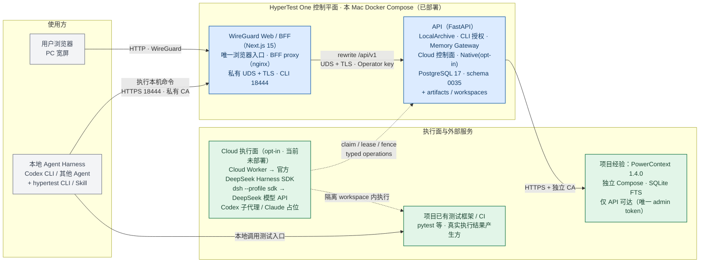
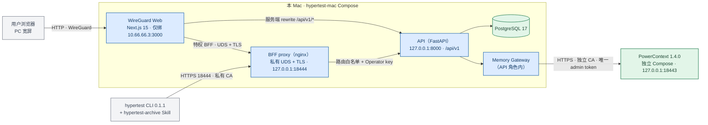
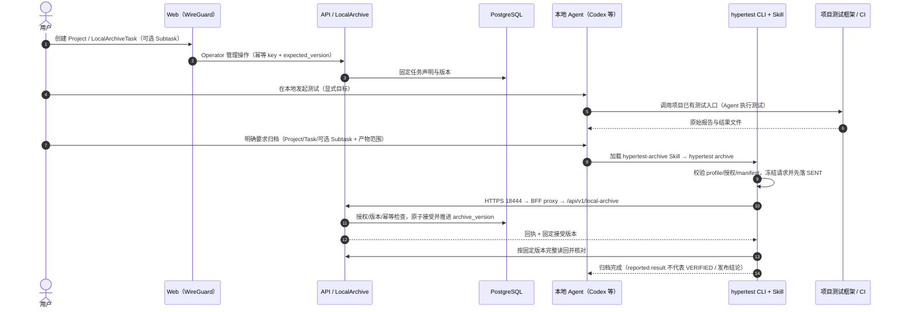
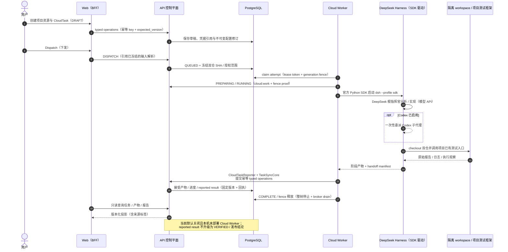
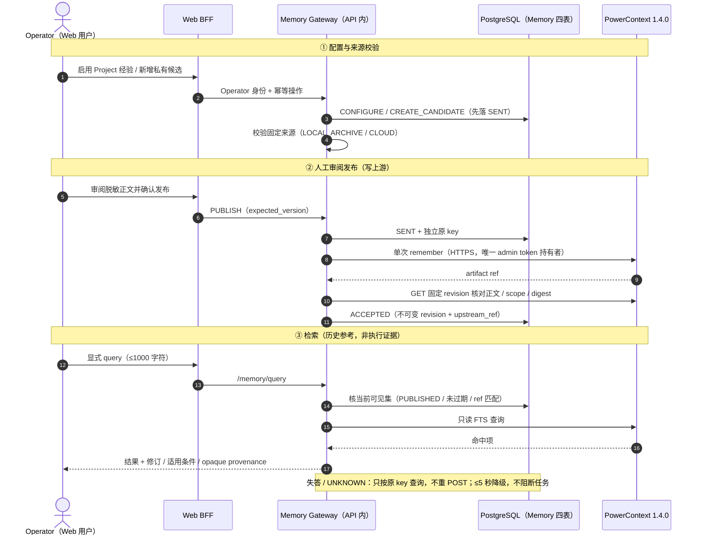

# HyperTest One 当前系统架构总览（2026-10-28）

> **快照定位：** 本文是当前（2026-10-28）实现与部署形态的**总览快照**，用于快速建立整体认识；它不是新的规范来源。长期合同与优先级仍由[产品白皮书](../foundation/HYPERTEST_WHITEPAPER.md)、[技术架构](HYPERTEST_TECHNICAL_ARCHITECTURE.md)、[测试任务协议](../protocol/TEST_MISSION_PROTOCOL.md)、[领域模型与状态机](../domain/HYPERTEST_DOMAIN_MODEL_AND_STATE_MACHINE.md)及各 ADR 拥有，冲突时以它们为准。
>
> **快照身份：** 代码 Git `2caf31d1ac90af03125432d25ceee4712bbd6031`；本机运行镜像构建自 Git `cdc70d34ca49a5da857143cbe349ca2ef0fbb57c`（HEAD 相对该提交仅为文档与已退役远端脚本差异，运行代码无变化）；PostgreSQL schema `0035_retire_legacy_test_runs`。部署事实于 2026-10-28 15:16 +08:00 只读核对，**操作前仍须现场核实**，不能把本文当作实时状态。
>
> **状态词：** **已部署**＝当前本机容器/宿主上实际存在；**已实现默认关闭**＝代码、路由、迁移存在但开关默认关闭；**占位**＝无实现、无验收；**已退休**＝按 [ADR-028](ADR-028_PROTOTYPE_LEGACY_REMOVAL.md) 退出入口与数据；**历史**＝文档记录仅供追溯。

---

## 1. 一页摘要

**一句话：** HyperTest One 是运行在本 Mac、单操作者、以 Docker Compose 交付的 **Agent-native 测试控制平面**：Agent 执行测试，项目已有测试框架/CI 产生真实结果，HyperTest 负责项目、测试任务、固定版本归档、回执与历史；项目经验（Memory）是独立可选服务；Cloud 测试执行链路已实现但默认关闭且本机未部署。

**当前能力分层（彼此独立，不互相推定权限）：**

| 能力 | 合同 | 当前状态 |
| --- | --- | --- |
| Local 显式归档 | [ADR-027](ADR-027_EXPLICIT_LOCAL_ARTIFACT_ARCHIVE.md) | **已实现 + 已部署**：本地 Agent 测试后显式调用 Skill + CLI；无 MCP/Hooks/常驻同步 |
| Cloud 测试任务 | [ADR-019](ADR-019_CLOUD_TEST_TASKS_WITH_DEEPSEEK_SDK.md)、[ADR-023](ADR-023_CLOUD_SSH_FIXED_DIAGNOSTICS.md)、[ADR-025](ADR-025_CLOUD_CONTROLLED_HTTPS_READS.md) | **已实现、默认关闭、本机未部署 Cloud Worker** |
| 项目经验 Memory | [ADR-022](ADR-022_PROJECT_MEMORY_WITH_POWERCONTEXT.md) | **已实现 + 已部署 + 启用**：独立 PowerContext 1.4.0；人工审阅发布 |
| Native 材料接入 | [ADR-017](ADR-017_NATIVE_FRAMEWORK_EVIDENCE_AND_HANDOFF.md) | 已实现、opt-in（`native_intake_enabled=false`），Operator CLI 入口 |
| 旧 SessionTask / 受管 TestRun | 被 ADR-028 取代 | **已退休**：入口与数据退出；物理表定义暂随迁移保留 |

**当前部署形态：** 单机单操作者 · OrbStack Docker Compose · 2 个 Compose 项目 · 6 个运行容器：

- `hypertest-mac`：`postgres:17`、`api`（FastAPI）、`bff-proxy`（nginx 私有 UDS/TLS + CLI 回环 18444）、`web-wireguard`（Next.js 15，唯一浏览器入口）。
- `hypertest-mac-powercontext`：`powercontext:1.4.0`（SQLite + FTS）、独立 `tls` 代理（仅回环 18443）。

**核心信任边界：** 浏览器只经 WireGuard 到 Next.js Web/BFF，不直连 API/数据库/PowerContext；API 只信任回环与 BFF 固定地址；CLI 只经本机回环 `https://localhost:18444` 提交归档；PowerContext 只由 API 内的 Memory Gateway 访问，上游 admin token 不下发到浏览器、CLI 或 Agent。

---

## 2. 全图（Mermaid，直接在本文件编辑）

- 图例：**蓝色实线框 = 已部署**；**琥珀虚线框 = opt-in / 当前未部署 / 占位**；**灰色框 = 外部系统或使用方**；**绿色框 = 数据存储/外部服务**；**实线箭头 = 当前默认路径**；**虚线箭头 = opt-in 或当前未部署路径**。本图为高层全景，各层细节见 §3–§6 与 §8。
- 图中未画出旧 SessionTask / 受管 TestRun：它们已按 ADR-028 退休，见 §5.4。
- SVG 导出（由上方 Mermaid 渲染生成，便于分享/离线查看）：[system-architecture-overview.svg](assets/system-architecture-overview.svg)。

---

## 3. 使用方与接入边界

SVG 导出：[access-boundary-flow.svg](assets/access-boundary-flow.svg)。

| 使用方 / 入口 | 路径与协议 | 认证与信任 | 当前状态 |
| --- | --- | --- | --- |
| 用户浏览器（PC 宽屏） | `http://10.66.66.3:3000/`（仅绑定 WireGuard 地址）→ Next.js Web | 同源；普通 API 由 Next.js 服务端 rewrite；特权域由 BFF Route Handler 加服务端 Operator 身份 | 已部署 |
| 本地 Agent Harness（Codex CLI 等） | 在用户本机执行测试，随后由用户显式触发归档 | 无平台身份；只能调用本机 `hypertest` CLI | 已部署（Codex 已验证） |
| `hypertest` CLI 0.1.1 + `hypertest-archive` Skill | `https://localhost:18444` → BFF proxy → API | 私有 CA 校验；每 Project 独立 `archive:read` + `archive:write` bearer；CLI 不持有 Operator key | 已部署 |
| Operator：`hypertest-native` CLI | 本机 CLI → API `/native-runs` | 显式 opt-in + Operator 边界 | 默认关闭 |
| Cloud Worker | 宿主独立进程（**不是容器**）→ PostgreSQL / API | 短期 work grant + lease/generation fence | 默认关闭、本机未部署 |

**浏览器请求的三条路径（当前部署实际配置）：**

1. **项目 CRUD**：浏览器 → Next.js → 服务端 `rewrite /api/v1/*` → `http://api:8000`。
2. **特权域 BFF**（`local-archive` / `cli-authorizations` / `memory` / `cloud`）：浏览器 → Next.js Route Handler → **HTTPS over Unix socket**（`hypertest.internal`，私有 CA，TLS ≥ 1.2）→ `bff-proxy`（固定 IP `192.168.97.200`）→ API。`X-Hypertest-Operator-Key` 只在 Web 服务器侧注入，**永不进入浏览器**。
3. **CLI 路径**：`hypertest` → `https://localhost:18444` → `bff-proxy` 的 CLI TLS server → 仅放行 `/api/v1/local-archive/` 与 `/api/v1/cli-authorizations/`，**显式清空 Operator key**；浏览器批准页由该入口 302 到 WireGuard Web。

**BFF 边界规则（当前实现）：** 固定路径/查询参数白名单；同源 `Origin`、`sec-fetch-site`、JSON Content-Type 与体积上限校验；只返回固定错误码与白名单字段；`readback=complete` 时逐页读回并核对 hash/版本。Memory 有独立 BFF 路由与独立浏览器 journal。

---

## 4. 控制平面：Web 与 API

### 4.1 Web / BFF（`web/`，Next.js 15 App Router）

| 路由 | 用途 |
| --- | --- |
| `/` | 项目列表、创建、搜索/筛选 |
| `/projects/[projectId]` | 项目工作区：项目档案 + Local 归档任务列表 + 模式指引 |
| `/projects/[projectId]/tasks/new` | 统一创建页：Local 归档任务 / Cloud 任务两种意图 |
| `/tasks/[taskId]` | 本地任务详情：任务概览、归档产物、子任务、产物版本、计划/用例/原始报告、汇总与历史 |
| `/projects/[projectId]/memory` | 项目经验：访问配置、显式检索、私有候选、人工发布/修订/撤回、固定修订读取 |
| `/projects/[projectId]/cloud` | Cloud 配置与资源（项目任务目录）；当前本机 BFF 未启用 Cloud，页面实际不可达 |
| `/cloud-tasks/[taskId]` | Cloud 任务详情（attempt / checkpoint / recovery / artifacts / records） |
| `/cli-authorizations` | CLI 授权：客户端/项目树、短码批准、撤销、安装 Prompt |
| `/archives/[taskId]` | 旧 `/archives/*` 链接客户端跳转到当前任务详情（兼容已发行 CLI 的链接，不是旧 SessionTask 入口） |

浏览器写操作采用 **operation journal**：**先**把冻结意图以 `SENT` 持久化到 IndexedDB，**再**发唯一 POST；失答/失败只按**原 key** 查询回执，不自动重发。任务域 journal（Cloud / LocalArchive / CLI 授权）共用 v4 数据库；Memory 使用**独立**数据库，不与任务账本混用。

### 4.2 API（`src/hypertest/`，FastAPI，`/api/v1`）

当前运行时 OpenAPI 共 **74 个 HTTP operation + 1 个 WebSocket**。按 router 分组：

| Router（`src/hypertest/api/`） | 主要路径 | 职责 | 状态 |
| --- | --- | --- | --- |
| `routes.py` | `/health`、`/projects`（CRUD/软删/恢复） | Project 与共享审计/outbox | 当前 |
| `archive_routes.py` | `/local-archive/*` | Local 归档：任务/子任务管理、根与子任务归档、固定快照读回、回执恢复、显式汇总 | 当前（已部署） |
| `cli_authorization_routes.py` | `/cli-authorizations/*` | CLI 配对：CREATE/APPROVE/REDEEM/REVOKE、grant 撤销、原 key 回执；`/actors` 固定 410 | 当前（已部署） |
| `memory_routes.py` | `/memory/*` | 经验 Gateway：CONFIGURE / CREATE_CANDIDATE / PUBLISH / REVISE / RETRACT、显式 query、固定版本读取、原 key 恢复 | 当前（已部署，可关闭） |
| `cloud_routes.py` | `/cloud/*` | Cloud 控制平面 typed operations、项目配置/凭据、任务目录 | 已实现默认关闭 |
| `native_routes.py` | `/native-runs/*` | ADR-017 native 材料接入与保守 Gate | 已实现默认关闭 |
| `interactive_routes.py` | `/interactive/*` | 交互身份/集成授权注册（archive/cloud/memory 的 grant 载体） | 当前（能力面收窄） |
| `connector_routes.py`、`source_transfer_routes.py` | `/harness-nodes/*`、`/source-transfers/*` | 旧 Connector / 源码接收路径（ADR-013/015） | 历史保留 |
| `harness_bridge` 等旧执行模块 | 无当前路由 | API 进程静态 import 部分旧模块（异常类/共享工具），**没有任何路由调用旧执行函数** | 已退休入口 |

**贯穿当前写 API 的通用契约：**

- **乐观并发**：写请求带 `expected_version`，冲突返回 409，不覆盖他人修订。
- **幂等与原 key 恢复**：客户端生成 `operation_key`/`idempotency_key`；服务端唯一约束 + 回执；结果不确定时只允许按**原 key** 读回，**不重发**、不改正文/版本。
- **固定版本完整读回**：归档/Cloud 读回必须核对固定接受版本的完整内容（分页 + hash），传输成功不等于业务接受。
- **错误不回显输入**：422 只返回 `type/loc/msg`；BFF 只返回固定错误码。

### 4.3 数据与可靠交付

**PostgreSQL（schema `0035_retire_legacy_test_runs`）当前有效数据组：**

| 组 | 表（摘要） | 说明 |
| --- | --- | --- |
| Project / 审计 | `projects`、`audit_events`、`outbox_events` | 唯一共同父实体；Local/Cloud/Native/Memory 共享 Project |
| Local 归档（ADR-027） | `local_archive_tasks`、`local_archive_subtasks`、`local_archive_snapshots`、`local_archive_submissions`、`local_archive_asset_revisions`、`local_archive_publications`、`local_archive_operations` | 任务声明/来源不可变；根与子任务独立归档版本；提交与接受版本一一对应 |
| CLI 授权 | `cli_authorization_requests`、`cli_authorization_grants`、`cli_authorization_receipts`、`cli_archive_uploaders` | 一次性配对 + Web 批准 + 专用上传身份映射；grant 可撤销 |
| 交互身份 / 集成授权 | `interactive_actor_identities`、`interactive_client_registrations`、`interactive_integration_grants` | scope 载体：`archive:*`、`cloud:*`、`memory:*` 分别独立 |
| Cloud（ADR-019/023/025） | `project_credentials`/`project_credential_versions`、`project_cloud_config_revisions`、`cloud_tasks`、`cloud_input_resolutions`、`cloud_attempts`、`cloud_work_grants`、`cloud_artifacts`/`cloud_asset_revisions`、`cloud_run_records`、`cloud_delegations`、`cloud_http_operations`/`observations`、`cloud_operation_receipts` | 凭据 envelope 加密；任务/尝试独立身份；lease/generation/fence；SSH 与受控 HTTPS 均默认关闭 |
| Memory（ADR-022） | `memory_project_mappings`、`memory_entries`、`memory_revisions`、`memory_operations` | 独立 scope/映射/版本/原 key 账本；不改任务状态，不占任务同步槽 |
| Native（ADR-017） | `native_test_runs`、`native_contributors`、`native_cases`、`native_execution_records`、`native_materials`、`native_verifications`、`native_conclusions`、`native_handoffs`、`native_operations` 等 | 独立 additive profile；材料不进入旧 trusted Evidence |
| 已退休（物理保留、0 行） | 11 张 SessionTask 专属表 + 35 张旧 Run/Mission/Evidence/Verdict 表 | `0034`/`0035` 为 **TRUNCATE 数据，不是 DROP TABLE**；当前无写入入口，ADR-028 允许后续定向删除 |

**文件存储：** `artifacts/` 与 `workspaces/` 是宿主 bind 到容器的共享目录（当前为空）；Local 归档的 PLAN/CASE/REPORT **文本内容保存在 PostgreSQL 资产修订记录**中，固定快照按归档版本读取。PowerContext 使用**独立的** SQLite 卷（当前 2 个 Compose 项目不共享数据卷）。

**当前数据库事实（2026-10-28 只读核对）：** `projects=2`、`local_archive_tasks=1`、`memory_entries=1`、`cloud_tasks=0`、CLI grant=1；库内约 120 余张表定义仍存在（旧域表为空）。业务数据内容未逐项核对，数量不能替代功能验收。

---

## 5. 执行面

### 5.1 Local 显式归档（已部署，ADR-027）

唯一正式路径：**本地测试 → 用户显式指令 → `hypertest-archive` Skill → `hypertest archive` → HTTPS 归档 API → PostgreSQL**。测试开始前**不需要**创建平台任务、绑定会话、安装 Hook 或保持连接；归档时不补造会话/BIND 身份，也不把归档成功升级为测试结论。

SVG 导出：[local-archive-flow.svg](assets/local-archive-flow.svg)。

**关键规则：**

- 每次上传**必填 Project ID、Task ID**；Subtask ID 可选，省略写 Task 根空间；无效/越权子任务明确拒绝、不回退根空间。
- 根空间与各子任务有**独立** `archive_version`；任务管理 version 与根归档 version 分开，避免争用。
- 授权：Web 批准一次性配对（短码 + 客户端 + 项目 allowlist + `archive:read`/`archive:write` + 期限），服务端把操作者映射为专用上传 actor（`CliArchiveUploader`）；CLI 不拿 Operator key、不自助扩权。
- 首片产物格式：UTF-8 PLAN/REPORT + 结构化 CASE；单文本 ≤ 262144 字符，每批 ≤ 16 PLAN / 200 CASE / 16 REPORT，最终 JSON ≤ 2 MiB；二进制截图/视频/压缩包未实现；超限整批拒绝，不截断/隐式分批。
- Skill 自动全局安装**仅 Codex 已核验**；其他宿主只能显式指定目录，不宣称已验证发现/调用能力。

### 5.2 Cloud 测试任务（已实现、默认关闭、本机未部署）

Cloud 是独立执行面：**CloudTask/CloudAttempt** 与 Local 归档身份、权限、账本均不混用；API 进程不执行 Agent/测试，只有当前 **fenced Worker** 能写 Cloud 报告。

SVG 导出：[cloud-task-flow.svg](assets/cloud-task-flow.svg)。

**六步流程：** 项目资源 → 冻结任务输入 → 下发 → DeepSeek/Codex 工作 → 接受产物 → 项目框架执行与报告。

**执行与隔离事实：**

- 官方 `deepseek-harness-sdk` 与同版本 runtime（当前固定 `0.2.1rc2`，wire `0.0.1`）以 `profile="sdk"` 驱动 `dsh` 子进程；SDK 描述符/协议版本不匹配即拒绝。
- DeepSeek 为根指挥官，Codex 为 opt-in 子代理（官方 bundle，一次性委派、无 continuation）；**Claude Code 为占位**，未实现。
- Cloud Worker：PostgreSQL claim/lease（默认 90 秒）/generation fence；每 Attempt 独立 workspace 与 `dsh_home`；已验证隔离基线为非 root systemd RootDirectory + cgroup + bubblewrap namespaces；根/子 Agent 不拿平台 token、数据库或 Operator key。
- 产物：workspace 内 handoff manifest + collector 回收原始报告/日志/patch；`CloudTaskReporter` + `CloudSyncAdapter` 复用 TaskSyncCore 的冻结、原 key、幂等与固定版本读回；SDK 活动/idle 不自动生成阶段完成或 PASS。
- 当前**不支持/不可宣称**：SDK 原会话续接（`supports_resume=false`）、SDK 单会话 cancel、一般 SSH、远端 CI 适配、`git:write`、Claude Code、真实模型与生产准入验收。固定 SSH 诊断（ADR-023）与受控 HTTPS 只读（ADR-025）已实现但**默认关闭**。

### 5.3 Native 材料接入（opt-in，ADR-017）

独立 additive profile：Operator 显式提交既有计划/用例/原始报告与来源，平台做材料校验、顺序贡献者交接与保守 Gate；首次 Gate 只产生 UNKNOWN/BLOCKED；**native 材料不能标为旧 VERIFIED Evidence**。入口为 `/native-runs` 与 `hypertest-native` CLI，默认关闭。

### 5.4 旧执行路径（已退休）

按 ADR-028，旧 SessionTask 的创建/同步/BIND/JOIN/协作 API、页面与 11 张专属表数据，以及旧受管 TestRun 的执行/报告/Evidence/Verdict 与 35 张专属表数据均已退出并清空；旧 `/api/v1/tasks*`、`/test-runs*` 已不存在。仓库仍保留部分旧模块可导入（`agent/`、`runner/`、`harness_bridge/`、`connector/`（除 `security.py`）、`local_sync/`、`interactive_client/`、`worker.py`），旧平台 Task Worker 也仍在镜像 stage 与 `compose.production.yml` 中，但**当前无生产者、本机未部署**；ADR-028 允许后续继续定向删除。

---

## 6. 项目经验 Memory（独立服务，已部署）

Memory 是**可选经验服务**：与 Canonical 测试状态、TaskSyncCore、任务授权分离；经验是历史参考，**不是执行证据、不是操作授权、不改变任务状态或报告结果**。

SVG 导出：[memory-flow.svg](assets/memory-flow.svg)。

**拓扑与认证：** Web BFF → API 内 Memory Gateway（唯一持有 PowerContext 上游 admin token）→ 独立 PowerContext 1.4.0（SQLite Basic/FTS；Generation/Embedding 关闭；`ACCESS_MODE=enforced`、Dashboard 关闭）。PowerContext 通过独立 Compose 项目部署，TLS 代理仅绑定 `127.0.0.1:18443`；浏览器/CLI/Agent 都不能直接访问。上游 1.4.0 的静态 Bearer 等价于**同一 admin**，Scope 不是 RBAC，多 Project 隔离由 Gateway 映射/授权完成。

**权限与来源：**

- scope 独立：`memory:read`（已发布可见经验）/`memory:propose`（私有候选）/`memory:publish`（管理范围）；`CONFIGURE`/`PUBLISH`/`REVISE`/`RETRACT` 还必须是**人工 Operator**。`task:sync`、`cloud:work`、archive grant 均**不**自动获得 Memory 权限，反之亦然。
- 来源校验只基于固定已接受材料：`LOCAL_ARCHIVE`（Operator 指定固定 Task/Submission/archive_version/REPORT 修订，ADR-027 增补）、`LOCAL`（旧 SessionTask，已退休，新请求 410）、`CLOUD`（同 Project/Task/Attempt + 当前 fenced Worker）。
- 发布先持久化 SENT + 独立原 key，再**单次**调用上游；ACK 后按固定 revision 读回核对正文/scope/digest 才接受；失答/UNKNOWN 只按原 key 查询，不重复 remember；撤回立即从可见集剔除，不依赖异步索引删除。
- 故障边界：每网络阶段总超时 ≤ 5 秒；Memory 故障不占任务同步槽、不改任务结果/HELD。

**当前状态：** 本机已部署并启用（`HYPERTEST_MEMORY_ENABLED=true`、Web Memory 入口启用），已有部署验收级真实闭环（Local 归档 REPORT → 私有候选 → Operator 发布 → FTS 查询命中），但**用户功能验收仍属 USER_OWNED**；单操作者单 admin，不能宣称多租户隔离。

---

## 7. 权限与信任矩阵

| 主体 | 持有凭据 | 可以做什么 | 不能做什么 |
| --- | --- | --- | --- |
| 用户浏览器 | 无服务凭据（仅 Web 会话/同源） | 经 WireGuard 使用 Web；批准 CLI 配对 | 不直连 API 8000 / CLI 18444 / PowerContext 18443；不接触 Operator key / PowerContext token |
| Web / BFF（Next.js） | 服务端 Operator key 文件 | 注入 Operator 身份、路径白名单、读回校验 | 不持有 PowerContext admin token；不执行测试 |
| API（FastAPI） | Operator 边界 + Memory Gateway 上游 token（只读挂载） | 授权、事务、回执、固定版本读回；Memory 网关 | 不运行 Agent/测试；不执行 Git/模型；不改写已接受历史 |
| `hypertest` CLI | 私有 profile + 每 Project archive bearer | 显式归档、原 key 恢复、doctor | 不拿 Operator key；不扩权；不装 MCP/Hooks；不后台常驻 |
| 本地 Agent Harness | 无平台身份 | 在用户本机执行测试、调用 CLI | 不直接访问平台 API 的 Operator 身份；不产生 Canonical 状态 |
| Cloud Worker | 私有 DB broker + work grant + 逐 Project memory 文件 | claim/lease/fence、执行 Attempt、提交 Cloud typed operations | 无 Operator key；不能越过 fence 写 Cloud 报告；不代 Agent 推理 |
| Cloud 根/子 Agent | 云端预配模型身份（只在 host broker） | 在隔离 workspace 内工作、调用项目测试入口 | 无平台 token / DB / Operator key；无一般网络与 SSH；子代理不独立写平台 |
| PowerContext | 上游 admin token（仅 API 挂载） | 存储/检索已发布经验 | 不是 RBAC/多租户边界；不执行测试；不被浏览器/CLI/Agent 直接访问 |

**授权不互相推定：** Local/Cloud 共享 Project，但任务身份、执行权、凭据、账本、报告历史分开；`archive:*`、`cloud:*`、`memory:*`、`task:sync`、`cloud:work` 之间不自动升级；读取一类任务不取得另一类任务的写入/调度权限。

---

## 8. 当前部署快照（2026-10-28）

### 8.1 运行容器

| Compose 项目 / 服务 | 镜像 | 端口 / 网络 | 持久化 | 状态 |
| --- | --- | --- | --- | --- |
| `hypertest-mac` / `postgres` | `postgres:17` | 仅容器网络 | 卷 `hypertest-mac-pgdata` | healthy |
| `hypertest-mac` / `api` | `hypertest-mac-api:cdc70d3`（revision = Git `cdc70d3…`） | `127.0.0.1:8000`；`192.168.97.2` | bind `artifacts/`、`workspaces/`；PowerContext CA/token 只读 | healthy |
| `hypertest-mac` / `bff-proxy` | `nginx:1.27-alpine` | 私有 Unix socket；`127.0.0.1:18444`；固定 IP `192.168.97.200` | 卷 `hypertest-mac_bff_socket` + 配置/证书 | Up |
| `hypertest-mac` / `web-wireguard` | `hypertest-mac-web:cdc70d3` | **仅** `10.66.66.3:3000`；`192.168.97.4` | BFF socket 只读 | healthy |
| `hypertest-mac-powercontext` / `powercontext` | `powercontext:1.4.0` | 仅内部网络 `192.168.107.0/24`（internal） | 卷 `hypertest-mac-powercontext_powercontext-data`（SQLite） | healthy |
| `hypertest-mac-powercontext` / `tls` | `nginx:1.27-alpine` | `127.0.0.1:18443 → 8443` | 配置/证书 | Up |

**入口汇总：** 浏览器 `http://10.66.66.3:3000`（WireGuard）｜ API `http://127.0.0.1:8000`（仅回环）｜ CLI `https://localhost:18444`（仅回环）｜ PowerContext `https://host.docker.internal:18443`（仅 API 可达）。API 的转发头只信任回环 + BFF 固定地址 `192.168.97.200`。

**TLS：** BFF 使用本机私有 CA（`HyperTest Mac Local CA`）：Web 侧叶证书 `hypertest.internal`、CLI 侧叶证书 `localhost`；PowerContext 使用独立 CA（`host.docker.internal`）。证书**不自动续期**，到期前成对更新并验证名称/链，不关闭校验。

### 8.2 数据库与计数

- schema：`0035_retire_legacy_test_runs`；库大小约 14 MB。
- 计数：`projects=2`、`local_archive_tasks=1`、`memory_entries=1`、`cloud_tasks=0`、CLI grant=1。
- 迁移入口：维护 profile 容器 `alembic upgrade head`（不在宿主 venv 直连业务库）。

### 8.3 宿主侧组件

| 组件 | 当前事实 |
| --- | --- |
| `hypertest` CLI | `~/.local/bin/hypertest` = 0.1.1；profile `hypertest-mac`（server `https://localhost:18444`）；`doctor` 实测 READY |
| `hypertest-archive` Skill | `~/.codex/skills/hypertest-archive/` 已安装（显式调用，非常驻同步） |
| 本地测试宿主 | Codex CLI 已安装（现场 0.165.0；仓库文档核对版本为旧值，属宿主事实差异，不构成验收） |
| WireGuard | `wg0`/`utun6` = `10.66.66.3/32`；浏览器从对端 `10.66.66.2` 接入（本轮未从对端复验） |
| DeepSeek Harness Web GUI | `http://10.66.66.3:3080` 为**独立 Agent Harness UI**，不属于 HyperTest 容器拓扑 |
| Docker | OrbStack 提供 Engine；本机 Compose 文件为手工维护的 `~/.local/share/hypertest-mac/` 三文件 overlay + 独立 PowerContext compose |

### 8.4 当前未部署 / 已退出

Cloud Worker（无容器、无宿主进程、平台 env 无 Cloud 开关）、Cloud Web 入口（BFF 未代理 `/api/v1/cloud`）、旧 TestRun/SessionTask Worker、独立 localhost Web、Harness Bridge、宿主 nginx/systemd、可信 Runner 容器、PowerContext Dashboard。仓库内 `compose.production.yml` + `ops/container/*` 是**生产模板形态**（含 worker/nginx/固定 digest/只读根等），不是本机当前运行栈，二者不能混写。

### 8.5 快照证据边界

- 上述容器、端口、卷、schema、计数与 TLS 公开字段为 2026-10-28 15:16 +08:00 现场**只读**核对；镜像身份与部署记录（[任务创建退休部署](../TASK_CREATION_RETIREMENT_20261028.md)、`~/.local/share/hypertest-mac/README.md` 顶部当前章节）一致。
- 本轮**未执行**用户功能验收、未从 WireGuard 对端复验、未实际走 Memory/Cloud 业务链路、未运行全量回归；健康检查与计数不等于功能验收。
- Cloud 相关的“已实现/默认关闭”来自代码、配置与文档交叉核对；“本机未部署”来自 Compose/进程/BFF 配置的现场核对。

---

## 9. 代码地图

| 路径 | 职责 | 状态 |
| --- | --- | --- |
| `src/hypertest/main.py` | FastAPI 组装、router 注册、统一 422 脱敏 | 当前 |
| `src/hypertest/api/` | HTTP 路由、严格 schema、错误映射 | 当前（其中 connector/source-transfer 为历史保留） |
| `src/hypertest/application/` | 事务服务：`local_archive`、`cli_authorization`、`memory_gateway`、`cloud_tasks`、`native`、`management`；旧 `runtime/controller/planner/...` 仅可导入 | 当前/历史混合 |
| `src/hypertest/domain/` | SQLAlchemy 模型、枚举、约束、状态机；旧域模型保留但数据已清空 | 当前 + 已退休 |
| `src/hypertest/db/` | async engine / session | 当前 |
| `src/hypertest/cli/` | `hypertest` 显式归档 CLI（auth/profile/doctor/archive/status/reconcile/skill/legacy） | 当前 |
| `src/hypertest/sync_core/` | 冻结请求、ledger、回执、固定版本读回的共享可靠投递库 | 当前共享库 |
| `src/hypertest/memory/` | PowerContext 1.4.0 受限适配器（FTS、固定 revision、无 generation） | 当前可选 |
| `src/hypertest/cloud/` | Cloud Worker：broker、SDK 驱动、沙箱、模型/委派 broker、reporter、SSH/HTTPS 受控通道 | 可选、默认关闭 |
| `src/hypertest/deepseek_harness/` | 官方 SDK 元数据/兼容性/无 prompt 探针（诊断，不是执行链） | 可选 |
| `src/hypertest/native_client.py`、`native_protocol.py` | ADR-017 Operator CLI 与 wire schema | 可选、默认关闭 |
| `web/app/`、`web/lib/` | Next.js 页面、BFF Route Handlers、服务端 TLS/UDS 客户端、IndexedDB journal、i18n | 当前 |
| `skills/hypertest-archive/` | 显式归档 Skill（与 CLI 同版本分发） | 当前 |
| `alembic/versions/` | 迁移链 head = `0035`；`0027/0030/0031/0032/0033` 为 Memory/LocalArchive/CLI 授权/双仓库；`0034/0035` 为退休清数据 | 当前 |
| `spec 文档` | `docs/foundation/`、`docs/architecture/`、`docs/protocol/`、`docs/domain/` | 合同来源 |

**包状态分层：** `current`（路由/CLI/部署实际使用）｜ `current-optional`（默认关闭的独立能力）｜ `legacy-retained`（旧 profile 代码仍可导入，无新写入路径）｜ `residual`（无入口引用）。判定以实际 router 注册、调用点与迁移为准，不以目录名推断。

---

## 10. 状态分层与常见误读

**状态分层：**

- **已部署并使用**：Project、Local 显式归档、CLI 配对授权、Memory（Gateway + PowerContext）、WireGuard Web/BFF、PostgreSQL。
- **已实现、默认关闭、本机未部署**：Cloud 全链路（CloudTask/Attempt/Worker/SDK/Codex/SSH 诊断/受控 HTTPS）、Cloud Web 入口、SDK resume。
- **占位**：Cloud Claude Code。
- **已退休（ADR-028）**：旧 Local 新写（MCP/Hooks/常驻同步）、SessionTask 创建/同步/BIND/JOIN/协作 API 与 11 张表数据、旧受管 TestRun/Run/Job/Evidence/Verdict/报告与 35 张表数据、旧 Web 协作 journal。
- **历史**：远端 C4 Cloud 部署、远端 PowerContext 主机、旧 local-v*/mcp-v* 发行与三宿主矩阵、旧 SSH/nginx 记录。

**常见误读：**

1. **DeepSeek Harness 有两个不同角色，不能合并成一条“DSH 集成”。** ① Cloud 执行目标：Cloud Worker 通过官方 Python SDK 以 `profile="sdk"` 驱动 `dsh`；② 本地 Agent Harness：本 DSH 会话这类宿主自行完成测试，之后只能走 `hypertest-archive` Skill + CLI（仓库没有 DSH 专用本地 adapter；旧 DSH Local bridge/MCP 属退休历史）。
2. **“旧实现已退休”不等于“表已 DROP、模块已删”。** 准确含义是：入口、路由、页面与新写路径退出，`0034/0035` 已清空 46 张专属表的数据；物理表定义与部分旧模块暂保留可导入，ADR-028 允许后续定向删除。
3. **API 进程 import 旧执行模块 ≠ 暴露旧执行。** 仅为异常类/共享工具引入，没有任何路由调用旧执行函数；“API 不执行 Agent/测试”仍成立。
4. **reported result ≠ VERIFIED / 发布结论。** 归档成功、上传成功、SDK idle、模型活动都不会自动产生 PASS 或正式证据；`reported PASS/FAIL/UNKNOWN` 原样保留并显示来源。
5. **Memory 是历史参考，不是执行证据或授权。** 命中内容不构成当前环境可用性证明；发布需人工审阅；Memory 故障不阻断任务流。
6. **本机实际部署 ≠ 仓库生产模板。** 现场是手工维护的 Web 单入口 + BFF + 独立 PowerContext；`compose.production.yml`/`ops/container/*` 里的 worker、nginx facade、systemd 等只是模板形态。
7. **PowerContext 单 admin、非多租户。** 上游 1.4.0 的 Scope 不能当项目授权；项目隔离由 Gateway 的映射与服务端授权完成；当前只验证了单 Project 的真实闭环。
8. **Cloud Worker 是宿主独立进程，不是容器。** 本机没有该进程；Compose 里也没有 Cloud Worker 服务。

---

## 11. 相关文档

- 基础合同：[产品白皮书](../foundation/HYPERTEST_WHITEPAPER.md)｜[技术架构](HYPERTEST_TECHNICAL_ARCHITECTURE.md)｜[测试任务协议](../protocol/TEST_MISSION_PROTOCOL.md)｜[领域模型与状态机](../domain/HYPERTEST_DOMAIN_MODEL_AND_STATE_MACHINE.md)。
- 关键决策：[ADR-022](ADR-022_PROJECT_MEMORY_WITH_POWERCONTEXT.md)（Memory）｜[ADR-027](ADR-027_EXPLICIT_LOCAL_ARTIFACT_ARCHIVE.md)（Local 显式归档）｜[ADR-028](ADR-028_PROTOTYPE_LEGACY_REMOVAL.md)（旧实现退休）｜[ADR-019](ADR-019_CLOUD_TEST_TASKS_WITH_DEEPSEEK_SDK.md)（Cloud）｜[ADR-021](ADR-021_SHARED_TASK_SYNC_CORE.md)（TaskSyncCore）｜[ADR-017](ADR-017_NATIVE_FRAMEWORK_EVIDENCE_AND_HANDOFF.md)（Native）。
- 当前操作与交付事实：[服务器操作](../SERVER_OPERATIONS.md)｜[任务创建退休部署](../TASK_CREATION_RETIREMENT_20261028.md)｜[Memory 集成交付](../POWERCONTEXT_INTEGRATION_DELIVERY_20261023.md)｜[CLI 授权指南](../CLI_AUTHORIZATION_GUIDE.md)｜[当前待办](../TODO.md)。
- 本机部署记录：`~/.local/share/hypertest-mac/README.md`（顶部当前章节；其下为历史）与 `~/.local/share/hypertest-mac-powercontext/`（独立 Compose 配置与私有证书目录）。

> **维护提示：** 本文是 2026-10-28 快照，不随每次部署自动更新。部署形态、Cloud Worker 状态、证书/镜像身份或能力开关发生变化时，应更新本文或新增一轮快照记录，并在[文档导航](../README.md)中保持入口指向。`assets/*.svg` 是上述 Mermaid 的渲染生成物，结构调整应以本文件 Mermaid 为准后重新渲染。
