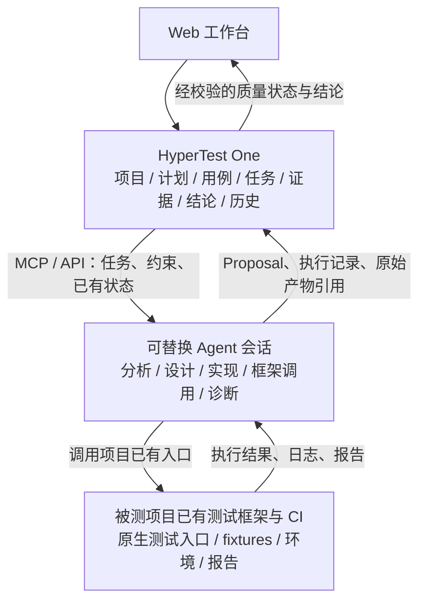

# HyperTest 白皮书

2026-10-23 P0 增补：Web 的 Cloud 与 Local CREATE 使用独立持久账本和原 key 对账；取消请求与停止确认分开，人工收尾声明不产生独立停止证明或预算结算权。当前 Cloud Worker 尚不支持 SDK 原会话续接。实现与部署见[P0 恢复交付](../P0_RECOVERY_DELIVERY_20261023.md)，不改变下文历史验收身份。

## 2026-10-23 新增真实矩阵（已通过）

`local-v0.1.0` 已公开，协调器、三宿主 Hooks/MCP、TaskSyncCore Local adapter 与固定摘要安装器已交付；首发仅 `darwin-arm64-py313`。本次直接使用原公开包，无产品 runtime 修改。Claude Code、Codex、DeepSeek harness 的用例、原始报告、真实 headless 与同源跨进程恢复必需矩阵均已独立复核通过。**DeepSeek 恢复仅指新进程的官方持久 Registry API，不是 CLI / SDK wire resume 参数，也未新增通用恢复命令。**

本次 `FAIL` 是管理同步保全 fixture，业务 SUT 为 `NOT_RUN`。Claude / Codex 原始证明中的生成时 `PENDING_INDEPENDENT_REVIEW` 保持不变，后续资格单独记录。精确流程、后端、版本与限制见[新增验收记录](../LOCAL_CASE_REPORT_RESUME_ACCEPTANCE_20261023.md)及[矩阵](../local-acceptance/local-matrix-20261023.json)。原 2026-10-22 R5/R6 证据、0.1.0 tag / 四资产 / manifest 和旧 MCP 发行保持历史身份；PR 合并与生产 Web 部署仍待最终 gate。

**版本：v1.6（Codex 会话任务管理；保留 v1.4 产品职责纠偏）**
**产品职责修订：2026-10-20，依据项目负责人明确的功能分层**
**定位：Agent-native Autonomous Testing Platform**
**架构角色：Autonomous Testing Control Plane**

### Cloud / Local：共享 Project，分别交付

Cloud 采用 [ADR-019](../architecture/ADR-019_CLOUD_TEST_TASKS_WITH_DEEPSEEK_SDK.md) 的六步流程：项目资源 → 任务输入 → 下发冻结 → DeepSeek 接取与 Codex 委派 → 测试产物 → 项目框架执行及报告。CloudTask / CloudAttempt 与 Local SessionTask 共存于同一 Project，不设置排他的 Project 模式，不混用身份、权限或历史；统一创建入口与 Local 预建绑定由其独立管理规范拥有。

Cloud 本轮仅接入官方 Python SDK 驱动的 DeepSeek Harness + Codex；Claude Code 保持占位。source30 Worker / source29 helper 的 r8 任务已固定完整读回 v19 COMPLETED / reported PASS，canonical 固定 SSH 专项通过；source31 只读验收器对同一 v19 固定快照的 SNAPSHOT_REASSESSMENT 为 strict PASS，独立只读重放 19 项通过并核对接受原件。该重评没有新的 current GET、模型、SSH 或 SUT 执行；来源仍是 runtime-reported，不是独立 writer 证明，不升级 legacy VERIFIED / Gate。旧 source30 NON_PASS、r7 UNKNOWN / HELD 和其他失败原件保持。C4已按固定Git部署到单人专用测试服务器，schema26、Cloud Worker以Codex=true / SSH=false空闲运行；构建、组件回归、doctor、迁移和基础健康只记部署检查。代码开关默认仍关闭，用户验收为PENDING / USER_OWNED，未经用户明确要求不擅自开展；Web Cloud详情步骤显示修正已按6d49单独部署，API / Worker / schema保持C4身份。精确Git / image / 轮次见[交付记录](../CLOUD_GIT_DELIVERY_20261023.md)，不以当前部署覆盖旧fixture身份。

共享同步语义由 ADR-021 定义；Cloud 的 SDK/runtime 与 Worker 不加入已发布 Local 安装包。ADR-022 的 Memory Gateway 已在2026-10-23独立集成切片中实现，范围与历史Cloud交付分开记录；其独立权限、Project映射与人工发布不改变已有任务身份或测试结果。经验服务与 Canonical 测试状态、TaskSyncCore 分离；`task:sync` / `cloud:work` 不授权经验访问，服务管理 key 不进入 Agent，外部 Generation / Embedding 默认关闭。

### Local 入口：Codex 测试任务与产物管理（ADR-018 优先）

**2026-10-27 后续方向已确定，尚未实现：** [ADR-027](../architecture/ADR-027_EXPLICIT_LOCAL_ARTIFACT_ARCHIVE.md)将新的 Local 接入改为用户显式调用 Skill 与 CLI 的后置产物归档，移除该模式 MCP/Hooks 和实时会话绑定依赖。下文 ADR-018/024/026 描述已交付版本及其历史合同；在新链路完成切换前继续适用，不据方案文字宣称已移除旧运行能力。

[ADR-026 多会话协作](../architecture/ADR-026_MULTI_SESSION_TASK_COLLABORATION.md)已接受并启动实施：显式启用的 Local 任务可以由多个获授权真实 root 参与、分别追加贡献，由一个当前主会话汇总。任务 UUID、初始绑定和历史保持；未启用任务继续使用下列单会话合同。源码、部署、客户端发行与用户功能验收分别记录。

**默认单会话合同中，一个 Codex 会话对应一个测试任务；ADR-026 协作合同中，一个任务可接纳多个真实会话的贡献。Agent 将计划、用例、原始报告及 reported result 同步到 HyperTest One；HyperTest 本身不承担测试执行。**
当前优先交付持久管理与查询，不以执行材料准入、平台 Runner、独立 CI 证明或 Gate 为保存报告的前提。平台显示提交者报告的 PASS/FAIL 等及其来源；它们不自动成为正式发布判定，也不因没有平台执行而被强制改成 UNKNOWN。
[ADR-018](../architecture/ADR-018_CODEX_SESSION_TASK_SYNC.md)明确共享 Project 的 SessionTask、用例/报告修订、幂等同步与旧版本保护；优先于下文对当前新入口的宽泛治理要求。ADR-017 与旧受管 Harness/Runner 的实现和历史结论继续保留，不作为本阶段同步的依赖。生产部署不包含在默认开发范围中。

> **HyperTest One 管理测试项目、下发测试任务、记录测试结论。**
> **Agent 执行测试分析、测试设计、测试实现，并调用被测对象已有的测试框架执行测试。**

HyperTest 持久管理计划、用例、执行记录、证据、缺陷与结论，把分散在不同 Agent
会话中的质量保障工作串联起来。测试框架、测试环境与既有 CI 属于被测项目的工具链；
HyperTest 不承担测试执行框架或通用执行引擎的产品职责。

### v1.5 最小迁移决定与实施边界

[ADR-017](../architecture/ADR-017_NATIVE_FRAMEWORK_EVIDENCE_AND_HANDOFF.md)保留历史 `native-framework-intake/v1alpha1` 的材料治理与顺序贡献者交接。该兼容 profile 不增加平台执行引擎，不自动提升材料可信度；当前 Codex 任务、用例及报告管理按 ADR-018 同步，私有执行与验收原件不随产品源码分发。

下面记录 v1.4 于 2026-10-20 修订时的历史边界；其中“尚未实现 / 后续 ADR”是该时点的状态，不抹去 ADR-017 新切片，也不把目标能力全部宣称已交付。

v1.4 当轮只修正白皮书的产品方向和架构职责，并提供[新 Mac 开发交接 Prompt](../handoffs/MAC_NATIVE_TEST_FRAMEWORK_HANDOFF_20261020.md)。
**v1.4 修订时原生测试框架接入、跨会话接续及新的执行结果契约尚未实现。** ADR-017 随后定义的最小材料接入与贡献者交接不等于完整可信执行 / 原生会话接力已完成。
[技术架构](../architecture/HYPERTEST_TECHNICAL_ARCHITECTURE.md)、[TMP](../protocol/TEST_MISSION_PROTOCOL.md)、
[领域模型](../domain/HYPERTEST_DOMAIN_MODEL_AND_STATE_MACHINE.md)、`AGENTS.md`、代码及 schema
仍包含旧 Runner / 单主会话约束。后续核心变更必须先用新的 ADR 明确替代范围，并在同一变更中
同步这些规范、兼容和验收方案；不能只依据白皮书修改数据库约束、扩大权限或重解释旧协议。

现有 ADR-013 / ADR-015 / ADR-016 及其生产结果继续作为历史事实保留：

| 已记录实现 | 历史证据与实际边界 |
| --- | --- |
| 服务器与本地 Connector 两种受管 Harness | [ADR-013 生产记录](../ADR013_PRODUCTION_DEPLOYMENT.md)、[ADR-015 生产记录](../ADR015_PRODUCTION_DEPLOYMENT.md)；既有授权、数据、会话和访问边界需要保全 |
| 当前 Agent 的 MCP 接入 | [ADR-016](../architecture/ADR-016_INTERACTIVE_AGENT_MCP_ACCESS.md)及[生产记录](../ADR016_PRODUCTION_DEPLOYMENT.md)；本地 Agent 推进任务，正式测试仍走平台 Docker / pytest，属于待纠偏的实现 |
| 已发布 MCP 与 Web 安装指引 | [安装交付记录](../MCP_INSTALLATION_DELIVERY_20261020.md)；固定发行 `mcp-v0.1.0`，PR #19 源码 `980f27a`，安装不等于任意 Agent 原生框架接入已完成 |
| 最近已记录后端与验收 | API / Worker `c7cd43ad6346d8ce6c85564f7838afbb017f2da4`、schema `0020_interactive_tool_inbox`；967 passed / 21 skipped，生产33项 HTTP 测试与五份 Evidence 属于该旧架构周期 |

以上是交付记录中的版本快照，不是对当前服务器或新 Mac 的即时巡检。隔离27项周期、生产33项
周期、MCP 安装验证及真实私有 SUT 验收各自独立，不相互替代。未来迁移保留原 Execution、
Evidence、Verdict、报告和审计，不删除或回填历史来宣称符合新架构。

---

## 1. 执行摘要

随着 Codex、Claude Code、OpenCode、Pi 等通用 Coding Agent 快速发展，软件研发正在从“AI 辅助编码”进入“Agent 自主完成复杂工程任务”的阶段。

测试领域也正在发生同样的变化。

今天的通用 Coding Agent 已经能够完成大量传统测试开发工作：

- 阅读 PRD 和技术文档；
- 理解代码仓库；
- 分析 Git Diff；
- 生成测试场景与测试代码；
- 调用 Shell、Docker、Kubernetes 和测试框架；
- 执行测试；
- 分析失败日志；
- 修改代码并进行迭代。

因此，HyperTest 不应重复构建另一个通用 Coding Agent。

HyperTest 的核心目标是解决另一个更重要的问题：

> **如何将通用 Agent 的智能能力转化为可治理、可验证、可追溯、可持续演进的软件测试能力。**

HyperTest 因此被定义为：

> **面向 Agent 时代的自治测试平台（Agent-native Autonomous Testing Platform）。**

在架构上，HyperTest 是：

> **Autonomous Testing Control Plane。**

Codex、Claude Code、Pi、OpenCode 等则作为：

> **Agent Harness / Intelligent Testing Worker。**

HyperTest 不负责重新实现 Agent Loop，而负责定义：

- 应该测试什么；
- 为什么测试；
- 应该测试到什么程度；
- 当前测试覆盖是否充分；
- Agent 应完成什么 Mission；
- 测试是否真正执行；
- 什么证据可以被信任；
- 测试结果是否满足质量门禁；
- 测试资产如何形成长期知识；
- 一个版本为什么可以或不可以发布。

HyperTest 的核心链路为：

**Requirement → Risk → Test Case → Implementation → Execution → Evidence → Finding → Verdict**

这条 Testing Semantic Chain，是 HyperTest 的核心领域模型，也是其长期技术与产品壁垒。

### 1.1 实际使用单位与工作归属

- 一个 SUT（被测系统）对应一个长期 Project；同一系统的 feat / MR 和测试轮次在项目内组织。Project 是系统身份，仓库 URL 不替代它。
- 一个确定变更版本的一次测试活动对应一个 TestRun。需求、源码版本、测试范围、Policy 及实际执行环境应有明确、可追溯的版本身份；改变输入或显式复测保留新轮次，不覆盖旧结论。
- HyperTest 管理测试计划、用例及覆盖关系，发布目标、范围、约束和验收要求，记录任务进度、执行出处与结论。Agent 完成分析、设计、实现、框架调用和失败诊断。
- 测试代码优先留在被测项目自己的测试资产中，遵守该项目已有框架、fixtures、配置与启动方式。平台记录实现引用和版本，不把所有项目统一成平台指定的测试文件或语言。
- 同一 Agent 会话可以连续完成任务，也可以由不同会话经过明确交接依次贡献。任务和测试资产的连续性由平台状态保障，原生聊天会话不再是产品层面的唯一连续性载体。
- 接力必须关联原任务、输入、已接受产物、未决操作及贡献者，明确当前写入责任，隔离已失效授权。ADR-017 新 native profile 以私有 writer capability 与 generation 支持显式顺序贡献者交接；现有受管 Run 的单主会话约束和真实 Provider 身份保持原语义，不允许并发多写者。
- 关键歧义、权限与外部副作用通过明确授权和持久问答处理。缺陷可关联项目既有问题单流程，提单不自动成为缺陷确认或质量结论。

“本地 / 云端”应清楚说明 Agent、项目测试框架及被测环境的实际位置。Agent 可在拥有项目工具链
的 Mac 上调用原生测试入口，也可使用已授权的远端环境或既有 CI；HyperTest 的部署位置不决定
测试必须在哪里运行。认证留在实际使用方，连通平台不扩大 Git、问题单或执行权限。

ADR-016 当前 `CLOUD / LOCAL` 只区分 Agent 的位置，测试仍走服务器 Runner；该旧含义及
`harness_mode` / `execution_driver` 组合继续解释已有请求和历史，不能冒称已符合上述新目标。
平台登记测试活动不应普遍要求上传全量源码或重建项目工作区；需要的版本、源码和产物验证范围
由实际任务与后续证据契约确定。

### 1.2 云端测试任务的六步流程（ADR-019，部分实现）

本流程的项目创建、任务创建与执行调度均经云端 Web / API / Worker 完成；已有同一 SUT 的 Project 直接复用，可与其 Local 任务共存。

| 步骤 | 用户输入与平台职责 | 持久交付 |
| --- | --- | --- |
| 1. 创建或复用项目并配置资源 | 在云端 Web 创建或选择已有 Project，手动添加被测对象 Git 仓库、测试框架 Git 仓库、仓库 token，以及测试环境私钥或 SSH 访问方式；两个仓库允许相同。资源可保存复用，分别关联项目授权 | 共享 Project、仓库 / 环境元数据、加密凭据引用及审计；秘密不进入普通配置和报告 |
| 2. 创建测试任务 | 选择被测分支、feat、MR 或 SHA，提供 PRD、测试目标、基本流程；确定测试框架版本、环境和允许的操作 / 时间 / 费用范围。`feat/*` 可按分支解析，feature 需求标签须关联可解析源码引用 | 独立 CloudTask 草稿及版本；不创建伪造的 SessionTask |
| 3. 下发任务 | Worker 侧解析 / 预检访问与环境连通性，接受执行 dispatch 前冻结 SUT 与框架精确 SHA、MR base/head 及实际测试的 head 或 merge SHA、PRD 版本、环境引用；API 引用已解析结果入队，准备独立工作区和执行尝试 | 不可变输入快照、CloudAttempt、预检记录；每轮观察实际部署身份，无法核实时明确 UNKNOWN / 缺口，禁止把仓库 SHA 当作部署证明 |
| 4. 接取与分工 | Python Worker 通过官方 `deepseek-harness-sdk` 启动 `dsh --profile sdk`、提交任务并收集事件；DeepSeek 自行参与或委派 Codex（Claude Code 保持占位） | Attempt 内 Harness 身份、委派关联、进度与操作记录；主指挥官统一回写平台 |
| 5. 保存测试产物 | 分阶段保存测试分析、设计、用例及自动化测试代码；代码落在测试框架仓库工作区，保留 commit 或完整 patch，push 受任务授权约束 | 带来源和版本的分析 / 设计 / 用例 / 代码资产；附件须真正上传并读回核验，单一 URI 不表示原件已保存 |
| 6. 执行并汇报 | Agent 调用项目已有框架 / CI，逐轮保存结果、日志、原始报告、实际版本 / 环境出处与用例 actual / reported result | 各轮执行记录、原始报告和最终测试结论；第 5、6 步可迭代，原 FAIL、ERROR、BLOCKED 与未完成记录继续保留 |

### 1.3 项目凭据与一次授权

项目资源的名称、地址、连接参数和 credential reference 属于普通管理数据；Git token、环境私钥、SSH 密钥等秘密由加密存储或 Secret Store 持久管理，密钥与密文分离。用户可以录入一次并在后续任务中复用、轮换或撤销，任务快照固定非秘密引用和授权范围，运行时才向 Git helper、SSH agent 或实际使用的工具注入所需凭据。

DeepSeek、Codex 和 Claude Code 的 Provider 身份由云端执行环境预配。用户为任务批准的项目资源范围可覆盖该任务的主代理和子代理，无需逐个子代理登录；模型服务身份与 Git / 测试环境授权仍分别配置、分别撤销。委派不能扩大网络、仓库写入、环境操作或费用范围，也不能从用户电脑静默复制既有登录和密钥。

原文秘密不进入 Git URL、PRD、提示词、普通数据库字段、SDK 事件、报告、补丁、日志或产物附件。旧会话同步仍只接收管理产物，不要求上传源码、环境密钥或 Provider 登录。

### 1.4 SDK 托管与结果边界

采用的是官方 **Harness Python SDK**，不是 DeepSeek 模型 HTTP API SDK，HyperTest 与 DeepSeek harness 的此路径不采用 ACP。SDK 和 `dsh` runtime 配对版本须先固定并完成兼容探针；选择 SDK 是接入与维护决策，不据此宣称测试运行更快。

每个 CloudAttempt 使用独立 runtime、workspace 和 `dsh_home`。首版按 SDK 当前限制设计：不能依赖单会话 cancel / close 或实时权限审批；Worker 执行预授权、预算与资源边界，超时 / 取消需终止该 Attempt 的完整进程树并核验清理。本地进程停止不证明远程 SSH / CI 或业务副作用停止，未决操作须保持待恢复并对账。缺少授权进入持久 `WAITING_INPUT`，不能默认放行；超出冻结授权或预算上限须创建关联新 CloudTask。恢复依据已保存输入和授权，由兼容探针确认安全恢复能力，不承诺原地 SDK 会话恢复。

DeepSeek 是任务指挥官，本次可委派 Codex，Claude Code 保持占位；仅有一个有效平台 writer。委派必须收尾并回收原件后才可完成，父会话 idle、模型一轮结束或 Worker 存活都不等于整个任务完成。执行中断、未知外部副作用和失答必须先查询原操作并对账，不能自动重发测试、CI 或写操作。

云端任务进度与 `reported_result` 分开，reported PASS / FAIL 保留来源和原报告；它们不自动成为 legacy VERIFIED Evidence、FINAL Verdict 或 RELEASE_READY。平台保存与校验产物，项目框架产生执行结果；Hash、Agent 摘要、SDK 事件和进程退出码各自不能单独证明产品行为通过。当前 SessionTask 的 scope、幂等、expected-version、结果及 UNKNOWN 语义完整保留。

规范字段由[领域模型](../domain/HYPERTEST_DOMAIN_MODEL_AND_STATE_MACHINE.md)拥有，通信与回传由[TMP](../protocol/TEST_MISSION_PROTOCOL.md)拥有，运行与凭据边界由[技术架构](../architecture/HYPERTEST_TECHNICAL_ARCHITECTURE.md)拥有。分阶段依赖和退出条件见[实施计划](../CLOUD_TEST_IMPLEMENTATION_PLAN.md)；增量源码与隔离验收见[实现状态](../CLOUD_IMPLEMENTATION_STATUS.md)，不据此宣称生产部署、真实凭据上传或 SUT 测试执行完成。

### 1.4.1 固定 SSH 环境诊断的独立扩展

[ADR-023](../architecture/ADR-023_CLOUD_SSH_FIXED_DIAGNOSTICS.md)增加默认关闭的固定SSH诊断设计；source30 Worker / source29 helper的r8 canonical专项已通过；source31对同v19固定快照strict重评PASS、旧source30 NON_PASS保留，故障矩阵与staging待验收。根 / 子代理只调用host窄代理，不得到SSH / 签名 / 平台密钥或一般网络；冻结精确目标与host key，只允许无参数、有限时间 / 输出的只读动作。远端操作单独持久登记和按原ID对账；本地停止或模型drain不能证明远端停止，未知继续RECOVERY_REQUIRED / HELD。该扩展不改变Local、项目框架归属或管理SSH访问。

环境路由硬边界：XBlock staging需SSH / 服务器日志 / 操作的任务仅Local，由用户Mac经Workbench CLI访问；166dev内网自建链仅Local。纯Web / API可选Cloud仍需独立实现并验收HTTPS访问，网络可达不等于当前runtime支持；在本SSH小片之后另行接通。禁止Cloud直连受限环境、转发绕过 / 扩IP许可或复制Mac登录 / 本地环境秘密。固定 SSH 诊断仅在隔离 fixture 中实施；通用 SSH 仍不支持，不改变Project共享双模式；见[执行环境路由](../CLOUD_LOCAL_ENVIRONMENT_ROUTING.md)。

### 1.6 Cloud 复用任务同步能力（ADR-021）

CloudTaskReporter 在当前 fenced Worker 内通过 CloudSyncAdapter 使用 TaskSyncCore，按现有 typed operation 保存阶段 REPORT、版本化资产、原始产物和实际执行结果；SDK 是执行控制通道，不是平台写入通道。根与子代理不获得平台 writer token、DB 或 Operator key，贡献回到原父任务，不各建 SessionTask。

Cloud 按 Task / Attempt 隔离账本、当前 lease/generation、完整非秘密请求、原 operation key 和目标版本；SENT / UNKNOWN / NOT_FOUND 只查原 key，ACK 后仍须完整读回固定接受版本。中途 REPORT 不自动结束 Task 或改 reported result；取消、失租和未决模型/远端动作分别对账，保留原 FAIL / HELD。Cloud 镜像可独立固定共享库，不要求用户安装 Local release、Hooks 或共用 token/journal；Local 原协议与已发布资格独立保留。


---

## 2. 背景：Coding Agent 正在改变测试开发

过去，测试自动化的核心问题是：

> 如何把人工编写的测试用例自动执行。

因此形成了大量测试框架：pytest、JUnit、Playwright、Selenium、k6、Locust、Robot Framework 以及各类内部测试平台。

这些工具解决的是 **Execution Automation**，但它们通常不负责理解需求、分析代码、判断风险、自动设计测试、自动实现测试代码、根据失败结果继续调查以及自动形成测试结论。

LLM 与 Coding Agent 的出现改变了这一边界。Agent 已经能够动态执行：

```text
理解需求
  ↓
阅读代码
  ↓
形成假设
  ↓
设计测试
  ↓
实现测试
  ↓
执行
  ↓
观察结果
  ↓
分析
  ↓
继续探索
```

软件测试由此开始从 **Automation** 演进为 **Autonomous Testing**。

然而，直接让 Codex 或 Claude Code 接收一句“根据 PRD 和代码完成测试”，并不能形成真正的自治测试平台。它只是一个强大的 Agent Session。

---

## 3. 问题定义

如果直接将 Codex CLI 部署在服务器，并由 Web 页面触发：

```text
PRD + Git
   ↓
Codex
   ↓
生成测试
   ↓
执行
   ↓
Markdown Report
```

短期能够快速形成 Demo，但随着项目规模增长，会迅速出现以下问题。

### 3.1 测试状态隐藏在 Agent Context 中

系统无法可靠回答：当前有哪些 Requirement、哪些 Requirement 已测试、哪些 Risk 尚未覆盖、一个 Test Case 为什么存在、哪些 Test Case 已实现自动化、哪些 Case 真正执行过、上一次执行对应哪个 Commit、哪些测试失败属于产品缺陷、哪些属于环境问题、当前发布结论基于哪些 Evidence。

**Agent Conversation 不能成为 Testing State。**

### 3.2 Agent 自述不能成为事实

Agent 可以说“所有测试均执行成功”，但自治测试系统必须能够证明：测试在哪里执行、使用什么代码版本和环境、执行命令、Exit Code、JUnit/XML、HTTP 返回、Metrics、Log、Trace、Screenshot 等。

因此：

> **Agent Claim ≠ Evidence**

### 3.3 Prompt 无法成为稳定的平台协议

如果平台核心逻辑长期存在于 `prompt_v37_final_final.md`，平台将很难实现版本升级、多 Agent、历史兼容、数据分析、测试资产复用、企业治理、审计、API 化和自动评估。

HyperTest 必须拥有 Agent 之外的稳定领域协议。

---

## 4. 产品定位

HyperTest 同时具有三个层次的身份。

### 4.1 面向用户：AI Test Engineering Workbench

> **AI 原生测试开发工作台。**

用户关联 PRD、SUT 仓库版本和已有测试环境。HyperTest 管理项目、计划和用例，向 Agent 下发
测试任务并记录结果；Agent 使用被测项目已有工具链完成从分析到测试执行的工程工作。
平台让这些工作形成可查询、可交接、可追溯的质量活动。

### 4.2 面向产品市场：Agent-native Autonomous Testing Platform

HyperTest 服务于 Codex、Claude Code、OpenCode、Pi 等可替换的通用 Agent。
Agent 与测试框架能力的增长应直接增强平台，而不要求平台复制这些能力。

### 4.3 面向架构：Autonomous Testing Control Plane

| 层次 | 职责 |
| --- | --- |
| HyperTest One | 管理测试项目、计划与用例；下发测试任务；保存执行记录、证据、缺陷和质量结论；维护权限、版本、历史、追溯及策略验收 |
| Agent | 执行测试分析、测试设计、测试实现；调用 SUT 既有测试框架 / CI；分析失败，提交结果、证据及结论建议 |
| 被测项目工具链 | 按项目原有测试语义运行断言，管理相应测试环境和依赖，产生原始日志、报告及其他执行产物 |
| MCP / 集成通道 | 传递任务与状态、提交产物引用和证据；提供范围受限的通信，不接管 Agent 推理或复制测试框架 |

HyperTest 对正式状态和结论的校验职责，不等于必须亲自运行测试。

---

## 5. 产品范围边界

HyperTest 的投入集中在 Testing State、Testing Semantic Model、任务契约、证据治理和质量结论。
Agent 提供已有的 LLM Loop、Tool Calling、Shell、Filesystem、Code Editing、Context Management
及 Subagent 能力；SUT 已有框架 / CI 提供测试执行能力。

平台不另建通用 Agent Loop、测试框架、通用测试执行引擎或项目环境管理体系，也不以增加
Runner backend、语言运行镜像和 SUT 启动器矩阵作为产品扩张方向。将这些能力改名为适配层，
不会改变其维护成本或职责归属。

平台可以为真实项目需要接入现有报告格式和 CI 结果，但接入目标是保留执行出处、证据与追溯，
不是重新实现测试发现、断言、fixtures、执行调度或 SUT 部署。既有自有 Runner 在迁移期间
作为旧路径保留，兼容范围和退出步骤另行决策，不成为新产品架构的必经组件。

Web 和 MCP 都是领域工作台入口；平台价值来自长期测试资产，不能只保存终端文本或聊天摘要。

---

## 6. 核心设计原则

### 6.1 Agent 可以消失，Testing State 不能消失

会话可以结束，Agent 和模型可以替换；Project、计划、Requirement、Risk、TestCase、
Implementation、Execution、Evidence、Finding、Verdict 及交接记录应长期存在。
下一会话通过平台获得已完成工作、剩余风险、未决问题及证据缺口，不依赖转抄整段聊天。

### 6.2 Agent 完成测试工程工作

Agent 负责需求与风险分析、测试设计、代码实现、调用项目测试框架、观察结果和诊断失败。
它根据任务契约自主选择工程动作，平台管理目标、授权和产物验收。

### 6.3 项目工具链产生执行事实

测试框架、已有 CI 和真实测试环境产生 Exit Code、JUnit、HTTP 响应、指标、数据库状态、
Trace、截图和日志。Agent 可通过授权通道提交这些原始产物及其引用；结果必须关联实际
源码、测试实现、环境和执行出处。平台自有 Runner 不是事实进入系统的唯一合法来源。

### 6.4 HyperTest 记录并治理质量结论

HyperTest 基于固定 Policy、覆盖、已接受产物、执行证据和 Finding 校验并记录结论。
Agent 摘要不自动成为事实；原始文件的 hash 证明完整性，身份认证或签名证明相应来源属性，
它们各自都不能单独证明测试真实发生或产品行为正确。证据不足时明确记录缺口和不确定性。

> **Agent performs testing work.**
> **Project test tools produce execution results.**
> **HyperTest connects testing state, evidence and conclusions.**

---

## 7. 总体架构



测试执行留在 Agent 与项目工具链之间。HyperTest 的数据接入、校验和报告解析围绕真实项目
需要建立；它不在这条链路中插入自有测试引擎。Agent 会话变化通过持久任务和可审计交接关联。

---

## 8. HyperTest 核心组件

1. **Project / Test Asset Management**：管理 SUT 项目、计划、需求、风险、用例、实现引用及长期质量资产。
2. **Task / Mission Management**：根据计划、策略和覆盖缺口发布任务，记录责任、输入、进度、人工问题和交接。
3. **Mission Contract / Agent Access**：通过稳定、类型化 MCP / API 提供目标、上下文、约束和验收要求，接收 Agent 的结构化贡献。
4. **Execution Record / Evidence Intake**：关联项目已有框架或 CI 的执行出处、版本、原始产物及其校验信息，维护证据链。
5. **Verifier / Quality Governance**：校验 Proposal、权限、版本、完整性、覆盖和证据充分性，按策略记录质量结论。
6. **History / Reporting**：保存 Finding、报告、Verdict 和历次贡献，供后续会话接力、审计与复测使用。

计划编译、覆盖检查和策略计算属于控制平面能力。自有 Runner、通用 Shell 和框架执行调度
不列入目标核心组件。以上组件是产品职责划分，不要求新增六个独立服务。

---

## 9. HyperTest 与 Codex / Claude Code 的关系

HyperTest 向 Agent 提供测试任务、已有质量状态和验收标准；Agent 决定如何在项目工具链中
完成分析、设计、实现、执行和诊断，并通过 MCP / API 提交结构化贡献及原始产物引用。

平台掌握任务与测试资产的持久身份，不需要掌握 Provider 的推理循环或把某个 native session
作为质量活动永久身份。一次会话可以完成完整任务，也可以在保存工作状态后交接给下一会话。
交接需保留贡献者、输入、已接受结果、未决副作用和当前写入责任，不能冒用旧会话或重发未知操作。

ADR-013 的单持续主会话和 ADR-016 的当前会话绑定属于现有实现约束。其历史继续保留；
ADR-017 新 profile 独立定义材料接入 / 贡献者交接，旧约束及原生会话身份不被回写或静默解除。

---

## 10. Agent 接入与 Harness 兼容

目标接入围绕任务领取、上下文读取、Proposal、执行记录、证据及结论协作建立，不要求平台
为每个 Provider 重做通用 Harness。MCP / API 是 Agent 与外接测试管理平台之间的通信接口。
平台认证、项目授权和写入责任必须明确；连接 ID、模型自报会话名不能代替身份或权限。

服务器 Harness 与本地 Connector 受管模式继续作为已实现的兼容路径保留。当前服务器 UDS
Bridge、本地 WSS Connector 和交互式 stdio / HTTPS 各有既有协议与生命周期，不能混用或
因新目标删除原会话、设备授权和历史。具体实际限制见 ADR-015 / ADR-016 和客户端说明。

本机可用的 Git、模型和问题单授权留在使用它们的节点，不复制到平台镜像或任务上下文。
设备配对、项目权限、来源采集和问题单操作分别授权；已有登录不意味着任何平台动作都获准。
ADR-017 新贡献与交接契约由真实框架场景约束，不从当前 Codex 适配推定所有 Agent / MCP 已支持。

---

## 11. Test Mission Protocol

TMP 表达 HyperTest 下发什么测试任务，以及 Agent 应提交哪些可验收结果。
Mission 至少有任务身份、目标、范围、上下文引用、约束、验收标准和输出契约。

任务可以包含测试分析、设计、实现、调用已有框架执行和失败诊断。ADR-017 接入契约按真实材料分层验收。框架、现有测试入口及
产物格式来自 SUT 的实际工具链；平台提供治理约束，不把某种语言或通用 Shell 命令固定为所有任务的语义。

Mission / Attempt 记录一次工作及其验收，不等同于新建或永久绑定一个 Agent 原生会话。
ADR-017 / TMP v0.7 已明确首版材料接入的领取、顺序贡献交接、幂等回传和迟到写入拒绝；它不证明真实 Provider 会话恢复。现有 TMP wire / profile 继续解释
已有请求和历史，新契约必须独立版本化并与领域规范一起实现。

---

## 12. Agent Result Protocol

Agent 的最终产出必须是 Machine-readable structured result。Markdown 总结可以保留，但只能作为 Human-readable Summary，不能替代 Canonical Domain State。

---

## 13. Proposal Model

Agent 不应直接修改 HyperTest Canonical State。

```text
Agent
   │
   ▼
Proposal
   │
   ▼
HyperTest Verifier
   │
   ├─ schema validation
   ├─ policy validation
   ├─ deduplication
   ├─ consistency check
   └─ permission check
   │
   ▼
Canonical State
```

原则：

> **Agent proposes. HyperTest commits.**

---

## 14. MCP 与任务协作入口

MCP 的目标是让 Agent 读取项目、计划、用例和已有结论，接收测试任务，提交分析、设计、
实现引用、执行记录及证据，查询进度和报告。Agent 使用自己已有的工程工具调用 SUT 测试框架；
MCP 不需要成为通用远程 Shell 或测试启动器。

写入采用 Proposal / 验收语义，平台按身份、Project、任务范围、输入版本和当前写入责任
校验并审计；读取按对象范围鉴权。具体工具名、字段和事务边界由后续 TMP / 领域规范确定，
本节不把规划能力冒充为已发布工具。

问题单操作关联批准的项目、Finding、Evidence 和操作意图，结果引用须可核验。超时或断线后
先查询原操作，不能盲目重复创建；设备、Git 或已有 MCP 登录不自动授予提单权限。

> **Read shared testing state. Propose traceable contributions.**

### 14.1 已发布交互 MCP 的实际边界与待迁移点

[ADR-016](../architecture/ADR-016_INTERACTIVE_AGENT_MCP_ACCESS.md) 已实现
stdio MCP → 私有 daemon → typed HTTPS API，提供九个交互入口，并在当前 Agent 显式绑定后
复用九个 TMP 工具，共18个工具。旧 `request_execution` 经原 Job Worker 调用 Docker Runner；
Implementation 仍绑定 Python / pytest，LOCAL 当前只改变 Agent 的位置。这些是实际限制，
不是新的产品分层目标，不能用重命名接口来掩盖差异。

“创建测试运行 → 我的电脑”已提供项目专属安装 Prompt、设备管理密钥来源和配对指引。
[正式发行与上线记录](../MCP_INSTALLATION_DELIVERY_20261020.md)包含固定 wheel、源码与校验身份。
独立 `setup` / `doctor` 使用私有文件或隐藏终端输入；管理 key 不进入 Agent 聊天或 MCP 配置。
安装不会隐式授予来源、问题单或执行权限。

首版支持 macOS/Linux：通用 stdio 宿主可提交 / 读取及请求 CLOUD；当前-Agent 执行仍受控于
Codex Desktop 的真实宿主证明和单 native / Run 绑定。这里没有宣称 Windows、任意 Agent 原生
测试框架或跨会话接力已可用。旧短期执行 grant、设备绑定与 inbox 规则继续按现有规范执行。

可复用的运输经验包括稳定请求 key、提交前持久意图、有界响应和原请求查询对账。UNKNOWN
结果保持待核对，不因为断线、NOT_FOUND 或换会话就自动再次 POST；新协作契约继续保留该原则。
平台范围撤权不等同于终止用户整个聊天或任意原生工具，取消与框架实际停止必须分别核实。

---

## 15. Testing Semantic Chain

HyperTest 最核心的领域模型：

```text
Requirement
     │
     ▼
    Risk
     │
     ▼
 Test Case
     │
     ▼
Implementation
     │
     ▼
 Execution
     │
     ▼
 Evidence
     │
     ▼
  Finding
     │
     ▼
  Verdict
```

任何质量结论都应能够沿这条链正向或反向追溯。

---

## 16. Evidence Model

Evidence 使执行记录能够支撑质量结论。来源可以是 SUT 原生测试框架、已有 CI、真实测试环境
及其授权采集通道，包括原始测试报告、Exit Code、HTTP 请求 / 响应、日志、指标、Trace、
数据库状态、截图、测试代码与 Git Diff 等。

证据应关联任务、用例 / 实现、实际源码和测试版本、执行环境、时间、执行出处及产物摘要。
接入形式可采用受保护上传或可验证的外部引用，依真实场景决定；平台不读取任意路径 / URL，
也不因接收结果而取得项目凭据。字段、大小限制、来源准入和事务边界需在后续契约中明确。

Agent 自述、聊天截图中的结论或单个 PASS 字符串不自动成为正式 Evidence。接收文件、
验证 hash、验证来源和确认足以支持质量结论是不同的检查。Hash 只证明相应内容完整性，
配对或签名也不单独证明真实执行；来源、版本或执行关联不足时明确记录缺口，按 Policy
决定可采纳范围。校验证据不以平台再次运行同一测试作为唯一方法。

现有 Runner 产生的 Evidence 保持原来源、校验状态和历史解释，不回填为新的外部来源。

---

## 17. Finding

Testing Failure 不等于 Product Bug。Finding 可分类为 PRODUCT_DEFECT、TEST_DEFECT、ENVIRONMENT_FAILURE、INFRA_FAILURE、FLAKY、DATA_ISSUE、EXPECTED_BEHAVIOR、REQUIREMENT_ISSUE、UNKNOWN。

Agent 可以完成初步 Root Cause Analysis，但正式 Finding 必须绑定 Evidence。

---

## 18. Verdict

Verdict 是 Testing Semantic Chain 的终点。Verdict 不应由 Agent 一句话决定，而应由 Policy + Coverage + Execution + Evidence + Finding 共同形成。

测试报告完成、Agent 会话关闭后，测试事实与质量治理仍可持续：操作者可以审计处置 Finding，并明确请求 HyperTest 根据固定策略和已有可信事实独立重评。重评不重开 Agent、不产生新的执行事实；新结论追加历史，旧报告保留生成时引用的结论。关闭 Finding 不等于修复通过，失败正式执行仍阻止发布；验证修复须在新轮次取得可信事实。具体准入与幂等规则见 ADR-014 及领域模型。

---

## 19. BUGate 与 HyperTest 的关系

BUGate 不再承担 Runtime，而定位为 **Testing Protocol / Policy Layer**。

```text
BUGate
   │
   ▼
Testing Protocol
   │
   ▼
HyperTest
   │
 compile
   ▼
Policy
Acceptance Criteria
Mission
Gate
```

BUGate 保持 Stateless；HyperTest 是 Stateful Runtime。

---

## 20. 典型端到端工作流

以下是纠偏后的产品目标流程。ADR-017 已明确首版材料接入与顺序贡献者写入契约；完整语义覆盖、可信原生 CI 与正式 native PASS 仍需独立实现 / 验收：

1. **项目与计划**：用户关联 SUT、需求、确定代码版本及已有框架 / 环境；HyperTest 管理测试计划、范围、用例和验收要求，创建可追溯测试任务。
2. **任务下发**：HyperTest 经 MCP / API 向获授权的 Agent 提供任务与已有状态。Agent 领取职责、核对实际仓库和工具链；不要求平台先复制仓库或启动自有 Runner。
3. **测试分析与设计**：Agent 分析需求和风险，读取已有测试，提交计划 / 用例及覆盖关系；平台校验并记录版本与追溯。
4. **测试实现**：Agent 在项目原生测试体系中新增、修订或复用测试；向平台关联实际测试代码、版本和入口，不强制生成平台专用 pytest 模块。
5. **原生框架执行**：Agent 调用项目已有测试入口或已授权 CI。框架按项目配置执行，产生真实结果、日志和报告；平台不承担测试引擎、依赖安装或 SUT 启动器角色。
6. **执行记录与证据接入**：Agent 提交实际版本、环境、执行出处、状态及原始产物 / 引用；平台校验身份、关联、完整性和来源，保留失败、未知与证据缺口。
7. **失败诊断与协作**：Agent 分析失败、关联 Finding，必要时提问或按授权推进项目既有问题单流程。修复后的再执行保留新的执行事实，不覆盖旧失败。
8. **结论记录**：Agent 提交分析和结论建议；HyperTest 结合已接受事实、覆盖和 Policy 校验并记录质量结论、报告和依据。
9. **完成或交接**：会话结束前保存已接受产物、剩余任务及未知操作。后续获授权会话在明确交接后继续；平台保留所有贡献和结论历史。

阶段可在一个会话内完成，也可顺序接力；不能通过换会话改变冻结输入、丢弃失败记录或重复外部副作用。

---

## 21. HyperTest 的任务管理循环

```text
管理项目、计划与用例
  → 固定任务输入、范围和验收要求
  → 向获授权 Agent 下发任务
  → 接收分析、设计、实现与实际框架执行记录
  → 校验并关联证据、覆盖、Finding 和结论
  → 保存已完成工作、缺口、问答及交接状态
  → 后续会话接续或新轮次复测
```

这是任务状态与质量治理循环。Think / Tool / Observe / Edit / Retry 由 Agent 自身驱动；
测试发现、fixtures、框架调度和断言由被测项目工具链承担。

平台任务下发、权限、幂等、问答、当前写入责任与审计属于 Operational State；被接受的领域
产物、执行事实和结论属于持久测试资产。跨会话接力不放弃单次写入责任和迟到提交防护，
但不应把原生会话不可恢复直接等同于整个质量活动必须丢弃或重新开始。

断线后先对账已提交结果和未知副作用，再明确继续或交接；不因重连自动重跑测试、重新提单
或改派另一 Agent。会话关闭不是测试取消，平台请求取消也不证明项目框架或 CI 已停止。
实际停止、已完成结果和未决操作分别记录。改变需求、代码或测试环境后如何建立新轮次，
继续依不可变输入和历史语义制定后续规范。

ADR-013～016 的 Job / lease / epoch / native 绑定继续约束旧 profile。ADR-017 在独立 native 轮次内采用新权限和交接，不把旧记录移入新身份，也不伪造原生会话来模拟接力。

---

## 22. Web 产品形态

工作台围绕测试项目、计划、任务、用例、覆盖、执行记录、证据、Finding、质量结论与报告组织。
用户应能看到：本轮测什么、谁在做、哪些用例已实现 / 执行、结果来自哪里、结论依据是什么，
以及下一会话需要继续处理什么。Agent Activity 和聊天摘要是辅助信息。

任务位置展示应区分 Agent 所在位置、项目测试框架 / CI 的实际执行环境和 SUT 位置。
“我的电脑”应能指导用户在已有工程环境的 Mac 上使用 MCP；平台不要求所有项目都迁移到
统一 Runner 镜像。在线、已配对、命令结束、产物上传和质量通过是不同状态，必须分别表达。

现有页面已经提供服务器 / 本地 Connector 的受管入口和 MCP 安装指引；该表单仍创建受管
Harness Run。原生框架材料、顺序贡献者交接和新状态页面没有由白皮书修订自动上线；ADR-017 首版 API / 本机客户端与旧 Web/MCP 分开验收，不能从现有控件推定完成。

---

## 23. 推荐技术架构与现有运行基线

目标控制平面继续使用现有 PostgreSQL 关系状态、审计及 transactional outbox，按实际需求
保留任务 Worker、Web、API 和 Artifact Store。Worker 承担任务分发、领域校验与异步治理，
不以重新实现测试执行引擎为职责。报告解析和集成优先服务首个真实 SUT 的现有产物。

Agent 运行在已经具备工程工具链和授权的本地或远端环境，通过 MCP / API 与平台通信。
项目自行维护测试框架、依赖和测试环境；HyperTest 记录环境身份、可用前提和实际结果，
不因此建立统一镜像构建 / SUT 部署服务。通信或产物存储有明确需求时再增加组件，
不预先引入 Kafka、Graph DB、完整事件溯源或通用 Workflow DSL。

以下是最近交付记录中的现有实现，仍需兼容和保全：

| 组件 | 已记录基线 |
| --- | --- |
| 平台 | nginx / Next.js / FastAPI / Task Worker / PostgreSQL Compose 容器；持久数据库卷和 Artifact Store |
| 服务器受管 Harness | UDS Host Harness Bridge、Provider CLI / SDK、原生会话和授权 |
| 本地受管 Harness | WSS Connector、本机专属 Harness、受控源码传输和问题单适配 |
| 当前 Agent MCP | stdio / 私有 daemon / scoped HTTPS / 原 Job typed inbox；受控 Codex Desktop 绑定 |
| 旧正式执行 | 平台 DockerRunner / Python / pytest、固定受控 API profiles；它是待迁移的旧执行路径 |

v1.4 修订当轮没有变更任何部署、schema 或权限。ADR-017 本机增量和验收另行记录，不包含生产发布 / 迁移。后续演进保留现有数据、授权、两种受管模式、
TLS / SSH / VPN 边界和历史结果；不把旧容器化验证当作新原生框架流程的验收。
精确镜像与访问状态由[服务器运维材料](../SERVER_OPERATIONS.md)及实际巡检维护。

---

## 24. 源码、工作区与测试资产

工程工作区由执行测试工作的 Agent 与项目工具链管理。Agent 优先使用已有 SUT 仓库、
测试框架、测试数据与运行入口；HyperTest 保存任务输入身份、测试实现关联、产物和交接信息。
平台登记计划、用例或结论，不普遍要求全量源码上传、平台 checkout 或独占托管工作区。

追溯仍需明确实际 SUT 版本、测试代码版本及必要变更。测试实现可来自已有仓库测试、Agent
新编写的测试或其他项目资产，不以语言、`tests/*.py` 或 pytest symbol 定义所有实现。
本地修改不能伪装成原提交；有必要的 diff / 产物摘要与版本关联应通过后续契约明确。
现有不可变 Snapshot、Artifact 和历史字段不在本节原地改写。

源码或产物确需传输时，先核对目的、范围、来源及权限，排除凭据和无关文件。
Git 授权、Provider 凭据与项目秘密留在实际使用环境；文件 hash 只证明内容完整性，
源码来源与结果可信度分别核验。现有 ADR-015 的源码接收路径保留原校验和授权语义，
不再作为所有目标工作流的必经步骤。

跨会话接力传递的是可追溯状态和工作成果，不复制整段 Provider 对话或认证目录。
工作区变化、贡献者接力、重新执行与新测试轮次分别记录；不能混淆为同一未变化的执行事实。

---

## 25. 纠偏后的首个实战范围

下一阶段在具有真实 SUT 测试框架的 Mac 上，从一个已有项目、一个明确变更版本和一条
实际可运行的原生测试入口开始。先观察项目如何安装依赖、使用 fixtures、启动环境和输出报告，
再决定 HyperTest 需要怎样的最小结果契约；不先建一个演示 Runner 来替代实战。

首个闭环应证明：

1. HyperTest 能管理该项目、计划和用例，并下发范围明确的测试任务。
2. Agent 使用项目原生框架完成分析、设计、实现及真实测试调用，框架配置不被平台替换。
3. 实际正向 / 失败结果、源码与测试版本、环境和原始产物能被关联、校验和记录。
4. 平台的测试结论可追溯到用例与证据，缺证据不能被描述为通过。
5. 保存交接状态后，后续会话能在明确授权和写入归属下读取并接续；此能力必须实际验证。

既有 Python / pytest、Docker、27项隔离周期及33项生产 HTTP 周期保留其真实历史价值，
证明的是旧路径，不替代真实私有 SUT、项目原生框架或跨会话接力验收。
MCP 发行与安装验证也不证明这些目标已经完成。

v1.4 当轮只更新白皮书和交接材料。ADR-017 现已按新 Mac 真实盘点记录决定并同步技术架构、TMP、领域模型和 Agent 指导；代码及实际平台接入验收另行记录，不能把本机框架断言通过等同平台可信质量结论。

---

## 26. 后续演进

根据首个真实 SUT 的需要完善计划 / 用例管理、任务下发、框架结果接入、证据关联、质量结论
和顺序会话交接。先复用项目已有代码、报告和 CI，再抽象重复需求。

后续价值集中在覆盖缺口、Finding 分类、历史比较、回归选择、测试资产复用及不同 Agent 的
可追溯贡献。增加报告格式或集成须有真实场景；扩大 Runner backend、构建语言镜像矩阵、
自研 SUT 启动器不作为默认路线。

---

## 27. 长期阶段

长期积累需求变化、版本差异、覆盖、失败模式和测试历史，支持影响分析、回归范围选择、
质量趋势、测试资产复用与跨项目知识。Agent 能力持续增强，平台通过稳定任务与质量资产承接它。

多 Agent 并发协作、Blackboard 或复杂调度只在真实需求与冲突治理方案明确后另行决策。
跨会话顺序接力本身不要求这些机制，也不要求引入通用 Agent Runtime 或测试执行平台。

---

## 28. 复用 Agent 与项目工具链

Codex / Claude Code 等 Agent 已提供推理、工具调用、代码编辑、上下文管理和工程执行能力；
被测项目通常已有测试框架、依赖、fixtures、环境和 CI。HyperTest 复用两者，
把投入集中在项目、任务、用例、证据、结论及长期质量状态。

> **复用 Agent 完成测试工作，复用项目工具链执行测试，专注持久测试管理与质量治理。**

维护测试执行引擎或自研通用 Harness 不构成当前目标。新增平台能力应先回答：
它解决了哪一个真实项目中的测试管理或质量追溯问题，已有 Agent / 项目工具链为何不足。

---

## 29. Agent Orchestration 的含义

HyperTest 下发和管理 Testing Mission：测试分析、测试设计、测试实现、框架执行、
失败诊断与 Finding 调查。平台管理任务身份、范围、输入、责任、进度和验收；
Agent 决定工程方法并调用已有工具完成工作。

一个任务可以由同一会话持续推进，也可以经过明确交接顺序接力。质量状态由持久领域资产
承载，不依赖某个 Provider 对话永久在线。既有单主会话实现仍按原 profile 运行；新 native 任务的贡献者交接按 ADR-017 执行，不通过伪造会话、修改旧绑定或丢弃历史迁移。

> **HyperTest manages testing missions; Agents perform the testing work.**

---

## 30. 核心资产

随着使用时间增长，HyperTest 最有价值的数据不是 Agent Conversation，而是：

```text
Testing State
Testing Policy
Testing Knowledge
Testing Evidence
Testing History
```

这些资产会逐渐支持历史缺陷模式、风险预测、回归测试选择、Case 复用、测试策略学习、版本质量趋势和项目质量画像，形成长期 Data Flywheel。

---

## 31. 产品壁垒

即使未来 Codex 和 Claude Code 强大到“输入 Repo 就能完成大量测试工作”，企业仍然需要知道：应该覆盖什么、为什么覆盖、哪些 Requirement 被验证、哪些 Risk 被接受、测试在哪里执行、Evidence 是什么、失败是否可靠、历史如何变化、为什么允许发布。

Coding Agent 负责 **完成工作**；HyperTest 负责 **定义、管理、证明和治理工作**。

---

## 32. 竞争边界

HyperTest 不与 Codex、Claude Code、OpenCode、Pi 竞争。它们属于 General-purpose Agent Harness。

```text
General Agent Capability
          │
          ▼
       HyperTest
          │
          ▼
Software Testing Domain
```

> **Coding Agent 越强，HyperTest 越强。**

---

## 33. 对外产品叙事

- 英文定位：**Agent-native Autonomous Testing Platform**
- 架构定位：**Autonomous Testing Control Plane**
- 用户产品：**AI Test Engineering Workbench**

---

## 34. 推荐宣传语

> **From Requirements to Evidence.**

中文：

> **从需求，到可信的质量结论。**

业务化表达：

> **用 HyperTest 管理测试任务，让 Agent 复用项目工具链完成测试，留下可追溯的质量结论。**

产品 slogan 保留：

> **One Input. One Mission. One Complete Test Cycle.**

完整测试周期描述质量工作的闭环，不要求全部工作发生在一个 Agent 会话中。

---

## 35. 对技术社区的介绍

> HyperTest One is an agent-native testing control plane that manages test projects and missions, connects evidence, and records quality conclusions. Agents perform the testing work using each project's existing test tools.

中文：

> HyperTest One 是面向 Agent 的测试控制平面，管理测试项目、下发测试任务、关联证据并记录质量结论；Agent 复用被测项目现有工具链完成测试工作。

---

## 36. 对企业客户的介绍

> HyperTest One 将分散在 Agent 会话中的测试计划、用例、执行记录、缺陷与质量结论串联起来。平台管理项目与任务；Agent 完成分析、设计、实现并调用企业已有测试框架和 CI，平台保存可交接、可审计的质量状态与证据链。

---

## 37. 核心架构原则总结

- **HyperTest One 管理测试项目、下发测试任务、记录测试结论。**
- **Agent 执行测试分析、测试设计、测试实现，并调用被测对象已有测试框架执行测试。**
- **测试框架、环境与既有 CI 属于项目工具链，平台不重复构建测试执行体系。**
- **计划、用例、执行记录、证据、Finding 和 Verdict 独立于 Agent 会话长期存在。**
- **Agent 提议，HyperTest 校验并记录；Agent 摘要不自动成为正式事实。**
- **执行来源、版本、完整性和证据充分性分别核验，不以平台自有 Runner 为唯一事实通道。**
- **任务下发与质量治理属于平台，工程动作与测试框架调用属于 Agent。**
- **跨会话接力明确贡献、授权和当前写入责任，不推导并发多写者或重放未知副作用。**
- **一个 SUT 一个 Project；输入变化、复测、执行记录和历史结论保持可追溯。**
- **认证留在实际使用方，项目授权不扩大 Git、问题单或个人工程工具的权限。**
- **原受管 Harness、Runner、Snapshot、协议及执行历史在明确迁移前保留原语义。**
- **新产品边界与已实现能力分别说明，以真实 SUT 验收推动最小必要演进。**

---

## 38. 最终定义

HyperTest One 是面向 Agent 时代的持久测试管理与质量治理控制平面。

> **平台管理测试项目、下发任务、记录结论；Agent 完成测试工作，调用项目已有框架执行。**

它把不同 Agent 会话中分散的测试分析、设计、实现、执行、诊断与结论关联为持续的质量活动，
保留从需求、风险、用例到实现、执行证据、Finding 和 Verdict 的可追溯链路。
平台价值来自这些状态、关系、证据和历史，而非测试执行框架的数量或自有 Runner 的能力。

> **HyperTest = Test Project & Mission Management + Test Assets + Evidence & Conclusion Governance**

长期资产：

> **Testing State + Testing History + Testing Knowledge**

愿景：

> **让 Agent 在项目原生工具链中完成测试，让质量状态与结论跨越会话持续存在。**

## Local 产品交付增补（ADR-020/021）


本节记录 Local（ADR-020）与 TaskSyncCore（ADR-021）Local 消费方的独立交付边界。
统一包包含 MCP、私有客户端与原 journal、协调器、明确产物策略、三个宿主 adapter、
Hooks 入口及安装/诊断/恢复/升级/回退/卸载；不打包新的 Cloud SDK/Worker 或 Memory Gateway。
真实宿主、OS/架构/Python 目标与发行状态以 LOCAL_MODE_IMPLEMENTATION_STATUS.md、
LOCAL_MODE_RELEASE_BUILD.md、各宿主验收记录和确切 release manifest 为准。
源码或安装成功不等于宿主已接受，不自动启用未经验证的 Hooks。

原 ADR-018 全文、TMP §45 与领域 §50 保持本分支基线原文。原 API/profile、task:sync、
Project/actor owner、完整请求、expected_version 与历史语义不变；hypertest_sync_task 不是 PATCH。
同一真实父会话由一个有效 LocalSyncCoordinator 接受 Hook 触发与显式 MCP；子代理只回交父任务。
只在批准的产物策略内读取正式文件，不扫描聊天、推理、原始工具负载或认证目录。
冻结后保留完整请求/key/version；SENT/UNKNOWN/失答及 NOT_FOUND 只 GET 原 key，不自动再次 POST。
有效 ACK 后完整读回固定接受版本才确认本次同步；传输状态不重写 reported_result，Stop 不代表 PASS/COMPLETED。

Local 发行独立使用 local-vSEMVER，旧 mcp-v0.1.0/mcp-v0.2.0 历史不重标。
安装只复用既有私有 Project 授权，不申请 Operator key、签发 grant 或复制模型登录；
Hooks 需显式选择 workspace 或私有 approved artifact policy，版本匹配后启用。
升级/回退/卸载保留私有身份、账本、未决 key、源产物、用户项目与其他宿主配置。
Local 发行不包含 Cloud runtime；Cloud 实施进度与最终树验收按独立 Cloud 状态记录，不由 Local 发行成绩推定。

## Local 显式后置归档方向 ADR-027

新 Local 流程让 Agent 按项目原有工具独立完成测试，保留正式文件，随后由用户在 HyperTest One 创建测试任务和子任务，并显式调用 `hypertest-archive` Skill。Skill 整理获准产物，`hypertest` CLI 按需通过 HTTPS 归档并读回，完成后退出；测试过程中无需平台任务、Hooks、MCP、SessionStart 或后台同步。

HyperTest One 在这条路径中管理业务任务、子任务、产物修订、真实 reported result 和来源。上传者由授权认证，原测试会话只是可选来源声明；一个任务可归档多个会话的材料，原会话结束后仍可上传留存文件。归档完成、测试进度和质量结果分别表达，不因上传成功产生 PASS、独立执行证明或 RELEASE_READY。

[ADR-027](../architecture/ADR-027_EXPLICIT_LOCAL_ARTIFACT_ARCHIVE.md)已确定替换方向，[开发计划](../LOCAL_ARCHIVE_REFACTOR_PLAN_20261027.md)记录待实现范围。新归档实体与旧 SessionTask、CloudTask 分别持有身份和历史，只共享 Project；移除旧 Local MCP/Hooks 接入时保留既有报告、授权、私有未决账本与原 key 只读恢复。方案、实现、部署、CLI 发行和用户验收分别记录。
